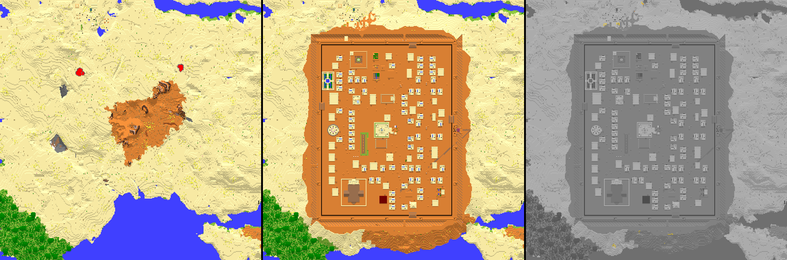

## Summary

| site | result |
|---|---|
| badlands | 29 findings |

# KingdomQuest field test

Seed 20261117. Positions in details are relative to the heart (x, y, z).

## badlands

minecraft:eroded_badlands at 5584, 84, -1160, facing COUNTERCLOCKWISE_90, relief 122, walkable out before founding: false, style arid, ground red_sand. Gate approach cost per side (* = used): south 327, west 179, north 177, east 79*.

| stage | ms | float built | float land | floating feet | buried | destroyed | doors unreached | walk out | breach | wet inside | wet moat | new cliffs | tall walls | pits | road gaps | road steps | wall gaps | cut trees | foreign ground | snow lost | road steep | stumps | road high | road bank | road moved |
|---|---|---|---|---|---|---|---|---|---|---|---|---|---|---|---|---|---|---|---|---|---|---|---|---|---|
Founded as flat castle: plateau at 0 (relative to the heart), site shaped in 520 ms.

| tent_1 | 664 | 0 | 0 | 0 | 0 | 0 | 0 | 1 | 0 | 0 | 0 | 19 | 0 | 8 | 0 | 0 | 0 | 0 | 0 | 0 | 0 | 0 | 0 | 0 | 0 |
Country road to 5593, 64, -1068 (4 blocks of water on the way).

Lord's changes: broke 2 blocks before tent_2; repair leaves them.

Lord's changes after tent_2: unchanged spot kept broken, changed spot rebuilt by the new plan, 1 change(s) remembered.

| tent_2 | 813 | 0 | 0 | 0 | 0 | 1 | 0 | 1 | 0 | 0 | 0 | 69 | 0 | 8 | 0 | 0 | 0 | 0 | 0 | 0 | 0 | 0 | 0 | 0 | 0 |
| tent_3 | 415 | 0 | 0 | 0 | 0 | 0 | 0 | 1 | 0 | 0 | 0 | 69 | 0 | 8 | 0 | 0 | 0 | 0 | 0 | 0 | 0 | 0 | 0 | 0 | 0 |
| hamlet_1 | 796 | 0 | 0 | 0 | 0 | 0 | 0 | 1 | 0 | 0 | 0 | 70 | 0 | 8 | 0 | 0 | 0 | 0 | 0 | 0 | 0 | 0 | 0 | 0 | 0 |
| hamlet_2 | 423 | 0 | 0 | 0 | 0 | 0 | 0 | 1 | 0 | 0 | 0 | 75 | 0 | 8 | 0 | 0 | 0 | 0 | 0 | 0 | 0 | 0 | 0 | 254 | 0 |
| hamlet_3 | 494 | 0 | 0 | 0 | 0 | 0 | 0 | 1 | 0 | 0 | 0 | 69 | 0 | 10 | 0 | 0 | 0 | 0 | 0 | 0 | 0 | 0 | 0 | 2 | 0 |
| village_1 | 989 | 0 | 0 | 0 | 0 | 0 | 0 | 1 | 0 | 0 | 0 | 128 | 0 | 13 | 0 | 0 | 0 | 0 | 0 | 0 | 0 | 0 | 0 | 2 | 0 |
| town_1 | 559 | 0 | 0 | 0 | 0 | 0 | 0 | 1 | 0 | 0 | 0 | 73 | 0 | 4 | 0 | 0 | 0 | 0 | 0 | 0 | 0 | 0 | 0 | 0 | 0 |
| castle_1 | 1222 | 0 | 0 | 0 | 0 | 0 | 0 | 1 | 0 | 0 | 0 | 69 | 0 | 3 | 0 | 0 | 0 | 0 | 0 | 0 | 0 | 0 | 0 | 0 | 0 |
| castle_2 | 1477 | 0 | 0 | 0 | 0 | 0 | 0 | 1 | 0 | 0 | 0 | 69 | 0 | 3 | 0 | 0 | 0 | 0 | 0 | 0 | 0 | 0 | 0 | 0 | 0 |
| citadel_1 | 1508 | 0 | 0 | 0 | 0 | 0 | 0 | 1 | 0 | 0 | 0 | 69 | 0 | 3 | 0 | 0 | 0 | 0 | 0 | 0 | 0 | 0 | 0 | 0 | 0 |
| final | 0 | 0 | 0 | 0 | 0 | 0 | 0 | 1 | 0 | 0 | 0 | 69 | 0 | 3 | 0 | 0 | 0 | 0 | 0 | 0 | 0 | 0 | 0 | 0 | 0 |
Country road at the end: 89 of 115 cells near the castle intact, cut at [99, -1, 12, 98, -1, 13, 97, -1, 14, 96, -1, 15, 95, -1, 16].

Gate (land relative to the heart, before -> after) at 0/5/10/15/20/30/40 blocks out of the gate: -12->-2 -12->-2 -12->-5 -13->-8 -14->-11 -14->-13 -13->-9. Moat columns per side {back=2883, gate=2711, left=755, right=759}. Way-out road none.

Production: level 1 made 16102 items in a game day, 48327 in three (store 4320 stacks); level 5 with every milestone 141571 items of 240 kinds a day. Storehouse goods shown: 14 blocks; unloaded 15552 items into the chests.

Tram: 880 rails, stops [gate, west, north, east]
Signal fires: 20 on 13 towers, lit 20, put out 20; tower guard posts 20.

- tent_1: new cliffs 19 [(-111,-1,28) to -45, (-111,-1,28) to -46, (-110,-1,27) to -46, (-110,-1,27) to -45, (-109,-1,26) to -47]
- tent_1: pits 8 [(-111,-47,29) hole, (-110,-46,28) hole, (-109,-47,27) hole, (-108,-48,26) hole, (-107,-48,25) hole]
- tent_2: destroyed 1 [main (-8,0,2) orange_terracotta->air]
- tent_2: new cliffs 69 [(-111,-1,28) to -45, (-111,-1,28) to -46, (-110,-1,27) to -46, (-110,-1,27) to -45, (-109,-1,26) to -47]
- tent_2: pits 8 [(-111,-47,29) hole, (-110,-46,28) hole, (-109,-47,27) hole, (-108,-48,26) hole, (-107,-48,25) hole]
- tent_3: new cliffs 69 [(-111,-1,28) to -45, (-111,-1,28) to -46, (-110,-1,27) to -46, (-110,-1,27) to -45, (-109,-1,26) to -47]
- tent_3: pits 8 [(-111,-47,29) hole, (-110,-46,28) hole, (-109,-47,27) hole, (-108,-48,26) hole, (-107,-48,25) hole]
- hamlet_1: new cliffs 70 [(-111,-1,28) to -45, (-111,-1,28) to -46, (-110,-1,27) to -46, (-110,-1,27) to -45, (-109,-1,26) to -47]
- hamlet_1: pits 8 [(-111,-47,29) hole, (-110,-46,28) hole, (-109,-47,27) hole, (-108,-48,26) hole, (-107,-48,25) hole]
- hamlet_2: new cliffs 75 [(-111,-1,28) to -45, (-111,-1,28) to -46, (-110,-1,27) to -46, (-110,-1,27) to -45, (-109,-1,26) to -47]
- hamlet_2: pits 8 [(-111,-47,29) hole, (-110,-46,28) hole, (-109,-47,27) hole, (-108,-48,26) hole, (-107,-48,25) hole]
- hamlet_2: road bank 254 [(14,-1,65) over 4/6, (78,-1,65) over 6/7, (46,-1,99) over 4/4, (46,-1,89) over 5/5, (-50,-1,-65) over 3/3]
- hamlet_3: new cliffs 69 [(-111,-1,28) to -45, (-111,-1,28) to -46, (-110,-1,27) to -46, (-110,-1,27) to -45, (-109,-1,26) to -47]
- hamlet_3: pits 10 [(-111,-47,29) hole, (-110,-46,28) hole, (-109,-47,27) hole, (-108,-48,26) hole, (-107,-48,25) hole]
- hamlet_3: road bank 2 [(88,-1,-3) over 3/3, (88,-1,3) over 3/3]
- village_1: new cliffs 128 [(-117,-46,18) to 45, (-117,-47,19) to 46, (-117,-47,19) to 46, (-116,-47,17) to 46, (-116,-1,18) to -47]
- village_1: pits 13 [(-112,-48,17) hole, (-111,-43,29) hole, (-110,-48,17) hole, (-110,-42,28) hole, (-109,-43,27) hole]
- village_1: road bank 2 [(88,-1,-3) over 3/3, (88,-1,3) over 3/3]
- town_1: new cliffs 73 [(-77,-4,-155) to -3, (-77,-3,-154) to -4, (-77,-2,-153) to -5, (-76,-4,-156) to -3, (-76,-7,-153) to 5]
- town_1: pits 4 [(-69,3,-135) spike, (-32,-17,-174) hole, (-20,-18,-185) spike, (-19,-18,-184) spike]
- castle_1: new cliffs 69 [(-77,-4,-155) to -3, (-77,-3,-154) to -4, (-77,-2,-153) to -5, (-76,-4,-156) to -3, (-76,-7,-153) to 5]
- castle_1: pits 3 [(-32,-17,-174) hole, (-20,-18,-185) spike, (-19,-18,-184) spike]
- castle_2: new cliffs 69 [(-77,-4,-155) to -3, (-77,-3,-154) to -4, (-77,-2,-153) to -5, (-76,-4,-156) to -3, (-76,-7,-153) to 5]
- castle_2: pits 3 [(-32,-17,-174) hole, (-20,-18,-185) spike, (-19,-18,-184) spike]
- citadel_1: new cliffs 69 [(-77,-4,-155) to -3, (-77,-3,-154) to -4, (-77,-2,-153) to -5, (-76,-4,-156) to -3, (-76,-7,-153) to 5]
- citadel_1: pits 3 [(-32,-17,-174) hole, (-20,-18,-185) spike, (-19,-18,-184) spike]
- final: new cliffs 69 [(-77,-4,-155) to -3, (-77,-3,-154) to -4, (-77,-2,-153) to -5, (-76,-4,-156) to -3, (-76,-7,-153) to 5]
- final: pits 3 [(-32,-17,-174) hole, (-20,-18,-185) spike, (-19,-18,-184) spike]
- country road cut in 26 cells, e.g. [99, -1, 12, 98, -1, 13, 97, -1, 14, 96, -1, 15, 95, -1, 16]

