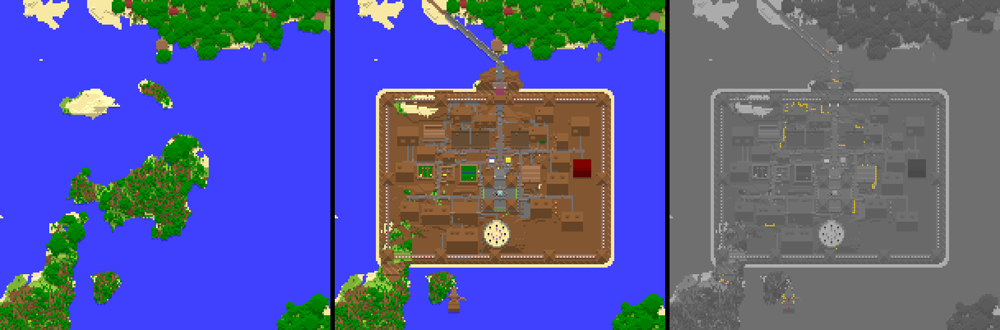

## Summary

| site | result |
|---|---|
| bamboo_jungle | 50 findings |

# KingdomQuest field test

Seed 1813296525. Positions in details are relative to the heart (x, y, z).

## bamboo_jungle

minecraft:bamboo_jungle at -2992, 67, 10196, facing CLOCKWISE_180, relief 32, walkable out before founding: false, style wild, ground podzol. Gate approach cost per side (* = used): south 74, west 72, north 59*, east 74.

| stage | ms | float built | float land | floating feet | buried | destroyed | doors unreached | walk out | breach | wet inside | wet moat | new cliffs | tall walls | pits | road gaps | road steps | wall gaps | cut trees | foreign ground | snow lost | road steep | stumps | road high | road bank | road moved |
|---|---|---|---|---|---|---|---|---|---|---|---|---|---|---|---|---|---|---|---|---|---|---|---|---|---|
| tent_1 | 808 | 0 | 10 | 0 | 0 | 0 | 0 | 0 | 0 | 0 | 0 | 46 | 0 | 10 | 0 | 0 | 0 | 0 | 0 | 0 | 0 | 0 | 0 | 0 | 0 |
Country road to -3084, 66, 10053 (60 blocks of water on the way).

Lord's changes: broke 2 blocks before tent_2; repair leaves them.

Lord's changes after tent_2: unchanged spot kept broken, changed spot rebuilt by the new plan, 1 change(s) remembered.

| tent_2 | 303 | 0 | 10 | 0 | 0 | 1 | 0 | 0 | 0 | 0 | 0 | 50 | 0 | 7 | 0 | 0 | 0 | 0 | 0 | 0 | 0 | 0 | 0 | 0 | 0 |
| tent_3 | 266 | 0 | 10 | 0 | 0 | 0 | 0 | 0 | 0 | 0 | 0 | 34 | 0 | 7 | 0 | 0 | 0 | 0 | 0 | 0 | 0 | 0 | 0 | 0 | 0 |
| hamlet_1 | 673 | 0 | 0 | 0 | 0 | 0 | 0 | 0 | 0 | 0 | 0 | 71 | 0 | 6 | 0 | 0 | 0 | 0 | 0 | 0 | 0 | 0 | 0 | 0 | 0 |
| hamlet_2 | 300 | 3 | 1 | 0 | 0 | 0 | 0 | 0 | 0 | 0 | 0 | 53 | 0 | 5 | 0 | 0 | 0 | 0 | 0 | 0 | 0 | 0 | 0 | 8 | 0 |
| hamlet_3 | 380 | 1 | 0 | 0 | 0 | 0 | 0 | 0 | 0 | 0 | 0 | 70 | 0 | 6 | 0 | 0 | 0 | 0 | 0 | 0 | 0 | 0 | 0 | 0 | 0 |
| village_1 | 338 | 1 | 1 | 0 | 0 | 0 | 0 | 0 | 0 | 0 | 0 | 78 | 0 | 5 | 0 | 0 | 0 | 0 | 0 | 0 | 0 | 0 | 0 | 0 | 0 |
| town_1 | 429 | 1 | 1 | 0 | 0 | 0 | 0 | 0 | 0 | 0 | 0 | 119 | 0 | 3 | 0 | 0 | 319 | 0 | 0 | 0 | 0 | 0 | 0 | 0 | 0 |
| castle_1 | 605 | 1 | 1 | 0 | 0 | 0 | 0 | 1 | 0 | 0 | 0 | 96 | 4 | 3 | 0 | 0 | 0 | 0 | 0 | 0 | 0 | 0 | 0 | 0 | 0 |
| castle_2 | 461 | 1 | 1 | 0 | 0 | 0 | 0 | 1 | 0 | 0 | 0 | 102 | 4 | 3 | 0 | 0 | 0 | 0 | 0 | 0 | 0 | 0 | 0 | 0 | 0 |
| citadel_1 | 468 | 1 | 1 | 0 | 0 | 0 | 0 | 1 | 0 | 0 | 0 | 102 | 4 | 3 | 0 | 0 | 0 | 0 | 0 | 0 | 0 | 0 | 0 | 0 | 0 |
| final | 0 | 1 | 1 | 0 | 0 | 0 | 0 | 1 | 0 | 0 | 0 | 121 | 4 | 3 | 0 | 0 | 0 | 0 | 0 | 0 | 0 | 0 | 0 | 0 | 0 |
Country road at the end: 28 of 28 cells near the castle intact.

Gate (land relative to the heart, before -> after) at 0/5/10/15/20/30/40 blocks out of the gate: -5->-11 -5->-7 -5->-2 -5->-1 -5->-1 1->1 -5->-5. Moat columns per side {back=356, gate=386, left=194, right=194}. Way-out road none.

- tent_1: float land 10 [(-43,6,21) bamboo, (-43,7,21) bamboo, (-43,8,21) bamboo, (-43,9,21) bamboo, (-43,10,21) bamboo]
- tent_1: new cliffs 46 [(-70,2,71) to 14, (-69,3,70) to 13, (-69,16,71) to -11, (-66,8,72) to 8, (-65,7,71) to 9]
- tent_1: pits 10 [(-69,16,71) spike, (-65,16,72) spike, (-40,-8,-16) hole, (-32,0,25) hole, (-30,-7,9) hole]
- tent_2: float land 10 [(-43,6,21) bamboo, (-43,7,21) bamboo, (-43,8,21) bamboo, (-43,9,21) bamboo, (-43,10,21) bamboo]
- tent_2: destroyed 1 [main (5,1,0) jungle_log->air]
- tent_2: new cliffs 50 [(-70,2,71) to 14, (-69,3,70) to 13, (-69,16,71) to -11, (-66,8,72) to 8, (-65,7,71) to 9]
- tent_2: pits 7 [(-69,16,71) spike, (-65,16,72) spike, (-40,-8,-16) hole, (-30,-7,9) hole, (-25,-8,48) hole]
- tent_3: float land 10 [(-43,6,21) bamboo, (-43,7,21) bamboo, (-43,8,21) bamboo, (-43,9,21) bamboo, (-43,10,21) bamboo]
- tent_3: new cliffs 34 [(-70,2,71) to 14, (-69,3,70) to 13, (-69,16,71) to -11, (-66,8,72) to 8, (-65,7,71) to 9]
- tent_3: pits 7 [(-69,16,71) spike, (-65,16,72) spike, (-40,-8,-16) hole, (-30,-7,9) hole, (-25,-8,48) hole]
- hamlet_1: new cliffs 71 [(-70,2,71) to 14, (-69,3,70) to 13, (-69,16,71) to -11, (-66,8,72) to 8, (-65,7,71) to 9]
- hamlet_1: pits 6 [(-69,16,71) spike, (-65,16,72) spike, (-40,-8,-16) hole, (-25,-8,48) hole, (-5,-5,-70) hole]
- hamlet_2: float built 3 [dock (-28,-2,82) lantern, lamps (22,-1,-10) jungle_fence, lamps (22,0,-10) torch]
- hamlet_2: float land 1 [(22,-2,-10) podzol]
- hamlet_2: new cliffs 53 [(-70,2,71) to 14, (-69,3,70) to 13, (-69,16,71) to -11, (-66,8,72) to 8, (-65,7,71) to 9]
- hamlet_2: pits 5 [(-69,16,71) spike, (-65,16,72) spike, (-47,-5,21) hole, (-25,-8,48) hole, (-5,-5,-70) hole]
- hamlet_2: road bank 8 [(0,-1,-36) over 3/3, (0,-2,-35) over 4/3, (0,-2,-34) over 3/3, (0,-2,-33) over 3/3, (0,-1,-38) over 4/4]
- hamlet_3: float built 1 [dock (-28,-2,82) lantern]
- hamlet_3: new cliffs 70 [(-70,2,71) to 14, (-69,3,70) to 13, (-69,16,71) to -11, (-66,8,72) to 8, (-65,7,71) to 9]
- hamlet_3: pits 6 [(-69,16,71) spike, (-65,16,72) spike, (-47,-5,21) hole, (-25,-8,48) hole, (-16,-4,-31) hole]
- village_1: float built 1 [dock (-28,-2,87) lantern]
- village_1: float land 1 [(-28,-2,82) podzol]
- village_1: new cliffs 78 [(-70,2,71) to 14, (-69,3,70) to 13, (-69,16,71) to -11, (-66,8,72) to 8, (-65,7,71) to 9]
- village_1: pits 5 [(-69,16,71) spike, (-65,16,72) spike, (-47,-5,21) hole, (-16,-4,-31) hole, (-5,-5,-70) hole]
- town_1: float built 1 [dock (-28,-2,87) lantern]
- town_1: float land 1 [(-28,-2,82) podzol]
- town_1: new cliffs 119 [(-70,2,71) to 14, (-69,3,70) to 13, (-69,16,71) to -11, (-68,1,67) to 3, (-68,6,70) to 3]
- town_1: pits 3 [(-69,16,71) spike, (-65,16,72) spike, (-5,-5,-70) hole]
- town_1: wall gaps 319 [(38,-5,-40) over water, (5,-5,56) over water, (37,-5,56) over water, (39,-5,-40) over water, (36,-5,56) over water]
- castle_1: float built 1 [dock (-28,-2,87) lantern]
- castle_1: float land 1 [(-28,-2,82) podzol]
- castle_1: new cliffs 96 [(-70,2,71) to 14, (-69,3,70) to 13, (-69,16,71) to -11, (-68,1,67) to 3, (-68,6,70) to 3]
- castle_1: tall walls 4 [(-3,-10,-37) 9 cap unowned low unowned:sand, (-3,-9,-36) 8 cap unowned low unowned:sand, (2,-1,-37) -9 cap unowned low unowned:sand, (2,-1,-36) -8 cap unowned low unowned:sand]
- castle_1: pits 3 [(-69,16,71) spike, (-65,16,72) spike, (-5,-5,-70) hole]
- castle_2: float built 1 [dock (-28,-2,87) lantern]
- castle_2: float land 1 [(-28,-2,82) podzol]
- castle_2: new cliffs 102 [(-70,2,71) to 14, (-69,3,70) to 13, (-69,16,71) to -11, (-68,1,67) to 3, (-68,6,70) to 3]
- castle_2: tall walls 4 [(-3,-10,-37) 9 cap unowned low unowned:sand, (-3,-9,-36) 8 cap unowned low unowned:sand, (2,-1,-37) -9 cap unowned low unowned:sand, (2,-1,-36) -8 cap unowned low unowned:sand]
- castle_2: pits 3 [(-69,16,71) spike, (-65,16,72) spike, (-5,-5,-70) hole]
- citadel_1: float built 1 [dock (-28,-2,87) lantern]
- citadel_1: float land 1 [(-28,-2,82) podzol]
- citadel_1: new cliffs 102 [(-70,2,71) to 14, (-69,3,70) to 13, (-69,16,71) to -11, (-68,1,67) to 3, (-68,6,70) to 3]
- citadel_1: tall walls 4 [(-3,-10,-37) 9 cap unowned low unowned:sand, (-3,-9,-36) 8 cap unowned low unowned:sand, (2,-1,-37) -9 cap unowned low unowned:sand, (2,-1,-36) -8 cap unowned low unowned:sand]
- citadel_1: pits 3 [(-69,16,71) spike, (-65,16,72) spike, (-5,-5,-70) hole]
- final: tall by [{unowned/unowned=4}]
- final: float built 1 [dock (-28,-2,87) lantern]
- final: float land 1 [(-28,-2,82) podzol]
- final: new cliffs 121 [(-70,2,71) to 14, (-69,3,70) to 13, (-69,16,71) to -11, (-68,1,67) to 3, (-68,6,70) to 3]
- final: tall walls 4 [(-3,-10,-37) 9 cap unowned low unowned:sand, (-3,-9,-36) 8 cap unowned low unowned:sand, (2,-1,-37) -9 cap unowned low unowned:sand, (2,-1,-36) -8 cap unowned low unowned:sand]
- final: pits 3 [(-69,16,71) spike, (-65,16,72) spike, (-5,-5,-70) hole]

