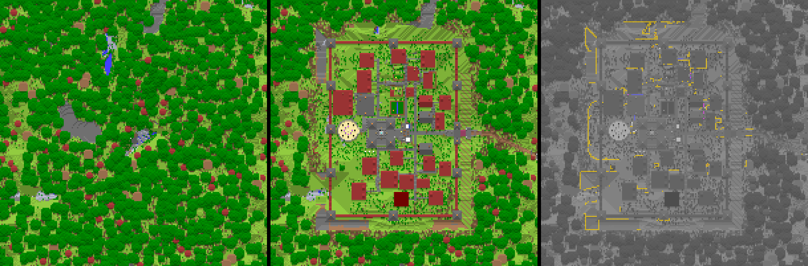

## Summary

| site | result |
|---|---|
| basin | 82 findings |

# KingdomQuest field test

Seed 1813296525. Positions in details are relative to the heart (x, y, z).

## basin

minecraft:dark_forest at -7184, 100, 10996, facing COUNTERCLOCKWISE_90, relief 77, walkable out before founding: true, style temperate, ground grass_block. Shape basin (score 17.0), land relative to the heart, directions S SE E NE N NW W SW: 24 out [26, 28, 30, 32, 30, 33, 35, 33]; 48 out [33, 28, 28, 37, 36, 36, 39, 35]; 72 out [34, 32, 31, 49, 43, 34, 37, 37]; 96 out [35, 39, 1, 39, 47, 34, 5, 36]. Gate approach cost per side (* = used): south 104, west 160, north 186, east 42*.

| stage | ms | float built | float land | floating feet | buried | destroyed | doors unreached | walk out | breach | wet inside | wet moat | new cliffs | tall walls | pits | road gaps | road steps | wall gaps | cut trees | foreign ground | snow lost | road steep | stumps | road high | road bank | road moved |
|---|---|---|---|---|---|---|---|---|---|---|---|---|---|---|---|---|---|---|---|---|---|---|---|---|---|
| tent_1 | 957 | 0 | 406 | 0 | 0 | 0 | 0 | 1 | 0 | 0 | 0 | 78 | 0 | 3 | 0 | 0 | 0 | 0 | 0 | 0 | 0 | 0 | 0 | 0 | 0 |
Country road to -7013, -64, 11046 (40 blocks of water on the way).

Lord's changes: broke 2 blocks before tent_2; repair leaves them.

Lord's changes after tent_2: unchanged spot kept broken, changed spot rebuilt by the new plan, 1 change(s) remembered.

| tent_2 | 588 | 0 | 406 | 0 | 0 | 1 | 0 | 1 | 0 | 0 | 0 | 70 | 1 | 4 | 0 | 0 | 0 | 0 | 0 | 0 | 0 | 0 | 0 | 0 | 0 |
| tent_3 | 483 | 0 | 406 | 0 | 0 | 0 | 0 | 1 | 0 | 0 | 0 | 63 | 1 | 3 | 0 | 0 | 0 | 0 | 0 | 0 | 0 | 0 | 0 | 0 | 0 |
| hamlet_1 | 1246 | 0 | 151 | 0 | 0 | 2 | 0 | 1 | 0 | 0 | 0 | 177 | 1 | 1 | 0 | 0 | 0 | 0 | 0 | 0 | 0 | 0 | 0 | 0 | 0 |
| hamlet_2 | 565 | 0 | 115 | 0 | 0 | 0 | 0 | 1 | 0 | 0 | 0 | 289 | 1 | 8 | 0 | 0 | 0 | 0 | 0 | 0 | 4 | 0 | 4 | 2 | 0 |
| hamlet_3 | 465 | 0 | 105 | 0 | 0 | 11 | 0 | 1 | 0 | 0 | 0 | 269 | 3 | 3 | 0 | 0 | 0 | 0 | 0 | 0 | 4 | 0 | 6 | 1 | 0 |
| village_1 | 491 | 0 | 105 | 0 | 0 | 11 | 0 | 1 | 0 | 0 | 0 | 307 | 2 | 3 | 0 | 0 | 0 | 0 | 0 | 0 | 14 | 0 | 12 | 1 | 0 |
| town_1 | 453 | 0 | 5 | 0 | 0 | 14 | 0 | 1 | 0 | 0 | 0 | 348 | 3 | 1 | 0 | 0 | 21 | 0 | 0 | 0 | 16 | 0 | 12 | 1 | 14 |
| castle_1 | 1065 | 0 | 0 | 0 | 0 | 8 | 0 | 1 | 0 | 0 | 0 | 662 | 4 | 4 | 0 | 0 | 0 | 0 | 0 | 0 | 16 | 0 | 10 | 1 | 0 |
| castle_2 | 668 | 0 | 0 | 0 | 0 | 6 | 0 | 1 | 0 | 0 | 0 | 621 | 3 | 5 | 0 | 0 | 0 | 0 | 0 | 0 | 16 | 0 | 9 | 1 | 0 |
| citadel_1 | 616 | 0 | 0 | 0 | 0 | 6 | 0 | 1 | 0 | 0 | 0 | 613 | 3 | 5 | 0 | 0 | 0 | 0 | 0 | 0 | 16 | 0 | 9 | 1 | 0 |
| final | 0 | 0 | 0 | 0 | 0 | 6 | 0 | 1 | 0 | 0 | 0 | 636 | 12 | 3 | 0 | 0 | 0 | 0 | 0 | 0 | 20 | 0 | 9 | 1 | 0 |
Country road at the end: 60 of 60 cells near the castle intact.

Gate (land relative to the heart, before -> after) at 0/5/10/15/20/30/40 blocks out of the gate: 5->-2 5->-7 5->-2 6->2 5->5 6->6 7->7. Moat columns per side {gate=888}. Way-out road none.

- tent_1: float land 406 [(-40,15,-40) brown_mushroom_block, (-40,15,-39) brown_mushroom_block, (-40,15,-38) brown_mushroom_block, (-40,15,-37) brown_mushroom_block, (-40,15,-36) brown_mushroom_block]
- tent_1: new cliffs 78 [(-23,-12,-59) to 5, (-20,6,47) to 3, (-9,-1,13) to -6, (-9,-13,15) to 3, (-8,-2,11) to -5]
- tent_1: pits 3 [(-9,-13,15) hole, (8,8,-16) spike, (14,-10,-2) hole]
- tent_2: float land 406 [(-40,15,-40) brown_mushroom_block, (-40,15,-39) brown_mushroom_block, (-40,15,-38) brown_mushroom_block, (-40,15,-37) brown_mushroom_block, (-40,15,-36) brown_mushroom_block]
- tent_2: destroyed 1 [main (0,1,5) spruce_log->air]
- tent_2: new cliffs 70 [(-23,-12,-59) to 5, (-20,6,47) to 3, (-10,2,16) to -5, (-10,2,17) to -5, (-9,-3,15) to 3]
- tent_2: tall walls 1 [(99,-36,16) 14 cap unowned low unowned:air]
- tent_2: pits 4 [(-8,-45,19) hole, (-6,-17,20) hole, (13,-8,6) hole, (24,-3,0) hole]
- tent_3: float land 406 [(-40,15,-40) brown_mushroom_block, (-40,15,-39) brown_mushroom_block, (-40,15,-38) brown_mushroom_block, (-40,15,-37) brown_mushroom_block, (-40,15,-36) brown_mushroom_block]
- tent_3: new cliffs 63 [(-23,-12,-59) to 5, (-20,6,47) to 3, (-12,4,20) to 3, (-12,7,21) to -3, (-9,2,19) to 3]
- tent_3: tall walls 1 [(99,-36,16) 14 cap unowned low unowned:air]
- tent_3: pits 3 [(-6,-13,22) hole, (13,-8,6) hole, (24,-3,0) hole]
- hamlet_1: float land 151 [(-36,14,47) red_mushroom_block, (-36,15,47) red_mushroom_block, (-36,16,47) red_mushroom_block, (-36,14,48) red_mushroom_block, (-36,15,48) red_mushroom_block]
- hamlet_1: destroyed 2 [main (-8,0,-4) rose_bush->air, main (-8,1,-4) rose_bush->air]
- hamlet_1: new cliffs 177 [(-48,20,-41) to -7, (-48,20,-40) to -6, (-48,20,-39) to -6, (-47,18,-42) to -5, (-47,13,-41) to 4]
- hamlet_1: tall walls 1 [(99,-36,16) 14 cap unowned low unowned:air]
- hamlet_1: pits 1 [(-16,2,-41) hole]
- hamlet_2: float land 115 [(-36,14,47) red_mushroom_block, (-36,15,47) red_mushroom_block, (-36,16,47) red_mushroom_block, (-36,14,48) red_mushroom_block, (-36,15,48) red_mushroom_block]
- hamlet_2: new cliffs 289 [(-48,20,-41) to -7, (-48,20,-40) to -6, (-48,20,-39) to -6, (-47,17,-42) to -4, (-47,14,-40) to 3]
- hamlet_2: tall walls 1 [(99,-36,16) 14 cap unowned low unowned:air]
- hamlet_2: pits 8 [(-22,-5,-50) hole, (-21,-5,-47) hole, (-20,17,-78) spike, (-18,-8,-76) hole, (-16,-6,-75) hole]
- hamlet_2: road steep 4 [(12,9,-42) to -3 in 3, (12,10,-43) to -3 in 3, (12,8,-41) to -3 in 3, (9,2,-38) to 3 in 3]
- hamlet_2: road high 4 [(12,9,-42) above kennel step (11,8,-42), (12,10,-44) above kennel step (11,8,-44), (12,10,-45) above kennel step (11,8,-45), (12,10,-43) above kennel step (11,8,-43)]
- hamlet_2: road bank 2 [(1,2,-38) over 3/3, (1,2,-37) over 3/3]
- hamlet_3: float land 105 [(-36,14,47) red_mushroom_block, (-36,15,47) red_mushroom_block, (-36,16,47) red_mushroom_block, (-36,14,48) red_mushroom_block, (-36,15,48) red_mushroom_block]
- hamlet_3: destroyed 11 [tavern (-35,1,-17) vine->air, tavern (-35,1,-18) vine->air, tavern (-35,1,-22) vine->air, tavern (-35,1,-26) vine->air, tavern (-35,2,-17) vine->air]
- hamlet_3: new cliffs 269 [(-53,16,2) to -4, (-52,12,2) to 5, (-50,13,-40) to -3, (-50,13,-39) to -3, (-50,13,-37) to -3]
- hamlet_3: tall walls 3 [(20,-1,-19) 8 cap unowned low unowned:stone_bricks, (23,7,-19) -8 cap unowned low unowned:stone_bricks, (99,-36,16) 14 cap unowned low unowned:air]
- hamlet_3: pits 3 [(-20,17,-78) spike, (-18,-8,-76) hole, (-16,-6,-75) hole]
- hamlet_3: road steep 4 [(12,9,-42) to -3 in 3, (12,10,-43) to -3 in 3, (12,8,-41) to -3 in 3, (9,2,-38) to 3 in 3]
- hamlet_3: road high 6 [(22,6,-15) above main step (21,5,-15), (22,6,-16) above main step (21,4,-16), (12,9,-42) above kennel step (11,8,-42), (12,10,-44) above kennel step (11,8,-44), (12,10,-45) above kennel step (11,8,-45)]
- hamlet_3: road bank 1 [(22,1,-2) over 2/2]
- village_1: float land 105 [(-36,14,47) red_mushroom_block, (-36,15,47) red_mushroom_block, (-36,16,47) red_mushroom_block, (-36,14,48) red_mushroom_block, (-36,15,48) red_mushroom_block]
- village_1: destroyed 11 [tavern (-35,1,-17) vine->air, tavern (-35,1,-18) vine->air, tavern (-35,1,-22) vine->air, tavern (-35,1,-26) vine->air, tavern (-35,2,-17) vine->air]
- village_1: new cliffs 307 [(-63,17,-19) to -3, (-63,17,-18) to -3, (-63,17,-17) to -3, (-62,16,-16) to -3, (-61,15,-15) to -4]
- village_1: tall walls 2 [(-38,5,-30) 7 cap unowned low unowned:stone_bricks, (99,-36,16) 14 cap unowned low unowned:air]
- village_1: pits 3 [(-20,17,-78) spike, (-18,-8,-76) hole, (-16,-6,-75) hole]
- village_1: road steep 14 [(-27,6,-29) to -3 in 3, (-28,7,-29) to -3 in 3, (-25,4,-29) to -3 in 3, (-26,5,-29) to -3 in 3, (-31,10,-29) to -3 in 3]
- village_1: road high 12 [(22,8,-22) above main step (21,7,-22), (22,7,-21) above main step (21,5,-21), (22,6,-15) above main step (21,5,-15), (22,6,-16) above main step (21,4,-16), (22,7,-20) above main step (21,4,-20)]
- village_1: road bank 1 [(22,1,-2) over 2/2]
- market_1 destroyed 2 blocks of tavern []
- town_1: float land 5 [(-43,15,-83) brown_mushroom_block, (-42,15,-83) brown_mushroom_block, (-41,15,-83) brown_mushroom_block, (-40,15,-83) brown_mushroom_block, (-39,15,-83) brown_mushroom_block]
- town_1: destroyed 14 [walls (-56,10,-67) coarse_dirt->oak_log, walls (-56,10,-68) coarse_dirt->oak_log, walls (-55,10,-69) coarse_dirt->oak_log, walls (40,3,8) coarse_dirt->oak_log, walls (40,2,7) coarse_dirt->oak_log]
- town_1: new cliffs 348 [(-61,13,-13) to -3, (-61,13,-12) to -3, (-58,11,43) to -19, (-57,11,43) to -19, (-53,16,12) to -3]
- town_1: tall walls 3 [(-38,3,-30) 8 cap unowned low unowned:stone_bricks, (-38,3,-30) 9 cap unowned low unowned:stone_bricks, (99,-36,16) 14 cap unowned low unowned:air]
- town_1: pits 1 [(-6,-48,9) hole]
- town_1: wall gaps 21 [(39,2,6) over air, (39,2,-6) over air, (-58,14,61) over air, (38,26,-67) over air, (38,26,-71) over air]
- town_1: road steep 16 [(5,11,-56) to 3 in 3, (-27,6,-29) to -3 in 3, (4,10,-56) to 3 in 3, (-28,7,-29) to -3 in 3, (-25,4,-29) to -3 in 3]
- town_1: road high 12 [(-32,11,-29) above tavern step (-32,9,-28), (12,10,-43) above kennel step (11,8,-43), (12,9,-42) above kennel step (11,8,-42), (12,10,-44) above kennel step (11,8,-44), (12,10,-45) above kennel step (11,8,-45)]
- town_1: road bank 1 [(22,1,-2) over 2/2]
- town_1: road moved 14 [(-27,5,-29) from 6, (-28,6,-29) from 7, (-25,3,-29) from 4, (-26,4,-29) from 5, (-31,9,-29) from 10]
- royal_2 destroyed 1 blocks of tavern [tavern (-35,1,-17) vine->air, tavern (-35,1,-18) vine->air, tavern (-35,1,-26) vine->air, tavern (-35,2,-17) vine->air]
- castle_1: destroyed 8 [tavern (-35,1,-17) vine->air, tavern (-35,1,-18) vine->air, tavern (-35,1,-26) vine->air, tavern (-35,2,-17) vine->air, tavern (-35,2,-18) vine->air]
- castle_1: new cliffs 662 [(-71,17,30) to -8, (-71,16,31) to -7, (-71,16,32) to -7, (-71,16,33) to -7, (-71,16,34) to -7]
- castle_1: tall walls 4 [(-38,4,-30) 7 cap unowned low unowned:stone_bricks, (-38,4,-30) 8 cap unowned low unowned:stone_bricks, (-11,1,-64) 7 cap unowned low unowned:stone, (99,-36,16) 14 cap unowned low unowned:air]
- castle_1: pits 4 [(-66,20,13) spike, (-51,16,11) spike, (-16,-4,-65) hole, (-14,-4,-74) hole]
- castle_1: road steep 16 [(5,11,-56) to 3 in 3, (-27,6,-29) to -3 in 3, (4,10,-56) to 3 in 3, (-28,7,-29) to -3 in 3, (-25,4,-29) to -3 in 3]
- castle_1: road high 10 [(-32,11,-29) above tavern step (-32,9,-28), (12,9,-42) above kennel step (11,8,-42), (12,10,-45) above kennel step (11,8,-45), (22,8,-22) above main step (21,7,-22), (22,8,-21) above main step (21,5,-21)]
- castle_1: road bank 1 [(22,1,-2) over 2/2]
- market_3 destroyed 2 blocks of tavern [tavern (-35,1,-17) vine->air, tavern (-35,1,-18) vine->air, tavern (-35,1,-26) vine->air, tavern (-35,2,-17) vine->air]
- castle_2: destroyed 6 [tavern (-35,1,-17) vine->air, tavern (-35,1,-18) vine->air, tavern (-35,1,-26) vine->air, tavern (-35,2,-17) vine->air, tavern (-35,2,-18) vine->air]
- castle_2: new cliffs 621 [(-71,17,30) to -8, (-71,16,31) to -7, (-71,16,32) to -7, (-71,16,33) to -7, (-71,16,34) to -7]
- castle_2: tall walls 3 [(-38,3,-30) 8 cap unowned low unowned:stone_bricks, (-11,1,-64) 7 cap unowned low unowned:stone, (99,-36,16) 14 cap unowned low unowned:air]
- castle_2: pits 5 [(-66,20,13) spike, (-51,16,11) spike, (-16,-4,-65) hole, (-14,-4,-74) hole, (25,4,24) spike]
- castle_2: road steep 16 [(5,11,-56) to 3 in 3, (-27,6,-29) to -3 in 3, (4,10,-56) to 3 in 3, (-28,7,-29) to -3 in 3, (-25,4,-29) to -3 in 3]
- castle_2: road high 9 [(12,9,-42) above kennel step (11,8,-42), (12,10,-45) above kennel step (11,8,-45), (22,8,-22) above main step (21,7,-22), (22,8,-21) above main step (21,5,-21), (22,5,-11) above tannery step (23,4,-11)]
- castle_2: road bank 1 [(22,1,-2) over 2/2]
- citadel_1: destroyed 6 [tavern (-35,1,-17) vine->air, tavern (-35,1,-18) vine->air, tavern (-35,1,-26) vine->air, tavern (-35,2,-17) vine->air, tavern (-35,2,-18) vine->air]
- citadel_1: new cliffs 613 [(-71,17,30) to -8, (-71,16,31) to -7, (-71,16,32) to -7, (-71,16,33) to -7, (-71,16,34) to -7]
- citadel_1: tall walls 3 [(-38,3,-30) 8 cap unowned low unowned:stone_bricks, (-11,1,-64) 7 cap unowned low unowned:stone, (99,-36,16) 14 cap unowned low unowned:air]
- citadel_1: pits 5 [(-66,20,13) spike, (-51,16,11) spike, (-16,-4,-65) hole, (-14,-4,-74) hole, (25,4,24) spike]
- citadel_1: road steep 16 [(5,11,-56) to 3 in 3, (-27,6,-29) to -3 in 3, (4,10,-56) to 3 in 3, (-28,7,-29) to -3 in 3, (-25,4,-29) to -3 in 3]
- citadel_1: road high 9 [(12,9,-42) above kennel step (11,8,-42), (12,10,-45) above kennel step (11,8,-45), (22,8,-22) above main step (21,7,-22), (22,8,-21) above main step (21,5,-21), (22,5,-11) above tannery step (23,4,-11)]
- citadel_1: road bank 1 [(22,1,-2) over 2/2]
- final: tall by [{unowned/unowned=12}]
- final: destroyed 6 [tavern (-35,1,-17) vine->air, tavern (-35,1,-18) vine->air, tavern (-35,1,-26) vine->air, tavern (-35,2,-17) vine->air, tavern (-35,2,-18) vine->air]
- final: new cliffs 636 [(-71,17,30) to -8, (-71,16,31) to -7, (-71,16,32) to -7, (-71,16,33) to -7, (-71,16,34) to -7]
- final: tall walls 12 [(-38,3,-30) 8 cap unowned low unowned:stone_bricks, (-32,-1,-8) 7 cap unowned low unowned:stone_bricks, (-32,-1,-7) 8 cap unowned low unowned:stone_bricks, (-32,-1,-6) 8 cap unowned low unowned:stone_bricks, (-32,-1,-5) 8 cap unowned low unowned:stone_bricks]
- final: pits 3 [(-16,-4,-65) hole, (-14,-4,-74) hole, (25,4,24) spike]
- final: road steep 20 [(5,11,-56) to 3 in 3, (-27,6,-29) to -3 in 3, (4,10,-56) to 3 in 3, (-28,7,-29) to -3 in 3, (-25,4,-29) to -3 in 3]
- final: road high 9 [(12,9,-42) above kennel step (11,8,-42), (12,10,-45) above kennel step (11,8,-45), (22,8,-22) above main step (21,7,-22), (22,8,-21) above main step (21,5,-21), (22,5,-11) above tannery step (23,4,-11)]
- final: road bank 1 [(22,1,-2) over 2/2]

