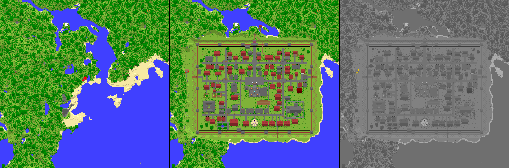

## Summary

| site | result |
|---|---|
| beach | 33 findings |

# KingdomQuest field test

Seed 20261117. Positions in details are relative to the heart (x, y, z).

## beach

minecraft:beach at 1516, 63, 2548, facing CLOCKWISE_180, relief 50, walkable out before founding: true, style temperate, ground grass_block. Gate approach cost per side (* = used): south 63, west 33, north 15*, east 23.

| stage | ms | float built | float land | floating feet | buried | destroyed | doors unreached | walk out | breach | wet inside | wet moat | new cliffs | tall walls | pits | road gaps | road steps | wall gaps | cut trees | foreign ground | snow lost | road steep | stumps | road high | road bank | road moved |
|---|---|---|---|---|---|---|---|---|---|---|---|---|---|---|---|---|---|---|---|---|---|---|---|---|---|
Founded as flat castle: plateau at 0 (relative to the heart), site shaped in 358 ms.

| tent_1 | 485 | 0 | 0 | 0 | 0 | 0 | 0 | 1 | 0 | 0 | 0 | 2 | 0 | 0 | 0 | 0 | 0 | 0 | 0 | 0 | 0 | 0 | 0 | 0 | 0 |
Country road to 1608, 64, 2539 (72 blocks of water on the way).

Lord's changes: broke 2 blocks before tent_2; repair leaves them.

Lord's changes after tent_2: unchanged spot kept broken, changed spot rebuilt by the new plan, 1 change(s) remembered.

| tent_2 | 417 | 0 | 0 | 0 | 0 | 1 | 0 | 1 | 0 | 0 | 0 | 2 | 0 | 0 | 0 | 0 | 0 | 0 | 0 | 0 | 0 | 0 | 0 | 0 | 0 |
| tent_3 | 383 | 0 | 0 | 0 | 0 | 0 | 0 | 1 | 0 | 0 | 0 | 2 | 0 | 0 | 0 | 0 | 0 | 0 | 0 | 0 | 0 | 0 | 0 | 0 | 0 |
| hamlet_1 | 632 | 0 | 0 | 0 | 0 | 2 | 0 | 1 | 0 | 0 | 0 | 6 | 0 | 2 | 0 | 0 | 0 | 0 | 0 | 0 | 0 | 0 | 0 | 0 | 0 |
| hamlet_2 | 329 | 3 | 0 | 0 | 0 | 0 | 0 | 1 | 0 | 0 | 0 | 10 | 0 | 2 | 0 | 0 | 0 | 0 | 0 | 0 | 0 | 0 | 0 | 9 | 0 |
| hamlet_3 | 340 | 1 | 0 | 0 | 0 | 11 | 0 | 1 | 0 | 0 | 0 | 0 | 0 | 0 | 0 | 0 | 0 | 0 | 0 | 0 | 0 | 0 | 0 | 0 | 0 |
| village_1 | 866 | 1 | 0 | 0 | 0 | 11 | 0 | 1 | 0 | 0 | 0 | 1 | 0 | 0 | 0 | 0 | 0 | 0 | 0 | 0 | 0 | 0 | 0 | 0 | 0 |
| town_1 | 561 | 1 | 0 | 0 | 0 | 5 | 0 | 1 | 0 | 0 | 0 | 30 | 0 | 0 | 0 | 0 | 0 | 0 | 0 | 0 | 0 | 0 | 0 | 0 | 0 |
| castle_1 | 1345 | 1 | 0 | 0 | 0 | 5 | 0 | 1 | 0 | 0 | 0 | 30 | 0 | 0 | 0 | 0 | 0 | 0 | 0 | 0 | 0 | 0 | 0 | 0 | 0 |
| castle_2 | 1429 | 1 | 0 | 0 | 0 | 5 | 0 | 1 | 0 | 0 | 0 | 30 | 0 | 0 | 0 | 0 | 0 | 0 | 0 | 0 | 0 | 0 | 0 | 0 | 0 |
| citadel_1 | 1492 | 1 | 0 | 0 | 0 | 5 | 0 | 1 | 0 | 0 | 0 | 30 | 0 | 0 | 0 | 0 | 0 | 0 | 0 | 0 | 0 | 0 | 0 | 0 | 0 |
| final | 0 | 1 | 0 | 0 | 0 | 5 | 0 | 1 | 0 | 0 | 0 | 30 | 0 | 0 | 0 | 0 | 0 | 0 | 0 | 0 | 0 | 0 | 0 | 0 | 0 |
Country road at the end: 115 of 129 cells near the castle intact, cut at [12, -1, -99, 13, -1, -98, 14, -1, -97, 15, -1, -96, 16, -1, -95].

Gate (land relative to the heart, before -> after) at 0/5/10/15/20/30/40 blocks out of the gate: -2->-2 -2->-2 -2->-3 -2->-3 -3->-3 -2->-2 -1->-2. Moat columns per side {back=2715, gate=2908, left=766, right=728}. Way-out road none.

Production: level 1 made 16102 items in a game day, 48327 in three (store 4320 stacks); level 5 with every milestone 141571 items of 239 kinds a day. Storehouse goods shown: 14 blocks; unloaded 15552 items into the chests.

Tram: 880 rails, stops [gate, west, north, east]
Signal fires: 20 on 13 towers, lit 20, put out 20; tower guard posts 20.

- tent_1: new cliffs 2 [(-48,-1,72) to -47, (-48,-48,73) to 47]
- tent_2: destroyed 1 [main (2,0,8) white_wool->air]
- tent_2: new cliffs 2 [(-48,-1,72) to -47, (-48,-48,73) to 47]
- tent_3: new cliffs 2 [(-48,-1,72) to -47, (-48,-48,73) to 47]
- hamlet_1: destroyed 2 [main (-4,0,8) rose_bush->air, main (-4,1,8) rose_bush->air]
- hamlet_1: new cliffs 6 [(-48,-1,72) to -47, (-48,-48,73) to 47, (-44,-28,66) to -3, (-42,-27,66) to -3, (-41,-1,68) to -47]
- hamlet_1: pits 2 [(-41,-1,68) spike, (-40,-1,69) spike]
- hamlet_2: float built 3 [dock (13,1,-126) lantern, lamps (62,0,-65) spruce_fence, lamps (62,1,-65) torch]
- hamlet_2: new cliffs 10 [(-51,-22,64) to -3, (-50,-25,65) to -3, (-49,-25,65) to -3, (-49,-34,68) to -3, (-48,-34,68) to -3]
- hamlet_2: pits 2 [(-41,-1,68) spike, (-40,-1,69) spike]
- hamlet_2: road bank 9 [(0,-1,-67) over 2/2, (0,-1,-60) over 2/2, (0,-1,-59) over 2/2, (0,-1,-66) over 2/2, (0,-1,-65) over 2/2]
- hamlet_3: float built 1 [dock (13,1,-126) lantern]
- hamlet_3: destroyed 11 [tavern (-40,1,60) vine->air, tavern (-41,1,60) vine->air, tavern (-45,1,60) vine->air, tavern (-49,1,60) vine->air, tavern (-40,2,60) vine->air]
- village_1: float built 1 [dock (13,1,-131) lantern]
- village_1: destroyed 11 [tavern (-40,1,60) vine->air, tavern (-41,1,60) vine->air, tavern (-45,1,60) vine->air, tavern (-49,1,60) vine->air, tavern (-40,2,60) vine->air]
- village_1: new cliffs 1 [(10,-4,-125) to 3]
- town_1: float built 1 [dock (13,1,-131) lantern]
- town_1: destroyed 5 [tavern (-40,1,60) vine->air, tavern (-41,1,60) vine->air, tavern (-40,2,60) vine->air, tavern (-41,2,60) vine->air, tavern (-42,3,49) dark_oak_hanging_sign->air]
- town_1: new cliffs 30 [(-156,2,-34) to 3, (-155,1,-34) to 4, (-154,0,-34) to 5, (-154,5,-26) to -4, (-154,5,-25) to -3]
- castle_1: float built 1 [dock (13,1,-131) lantern]
- castle_1: destroyed 5 [tavern (-40,1,60) vine->air, tavern (-41,1,60) vine->air, tavern (-40,2,60) vine->air, tavern (-41,2,60) vine->air, tavern (-42,3,49) dark_oak_hanging_sign->air]
- castle_1: new cliffs 30 [(-156,2,-34) to 3, (-155,1,-34) to 4, (-154,0,-34) to 5, (-154,5,-26) to -4, (-154,5,-25) to -3]
- castle_2: float built 1 [dock (13,1,-131) lantern]
- castle_2: destroyed 5 [tavern (-40,1,60) vine->air, tavern (-41,1,60) vine->air, tavern (-40,2,60) vine->air, tram (19,0,-85) rail->air, tram (18,0,-85) rail->air]
- castle_2: new cliffs 30 [(-156,2,-34) to 3, (-155,1,-34) to 4, (-154,0,-34) to 5, (-154,5,-26) to -4, (-154,5,-25) to -3]
- citadel_1: float built 1 [dock (13,1,-131) lantern]
- citadel_1: destroyed 5 [tavern (-40,1,60) vine->air, tavern (-41,1,60) vine->air, tavern (-40,2,60) vine->air, tram (19,0,-85) rail->air, tram (18,0,-85) rail->air]
- citadel_1: new cliffs 30 [(-156,2,-34) to 3, (-155,1,-34) to 4, (-154,0,-34) to 5, (-154,5,-26) to -4, (-154,5,-25) to -3]
- final: float built 1 [dock (13,1,-131) lantern]
- final: destroyed 5 [tavern (-40,1,60) vine->air, tavern (-41,1,60) vine->air, tavern (-40,2,60) vine->air, tram (19,0,-85) rail->air, tram (18,0,-85) rail->air]
- final: new cliffs 30 [(-156,2,-34) to 3, (-155,1,-34) to 4, (-154,0,-34) to 5, (-154,5,-26) to -4, (-154,5,-25) to -3]
- country road cut in 14 cells, e.g. [12, -1, -99, 13, -1, -98, 14, -1, -97, 15, -1, -96, 16, -1, -95]
- tram: rails missing at [18, 0, -85, 19, 0, -85]

