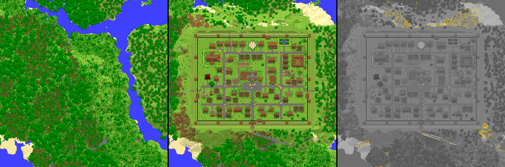

## Summary

| site | result |
|---|---|
| big_hill | 76 findings |

# KingdomQuest field test

Seed 20261117. Positions in details are relative to the heart (x, y, z).

## big_hill

minecraft:bamboo_jungle at -2924, 118, 8912, facing NONE, relief 94, walkable out before founding: true, style wild, ground grass_block. Shape big_hill (score 3.2), land relative to the heart, directions S SE E NE N NW W SW: 24 out [1, 1, 1, 0, -4, -4, -2, -2]; 48 out [-8, -6, -22, -14, -22, -8, -9, -8]; 72 out [-9, -8, -39, -43, -50, -17, -8, -17]; 96 out [-16, -39, -53, -46, -52, -24, -13, -32]. Gate approach cost per side (* = used): south 158*, west 316, north 1057, east 982.

| stage | ms | float built | float land | floating feet | buried | destroyed | doors unreached | walk out | breach | wet inside | wet moat | new cliffs | tall walls | pits | road gaps | road steps | wall gaps | cut trees | foreign ground | snow lost | road steep | stumps | road high | road bank | road moved |
|---|---|---|---|---|---|---|---|---|---|---|---|---|---|---|---|---|---|---|---|---|---|---|---|---|---|
Founded as flat castle: plateau at 0 (relative to the heart), site shaped in 1209 ms.

| tent_1 | 806 | 0 | 0 | 0 | 0 | 0 | 0 | 1 | 0 | 0 | 0 | 870 | 0 | 45 | 0 | 0 | 0 | 0 | 15205 | 0 | 0 | 14 | 0 | 0 | 0 |
Country road to -2804, 73, 9063 (0 blocks of water on the way).

Lord's changes: broke 2 blocks before tent_2; repair leaves them.

Lord's changes after tent_2: unchanged spot kept broken, changed spot rebuilt by the new plan, 1 change(s) remembered.

| tent_2 | 921 | 0 | 20 | 0 | 0 | 1 | 0 | 1 | 0 | 0 | 0 | 978 | 172 | 51 | 0 | 0 | 0 | 0 | 15132 | 0 | 0 | 12 | 0 | 0 | 0 |
| tent_3 | 424 | 0 | 20 | 0 | 0 | 0 | 0 | 1 | 0 | 0 | 0 | 978 | 172 | 51 | 0 | 0 | 0 | 0 | 15132 | 0 | 0 | 12 | 0 | 0 | 0 |
| hamlet_1 | 1520 | 0 | 20 | 0 | 0 | 0 | 0 | 1 | 0 | 0 | 0 | 993 | 172 | 51 | 0 | 0 | 0 | 0 | 15132 | 0 | 0 | 10 | 0 | 0 | 0 |
| hamlet_2 | 557 | 5 | 20 | 0 | 0 | 0 | 0 | 1 | 0 | 0 | 0 | 1004 | 172 | 56 | 0 | 0 | 0 | 0 | 12965 | 0 | 0 | 9 | 0 | 213 | 0 |
| hamlet_3 | 525 | 1 | 29 | 0 | 0 | 26 | 0 | 1 | 0 | 0 | 0 | 1118 | 172 | 72 | 0 | 0 | 0 | 0 | 12299 | 0 | 0 | 0 | 0 | 2 | 0 |
| village_1 | 1533 | 1 | 96 | 0 | 0 | 29 | 0 | 1 | 0 | 0 | 0 | 1400 | 172 | 60 | 24 | 0 | 0 | 0 | 13857 | 0 | 0 | 0 | 0 | 2 | 0 |
| town_1 | 902 | 0 | 18 | 0 | 0 | 3 | 0 | 1 | 0 | 0 | 0 | 2373 | 126 | 88 | 0 | 0 | 0 | 0 | 4127 | 0 | 0 | 0 | 0 | 0 | 0 |
| castle_1 | 1867 | 0 | 18 | 0 | 0 | 0 | 0 | 1 | 0 | 0 | 0 | 2363 | 126 | 88 | 0 | 0 | 0 | 0 | 4127 | 0 | 0 | 0 | 0 | 0 | 0 |
| castle_2 | 2038 | 0 | 18 | 0 | 0 | 0 | 0 | 1 | 0 | 0 | 0 | 2363 | 126 | 88 | 0 | 0 | 0 | 0 | 4127 | 0 | 0 | 0 | 0 | 0 | 0 |
| citadel_1 | 1837 | 0 | 18 | 0 | 0 | 0 | 0 | 1 | 0 | 0 | 0 | 2363 | 126 | 88 | 0 | 0 | 0 | 0 | 4127 | 0 | 0 | 0 | 0 | 0 | 0 |
| final | 0 | 0 | 18 | 0 | 0 | 0 | 0 | 1 | 0 | 0 | 0 | 2363 | 126 | 88 | 0 | 0 | 0 | 0 | 4127 | 0 | 0 | 0 | 0 | 0 | 0 |
Country road at the end: 10 of 10 cells near the castle intact.

Gate (land relative to the heart, before -> after) at 0/5/10/15/20/30/40 blocks out of the gate: 10->-2 8->-2 0->-2 0->-2 0->-2 2->-2 2->-2. Moat columns per side {back=2321, gate=2780, left=735, right=739}. Way-out road none.

Production: level 1 made 16102 items in a game day, 48327 in three (store 4320 stacks); level 5 with every milestone 141571 items of 241 kinds a day. Storehouse goods shown: 14 blocks; unloaded 15552 items into the chests.

Tram: 880 rails, stops [gate, west, north, east]
Signal fires: 20 on 13 towers, lit 20, put out 20; tower guard posts 20.

- tent_1: new cliffs 870 [(-170,-37,57) to -3, (-162,-43,-75) to 5, (-161,-43,-75) to 4, (-160,-43,-75) to 3, (-159,-43,-75) to 3]
- tent_1: pits 45 [(-149,-47,-149) hole, (-133,-48,138) hole, (-126,-46,-175) hole, (-121,-46,-174) hole, (-114,-48,-140) hole]
- tent_1: foreign ground 15205 [water 15205 of 116227 columns (was 0)]
- tent_1: stumps 14 [(-69,-5,-62) bamboo under oak_leaves, (-68,-3,38) bamboo under oak_leaves, (-68,-3,39) bamboo under oak_leaves, (-68,-14,64) bamboo under oak_leaves, (-67,-14,64) bamboo under oak_leaves]
- tent_2: float land 20 [(19,2,118) bamboo, (19,3,118) bamboo, (19,4,118) bamboo, (19,5,118) bamboo, (26,-1,122) bamboo]
- tent_2: destroyed 1 [main (-5,1,0) jungle_log->air]
- tent_2: new cliffs 978 [(-170,-37,57) to -3, (-162,-43,-75) to 5, (-161,-43,-75) to 4, (-160,-43,-75) to 3, (-159,-43,-75) to 3]
- tent_2: tall walls 172 [(3,-1,116) -8 cap unowned low unowned:stone_bricks, (4,-1,116) -8 cap unowned low unowned:stone_bricks, (5,-7,113) 8 cap unowned low unowned:air, (5,-10,117) 11 cap unowned low unowned:air, (6,-6,112) 7 cap unowned low unowned:air]
- tent_2: pits 51 [(-149,-47,-149) hole, (-133,-48,138) hole, (-126,-46,-175) hole, (-121,-46,-174) hole, (-114,-48,-140) hole]
- tent_2: foreign ground 15132 [water 15132 of 116203 columns (was 0)]
- tent_2: stumps 12 [(-69,-5,-62) bamboo under oak_leaves, (-68,-3,38) bamboo under oak_leaves, (-68,-3,39) bamboo under oak_leaves, (-68,-14,64) bamboo under oak_leaves, (-67,-14,64) bamboo under oak_leaves]
- tent_3: float land 20 [(19,2,118) bamboo, (19,3,118) bamboo, (19,4,118) bamboo, (19,5,118) bamboo, (26,-1,122) bamboo]
- tent_3: new cliffs 978 [(-170,-37,57) to -3, (-162,-43,-75) to 5, (-161,-43,-75) to 4, (-160,-43,-75) to 3, (-159,-43,-75) to 3]
- tent_3: tall walls 172 [(3,-1,116) -8 cap unowned low unowned:stone_bricks, (4,-1,116) -8 cap unowned low unowned:stone_bricks, (5,-7,113) 8 cap unowned low unowned:air, (5,-10,117) 11 cap unowned low unowned:air, (6,-6,112) 7 cap unowned low unowned:air]
- tent_3: pits 51 [(-149,-47,-149) hole, (-133,-48,138) hole, (-126,-46,-175) hole, (-121,-46,-174) hole, (-114,-48,-140) hole]
- tent_3: foreign ground 15132 [water 15132 of 116168 columns (was 0)]
- tent_3: stumps 12 [(-69,-5,-62) bamboo under oak_leaves, (-68,-3,38) bamboo under oak_leaves, (-68,-3,39) bamboo under oak_leaves, (-68,-14,64) bamboo under oak_leaves, (-67,-14,64) bamboo under oak_leaves]
- hamlet_1: float land 20 [(19,2,118) bamboo, (19,3,118) bamboo, (19,4,118) bamboo, (19,5,118) bamboo, (26,-1,122) bamboo]
- hamlet_1: new cliffs 993 [(-170,-37,57) to -3, (-162,-43,-75) to 5, (-161,-43,-75) to 4, (-160,-43,-75) to 3, (-159,-43,-75) to 3]
- hamlet_1: tall walls 172 [(3,-1,116) -8 cap unowned low unowned:stone_bricks, (4,-1,116) -8 cap unowned low unowned:stone_bricks, (5,-7,113) 8 cap unowned low unowned:air, (5,-10,117) 11 cap unowned low unowned:air, (6,-6,112) 7 cap unowned low unowned:air]
- hamlet_1: pits 51 [(-149,-47,-149) hole, (-133,-48,138) hole, (-126,-46,-175) hole, (-121,-46,-174) hole, (-114,-48,-140) hole]
- hamlet_1: foreign ground 15132 [water 15132 of 116139 columns (was 0)]
- hamlet_1: stumps 10 [(-69,-5,-62) bamboo under oak_leaves, (-68,-3,38) bamboo under oak_leaves, (-68,-3,39) bamboo under oak_leaves, (-68,-14,64) bamboo under oak_leaves, (-67,-14,64) bamboo under oak_leaves]
- hamlet_2: float built 5 [dock (-49,-41,-136) lantern, lamps (62,0,-53) jungle_fence, lamps (62,1,-53) torch, lamps (68,0,-66) jungle_fence, lamps (68,1,-66) torch]
- hamlet_2: float land 20 [(19,2,118) bamboo, (19,3,118) bamboo, (19,4,118) bamboo, (19,5,118) bamboo, (26,-1,122) bamboo]
- hamlet_2: new cliffs 1004 [(-170,-37,57) to -3, (-162,-43,-75) to 5, (-161,-43,-75) to 4, (-160,-43,-75) to 3, (-159,-43,-75) to 3]
- hamlet_2: tall walls 172 [(3,-1,116) -8 cap unowned low unowned:stone_bricks, (4,-1,116) -8 cap unowned low unowned:stone_bricks, (5,-7,113) 8 cap unowned low unowned:air, (5,-10,117) 11 cap unowned low unowned:air, (6,-6,112) 7 cap unowned low unowned:air]
- hamlet_2: pits 56 [(-158,-19,54) spike, (-151,-36,80) spike, (-149,-47,-149) hole, (-133,-48,138) hole, (-126,-46,-175) hole]
- hamlet_2: foreign ground 12965 [water 12965 of 114181 columns (was 0)]
- hamlet_2: stumps 9 [(-69,-5,-62) bamboo under oak_leaves, (-68,-1,26) bamboo under jungle_fence, (-67,-2,31) bamboo under dirt_path, (-65,-2,17) bamboo under dirt_path, (-65,-2,18) bamboo under dirt_path]
- hamlet_2: road bank 213 [(-93,-1,48) over 2/4, (67,-1,-62) over 20/21, (67,-1,-50) over 7/9, (67,-1,-70) over 29/30, (-94,-1,48) over 2/4]
- hamlet_3: float built 1 [dock (-49,-41,-136) lantern]
- hamlet_3: float land 29 [(-3,2,86) bamboo, (-3,3,86) bamboo, (-3,4,86) bamboo, (-3,5,86) bamboo, (-3,6,86) bamboo]
- hamlet_3: destroyed 26 [lumbercamp (191,-11,-34) jungle_log->air, lumbercamp (200,-10,-32) jungle_log->air, lumbercamp (201,-10,-32) jungle_log->air, lumbercamp (202,-10,-32) jungle_log->air, lumbercamp (203,-10,-32) jungle_log->air]
- hamlet_3: new cliffs 1118 [(-170,-37,57) to -3, (-162,-43,-75) to 5, (-161,-43,-75) to 4, (-160,-43,-75) to 3, (-159,-43,-75) to 3]
- hamlet_3: tall walls 172 [(3,-1,116) -8 cap unowned low unowned:stone_bricks, (4,-1,116) -8 cap unowned low unowned:stone_bricks, (5,-7,113) 8 cap unowned low unowned:air, (5,-10,117) 11 cap unowned low unowned:air, (6,-6,112) 7 cap unowned low unowned:air]
- hamlet_3: pits 72 [(-158,-19,54) spike, (-157,-7,23) spike, (-152,-5,25) spike, (-149,-47,-149) hole, (-133,-48,138) hole]
- hamlet_3: foreign ground 12299 [water 12299 of 110054 columns (was 0)]
- hamlet_3: road bank 2 [(3,-1,88) over 2/3, (-3,-1,88) over 2/2]
- village_1: float built 1 [dock (-49,-41,-141) lantern]
- village_1: float land 96 [(-67,2,30) bamboo, (-67,3,30) bamboo, (-67,4,30) bamboo, (-67,5,30) bamboo, (-67,6,30) bamboo]
- village_1: destroyed 29 [quarry (-248,-34,3) jungle_log->air, quarry (-248,-33,3) jungle_log->air, quarry (-248,-32,3) jungle_log->air, lumbercamp (191,-11,-34) jungle_log->air, lumbercamp (200,-10,-32) jungle_log->air]
- village_1: new cliffs 1400 [(-170,-37,57) to -3, (-162,-43,-75) to 5, (-161,-43,-75) to 4, (-160,-43,-75) to 3, (-159,-43,-75) to 3]
- village_1: tall walls 172 [(3,-1,116) -8 cap unowned low unowned:stone_bricks, (4,-1,116) -8 cap unowned low unowned:stone_bricks, (5,-7,113) 8 cap unowned low unowned:air, (5,-10,117) 11 cap unowned low unowned:air, (6,-6,112) 7 cap unowned low unowned:air]
- village_1: pits 60 [(-158,-19,54) spike, (-157,-7,23) spike, (-152,-5,25) spike, (-149,-47,-149) hole, (-133,-48,138) hole]
- village_1: road gaps 24 [(-71,-3,48) cobblestone over air, (-65,-1,30) dirt_path over air, (-67,-1,31) dirt_path over air, (-65,-1,33) dirt_path over air, (-65,-1,35) dirt_path over air]
- village_1: foreign ground 13857 [water 9395 of 107547 columns (was 0), sand 4462 of 107547 columns (was 0)]
- village_1: road bank 2 [(3,-1,88) over 2/3, (-3,-1,88) over 2/2]
- walls 1 took 9504 ms
- town_1: float land 18 [(-142,-31,-168) oak_log, (-141,-31,-167) oak_log, (-26,4,-141) jungle_log, (-24,0,-142) jungle_log, (26,-1,122) bamboo]
- town_1: destroyed 3 [quarry (-248,-34,3) jungle_log->air, quarry (-248,-33,3) jungle_log->air, quarry (-248,-32,3) jungle_log->air]
- town_1: new cliffs 2373 [(-182,-28,-72) to 11, (-181,-29,-73) to 12, (-181,-17,-72) to -11, (-181,-17,-72) to -11, (-174,-20,-138) to 11]
- town_1: tall walls 126 [(3,-8,116) 7 cap unowned low unowned:stone_bricks, (4,-1,116) -8 cap unowned low unowned:stone_bricks, (5,-10,117) 11 cap unowned low unowned:air, (6,-9,115) 9 cap unowned low unowned:air, (6,1,117) -12 cap unowned low unowned:air]
- town_1: pits 88 [(-181,-17,-72) spike, (-173,-9,-138) spike, (-133,-31,134) hole, (-133,-36,141) hole, (-130,-39,138) hole]
- town_1: foreign ground 4127 [sand 4127 of 100859 columns (was 0)]
- castle_1: float land 18 [(-142,-31,-168) oak_log, (-141,-31,-167) oak_log, (-26,4,-141) jungle_log, (-24,0,-142) jungle_log, (26,-1,122) bamboo]
- castle_1: new cliffs 2363 [(-182,-28,-72) to 11, (-181,-29,-73) to 12, (-181,-17,-72) to -11, (-181,-17,-72) to -11, (-174,-20,-138) to 11]
- castle_1: tall walls 126 [(3,-8,116) 7 cap unowned low unowned:stone_bricks, (4,-1,116) -8 cap unowned low unowned:stone_bricks, (5,-10,117) 11 cap unowned low unowned:air, (6,-9,115) 9 cap unowned low unowned:air, (6,1,117) -12 cap unowned low unowned:air]
- castle_1: pits 88 [(-181,-17,-72) spike, (-173,-9,-138) spike, (-133,-31,134) hole, (-133,-36,141) hole, (-130,-39,138) hole]
- castle_1: foreign ground 4127 [sand 4127 of 89850 columns (was 0)]
- castle_2: float land 18 [(-142,-31,-168) oak_log, (-141,-31,-167) oak_log, (-26,4,-141) jungle_log, (-24,0,-142) jungle_log, (26,-1,122) bamboo]
- castle_2: new cliffs 2363 [(-182,-28,-72) to 11, (-181,-29,-73) to 12, (-181,-17,-72) to -11, (-181,-17,-72) to -11, (-174,-20,-138) to 11]
- castle_2: tall walls 126 [(3,-8,116) 7 cap unowned low unowned:stone_bricks, (4,-1,116) -8 cap unowned low unowned:stone_bricks, (5,-10,117) 11 cap unowned low unowned:air, (6,-9,115) 9 cap unowned low unowned:air, (6,1,117) -12 cap unowned low unowned:air]
- castle_2: pits 88 [(-181,-17,-72) spike, (-173,-9,-138) spike, (-133,-31,134) hole, (-133,-36,141) hole, (-130,-39,138) hole]
- castle_2: foreign ground 4127 [sand 4127 of 86579 columns (was 0)]
- citadel_1: float land 18 [(-142,-31,-168) oak_log, (-141,-31,-167) oak_log, (-26,4,-141) jungle_log, (-24,0,-142) jungle_log, (26,-1,122) bamboo]
- citadel_1: new cliffs 2363 [(-182,-28,-72) to 11, (-181,-29,-73) to 12, (-181,-17,-72) to -11, (-181,-17,-72) to -11, (-174,-20,-138) to 11]
- citadel_1: tall walls 126 [(3,-8,116) 7 cap unowned low unowned:stone_bricks, (4,-1,116) -8 cap unowned low unowned:stone_bricks, (5,-10,117) 11 cap unowned low unowned:air, (6,-9,115) 9 cap unowned low unowned:air, (6,1,117) -12 cap unowned low unowned:air]
- citadel_1: pits 88 [(-181,-17,-72) spike, (-173,-9,-138) spike, (-133,-31,134) hole, (-133,-36,141) hole, (-130,-39,138) hole]
- citadel_1: foreign ground 4127 [sand 4127 of 86451 columns (was 0)]
- final: tall by [{unowned/unowned=126}]
- final: float land 18 [(-142,-31,-168) oak_log, (-141,-31,-167) oak_log, (-26,4,-141) jungle_log, (-24,0,-142) jungle_log, (26,-1,122) bamboo]
- final: new cliffs 2363 [(-182,-28,-72) to 11, (-181,-29,-73) to 12, (-181,-17,-72) to -11, (-181,-17,-72) to -11, (-174,-20,-138) to 11]
- final: tall walls 126 [(3,-8,116) 7 cap unowned low unowned:stone_bricks, (4,-1,116) -8 cap unowned low unowned:stone_bricks, (5,-10,117) 11 cap unowned low unowned:air, (6,-9,115) 9 cap unowned low unowned:air, (6,1,117) -12 cap unowned low unowned:air]
- final: pits 88 [(-181,-17,-72) spike, (-173,-9,-138) spike, (-133,-31,134) hole, (-133,-36,141) hole, (-130,-39,138) hole]
- final: foreign ground 4127 [sand 4127 of 85856 columns (was 0)]

