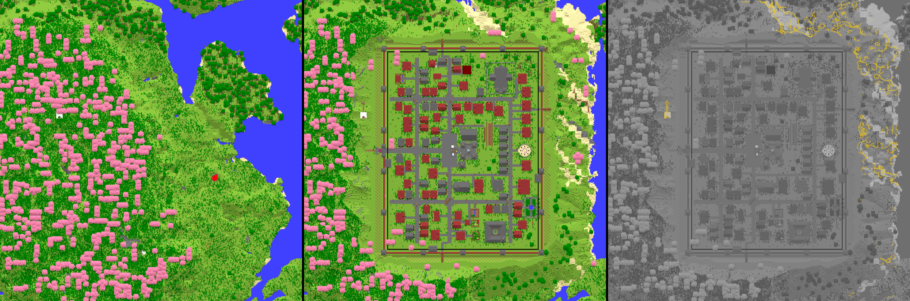

## Summary

| site | result |
|---|---|
| cherry_grove | 58 findings |

# KingdomQuest field test

Seed 20261117. Positions in details are relative to the heart (x, y, z).

## cherry_grove

minecraft:cherry_grove at -2000, 118, 6000, facing CLOCKWISE_90, relief 82, walkable out before founding: true, style temperate, ground grass_block. Gate approach cost per side (* = used): south 8, west 3*, north 895, east 1071.

| stage | ms | float built | float land | floating feet | buried | destroyed | doors unreached | walk out | breach | wet inside | wet moat | new cliffs | tall walls | pits | road gaps | road steps | wall gaps | cut trees | foreign ground | snow lost | road steep | stumps | road high | road bank | road moved |
|---|---|---|---|---|---|---|---|---|---|---|---|---|---|---|---|---|---|---|---|---|---|---|---|---|---|
Founded as flat castle: plateau at 0 (relative to the heart), site shaped in 895 ms.

| tent_1 | 606 | 0 | 0 | 0 | 0 | 0 | 0 | 1 | 0 | 0 | 0 | 843 | 0 | 35 | 0 | 0 | 0 | 0 | 16073 | 0 | 0 | 0 | 0 | 0 | 0 |
Country road to -1971, 100, 6000 (0 blocks of water on the way).

Lord's changes: broke 2 blocks before tent_2; repair leaves them.

Lord's changes after tent_2: unchanged spot kept broken, changed spot rebuilt by the new plan, 1 change(s) remembered.

| tent_2 | 808 | 0 | 0 | 0 | 0 | 1 | 0 | 1 | 0 | 0 | 0 | 826 | 0 | 35 | 0 | 0 | 0 | 0 | 16066 | 0 | 0 | 0 | 0 | 0 | 0 |
| tent_3 | 364 | 0 | 0 | 0 | 0 | 0 | 0 | 1 | 0 | 0 | 0 | 826 | 0 | 35 | 0 | 0 | 0 | 0 | 16066 | 0 | 0 | 0 | 0 | 0 | 0 |
| hamlet_1 | 1025 | 0 | 0 | 0 | 0 | 2 | 0 | 1 | 0 | 0 | 0 | 761 | 0 | 33 | 0 | 0 | 0 | 0 | 15949 | 0 | 0 | 0 | 0 | 0 | 0 |
| hamlet_2 | 372 | 3 | 3 | 0 | 0 | 0 | 0 | 1 | 0 | 0 | 0 | 674 | 0 | 25 | 0 | 0 | 0 | 0 | 15773 | 0 | 0 | 0 | 0 | 105 | 0 |
| hamlet_3 | 480 | 1 | 0 | 0 | 0 | 11 | 0 | 1 | 0 | 0 | 0 | 724 | 0 | 22 | 0 | 0 | 0 | 0 | 15764 | 0 | 0 | 0 | 0 | 0 | 0 |
| village_1 | 1047 | 1 | 2 | 0 | 0 | 11 | 0 | 1 | 0 | 0 | 0 | 760 | 0 | 28 | 0 | 0 | 0 | 0 | 13639 | 0 | 0 | 0 | 0 | 0 | 0 |
| town_1 | 706 | 0 | 4 | 0 | 0 | 5 | 0 | 1 | 0 | 0 | 0 | 2628 | 0 | 74 | 0 | 0 | 0 | 0 | 3190 | 0 | 0 | 0 | 0 | 0 | 0 |
| castle_1 | 1363 | 0 | 4 | 0 | 0 | 5 | 0 | 1 | 0 | 0 | 0 | 2624 | 0 | 73 | 0 | 0 | 0 | 0 | 3190 | 0 | 0 | 0 | 0 | 0 | 0 |
| castle_2 | 1376 | 0 | 4 | 0 | 0 | 3 | 0 | 1 | 0 | 0 | 0 | 2624 | 0 | 73 | 0 | 0 | 0 | 0 | 3190 | 0 | 0 | 0 | 0 | 0 | 0 |
| citadel_1 | 1470 | 0 | 4 | 0 | 0 | 3 | 0 | 1 | 0 | 0 | 0 | 2624 | 0 | 73 | 0 | 0 | 0 | 0 | 3190 | 0 | 0 | 0 | 0 | 0 | 0 |
| final | 0 | 0 | 4 | 0 | 0 | 3 | 0 | 1 | 0 | 0 | 0 | 2624 | 0 | 73 | 0 | 0 | 0 | 0 | 3190 | 0 | 0 | 0 | 0 | 0 | 0 |
Country road at the end: 134 of 150 cells near the castle intact, cut at [-96, -1, 0, -95, -1, 0, -94, -1, 0, -93, -1, 0, -92, -1, 0].

Gate (land relative to the heart, before -> after) at 0/5/10/15/20/30/40 blocks out of the gate: 17->-2 18->-2 20->-2 21->-2 22->-2 23->-2 17->-2. Moat columns per side {back=1846, gate=2597, left=595, right=743}. Way-out road none.

Production: level 1 made 16102 items in a game day, 48327 in three (store 4320 stacks); level 5 with every milestone 141571 items of 239 kinds a day. Storehouse goods shown: 14 blocks; unloaded 15552 items into the chests.

Tram: 880 rails, stops [gate, west, north, east]
Signal fires: 20 on 13 towers, lit 20, put out 20; tower guard posts 20.

- tent_1: new cliffs 843 [(-22,-38,-189) to -3, (-21,-39,-188) to -3, (-20,-42,-188) to 3, (-19,-42,-188) to 4, (-18,-41,-188) to 3]
- tent_1: pits 35 [(-9,-48,-89) hole, (-8,-48,-90) hole, (-7,-48,-92) hole, (-6,-46,-93) hole, (-3,-48,-94) hole]
- tent_1: foreign ground 16073 [water 16073 of 116227 columns (was 0)]
- tent_2: destroyed 1 [main (0,1,-5) spruce_log->air]
- tent_2: new cliffs 826 [(-22,-38,-189) to -3, (-21,-39,-188) to -3, (-20,-42,-188) to 3, (-19,-42,-188) to 4, (-18,-41,-188) to 3]
- tent_2: pits 35 [(-9,-48,-89) hole, (-8,-48,-90) hole, (-7,-48,-92) hole, (-6,-46,-93) hole, (-3,-48,-94) hole]
- tent_2: foreign ground 16066 [water 16066 of 116203 columns (was 0)]
- tent_3: new cliffs 826 [(-22,-38,-189) to -3, (-21,-39,-188) to -3, (-20,-42,-188) to 3, (-19,-42,-188) to 4, (-18,-41,-188) to 3]
- tent_3: pits 35 [(-9,-48,-89) hole, (-8,-48,-90) hole, (-7,-48,-92) hole, (-6,-46,-93) hole, (-3,-48,-94) hole]
- tent_3: foreign ground 16066 [water 16066 of 116168 columns (was 0)]
- hamlet_1: destroyed 2 [main (8,0,4) rose_bush->air, main (8,1,4) rose_bush->air]
- hamlet_1: new cliffs 761 [(-22,-38,-189) to -3, (-21,-39,-188) to -3, (-20,-42,-188) to 3, (-19,-42,-188) to 4, (-18,-41,-188) to 3]
- hamlet_1: pits 33 [(-9,-48,-89) hole, (-8,-48,-90) hole, (-7,-48,-92) hole, (-6,-46,-93) hole, (-3,-48,-94) hole]
- hamlet_1: foreign ground 15949 [water 15949 of 116164 columns (was 0)]
- hamlet_2: float built 3 [lamps (53,0,62) spruce_fence, lamps (53,1,62) torch, dock (136,-41,19) lantern]
- hamlet_2: float land 3 [(-27,7,-103) oak_log, (-27,5,-97) oak_log, (-27,5,-96) oak_log]
- hamlet_2: new cliffs 674 [(-22,-38,-189) to -3, (-21,-39,-188) to -3, (-20,-42,-188) to 3, (-19,-42,-188) to 4, (-18,-41,-188) to 3]
- hamlet_2: pits 25 [(8,-28,-92) hole, (9,-29,-93) hole, (19,-23,-73) hole, (52,-46,-75) hole, (53,-46,-77) hole]
- hamlet_2: foreign ground 15773 [water 15773 of 114207 columns (was 0)]
- hamlet_2: road bank 105 [(42,-1,65) over 2/2, (43,-1,67) over 3/2, (43,-1,66) over 3/2, (72,-1,64) over 27/26, (46,-1,65) over 4/5]
- hamlet_3: float built 1 [dock (136,-41,19) lantern]
- hamlet_3: destroyed 11 [tavern (60,1,40) vine->air, tavern (60,1,41) vine->air, tavern (60,1,45) vine->air, tavern (60,1,49) vine->air, tavern (60,2,40) vine->air]
- hamlet_3: new cliffs 724 [(-36,-19,-148) to 3, (-35,-19,-148) to 3, (-26,-23,-151) to 3, (-22,-38,-189) to -3, (-21,-39,-188) to -3]
- hamlet_3: pits 22 [(8,-28,-92) hole, (9,-29,-93) hole, (19,-23,-73) hole, (52,-46,-75) hole, (53,-46,-77) hole]
- hamlet_3: foreign ground 15764 [water 15764 of 110112 columns (was 0)]
- village_1: float built 1 [dock (141,-41,19) lantern]
- village_1: float land 2 [(80,5,14) oak_log, (80,5,15) oak_log]
- village_1: destroyed 11 [tavern (60,1,40) vine->air, tavern (60,1,41) vine->air, tavern (60,1,45) vine->air, tavern (60,1,49) vine->air, tavern (60,2,40) vine->air]
- village_1: new cliffs 760 [(-36,-19,-148) to 3, (-35,-19,-148) to 3, (-26,-23,-151) to 3, (-22,-38,-189) to -3, (-21,-39,-188) to -3]
- village_1: pits 28 [(8,-28,-92) hole, (9,-29,-93) hole, (53,-41,-103) hole, (55,-34,-105) spike, (56,-37,-105) hole]
- village_1: foreign ground 13639 [water 13639 of 107728 columns (was 0)]
- walls 1 took 6432 ms
- town_1: float land 4 [(87,-16,171) oak_log, (127,5,75) oak_log, (127,5,76) oak_log, (142,-15,125) oak_log]
- town_1: destroyed 5 [tavern (60,1,40) vine->air, tavern (60,1,41) vine->air, tavern (60,2,40) vine->air, tavern (60,2,41) vine->air, tavern (49,3,42) dark_oak_hanging_sign->air]
- town_1: new cliffs 2628 [(-119,13,-48) to 10, (-119,12,-47) to 11, (-119,12,-46) to 11, (-119,12,-45) to 11, (-119,11,-44) to 12]
- town_1: pits 74 [(-117,10,-44) hole, (-116,5,-60) hole, (-116,23,-41) spike, (-115,8,-44) hole, (-80,3,91) spike]
- town_1: foreign ground 3190 [sand 3190 of 101256 columns (was 0)]
- castle_1: float land 4 [(87,-16,171) oak_log, (127,5,75) oak_log, (127,5,76) oak_log, (142,-15,125) oak_log]
- castle_1: destroyed 5 [tavern (60,1,40) vine->air, tavern (60,1,41) vine->air, tavern (60,2,40) vine->air, tavern (60,2,41) vine->air, tavern (49,3,42) dark_oak_hanging_sign->air]
- castle_1: new cliffs 2624 [(-119,13,-48) to 10, (-119,12,-47) to 11, (-119,12,-46) to 11, (-119,12,-45) to 11, (-119,11,-44) to 12]
- castle_1: pits 73 [(-117,10,-44) hole, (-116,5,-60) hole, (-116,23,-41) spike, (-115,8,-44) hole, (15,-32,-179) hole]
- castle_1: foreign ground 3190 [sand 3190 of 91268 columns (was 0)]
- castle_2: float land 4 [(87,-16,171) oak_log, (127,5,75) oak_log, (127,5,76) oak_log, (142,-15,125) oak_log]
- castle_2: destroyed 3 [tavern (60,1,40) vine->air, tavern (60,1,41) vine->air, tavern (60,2,40) vine->air]
- castle_2: new cliffs 2624 [(-119,13,-48) to 10, (-119,12,-47) to 11, (-119,12,-46) to 11, (-119,12,-45) to 11, (-119,11,-44) to 12]
- castle_2: pits 73 [(-117,10,-44) hole, (-116,5,-60) hole, (-116,23,-41) spike, (-115,8,-44) hole, (15,-32,-179) hole]
- castle_2: foreign ground 3190 [sand 3190 of 87355 columns (was 0)]
- citadel_1: float land 4 [(87,-16,171) oak_log, (127,5,75) oak_log, (127,5,76) oak_log, (142,-15,125) oak_log]
- citadel_1: destroyed 3 [tavern (60,1,40) vine->air, tavern (60,1,41) vine->air, tavern (60,2,40) vine->air]
- citadel_1: new cliffs 2624 [(-119,13,-48) to 10, (-119,12,-47) to 11, (-119,12,-46) to 11, (-119,12,-45) to 11, (-119,11,-44) to 12]
- citadel_1: pits 73 [(-117,10,-44) hole, (-116,5,-60) hole, (-116,23,-41) spike, (-115,8,-44) hole, (15,-32,-179) hole]
- citadel_1: foreign ground 3190 [sand 3190 of 85436 columns (was 0)]
- final: float land 4 [(87,-16,171) oak_log, (127,5,75) oak_log, (127,5,76) oak_log, (142,-15,125) oak_log]
- final: destroyed 3 [tavern (60,1,40) vine->air, tavern (60,1,41) vine->air, tavern (60,2,40) vine->air]
- final: new cliffs 2624 [(-119,13,-48) to 10, (-119,12,-47) to 11, (-119,12,-46) to 11, (-119,12,-45) to 11, (-119,11,-44) to 12]
- final: pits 73 [(-117,10,-44) hole, (-116,5,-60) hole, (-116,23,-41) spike, (-115,8,-44) hole, (15,-32,-179) hole]
- final: foreign ground 3190 [sand 3190 of 84859 columns (was 0)]
- country road cut in 16 cells, e.g. [-96, -1, 0, -95, -1, 0, -94, -1, 0, -93, -1, 0, -92, -1, 0]

