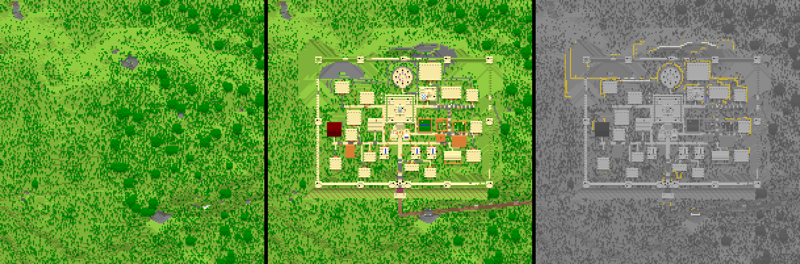

## Summary

| site | result |
|---|---|
| cliff_away | 38 findings |

# KingdomQuest field test

Seed 1813296525. Positions in details are relative to the heart (x, y, z).

## cliff_away

minecraft:savanna at -3820, 120, 12820, facing NONE, relief 40, walkable out before founding: true, style arid, ground grass_block. Shape cliff_away (score 9.8), land relative to the heart, directions S SE E NE N NW W SW, gate toward S: 24 out [3, 1, 0, -2, 0, 0, 0, 0]; 48 out [4, 4, -2, -10, -8, 0, 4, 0]; 72 out [-1, -4, -17, -24, -33, -25, 3, -1]; 96 out [-9, -32, -24, -41, -50, -18, -3, -2]. Gate approach cost per side (* = used): south 8*, west 9, north 334, east 26.

| stage | ms | float built | float land | floating feet | buried | destroyed | doors unreached | walk out | breach | wet inside | wet moat | new cliffs | tall walls | pits | road gaps | road steps | wall gaps | cut trees | foreign ground | snow lost | road steep | stumps | road high | road bank | road moved |
|---|---|---|---|---|---|---|---|---|---|---|---|---|---|---|---|---|---|---|---|---|---|---|---|---|---|
| tent_1 | 601 | 0 | 0 | 0 | 0 | 0 | 0 | 1 | 0 | 0 | 0 | 2 | 0 | 0 | 0 | 0 | 0 | 0 | 0 | 0 | 0 | 0 | 0 | 0 | 0 |
Country road to -3690, 80, 12871 (0 blocks of water on the way).

Lord's changes: broke 2 blocks before tent_2; repair leaves them.

Lord's changes after tent_2: unchanged spot kept broken, changed spot rebuilt by the new plan, 1 change(s) remembered.

| tent_2 | 318 | 0 | 0 | 0 | 0 | 1 | 0 | 1 | 0 | 0 | 0 | 7 | 9 | 0 | 0 | 0 | 0 | 0 | 0 | 0 | 0 | 0 | 0 | 0 | 0 |
| tent_3 | 216 | 0 | 0 | 0 | 0 | 0 | 0 | 1 | 0 | 0 | 0 | 7 | 9 | 0 | 0 | 0 | 0 | 0 | 0 | 0 | 0 | 0 | 0 | 0 | 0 |
| hamlet_1 | 704 | 0 | 0 | 0 | 0 | 0 | 0 | 1 | 0 | 0 | 0 | 28 | 9 | 0 | 0 | 0 | 0 | 0 | 0 | 0 | 0 | 0 | 0 | 0 | 0 |
| hamlet_2 | 277 | 0 | 0 | 0 | 0 | 0 | 0 | 1 | 0 | 0 | 0 | 56 | 9 | 0 | 0 | 0 | 0 | 0 | 0 | 0 | 0 | 0 | 0 | 0 | 0 |
| hamlet_3 | 285 | 0 | 0 | 0 | 0 | 0 | 0 | 1 | 0 | 0 | 0 | 113 | 9 | 0 | 0 | 0 | 0 | 0 | 0 | 0 | 0 | 0 | 0 | 0 | 0 |
| village_1 | 339 | 0 | 0 | 0 | 0 | 0 | 0 | 1 | 0 | 0 | 0 | 303 | 9 | 0 | 0 | 0 | 0 | 0 | 0 | 0 | 4 | 0 | 0 | 0 | 0 |
| town_1 | 318 | 0 | 0 | 0 | 0 | 3 | 0 | 1 | 0 | 0 | 0 | 504 | 15 | 0 | 0 | 0 | 14 | 0 | 0 | 0 | 5 | 0 | 0 | 1 | 0 |
| castle_1 | 486 | 0 | 0 | 0 | 0 | 0 | 0 | 1 | 0 | 0 | 0 | 460 | 34 | 0 | 0 | 0 | 0 | 0 | 0 | 0 | 5 | 0 | 0 | 1 | 0 |
| castle_2 | 561 | 0 | 0 | 0 | 0 | 0 | 0 | 1 | 0 | 0 | 0 | 447 | 50 | 0 | 0 | 0 | 0 | 0 | 0 | 0 | 5 | 0 | 0 | 1 | 0 |
| citadel_1 | 489 | 0 | 0 | 0 | 0 | 0 | 0 | 1 | 0 | 0 | 0 | 457 | 50 | 0 | 0 | 0 | 0 | 0 | 0 | 0 | 5 | 0 | 0 | 1 | 0 |
| final | 0 | 0 | 0 | 0 | 0 | 0 | 0 | 1 | 0 | 0 | 0 | 511 | 87 | 0 | 0 | 0 | 0 | 0 | 0 | 0 | 5 | 0 | 0 | 1 | 0 |
Country road at the end: 118 of 118 cells near the castle intact.

Gate (land relative to the heart, before -> after) at 0/5/10/15/20/30/40 blocks out of the gate: -2->-2 -1->-7 1->-2 3->2 3->3 0->0 -3->-3. Moat columns per side {gate=1056}. Way-out road none.

- tent_1: new cliffs 2 [(35,-9,-13) to -4, (52,-7,37) to 4]
- tent_2: destroyed 1 [main (-5,1,0) acacia_log->air]
- tent_2: new cliffs 7 [(1,2,50) to -3, (18,-3,59) to -3, (19,-3,58) to -3, (20,-4,58) to -3, (24,-8,62) to -25]
- tent_2: tall walls 9 [(18,-27,62) 20 cap unowned low unowned:air, (18,-27,63) 21 cap unowned low unowned:air, (19,-6,63) -22 cap unowned low unowned:air, (20,-7,63) -22 cap unowned low unowned:air, (21,-7,63) -24 cap unowned low unowned:air]
- tent_3: new cliffs 7 [(1,2,50) to -3, (18,-3,59) to -3, (19,-3,58) to -3, (20,-4,58) to -3, (24,-8,62) to -25]
- tent_3: tall walls 9 [(18,-27,62) 20 cap unowned low unowned:air, (18,-27,63) 21 cap unowned low unowned:air, (19,-6,63) -22 cap unowned low unowned:air, (20,-7,63) -22 cap unowned low unowned:air, (21,-7,63) -24 cap unowned low unowned:air]
- hamlet_1: new cliffs 28 [(-35,-5,-40) to -4, (-35,-4,-39) to -5, (-34,-9,-39) to 5, (-33,-9,-39) to 5, (-32,-9,-39) to 5]
- hamlet_1: tall walls 9 [(18,-27,62) 20 cap unowned low unowned:air, (18,-27,63) 21 cap unowned low unowned:air, (19,-6,63) -22 cap unowned low unowned:air, (20,-7,63) -22 cap unowned low unowned:air, (21,-7,63) -24 cap unowned low unowned:air]
- hamlet_2: new cliffs 56 [(-35,-5,-40) to -4, (-35,-4,-39) to -4, (-34,-8,-39) to 4, (-34,-4,-38) to -5, (-33,-9,-38) to 5]
- hamlet_2: tall walls 9 [(18,-27,62) 20 cap unowned low unowned:air, (18,-27,63) 21 cap unowned low unowned:air, (19,-6,63) -22 cap unowned low unowned:air, (20,-7,63) -22 cap unowned low unowned:air, (21,-7,63) -24 cap unowned low unowned:air]
- hamlet_3: new cliffs 113 [(-52,-1,31) to 3, (-51,2,31) to -3, (-50,2,31) to -3, (-49,2,31) to -3, (-48,2,31) to -3]
- hamlet_3: tall walls 9 [(18,-27,62) 20 cap unowned low unowned:air, (18,-27,63) 21 cap unowned low unowned:air, (19,-6,63) -22 cap unowned low unowned:air, (20,-7,63) -22 cap unowned low unowned:air, (21,-7,63) -24 cap unowned low unowned:air]
- village_1: new cliffs 303 [(-52,-1,31) to 3, (-51,2,31) to -3, (-50,2,31) to -3, (-49,2,31) to -3, (-48,2,31) to -3]
- village_1: tall walls 9 [(18,-27,62) 20 cap unowned low unowned:air, (18,-27,63) 21 cap unowned low unowned:air, (19,-6,63) -22 cap unowned low unowned:air, (20,-7,63) -22 cap unowned low unowned:air, (21,-7,63) -24 cap unowned low unowned:air]
- village_1: road steep 4 [(29,-5,-24) to 3 in 3, (29,-8,-27) to 3 in 3, (29,-7,-26) to 3 in 3, (29,-6,-25) to 3 in 3]
- town_1: destroyed 3 [walls (67,-35,-56) coarse_dirt->acacia_log, walls (69,-35,-55) coarse_dirt->acacia_log, walls (69,-35,-54) coarse_dirt->acacia_log]
- town_1: new cliffs 504 [(-78,-1,-56) to -3, (-78,-1,-55) to -3, (-78,-1,-54) to -3, (-78,-1,-53) to -3, (-78,-1,-52) to -3]
- town_1: tall walls 15 [(-51,-26,-41) 14 cap unowned low unowned:stone, (-37,-26,-41) 24 cap unowned low unowned:andesite, (18,-27,62) 20 cap unowned low unowned:air, (18,-27,63) 21 cap unowned low unowned:air, (19,-6,63) -22 cap unowned low unowned:air]
- town_1: wall gaps 14 [(-65,-13,-58) over air, (-65,-13,-54) over air, (-61,-13,-58) over air, (-61,-13,-54) over air, (67,-35,-58) over air]
- town_1: road steep 5 [(29,-5,-24) to 3 in 3, (29,-4,-23) to 3 in 3, (29,-8,-27) to 3 in 3, (29,-7,-26) to 3 in 3, (29,-6,-25) to 3 in 3]
- town_1: road bank 1 [(39,-5,-21) over 2/2]
- castle_1: new cliffs 460 [(-78,-4,-59) to -3, (-78,-3,-58) to -4, (-78,-2,-57) to -5, (-78,-1,-56) to -6, (-78,-1,-55) to -6]
- castle_1: tall walls 34 [(-61,-27,-41) 10 cap unowned low unowned:stone, (-51,-27,-41) 19 cap unowned low unowned:stone, (-37,-27,-41) 7 cap unowned low unowned:stone, (-36,-19,-39) 17 cap unowned low unowned:stone, (-32,-27,-41) 7 cap unowned low unowned:stone]
- castle_1: road steep 5 [(29,-5,-24) to 3 in 3, (29,-4,-23) to 3 in 3, (29,-8,-27) to 3 in 3, (29,-7,-26) to 3 in 3, (29,-6,-25) to 3 in 3]
- castle_1: road bank 1 [(39,-5,-21) over 2/2]
- castle_2: new cliffs 447 [(-78,-4,-59) to -3, (-78,-3,-58) to -4, (-78,-2,-57) to -5, (-78,-1,-56) to -6, (-78,-1,-55) to -6]
- castle_2: tall walls 50 [(-61,-27,-41) 10 cap unowned low unowned:stone, (-51,-27,-41) 19 cap unowned low unowned:stone, (-37,-27,-41) 7 cap unowned low unowned:stone, (-36,-19,-39) 17 cap unowned low unowned:stone, (-34,-19,-39) 15 cap unowned low unowned:stone]
- castle_2: road steep 5 [(29,-5,-24) to 3 in 3, (29,-4,-23) to 3 in 3, (29,-8,-27) to 3 in 3, (29,-7,-26) to 3 in 3, (29,-6,-25) to 3 in 3]
- castle_2: road bank 1 [(39,-5,-21) over 2/2]
- citadel_1: new cliffs 457 [(-78,-4,-59) to -3, (-78,-3,-58) to -4, (-78,-2,-57) to -5, (-78,-1,-56) to -6, (-78,-1,-55) to -6]
- citadel_1: tall walls 50 [(-61,-27,-41) 10 cap unowned low unowned:stone, (-51,-27,-41) 19 cap unowned low unowned:stone, (-37,-27,-41) 7 cap unowned low unowned:stone, (-36,-19,-39) 17 cap unowned low unowned:stone, (-34,-19,-39) 15 cap unowned low unowned:stone]
- citadel_1: road steep 5 [(29,-5,-24) to 3 in 3, (29,-4,-23) to 3 in 3, (29,-8,-27) to 3 in 3, (29,-7,-26) to 3 in 3, (29,-6,-25) to 3 in 3]
- citadel_1: road bank 1 [(39,-5,-21) over 2/2]
- final: tall by [{unowned/unowned=87}]
- final: new cliffs 511 [(-78,-4,-59) to -3, (-78,-3,-58) to -4, (-78,-2,-57) to -5, (-78,-1,-56) to -6, (-78,-1,-55) to -6]
- final: tall walls 87 [(-61,-27,-41) 10 cap unowned low unowned:stone, (-51,-27,-41) 19 cap unowned low unowned:stone, (-37,-27,-41) 7 cap unowned low unowned:stone, (-36,-19,-39) 17 cap unowned low unowned:stone, (-34,-19,-39) 15 cap unowned low unowned:stone]
- final: road steep 5 [(29,-5,-24) to 3 in 3, (29,-4,-23) to 3 in 3, (29,-8,-27) to 3 in 3, (29,-7,-26) to 3 in 3, (29,-6,-25) to 3 in 3]
- final: road bank 1 [(39,-5,-21) over 2/2]

