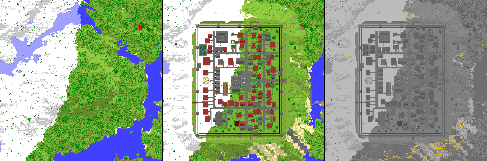

## Summary

| site | result |
|---|---|
| cliff_toward | 70 findings |

# KingdomQuest field test

Seed 20261117. Positions in details are relative to the heart (x, y, z).

## cliff_toward

minecraft:meadow at -2568, 119, 11892, facing COUNTERCLOCKWISE_90, relief 61, walkable out before founding: true, style temperate, ground grass_block. Shape cliff_toward (score 8.2), land relative to the heart, directions S SE E NE N NW W SW, gate toward NE: 24 out [0, 1, 1, -3, -1, -3, -1, -1]; 48 out [-1, 4, 4, -7, -5, -1, -1, 0]; 72 out [-30, -19, -9, -29, -14, -5, -7, -6]; 96 out [-48, -48, -43, -46, -47, -48, -42, -17]. Gate approach cost per side (* = used): south 938, west 938, north 940, east 868*.

| stage | ms | float built | float land | floating feet | buried | destroyed | doors unreached | walk out | breach | wet inside | wet moat | new cliffs | tall walls | pits | road gaps | road steps | wall gaps | cut trees | foreign ground | snow lost | road steep | stumps | road high | road bank | road moved |
|---|---|---|---|---|---|---|---|---|---|---|---|---|---|---|---|---|---|---|---|---|---|---|---|---|---|
Founded as flat castle: plateau at 0 (relative to the heart), site shaped in 583 ms.

| tent_1 | 469 | 0 | 0 | 0 | 0 | 0 | 0 | 1 | 0 | 0 | 0 | 668 | 0 | 60 | 0 | 0 | 0 | 0 | 17451 | 17 | 0 | 0 | 0 | 0 | 0 |
Country road to -2347, 63, 11942 (62 blocks of water on the way).

Lord's changes: broke 2 blocks before tent_2; repair leaves them.

Lord's changes after tent_2: unchanged spot kept broken, changed spot rebuilt by the new plan, 1 change(s) remembered.

| tent_2 | 931 | 0 | 0 | 0 | 0 | 1 | 0 | 1 | 0 | 0 | 0 | 680 | 0 | 58 | 0 | 0 | 0 | 0 | 17039 | 35 | 0 | 0 | 0 | 0 | 0 |
| tent_3 | 479 | 0 | 0 | 0 | 0 | 0 | 0 | 1 | 0 | 0 | 0 | 680 | 0 | 58 | 0 | 0 | 0 | 0 | 17039 | 35 | 0 | 0 | 0 | 0 | 0 |
| hamlet_1 | 984 | 0 | 0 | 0 | 0 | 2 | 0 | 1 | 0 | 0 | 0 | 753 | 0 | 60 | 0 | 0 | 0 | 0 | 17039 | 51 | 0 | 0 | 0 | 0 | 0 |
| hamlet_2 | 450 | 1 | 1 | 0 | 0 | 0 | 0 | 1 | 0 | 0 | 0 | 831 | 0 | 44 | 0 | 0 | 0 | 0 | 15775 | 56 | 0 | 0 | 0 | 221 | 0 |
| hamlet_3 | 385 | 1 | 0 | 0 | 0 | 11 | 0 | 1 | 0 | 0 | 0 | 1050 | 0 | 46 | 0 | 0 | 0 | 0 | 14539 | 65 | 0 | 0 | 0 | 2 | 0 |
| village_1 | 959 | 1 | 0 | 0 | 0 | 11 | 0 | 1 | 0 | 0 | 0 | 1081 | 0 | 46 | 0 | 0 | 0 | 0 | 10914 | 73 | 0 | 0 | 0 | 2 | 0 |
| town_1 | 650 | 0 | 1 | 0 | 0 | 5 | 0 | 1 | 0 | 0 | 0 | 2329 | 0 | 95 | 0 | 0 | 0 | 0 | 4476 | 87 | 0 | 0 | 0 | 0 | 0 |
| castle_1 | 1603 | 0 | 1 | 0 | 0 | 5 | 0 | 1 | 0 | 0 | 0 | 2321 | 0 | 93 | 0 | 0 | 0 | 0 | 4468 | 72 | 0 | 0 | 0 | 0 | 0 |
| castle_2 | 1550 | 0 | 1 | 0 | 0 | 3 | 0 | 1 | 0 | 0 | 0 | 2315 | 0 | 91 | 0 | 0 | 0 | 0 | 4468 | 50 | 0 | 0 | 0 | 0 | 0 |
| citadel_1 | 1530 | 0 | 1 | 0 | 0 | 3 | 0 | 1 | 0 | 0 | 0 | 2315 | 0 | 91 | 0 | 0 | 0 | 0 | 4468 | 50 | 0 | 0 | 0 | 0 | 0 |
| final | 0 | 0 | 1 | 0 | 0 | 3 | 0 | 1 | 0 | 0 | 0 | 2315 | 0 | 91 | 0 | 0 | 0 | 0 | 4468 | 49 | 0 | 0 | 0 | 0 | 0 |
Country road at the end: 10 of 10 cells near the castle intact.

Gate (land relative to the heart, before -> after) at 0/5/10/15/20/30/40 blocks out of the gate: 14->-2 14->-2 15->-2 15->-2 13->-2 3->-2 -18->-10. Moat columns per side {back=2492, gate=2486, left=670, right=633}. Way-out road none.

Production: level 1 made 16102 items in a game day, 48327 in three (store 4320 stacks); level 5 with every milestone 141571 items of 239 kinds a day. Storehouse goods shown: 14 blocks; unloaded 15552 items into the chests.

Tram: 880 rails, stops [gate, west, north, east]
Signal fires: 20 on 13 towers, lit 20, put out 20; tower guard posts 20.

- tent_1: new cliffs 668 [(-188,-41,69) to 3, (-188,-44,135) to 3, (-187,-38,60) to -3, (-187,-41,69) to 3, (-187,-42,136) to 3]
- tent_1: pits 60 [(-166,-43,67) hole, (-164,-44,59) hole, (-41,-45,-189) hole, (-40,-45,-186) hole, (12,-42,111) hole]
- tent_1: foreign ground 17451 [ice 6253 of 116227 columns (was 0), water 11198 of 116227 columns (was 0)]
- tent_1: snow lost 17 [(-28,7,-6) on grass_block at air light 0]
- tent_2: destroyed 1 [main (0,1,5) spruce_log->air]
- tent_2: new cliffs 680 [(-188,-41,69) to 3, (-188,-44,135) to 3, (-187,-38,60) to -3, (-187,-41,69) to 3, (-187,-42,136) to 3]
- tent_2: pits 58 [(-166,-43,67) hole, (-164,-44,59) hole, (-41,-45,-189) hole, (-40,-45,-186) hole, (12,-42,111) hole]
- tent_2: foreign ground 17039 [ice 6253 of 116203 columns (was 0), water 10786 of 116203 columns (was 0)]
- tent_2: snow lost 35 [(-30,3,4) on grass_block at air light 0]
- tent_3: new cliffs 680 [(-188,-41,69) to 3, (-188,-44,135) to 3, (-187,-38,60) to -3, (-187,-41,69) to 3, (-187,-42,136) to 3]
- tent_3: pits 58 [(-166,-43,67) hole, (-164,-44,59) hole, (-41,-45,-189) hole, (-40,-45,-186) hole, (12,-42,111) hole]
- tent_3: foreign ground 17039 [ice 6253 of 116168 columns (was 0), water 10786 of 116168 columns (was 0)]
- tent_3: snow lost 35 [(-30,3,4) on grass_block at air light 0]
- hamlet_1: destroyed 2 [main (-8,0,-4) rose_bush->air, main (-8,1,-4) rose_bush->air]
- hamlet_1: new cliffs 753 [(-188,-41,69) to 3, (-188,-44,135) to 3, (-187,-38,60) to -3, (-187,-41,69) to 3, (-187,-42,136) to 3]
- hamlet_1: pits 60 [(-166,-43,67) hole, (-164,-44,59) hole, (-41,-45,-189) hole, (-40,-45,-186) hole, (-32,5,24) spike]
- hamlet_1: foreign ground 17039 [ice 6253 of 116164 columns (was 0), water 10786 of 116164 columns (was 0)]
- hamlet_1: snow lost 51 [(-40,8,47) on grass_block at air light 0, (-8,1,-43) on grass_block at air light 0]
- hamlet_2: float built 1 [dock (116,-42,-55) lantern]
- hamlet_2: float land 1 [(68,5,36) oak_log]
- hamlet_2: new cliffs 831 [(-188,-41,69) to 3, (-188,-44,135) to 3, (-187,-38,60) to -3, (-187,-41,69) to 3, (-187,-42,136) to 3]
- hamlet_2: pits 44 [(-166,-43,67) hole, (-164,-44,59) hole, (-41,-45,-189) hole, (-40,-45,-186) hole, (-13,4,47) spike]
- hamlet_2: foreign ground 15775 [ice 4319 of 114206 columns (was 0), water 8859 of 114206 columns (was 0), sand 2597 of 114206 columns (was 0)]
- hamlet_2: snow lost 56 [(-40,8,47) on grass_block at air light 0, (-11,0,-31) on grass_block at air light 0]
- hamlet_2: road bank 221 [(28,-1,65) over 5/4, (60,-1,65) over 6/8, (-68,-1,-65) over 29/28, (29,-1,65) over 5/4, (61,-1,65) over 6/8]
- hamlet_3: float built 1 [dock (116,-42,-55) lantern]
- hamlet_3: destroyed 11 [tavern (-60,1,-40) vine->air, tavern (-60,1,-41) vine->air, tavern (-60,1,-45) vine->air, tavern (-60,1,-49) vine->air, tavern (-60,2,-40) vine->air]
- hamlet_3: new cliffs 1050 [(-188,-41,69) to 3, (-188,-44,135) to 3, (-187,-38,60) to -3, (-187,-41,69) to 3, (-187,-42,136) to 3]
- hamlet_3: pits 46 [(-166,-43,67) hole, (-164,-44,59) hole, (-41,-45,-189) hole, (-40,-45,-186) hole, (27,-41,151) hole]
- hamlet_3: foreign ground 14539 [ice 3582 of 110110 columns (was 0), water 7786 of 110110 columns (was 0), sand 3171 of 110110 columns (was 0)]
- hamlet_3: snow lost 65 [(-69,4,-34) on lantern at air light 14, (-27,0,8) on grass_block at air light 0]
- hamlet_3: road bank 2 [(88,-1,-3) over 3/3, (88,-1,3) over 2/2]
- village_1: float built 1 [dock (121,-42,-55) lantern]
- village_1: destroyed 11 [tavern (-60,1,-40) vine->air, tavern (-60,1,-41) vine->air, tavern (-60,1,-45) vine->air, tavern (-60,1,-49) vine->air, tavern (-60,2,-40) vine->air]
- village_1: new cliffs 1081 [(-188,-41,69) to 3, (-188,-44,135) to 3, (-187,-38,60) to -3, (-187,-41,69) to 3, (-187,-42,136) to 3]
- village_1: pits 46 [(-166,-43,67) hole, (-164,-44,59) hole, (-41,-45,-189) hole, (-40,-45,-186) hole, (27,-41,151) hole]
- village_1: foreign ground 10914 [water 7744 of 107726 columns (was 0), sand 3170 of 107726 columns (was 0)]
- village_1: snow lost 73 [(-101,1,69) on azalea_leaves at air light 0, (-28,0,12) on grass_block at air light 0]
- village_1: road bank 2 [(88,-1,-3) over 3/3, (88,-1,3) over 2/2]
- walls 1 took 7854 ms
- town_1: float land 1 [(145,-32,99) oak_log]
- town_1: destroyed 5 [tavern (-60,1,-40) vine->air, tavern (-60,1,-41) vine->air, tavern (-60,2,-40) vine->air, tavern (-60,2,-41) vine->air, tavern (-49,3,-42) dark_oak_hanging_sign->air]
- town_1: new cliffs 2329 [(-188,-41,69) to 3, (-188,-44,135) to 3, (-187,-38,60) to -3, (-187,-41,69) to 3, (-187,-42,136) to 3]
- town_1: pits 95 [(-163,-34,60) hole, (-57,-31,181) hole, (-50,-30,183) spike, (-29,4,38) spike, (-28,4,83) spike]
- town_1: foreign ground 4476 [sand 4476 of 101255 columns (was 0)]
- town_1: snow lost 87 [(-101,1,12) on azalea_leaves at air light 0, (-29,0,9) on grass_block at air light 0]
- castle_1: float land 1 [(145,-32,99) oak_log]
- castle_1: destroyed 5 [tavern (-60,1,-40) vine->air, tavern (-60,1,-41) vine->air, tavern (-60,2,-40) vine->air, tavern (-60,2,-41) vine->air, tavern (-49,3,-42) dark_oak_hanging_sign->air]
- castle_1: new cliffs 2321 [(-188,-41,69) to 3, (-188,-44,135) to 3, (-187,-38,60) to -3, (-187,-41,69) to 3, (-187,-42,136) to 3]
- castle_1: pits 93 [(-163,-34,60) hole, (-57,-31,181) hole, (-50,-30,183) spike, (-29,4,38) spike, (-28,4,83) spike]
- castle_1: foreign ground 4468 [sand 4468 of 90747 columns (was 0)]
- castle_1: snow lost 72 [(-101,1,12) on azalea_leaves at air light 0, (-28,0,-4) on grass_block at air light 0]
- castle_2: float land 1 [(145,-32,99) oak_log]
- castle_2: destroyed 3 [tavern (-60,1,-40) vine->air, tavern (-60,1,-41) vine->air, tavern (-60,2,-40) vine->air]
- castle_2: new cliffs 2315 [(-188,-41,69) to 3, (-188,-44,135) to 3, (-187,-38,60) to -3, (-187,-41,69) to 3, (-187,-42,136) to 3]
- castle_2: pits 91 [(-163,-34,60) hole, (-57,-31,181) hole, (-50,-30,183) spike, (-29,4,38) spike, (-9,-35,185) spike]
- castle_2: foreign ground 4468 [sand 4468 of 86834 columns (was 0)]
- castle_2: snow lost 50 [(-101,1,12) on azalea_leaves at air light 0]
- citadel_1: float land 1 [(145,-32,99) oak_log]
- citadel_1: destroyed 3 [tavern (-60,1,-40) vine->air, tavern (-60,1,-41) vine->air, tavern (-60,2,-40) vine->air]
- citadel_1: new cliffs 2315 [(-188,-41,69) to 3, (-188,-44,135) to 3, (-187,-38,60) to -3, (-187,-41,69) to 3, (-187,-42,136) to 3]
- citadel_1: pits 91 [(-163,-34,60) hole, (-57,-31,181) hole, (-50,-30,183) spike, (-29,4,38) spike, (-9,-35,185) spike]
- citadel_1: foreign ground 4468 [sand 4468 of 84915 columns (was 0)]
- citadel_1: snow lost 50 [(-101,1,12) on azalea_leaves at air light 0]
- final: float land 1 [(145,-32,99) oak_log]
- final: destroyed 3 [tavern (-60,1,-40) vine->air, tavern (-60,1,-41) vine->air, tavern (-60,2,-40) vine->air]
- final: new cliffs 2315 [(-188,-41,69) to 3, (-188,-44,135) to 3, (-187,-38,60) to -3, (-187,-41,69) to 3, (-187,-42,136) to 3]
- final: pits 91 [(-163,-34,60) hole, (-57,-31,181) hole, (-50,-30,183) spike, (-29,4,38) spike, (-9,-35,185) spike]
- final: foreign ground 4468 [sand 4468 of 84338 columns (was 0)]
- final: snow lost 49 [(-101,1,12) on azalea_leaves at air light 0]

