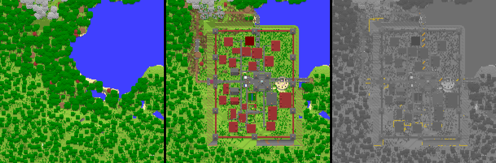

## Summary

| site | result |
|---|---|
| dark_forest | 54 findings |

# KingdomQuest field test

Seed 1813296525. Positions in details are relative to the heart (x, y, z).

## dark_forest

minecraft:dark_forest at -592, 63, -3324, facing CLOCKWISE_90, relief 16, walkable out before founding: true, style temperate, ground grass_block. Gate approach cost per side (* = used): south 142, west 9*, north 26, east 45.

| stage | ms | float built | float land | floating feet | buried | destroyed | doors unreached | walk out | breach | wet inside | wet moat | new cliffs | tall walls | pits | road gaps | road steps | wall gaps | cut trees | foreign ground | snow lost | road steep | stumps | road high | road bank | road moved |
|---|---|---|---|---|---|---|---|---|---|---|---|---|---|---|---|---|---|---|---|---|---|---|---|---|---|
| tent_1 | 524 | 0 | 0 | 0 | 0 | 0 | 0 | 1 | 0 | 0 | 0 | 9 | 0 | 0 | 0 | 0 | 0 | 0 | 0 | 0 | 0 | 0 | 0 | 0 | 0 |
Country road to -513, 67, -3324 (52 blocks of water on the way).

Lord's changes: broke 2 blocks before tent_2; repair leaves them.

Lord's changes after tent_2: unchanged spot kept broken, changed spot rebuilt by the new plan, 1 change(s) remembered.

| tent_2 | 197 | 0 | 0 | 0 | 0 | 1 | 0 | 1 | 0 | 0 | 0 | 15 | 1 | 2 | 0 | 0 | 0 | 0 | 0 | 0 | 0 | 0 | 0 | 0 | 0 |
| tent_3 | 142 | 0 | 0 | 0 | 0 | 0 | 0 | 1 | 0 | 0 | 0 | 25 | 1 | 4 | 0 | 0 | 0 | 0 | 0 | 0 | 0 | 0 | 0 | 0 | 0 |
| hamlet_1 | 400 | 0 | 0 | 0 | 0 | 2 | 0 | 1 | 0 | 0 | 0 | 93 | 1 | 15 | 0 | 0 | 0 | 0 | 0 | 0 | 0 | 0 | 0 | 0 | 0 |
| hamlet_2 | 202 | 0 | 0 | 0 | 0 | 0 | 0 | 1 | 0 | 0 | 0 | 140 | 1 | 16 | 0 | 0 | 0 | 0 | 0 | 0 | 0 | 0 | 0 | 2 | 0 |
| hamlet_3 | 229 | 5 | 0 | 0 | 0 | 11 | 0 | 1 | 0 | 0 | 0 | 127 | 1 | 17 | 0 | 0 | 0 | 0 | 0 | 0 | 0 | 0 | 0 | 0 | 0 |
| village_1 | 238 | 5 | 0 | 0 | 0 | 11 | 0 | 1 | 0 | 0 | 0 | 129 | 1 | 16 | 0 | 0 | 0 | 0 | 0 | 0 | 0 | 0 | 0 | 0 | 0 |
| town_1 | 215 | 0 | 0 | 0 | 0 | 8 | 0 | 1 | 0 | 0 | 0 | 248 | 1 | 24 | 0 | 0 | 122 | 0 | 0 | 0 | 3 | 0 | 0 | 0 | 0 |
| castle_1 | 478 | 0 | 0 | 0 | 0 | 5 | 0 | 1 | 0 | 0 | 0 | 367 | 2 | 25 | 0 | 0 | 0 | 0 | 0 | 0 | 3 | 0 | 0 | 0 | 0 |
| castle_2 | 484 | 0 | 0 | 0 | 0 | 3 | 0 | 1 | 0 | 0 | 0 | 294 | 2 | 20 | 0 | 0 | 0 | 0 | 0 | 0 | 3 | 0 | 0 | 0 | 0 |
| citadel_1 | 460 | 0 | 0 | 0 | 0 | 3 | 0 | 1 | 0 | 0 | 0 | 294 | 2 | 20 | 0 | 0 | 0 | 0 | 0 | 0 | 3 | 0 | 0 | 0 | 0 |
| final | 0 | 0 | 0 | 0 | 0 | 3 | 0 | 1 | 0 | 0 | 0 | 284 | 1 | 18 | 0 | 0 | 0 | 0 | 0 | 0 | 3 | 0 | 0 | 0 | 0 |
Country road at the end: 146 of 177 cells near the castle intact, cut at [-60, 34, -85, -59, 35, -85, -58, 35, -85, -57, 35, -85, -56, 35, -85].

Gate (land relative to the heart, before -> after) at 0/5/10/15/20/30/40 blocks out of the gate: 0->-2 0->-7 1->-2 4->2 6->6 7->7 8->8. Moat columns per side {back=641, gate=1080, left=477}. Way-out road none.

- tent_1: new cliffs 9 [(-28,1,32) to 3, (-10,-1,-59) to 4, (-6,3,-60) to -4, (3,-1,27) to -5, (3,4,42) to -6]
- tent_2: destroyed 1 [main (0,1,-5) spruce_log->air]
- tent_2: new cliffs 15 [(-28,1,32) to 3, (-10,-1,-59) to 4, (-6,3,-60) to -4, (3,-1,27) to -5, (3,4,42) to -6]
- tent_2: tall walls 1 [(-61,9,-37) -7 cap unowned low unowned:air]
- tent_2: pits 2 [(7,1,-84) spike, (11,3,-8) spike]
- tent_3: new cliffs 25 [(-28,1,32) to 3, (-24,7,26) to -7, (-23,0,26) to 7, (-22,0,26) to 7, (-10,-1,-59) to 4]
- tent_3: tall walls 1 [(-61,9,-37) -7 cap unowned low unowned:air]
- tent_3: pits 4 [(7,1,-84) spike, (11,3,-8) spike, (12,3,-9) spike, (13,3,-10) spike]
- hamlet_1: destroyed 2 [main (8,0,4) rose_bush->air, main (8,1,4) rose_bush->air]
- hamlet_1: new cliffs 93 [(-34,0,27) to 3, (-34,9,40) to 3, (-33,0,27) to 3, (-32,0,27) to 3, (-31,0,27) to 3]
- hamlet_1: tall walls 1 [(-61,9,-37) -7 cap unowned low unowned:air]
- hamlet_1: pits 15 [(7,1,-84) spike, (11,3,-22) spike, (11,3,-15) spike, (11,3,-8) spike, (12,3,-23) spike]
- hamlet_2: new cliffs 140 [(-34,9,40) to 3, (-24,7,40) to 3, (-24,10,41) to -3, (-23,7,41) to 3, (-22,6,41) to 4]
- hamlet_2: tall walls 1 [(-61,9,-37) -7 cap unowned low unowned:air]
- hamlet_2: pits 16 [(7,1,-84) spike, (11,3,-29) spike, (11,3,-8) spike, (12,3,-30) spike, (12,3,-23) spike]
- hamlet_2: road bank 2 [(-1,2,38) over 3/3, (-1,2,37) over 3/3]
- hamlet_3: float built 5 [mine (6,10,51) spruce_fence, mine (6,11,51) spruce_fence, mine (6,12,51) spruce_fence, mine (7,11,51) spruce_hanging_sign, mine (7,12,51) spruce_fence]
- hamlet_3: destroyed 11 [tavern (35,1,17) vine->air, tavern (35,1,18) vine->air, tavern (35,1,22) vine->air, tavern (35,1,26) vine->air, tavern (35,2,17) vine->air]
- hamlet_3: new cliffs 127 [(-43,8,-67) to -3, (-38,6,-68) to -3, (-20,14,64) to 3, (-19,14,64) to 3, (-18,14,64) to 3]
- hamlet_3: tall walls 1 [(-61,9,-37) -7 cap unowned low unowned:air]
- hamlet_3: pits 17 [(7,1,-84) spike, (11,3,-29) spike, (11,3,-8) spike, (12,3,-30) spike, (12,3,-23) spike]
- village_1: float built 5 [mine (6,10,51) spruce_fence, mine (6,11,51) spruce_fence, mine (6,12,51) spruce_fence, mine (7,11,51) spruce_hanging_sign, mine (7,12,51) spruce_fence]
- village_1: destroyed 11 [tavern (35,1,17) vine->air, tavern (35,1,18) vine->air, tavern (35,1,22) vine->air, tavern (35,1,26) vine->air, tavern (35,2,17) vine->air]
- village_1: new cliffs 129 [(-43,8,-67) to -3, (-38,6,-68) to -3, (-20,14,64) to 3, (-19,14,64) to 3, (-18,14,64) to 3]
- village_1: tall walls 1 [(-61,9,-37) -7 cap unowned low unowned:air]
- village_1: pits 16 [(7,1,-84) spike, (11,3,-29) spike, (11,3,-8) spike, (12,3,-30) spike, (12,3,-23) spike]
- town_1: destroyed 8 [walls (56,4,68) coarse_dirt->oak_log, walls (55,4,69) coarse_dirt->oak_log, walls (54,4,69) coarse_dirt->oak_log, tavern (35,1,17) vine->air, tavern (35,1,18) vine->air]
- town_1: new cliffs 248 [(-55,28,-76) to -22, (-55,27,-75) to -14, (-55,25,-74) to -12, (-55,23,-73) to -10, (-55,22,-72) to -9]
- town_1: tall walls 1 [(-61,9,-37) -7 cap unowned low unowned:air]
- town_1: pits 24 [(7,1,-84) spike, (11,3,-57) spike, (11,3,-50) spike, (11,3,-43) spike, (12,3,-65) spike]
- town_1: wall gaps 122 [(19,-1,-63) over water, (51,-1,-63) over water, (18,-1,-63) over water, (50,-1,-63) over water, (17,-1,-63) over water]
- town_1: road steep 3 [(-6,12,56) to -3 in 3, (-7,13,56) to -3 in 3, (-8,14,56) to -3 in 3]
- castle_1: destroyed 5 [tavern (35,1,17) vine->air, tavern (35,1,18) vine->air, tavern (35,2,17) vine->air, tavern (35,2,18) vine->air, tavern (24,3,19) dark_oak_hanging_sign->air]
- castle_1: new cliffs 367 [(-59,6,2) to -4, (-58,5,2) to -4, (-57,1,-3) to 3, (-57,4,2) to -3, (-56,1,-3) to 3]
- castle_1: tall walls 2 [(-61,9,-37) -7 cap unowned low unowned:air, (48,-7,-1) 10 cap unowned low unowned:water]
- castle_1: pits 25 [(-44,5,-76) hole, (7,1,-84) spike, (11,3,-57) spike, (11,3,-50) spike, (11,3,-43) spike]
- castle_1: road steep 3 [(-6,12,56) to -3 in 3, (-7,13,56) to -3 in 3, (-8,14,56) to -3 in 3]
- castle_2: destroyed 3 [tavern (35,1,17) vine->air, tavern (35,1,18) vine->air, tavern (35,2,17) vine->air]
- castle_2: new cliffs 294 [(-59,6,2) to -4, (-58,5,2) to -4, (-57,1,-3) to 3, (-57,4,2) to -3, (-56,1,-3) to 3]
- castle_2: tall walls 2 [(-61,9,-37) -7 cap unowned low unowned:air, (48,-7,-1) 10 cap unowned low unowned:water]
- castle_2: pits 20 [(-44,5,-76) hole, (7,1,-84) spike, (11,3,-57) spike, (11,3,-50) spike, (11,3,-43) spike]
- castle_2: road steep 3 [(-6,12,56) to -3 in 3, (-7,13,56) to -3 in 3, (-8,14,56) to -3 in 3]
- citadel_1: destroyed 3 [tavern (35,1,17) vine->air, tavern (35,1,18) vine->air, tavern (35,2,17) vine->air]
- citadel_1: new cliffs 294 [(-59,6,2) to -4, (-58,5,2) to -4, (-57,1,-3) to 3, (-57,4,2) to -3, (-56,1,-3) to 3]
- citadel_1: tall walls 2 [(-61,9,-37) -7 cap unowned low unowned:air, (48,-7,-1) 10 cap unowned low unowned:water]
- citadel_1: pits 20 [(-44,5,-76) hole, (7,1,-84) spike, (11,3,-57) spike, (11,3,-50) spike, (11,3,-43) spike]
- citadel_1: road steep 3 [(-6,12,56) to -3 in 3, (-7,13,56) to -3 in 3, (-8,14,56) to -3 in 3]
- final: tall by [{unowned/unowned=1}]
- final: destroyed 3 [tavern (35,1,17) vine->air, tavern (35,1,18) vine->air, tavern (35,2,17) vine->air]
- final: new cliffs 284 [(-59,6,2) to -4, (-58,5,2) to -4, (-57,1,-3) to 3, (-57,4,2) to -3, (-56,1,-3) to 3]
- final: tall walls 1 [(-61,9,-37) -7 cap unowned low unowned:air]
- final: pits 18 [(-44,5,-76) hole, (7,1,-84) spike, (11,3,-57) spike, (11,3,-50) spike, (11,3,-43) spike]
- final: road steep 3 [(-6,12,56) to -3 in 3, (-7,13,56) to -3 in 3, (-8,14,56) to -3 in 3]
- country road cut in 31 cells, e.g. [-60, 34, -85, -59, 35, -85, -58, 35, -85, -57, 35, -85, -56, 35, -85]

