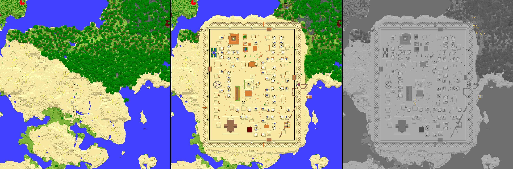

## Summary

| site | result |
|---|---|
| desert | 38 findings |

# KingdomQuest field test

Seed 20261117. Positions in details are relative to the heart (x, y, z).

## desert

minecraft:desert at -148, 64, 1632, facing COUNTERCLOCKWISE_90, relief 35, walkable out before founding: true, style arid, ground sand. Gate approach cost per side (* = used): south 44, west 28, north 59, east 5*.

| stage | ms | float built | float land | floating feet | buried | destroyed | doors unreached | walk out | breach | wet inside | wet moat | new cliffs | tall walls | pits | road gaps | road steps | wall gaps | cut trees | foreign ground | snow lost | road steep | stumps | road high | road bank | road moved |
|---|---|---|---|---|---|---|---|---|---|---|---|---|---|---|---|---|---|---|---|---|---|---|---|---|---|
Founded as flat castle: plateau at 0 (relative to the heart), site shaped in 449 ms.

| tent_1 | 584 | 0 | 0 | 0 | 0 | 0 | 0 | 1 | 0 | 0 | 0 | 5 | 0 | 4 | 0 | 0 | 0 | 0 | 0 | 0 | 0 | 1 | 0 | 0 | 0 |
Country road to -97, 64, 1752 (32 blocks of water on the way).

Lord's changes: broke 2 blocks before tent_2; repair leaves them.

Lord's changes after tent_2: unchanged spot kept broken, changed spot rebuilt by the new plan, 1 change(s) remembered.

| tent_2 | 452 | 0 | 0 | 0 | 0 | 1 | 0 | 1 | 0 | 0 | 0 | 13 | 0 | 5 | 0 | 0 | 0 | 0 | 0 | 0 | 0 | 1 | 0 | 0 | 0 |
| tent_3 | 399 | 0 | 0 | 0 | 0 | 0 | 0 | 1 | 0 | 0 | 0 | 13 | 0 | 5 | 0 | 0 | 0 | 0 | 0 | 0 | 0 | 1 | 0 | 0 | 0 |
| hamlet_1 | 630 | 0 | 0 | 0 | 0 | 0 | 0 | 1 | 0 | 0 | 0 | 17 | 0 | 8 | 0 | 0 | 0 | 0 | 0 | 0 | 0 | 1 | 0 | 0 | 0 |
| hamlet_2 | 349 | 0 | 0 | 0 | 0 | 0 | 0 | 1 | 0 | 0 | 0 | 21 | 0 | 9 | 0 | 0 | 0 | 0 | 0 | 0 | 0 | 1 | 0 | 82 | 0 |
| hamlet_3 | 365 | 0 | 0 | 0 | 0 | 0 | 0 | 1 | 0 | 0 | 0 | 17 | 0 | 8 | 0 | 0 | 0 | 0 | 0 | 0 | 0 | 0 | 0 | 1 | 0 |
| village_1 | 743 | 0 | 0 | 0 | 0 | 0 | 0 | 1 | 0 | 0 | 0 | 27 | 0 | 9 | 0 | 0 | 0 | 0 | 0 | 0 | 0 | 0 | 0 | 1 | 0 |
| town_1 | 498 | 0 | 0 | 0 | 0 | 0 | 0 | 1 | 0 | 0 | 0 | 96 | 0 | 15 | 0 | 0 | 0 | 0 | 0 | 0 | 0 | 0 | 0 | 0 | 0 |
| castle_1 | 1046 | 0 | 0 | 0 | 0 | 0 | 0 | 1 | 0 | 0 | 0 | 89 | 0 | 10 | 0 | 0 | 0 | 0 | 0 | 0 | 0 | 0 | 0 | 0 | 0 |
| castle_2 | 1174 | 0 | 0 | 0 | 0 | 6 | 0 | 1 | 0 | 0 | 0 | 83 | 0 | 7 | 0 | 0 | 0 | 0 | 0 | 0 | 0 | 0 | 0 | 0 | 0 |
| citadel_1 | 1335 | 0 | 0 | 0 | 0 | 6 | 0 | 1 | 0 | 0 | 0 | 83 | 0 | 7 | 0 | 0 | 0 | 0 | 0 | 0 | 0 | 0 | 0 | 0 | 0 |
| final | 0 | 0 | 0 | 0 | 0 | 6 | 0 | 1 | 0 | 0 | 0 | 83 | 0 | 7 | 0 | 0 | 0 | 0 | 0 | 0 | 0 | 0 | 0 | 0 | 0 |
Country road at the end: 119 of 151 cells near the castle intact, cut at [100, -1, 9, 99, -1, 9, 98, -1, 9, 97, -1, 9, 96, -1, 9].

Gate (land relative to the heart, before -> after) at 0/5/10/15/20/30/40 blocks out of the gate: 1->-2 1->-2 2->-2 2->-2 1->-2 -2->-2 -4->-2. Moat columns per side {back=2905, gate=3006, left=776, right=698}. Way-out road none.

Production: level 1 made 16102 items in a game day, 48327 in three (store 4320 stacks); level 5 with every milestone 141571 items of 240 kinds a day. Storehouse goods shown: 14 blocks; unloaded 15552 items into the chests.

Tram: 880 rails, stops [gate, west, north, east]
Signal fires: 20 on 13 towers, lit 20, put out 20; tower guard posts 20.

- tent_1: new cliffs 5 [(-20,2,4) to -3, (-15,2,-1) to -3, (-15,-1,7) to 3, (-14,2,-1) to -3, (-14,-1,3) to 3]
- tent_1: pits 4 [(-20,2,4) spike, (-17,1,4) spike, (-15,2,8) spike, (-14,2,4) spike]
- tent_1: stumps 1 [(61,10,-33) bamboo under vine]
- tent_2: destroyed 1 [main (0,1,5) acacia_log->air]
- tent_2: new cliffs 13 [(-20,2,4) to -3, (-20,2,4) to -3, (-20,-1,7) to 3, (-20,2,8) to -3, (-16,-1,8) to 3]
- tent_2: pits 5 [(-20,2,4) spike, (-20,2,8) spike, (-17,1,4) spike, (-15,2,8) spike, (-14,2,4) spike]
- tent_2: stumps 1 [(61,10,-33) bamboo under vine]
- tent_3: new cliffs 13 [(-20,2,4) to -3, (-20,2,4) to -3, (-20,-1,7) to 3, (-20,2,8) to -3, (-16,-1,8) to 3]
- tent_3: pits 5 [(-20,2,4) spike, (-20,2,8) spike, (-17,1,4) spike, (-15,2,8) spike, (-14,2,4) spike]
- tent_3: stumps 1 [(61,10,-33) bamboo under vine]
- hamlet_1: new cliffs 17 [(-31,13,41) to -12, (-30,1,41) to 12, (-28,-1,34) to 3, (-28,2,35) to -3, (-27,2,44) to -3]
- hamlet_1: pits 8 [(-28,2,35) spike, (-26,-3,33) hole, (-26,-3,37) hole, (-20,2,4) spike, (-20,2,8) spike]
- hamlet_1: stumps 1 [(61,10,-33) bamboo under vine]
- hamlet_2: new cliffs 21 [(-31,13,41) to -12, (-30,1,41) to 12, (-28,-1,34) to 3, (-28,2,35) to -3, (-27,2,44) to -3]
- hamlet_2: pits 9 [(-28,2,35) spike, (-26,-3,33) hole, (-26,-3,37) hole, (-20,2,4) spike, (-20,2,8) spike]
- hamlet_2: stumps 1 [(7,-4,68) sugar_cane under sandstone]
- hamlet_2: road bank 82 [(50,-1,91) over 2/2, (18,-1,65) over 3/3, (-46,-1,-65) over 4/4, (19,-1,65) over 3/3, (-45,-1,-65) over 4/4]
- hamlet_3: new cliffs 17 [(-31,13,41) to -12, (-30,1,41) to 12, (-28,-1,34) to 3, (-28,2,35) to -3, (-27,2,44) to -3]
- hamlet_3: pits 8 [(-28,2,35) spike, (-26,-3,33) hole, (-26,-3,37) hole, (-20,2,4) spike, (-20,2,8) spike]
- hamlet_3: road bank 1 [(88,-1,-3) over 2/3]
- village_1: new cliffs 27 [(-31,13,41) to -14, (-30,-1,41) to 14, (-28,-1,34) to 3, (-28,2,35) to -3, (-28,3,43) to -4]
- village_1: pits 9 [(-28,2,35) spike, (-28,4,45) spike, (-26,-3,33) hole, (-26,-3,37) hole, (-20,2,4) spike]
- village_1: road bank 1 [(88,-1,-3) over 2/3]
- town_1: new cliffs 96 [(-31,13,41) to -14, (-30,-1,41) to 14, (-28,-1,34) to 3, (-28,2,35) to -3, (-28,3,43) to -4]
- town_1: pits 15 [(-28,2,35) spike, (-28,4,45) spike, (-26,-3,33) hole, (-26,-3,37) hole, (-20,2,4) spike]
- castle_1: new cliffs 89 [(-31,13,41) to -14, (-30,-1,41) to 14, (-28,-1,34) to 3, (-28,2,35) to -3, (-28,3,43) to -4]
- castle_1: pits 10 [(-28,2,35) spike, (-28,4,45) spike, (-26,-3,37) hole, (-20,-4,71) hole, (-20,-4,75) hole]
- castle_2: destroyed 6 [tram (85,0,56) rail->air, tram (85,0,55) rail->air, tram (85,0,54) rail->air, tram (85,0,53) rail->air, tram (85,0,27) rail->air]
- castle_2: new cliffs 83 [(-31,13,41) to -14, (-30,-1,41) to 14, (-28,-1,34) to 3, (-28,2,35) to -3, (-28,3,43) to -4]
- castle_2: pits 7 [(-28,2,35) spike, (-28,4,45) spike, (-26,-3,37) hole, (103,10,-139) spike, (104,0,-130) hole]
- citadel_1: destroyed 6 [tram (85,0,56) rail->air, tram (85,0,55) rail->air, tram (85,0,54) rail->air, tram (85,0,53) rail->air, tram (85,0,27) rail->air]
- citadel_1: new cliffs 83 [(-31,13,41) to -14, (-30,-1,41) to 14, (-28,-1,34) to 3, (-28,2,35) to -3, (-28,3,43) to -4]
- citadel_1: pits 7 [(-28,2,35) spike, (-28,4,45) spike, (-26,-3,37) hole, (103,10,-139) spike, (104,0,-130) hole]
- final: destroyed 6 [tram (85,0,56) rail->air, tram (85,0,55) rail->air, tram (85,0,54) rail->air, tram (85,0,53) rail->air, tram (85,0,27) rail->air]
- final: new cliffs 83 [(-31,13,41) to -14, (-30,-1,41) to 14, (-28,-1,34) to 3, (-28,2,35) to -3, (-28,3,43) to -4]
- final: pits 7 [(-28,2,35) spike, (-28,4,45) spike, (-26,-3,37) hole, (103,10,-139) spike, (104,0,-130) hole]
- country road cut in 32 cells, e.g. [100, -1, 9, 99, -1, 9, 98, -1, 9, 97, -1, 9, 96, -1, 9]
- tram: rails missing at [85, 0, 26, 85, 0, 27, 85, 0, 53, 85, 0, 54]

