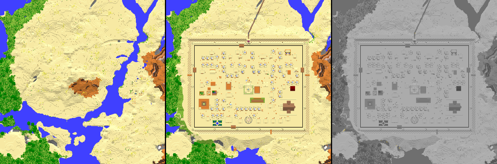

## Summary

| site | result |
|---|---|
| eroded_badlands | 16 findings |

# KingdomQuest field test

Seed 20261117. Positions in details are relative to the heart (x, y, z).

## eroded_badlands

minecraft:eroded_badlands at -2604, 90, 8396, facing CLOCKWISE_180, relief 62, walkable out before founding: true, style arid, ground sand. Gate approach cost per side (* = used): south 453, west 263, north 77*, east 372.

| stage | ms | float built | float land | floating feet | buried | destroyed | doors unreached | walk out | breach | wet inside | wet moat | new cliffs | tall walls | pits | road gaps | road steps | wall gaps | cut trees | foreign ground | snow lost | road steep | stumps | road high | road bank | road moved |
|---|---|---|---|---|---|---|---|---|---|---|---|---|---|---|---|---|---|---|---|---|---|---|---|---|---|
Founded as flat castle: plateau at 0 (relative to the heart), site shaped in 703 ms.

| tent_1 | 508 | 0 | 0 | 0 | 0 | 0 | 0 | 1 | 0 | 0 | 0 | 6 | 0 | 0 | 0 | 0 | 0 | 0 | 0 | 0 | 0 | 0 | 0 | 0 | 0 |
Country road to -2554, 64, 8175 (18 blocks of water on the way).

Lord's changes: broke 2 blocks before tent_2; repair leaves them.

Lord's changes after tent_2: unchanged spot kept broken, changed spot rebuilt by the new plan, 1 change(s) remembered.

| tent_2 | 377 | 0 | 0 | 0 | 0 | 1 | 0 | 1 | 0 | 0 | 0 | 7 | 0 | 0 | 0 | 0 | 0 | 0 | 0 | 0 | 0 | 0 | 0 | 0 | 0 |
| tent_3 | 300 | 0 | 0 | 0 | 0 | 0 | 0 | 1 | 0 | 0 | 0 | 7 | 0 | 0 | 0 | 0 | 0 | 0 | 0 | 0 | 0 | 0 | 0 | 0 | 0 |
| hamlet_1 | 658 | 0 | 0 | 0 | 0 | 0 | 0 | 1 | 0 | 0 | 0 | 7 | 0 | 0 | 0 | 0 | 0 | 0 | 0 | 0 | 0 | 0 | 0 | 0 | 0 |
| hamlet_2 | 367 | 2 | 0 | 0 | 0 | 0 | 0 | 1 | 0 | 0 | 0 | 10 | 0 | 2 | 0 | 0 | 0 | 0 | 0 | 0 | 0 | 0 | 0 | 236 | 0 |
| hamlet_3 | 477 | 0 | 0 | 0 | 0 | 0 | 0 | 1 | 0 | 0 | 0 | 9 | 0 | 0 | 0 | 0 | 0 | 0 | 0 | 0 | 0 | 0 | 0 | 0 | 0 |
| village_1 | 1092 | 0 | 0 | 0 | 0 | 0 | 0 | 1 | 0 | 0 | 0 | 33 | 0 | 0 | 0 | 0 | 0 | 0 | 0 | 0 | 0 | 0 | 0 | 0 | 0 |
| town_1 | 578 | 0 | 0 | 0 | 0 | 0 | 0 | 1 | 0 | 0 | 0 | 26 | 0 | 0 | 0 | 0 | 0 | 0 | 0 | 0 | 0 | 0 | 0 | 0 | 0 |
| castle_1 | 1284 | 0 | 0 | 0 | 0 | 0 | 0 | 1 | 0 | 0 | 0 | 26 | 0 | 0 | 0 | 0 | 0 | 0 | 0 | 0 | 0 | 0 | 0 | 0 | 0 |
| castle_2 | 1533 | 0 | 0 | 0 | 0 | 0 | 0 | 1 | 0 | 0 | 0 | 31 | 0 | 0 | 0 | 0 | 0 | 0 | 0 | 0 | 0 | 0 | 0 | 0 | 0 |
| citadel_1 | 1503 | 0 | 0 | 0 | 0 | 0 | 0 | 1 | 0 | 0 | 0 | 31 | 0 | 0 | 0 | 0 | 0 | 0 | 0 | 0 | 0 | 0 | 0 | 0 | 0 |
| final | 0 | 0 | 0 | 0 | 0 | 0 | 0 | 1 | 0 | 0 | 0 | 31 | 0 | 0 | 0 | 0 | 0 | 0 | 0 | 0 | 0 | 0 | 0 | 0 | 0 |
Country road at the end: 10 of 10 cells near the castle intact.

Gate (land relative to the heart, before -> after) at 0/5/10/15/20/30/40 blocks out of the gate: 0->-2 0->-2 0->-2 0->-2 0->-2 -1->-2 3->-2. Moat columns per side {back=2826, gate=2920, left=746, right=758}. Way-out road none.

Production: level 1 made 16102 items in a game day, 48327 in three (store 4320 stacks); level 5 with every milestone 141571 items of 240 kinds a day. Storehouse goods shown: 14 blocks; unloaded 15552 items into the chests.

Tram: 880 rails, stops [gate, west, north, east]
Signal fires: 20 on 13 towers, lit 20, put out 20; tower guard posts 20.

- tent_1: new cliffs 6 [(-24,19,-36) to -18, (173,-1,149) to -47, (173,-1,150) to -47, (173,-1,150) to -47, (174,-1,148) to -47]
- tent_2: destroyed 1 [main (5,1,0) acacia_log->air]
- tent_2: new cliffs 7 [(1,-4,-114) to 3, (1,-4,-113) to 3, (173,-1,149) to -47, (173,-1,150) to -47, (173,-1,150) to -47]
- tent_3: new cliffs 7 [(1,-4,-114) to 3, (1,-4,-113) to 3, (173,-1,149) to -47, (173,-1,150) to -47, (173,-1,150) to -47]
- hamlet_1: new cliffs 7 [(1,-4,-114) to 3, (1,-4,-113) to 3, (173,-1,149) to -47, (173,-1,150) to -47, (173,-1,150) to -47]
- hamlet_2: float built 2 [lamps (-68,0,66) acacia_fence, lamps (-68,1,66) torch]
- hamlet_2: new cliffs 10 [(1,-4,-114) to 3, (1,-4,-113) to 3, (111,-10,3) to -4, (112,-10,3) to -4, (116,-11,1) to -3]
- hamlet_2: pits 2 [(-148,-39,24) hole, (117,-14,1) hole]
- hamlet_2: road bank 236 [(67,-1,-7) over 9/10, (99,-1,-47) over 4/4, (67,-1,-48) over 9/8, (67,-1,-58) over 6/6, (99,-1,-46) over 4/4]
- hamlet_3: new cliffs 9 [(1,-4,-114) to 3, (1,-4,-113) to 3, (111,-10,3) to -4, (112,-10,3) to -4, (173,-1,149) to -47]
- village_1: new cliffs 33 [(-35,-16,150) to 4, (-35,-16,151) to 4, (-35,-16,152) to 4, (-35,-16,153) to 4, (-35,-16,154) to 4]
- town_1: new cliffs 26 [(-165,-16,115) to -10, (-165,-16,115) to -9, (-164,-16,113) to -8, (-164,-16,114) to -9, (-164,-16,114) to -10]
- castle_1: new cliffs 26 [(-165,-16,115) to -10, (-165,-16,115) to -9, (-164,-16,113) to -8, (-164,-16,114) to -9, (-164,-16,114) to -10]
- castle_2: new cliffs 31 [(-189,-9,-32) to 5, (-189,-4,-31) to -5, (-189,-3,-30) to -6, (-189,-4,-29) to -6, (-189,-4,-29) to -6]
- citadel_1: new cliffs 31 [(-189,-9,-32) to 5, (-189,-4,-31) to -5, (-189,-3,-30) to -6, (-189,-4,-29) to -6, (-189,-4,-29) to -6]
- final: new cliffs 31 [(-189,-9,-32) to 5, (-189,-4,-31) to -5, (-189,-3,-30) to -6, (-189,-4,-29) to -6, (-189,-4,-29) to -6]

