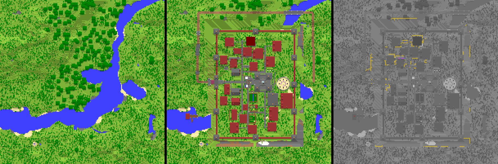

## Summary

| site | result |
|---|---|
| flower_forest | 57 findings |

# KingdomQuest field test

Seed 1813296525. Positions in details are relative to the heart (x, y, z).

## flower_forest

minecraft:flower_forest at 7300, 63, 828, facing CLOCKWISE_90, relief 35, walkable out before founding: false, style temperate, ground grass_block. Gate approach cost per side (* = used): south 24, west 15*, north 94, east 22.

| stage | ms | float built | float land | floating feet | buried | destroyed | doors unreached | walk out | breach | wet inside | wet moat | new cliffs | tall walls | pits | road gaps | road steps | wall gaps | cut trees | foreign ground | snow lost | road steep | stumps | road high | road bank | road moved |
|---|---|---|---|---|---|---|---|---|---|---|---|---|---|---|---|---|---|---|---|---|---|---|---|---|---|
| tent_1 | 408 | 0 | 0 | 0 | 0 | 0 | 0 | 1 | 0 | 0 | 0 | 5 | 0 | 1 | 0 | 0 | 0 | 0 | 0 | 0 | 0 | 0 | 0 | 0 | 0 |
Country road to 7379, 66, 828 (40 blocks of water on the way).

Lord's changes: broke 2 blocks before tent_2; repair leaves them.

Lord's changes after tent_2: unchanged spot kept broken, changed spot rebuilt by the new plan, 1 change(s) remembered.

| tent_2 | 275 | 0 | 0 | 0 | 0 | 1 | 0 | 1 | 0 | 0 | 0 | 19 | 0 | 1 | 0 | 0 | 0 | 0 | 0 | 0 | 0 | 0 | 0 | 0 | 0 |
| tent_3 | 239 | 0 | 0 | 0 | 0 | 0 | 0 | 1 | 0 | 0 | 0 | 19 | 0 | 1 | 0 | 0 | 0 | 0 | 0 | 0 | 0 | 0 | 0 | 0 | 0 |
| hamlet_1 | 660 | 0 | 0 | 0 | 0 | 2 | 0 | 1 | 0 | 0 | 0 | 48 | 0 | 1 | 0 | 0 | 0 | 0 | 0 | 0 | 0 | 0 | 0 | 0 | 0 |
| hamlet_2 | 244 | 1 | 0 | 0 | 0 | 0 | 0 | 1 | 0 | 0 | 0 | 105 | 0 | 1 | 0 | 0 | 0 | 0 | 0 | 0 | 0 | 0 | 1 | 0 | 0 |
| hamlet_3 | 255 | 1 | 0 | 0 | 0 | 11 | 0 | 1 | 0 | 0 | 0 | 134 | 0 | 1 | 0 | 0 | 0 | 0 | 0 | 0 | 2 | 0 | 0 | 0 | 0 |
| village_1 | 249 | 1 | 0 | 0 | 0 | 11 | 0 | 1 | 0 | 0 | 0 | 134 | 0 | 1 | 0 | 0 | 0 | 0 | 0 | 0 | 2 | 0 | 0 | 0 | 0 |
| town_1 | 295 | 1 | 0 | 0 | 0 | 9 | 0 | 1 | 0 | 0 | 0 | 171 | 0 | 0 | 0 | 0 | 42 | 0 | 0 | 0 | 4 | 0 | 0 | 0 | 0 |
| castle_1 | 618 | 1 | 0 | 0 | 0 | 5 | 0 | 1 | 0 | 0 | 0 | 313 | 4 | 0 | 0 | 0 | 0 | 0 | 0 | 0 | 11 | 0 | 5 | 0 | 0 |
| castle_2 | 393 | 1 | 0 | 0 | 0 | 3 | 0 | 1 | 0 | 0 | 0 | 347 | 2 | 1 | 0 | 0 | 0 | 0 | 0 | 0 | 11 | 0 | 5 | 0 | 0 |
| citadel_1 | 395 | 1 | 0 | 0 | 0 | 3 | 0 | 1 | 0 | 0 | 0 | 343 | 10 | 1 | 0 | 0 | 0 | 0 | 0 | 0 | 11 | 0 | 5 | 0 | 0 |
| final | 0 | 1 | 0 | 0 | 0 | 3 | 0 | 1 | 0 | 0 | 0 | 324 | 10 | 1 | 0 | 0 | 0 | 0 | 0 | 0 | 11 | 0 | 5 | 0 | 0 |
Country road at the end: 299 of 299 cells near the castle intact.

Gate (land relative to the heart, before -> after) at 0/5/10/15/20/30/40 blocks out of the gate: 3->-2 2->-7 2->-2 2->2 2->2 3->3 3->3. Moat columns per side {gate=670}. Way-out road none.

- tent_1: new cliffs 5 [(5,-1,32) to -4, (6,-1,31) to -4, (6,-5,32) to 4, (6,-5,32) to 4, (30,-1,61) to 3]
- tent_1: pits 1 [(6,-5,32) hole]
- tent_2: destroyed 1 [main (8,0,-2) white_wool->air]
- tent_2: new cliffs 19 [(-52,15,-14) to -3, (-52,14,-13) to -3, (-52,13,-12) to -3, (-52,12,-11) to -3, (-51,16,-15) to -4]
- tent_2: pits 1 [(6,-5,32) hole]
- tent_3: new cliffs 19 [(-52,15,-14) to -3, (-52,14,-13) to -3, (-52,13,-12) to -3, (-52,12,-11) to -3, (-51,16,-15) to -4]
- tent_3: pits 1 [(6,-5,32) hole]
- hamlet_1: destroyed 2 [main (8,0,4) rose_bush->air, main (8,1,4) rose_bush->air]
- hamlet_1: new cliffs 48 [(-52,15,-14) to -3, (-52,14,-13) to -3, (-52,13,-12) to -3, (-52,12,-11) to -3, (-51,16,-15) to -4]
- hamlet_1: pits 1 [(6,-4,32) hole]
- hamlet_2: float built 1 [dock (-70,2,42) lantern]
- hamlet_2: new cliffs 105 [(-54,15,-15) to -3, (-53,15,-15) to -3, (-52,16,-15) to -4, (-51,16,-15) to -4, (-51,0,-2) to 3]
- hamlet_2: pits 1 [(-16,1,70) hole]
- hamlet_2: road high 1 [(0,3,-19) above smith step (1,2,-19)]
- hamlet_3: float built 1 [dock (-70,2,42) lantern]
- hamlet_3: destroyed 11 [tavern (35,1,17) vine->air, tavern (35,1,18) vine->air, tavern (35,1,22) vine->air, tavern (35,1,26) vine->air, tavern (35,2,17) vine->air]
- hamlet_3: new cliffs 134 [(-55,15,-15) to -3, (-54,16,-16) to -4, (-53,16,-16) to -4, (-52,16,-16) to -4, (-51,16,-16) to -4]
- hamlet_3: pits 1 [(-16,1,70) hole]
- hamlet_3: road steep 2 [(-13,14,-49) to -3 in 3, (-12,13,-49) to -3 in 3]
- village_1: float built 1 [dock (-75,2,42) lantern]
- village_1: destroyed 11 [tavern (35,1,17) vine->air, tavern (35,1,18) vine->air, tavern (35,1,22) vine->air, tavern (35,1,26) vine->air, tavern (35,2,17) vine->air]
- village_1: new cliffs 134 [(-55,15,-15) to -3, (-54,16,-16) to -4, (-53,16,-16) to -4, (-52,16,-16) to -4, (-51,16,-16) to -4]
- village_1: pits 1 [(-16,1,70) hole]
- village_1: road steep 2 [(-13,14,-49) to -3 in 3, (-12,13,-49) to -3 in 3]
- town_1: float built 1 [dock (-75,2,42) lantern]
- town_1: destroyed 9 [walls (-40,3,-8) coarse_dirt->oak_log, walls (-40,2,-7) coarse_dirt->oak_log, walls (-40,2,7) coarse_dirt->oak_log, walls (-40,2,8) coarse_dirt->oak_log, tavern (35,1,17) vine->air]
- town_1: new cliffs 171 [(-55,22,-26) to -3, (-55,22,-25) to -4, (-55,22,-24) to -5, (-55,21,-23) to -5, (-55,21,-22) to -8]
- town_1: wall gaps 42 [(-18,3,69) over air, (-17,3,69) over air, (54,4,-61) over air, (54,4,-65) over air, (54,11,67) over short_grass]
- town_1: road steep 4 [(-14,15,-49) to -3 in 3, (-13,14,-49) to -3 in 3, (-12,13,-49) to -3 in 3, (-8,0,-19) to 3 in 3]
- castle_1: float built 1 [dock (-75,2,42) lantern]
- castle_1: destroyed 5 [tavern (35,1,17) vine->air, tavern (35,1,18) vine->air, tavern (35,2,17) vine->air, tavern (35,2,18) vine->air, tavern (24,3,19) dark_oak_hanging_sign->air]
- castle_1: new cliffs 313 [(-61,13,-14) to -5, (-60,14,-15) to -6, (-59,14,-15) to -6, (-58,14,-15) to -6, (-58,14,-15) to -7]
- castle_1: tall walls 4 [(-35,13,-21) -9 cap unowned low unowned:dirt, (-34,13,-21) -9 cap unowned low unowned:andesite, (-25,4,-30) 10 cap unowned low unowned:stone_bricks, (-25,4,-30) 10 cap unowned low unowned:stone_bricks]
- castle_1: road steep 11 [(-19,13,-29) to -3 in 3, (-18,12,-29) to -3 in 3, (-17,11,-29) to -3 in 3, (-16,10,-29) to -3 in 3, (-15,9,-29) to -3 in 3]
- castle_1: road high 5 [(-21,14,-29) above brewery step (-21,10,-28), (-20,13,-29) above brewery step (-20,12,-28), (-17,11,-29) above brewery step (-17,10,-28), (-16,10,-29) above brewery step (-16,9,-28), (-15,9,-29) above brewery step (-15,8,-28)]
- castle_2: float built 1 [dock (-75,2,42) lantern]
- castle_2: destroyed 3 [tavern (35,1,17) vine->air, tavern (35,1,18) vine->air, tavern (35,2,17) vine->air]
- castle_2: new cliffs 347 [(-61,13,-14) to -5, (-60,14,-15) to -6, (-59,14,-15) to -6, (-58,14,-15) to -6, (-58,14,-15) to -7]
- castle_2: tall walls 2 [(-34,13,-21) -9 cap unowned low unowned:andesite, (-25,4,-30) 10 cap unowned low unowned:stone_bricks]
- castle_2: pits 1 [(-25,7,-24) spike]
- castle_2: road steep 11 [(-19,13,-29) to -3 in 3, (-18,12,-29) to -3 in 3, (-17,11,-29) to -3 in 3, (-16,10,-29) to -3 in 3, (-15,9,-29) to -3 in 3]
- castle_2: road high 5 [(-21,14,-29) above brewery step (-21,10,-28), (-20,13,-29) above brewery step (-20,12,-28), (-17,11,-29) above brewery step (-17,10,-28), (-16,10,-29) above brewery step (-16,9,-28), (-15,9,-29) above brewery step (-15,8,-28)]
- citadel_1: float built 1 [dock (-75,2,42) lantern]
- citadel_1: destroyed 3 [tavern (35,1,17) vine->air, tavern (35,1,18) vine->air, tavern (35,2,17) vine->air]
- citadel_1: new cliffs 343 [(-61,13,-14) to -5, (-60,14,-15) to -6, (-59,14,-15) to -6, (-58,14,-15) to -6, (-58,14,-15) to -7]
- citadel_1: tall walls 10 [(-34,13,-21) -9 cap unowned low unowned:andesite, (-25,4,-30) 10 cap unowned low unowned:stone_bricks, (5,11,-44) -8 cap unowned low unowned:stone, (6,11,-44) -8 cap unowned low unowned:andesite, (7,11,-44) -8 cap unowned low unowned:stone]
- citadel_1: pits 1 [(-25,7,-24) spike]
- citadel_1: road steep 11 [(-19,13,-29) to -3 in 3, (-18,12,-29) to -3 in 3, (-17,11,-29) to -3 in 3, (-16,10,-29) to -3 in 3, (-15,9,-29) to -3 in 3]
- citadel_1: road high 5 [(-21,14,-29) above brewery step (-21,10,-28), (-20,13,-29) above brewery step (-20,12,-28), (-17,11,-29) above brewery step (-17,10,-28), (-16,10,-29) above brewery step (-16,9,-28), (-15,9,-29) above brewery step (-15,8,-28)]
- final: tall by [{unowned/unowned=10}]
- final: float built 1 [dock (-75,2,42) lantern]
- final: destroyed 3 [tavern (35,1,17) vine->air, tavern (35,1,18) vine->air, tavern (35,2,17) vine->air]
- final: new cliffs 324 [(-61,13,-14) to -5, (-60,14,-15) to -6, (-59,14,-15) to -6, (-58,14,-15) to -6, (-58,14,-15) to -7]
- final: tall walls 10 [(-34,13,-21) -9 cap unowned low unowned:andesite, (-25,4,-30) 10 cap unowned low unowned:stone_bricks, (5,11,-44) -8 cap unowned low unowned:stone, (6,11,-44) -8 cap unowned low unowned:andesite, (7,11,-44) -8 cap unowned low unowned:stone]
- final: pits 1 [(-25,7,-24) spike]
- final: road steep 11 [(-19,13,-29) to -3 in 3, (-18,12,-29) to -3 in 3, (-17,11,-29) to -3 in 3, (-16,10,-29) to -3 in 3, (-15,9,-29) to -3 in 3]
- final: road high 5 [(-21,14,-29) above brewery step (-21,10,-28), (-20,13,-29) above brewery step (-20,12,-28), (-17,11,-29) above brewery step (-17,10,-28), (-16,10,-29) above brewery step (-16,9,-28), (-15,9,-29) above brewery step (-15,8,-28)]

