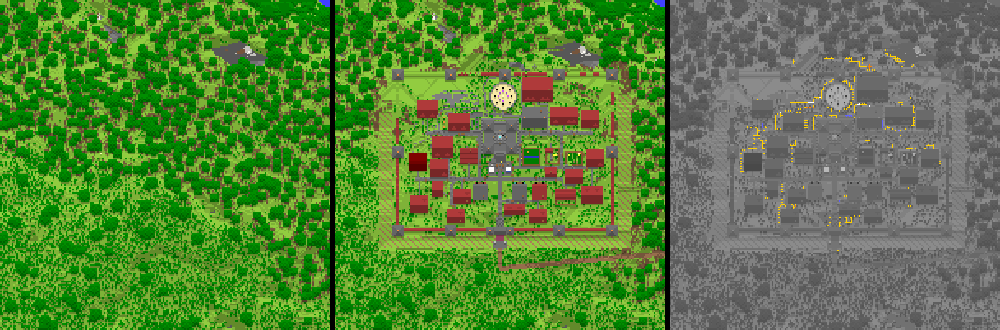

## Summary

| site | result |
|---|---|
| forest | 59 findings |

# KingdomQuest field test

Seed 1813296525. Positions in details are relative to the heart (x, y, z).

## forest

minecraft:forest at -3388, 112, -2676, facing NONE, relief 43, walkable out before founding: true, style temperate, ground grass_block. Gate approach cost per side (* = used): south 20*, west 85, north 118, east 22.

| stage | ms | float built | float land | floating feet | buried | destroyed | doors unreached | walk out | breach | wet inside | wet moat | new cliffs | tall walls | pits | road gaps | road steps | wall gaps | cut trees | foreign ground | snow lost | road steep | stumps | road high | road bank | road moved |
|---|---|---|---|---|---|---|---|---|---|---|---|---|---|---|---|---|---|---|---|---|---|---|---|---|---|
| tent_1 | 584 | 0 | 0 | 0 | 0 | 0 | 0 | 1 | 0 | 0 | 0 | 13 | 0 | 2 | 0 | 0 | 0 | 0 | 0 | 0 | 0 | 0 | 0 | 0 | 0 |
Country road to -3258, 94, -2625 (0 blocks of water on the way).

Lord's changes: broke 2 blocks before tent_2; repair leaves them.

Lord's changes after tent_2: unchanged spot kept broken, changed spot rebuilt by the new plan, 1 change(s) remembered.

| tent_2 | 210 | 0 | 0 | 0 | 0 | 1 | 0 | 1 | 0 | 0 | 0 | 20 | 0 | 2 | 0 | 0 | 0 | 0 | 0 | 0 | 0 | 0 | 0 | 0 | 0 |
| tent_3 | 309 | 0 | 0 | 0 | 0 | 0 | 0 | 1 | 0 | 0 | 0 | 29 | 0 | 3 | 0 | 0 | 0 | 0 | 0 | 0 | 0 | 0 | 0 | 0 | 0 |
| hamlet_1 | 626 | 0 | 0 | 0 | 0 | 2 | 0 | 1 | 0 | 0 | 0 | 310 | 1 | 7 | 0 | 0 | 0 | 0 | 0 | 0 | 0 | 0 | 0 | 0 | 0 |
| hamlet_2 | 421 | 0 | 0 | 0 | 0 | 0 | 0 | 1 | 0 | 0 | 0 | 141 | 0 | 11 | 0 | 0 | 0 | 0 | 0 | 0 | 0 | 0 | 0 | 1 | 0 |
| hamlet_3 | 296 | 0 | 0 | 0 | 0 | 11 | 0 | 1 | 0 | 0 | 0 | 218 | 0 | 11 | 0 | 0 | 0 | 0 | 0 | 0 | 3 | 0 | 0 | 0 | 0 |
| village_1 | 290 | 0 | 0 | 0 | 0 | 11 | 0 | 1 | 0 | 0 | 0 | 238 | 0 | 9 | 0 | 0 | 0 | 0 | 0 | 0 | 7 | 0 | 0 | 0 | 0 |
| town_1 | 565 | 0 | 0 | 0 | 0 | 9 | 0 | 1 | 0 | 0 | 0 | 281 | 14 | 4 | 0 | 1 | 14 | 0 | 0 | 0 | 10 | 0 | 0 | 4 | 0 |
| castle_1 | 442 | 0 | 0 | 0 | 0 | 5 | 0 | 1 | 0 | 0 | 0 | 305 | 3 | 8 | 0 | 1 | 0 | 0 | 0 | 0 | 10 | 0 | 0 | 4 | 0 |
| castle_2 | 518 | 0 | 0 | 0 | 0 | 3 | 0 | 1 | 0 | 0 | 0 | 281 | 16 | 6 | 0 | 1 | 0 | 0 | 0 | 0 | 10 | 0 | 0 | 4 | 0 |
| citadel_1 | 435 | 0 | 0 | 0 | 0 | 3 | 0 | 1 | 0 | 0 | 0 | 309 | 16 | 5 | 0 | 1 | 0 | 0 | 0 | 0 | 10 | 0 | 0 | 4 | 0 |
| final | 0 | 0 | 0 | 0 | 0 | 3 | 0 | 1 | 0 | 0 | 0 | 444 | 12 | 10 | 0 | 1 | 0 | 0 | 0 | 0 | 14 | 0 | 0 | 4 | 0 |
Country road at the end: 121 of 121 cells near the castle intact.

Gate (land relative to the heart, before -> after) at 0/5/10/15/20/30/40 blocks out of the gate: 7->-2 7->-7 4->-2 -1->-1 -2->-2 -2->-2 -3->-3. Moat columns per side {gate=1220, left=600, right=672}. Way-out road none.

- tent_1: new cliffs 13 [(-5,-10,-19) to 3, (-2,4,13) to -3, (-2,5,14) to -4, (-2,6,15) to -5, (-1,1,15) to 4]
- tent_1: pits 2 [(-5,-10,-19) hole, (9,-6,-12) hole]
- tent_2: destroyed 1 [main (-5,1,0) spruce_log->air]
- tent_2: new cliffs 20 [(-9,-12,-21) to 3, (-8,-12,-21) to 3, (-6,-7,-19) to -3, (-5,-10,-19) to 3, (-5,-10,-19) to 4]
- tent_2: pits 2 [(-5,-10,-19) hole, (2,-8,-18) hole]
- tent_3: new cliffs 29 [(-9,-9,-21) to -3, (-8,-12,-21) to 4, (-6,-7,-19) to -3, (-5,-10,-19) to 3, (-5,-10,-19) to 4]
- tent_3: pits 3 [(-8,-12,-21) hole, (-5,-10,-19) hole, (2,-8,-18) hole]
- hamlet_1: destroyed 2 [main (4,0,-8) rose_bush->air, main (4,1,-8) rose_bush->air]
- hamlet_1: new cliffs 310 [(-31,-16,-28) to 3, (-30,-16,-30) to 3, (-30,-16,-29) to 3, (-30,-16,-29) to 3, (-30,-13,-28) to 3]
- hamlet_1: tall walls 1 [(9,-9,-33) 8 cap unowned low unowned:stone]
- hamlet_1: pits 7 [(-24,-10,-13) hole, (-14,-16,-41) hole, (-11,-15,-41) hole, (-6,-13,-38) hole, (9,-9,-33) hole]
- hamlet_2: new cliffs 141 [(-55,-15,-2) to 3, (-51,-15,-4) to 3, (-50,-14,-4) to 3, (-49,-15,-6) to 3, (-49,-14,-4) to 3]
- hamlet_2: pits 11 [(-32,-12,-16) hole, (-32,-10,-13) hole, (-30,-14,-20) hole, (-6,-13,-38) hole, (1,-10,-38) hole]
- hamlet_2: road bank 1 [(-31,0,8) over 2/2]
- hamlet_3: destroyed 11 [tavern (17,1,-35) vine->air, tavern (18,1,-35) vine->air, tavern (22,1,-35) vine->air, tavern (26,1,-35) vine->air, tavern (17,2,-35) vine->air]
- hamlet_3: new cliffs 218 [(-55,-15,-2) to 3, (-55,3,42) to 3, (-54,4,43) to 4, (-53,4,43) to 4, (-52,-15,-5) to 3]
- hamlet_3: pits 11 [(-32,-12,-16) hole, (-32,-10,-13) hole, (-30,-14,-20) hole, (-6,-13,-38) hole, (1,-10,-38) hole]
- hamlet_3: road steep 3 [(2,0,22) to 3 in 3, (3,1,22) to 3 in 3, (1,-1,22) to 3 in 3]
- village_1: destroyed 11 [tavern (17,1,-35) vine->air, tavern (18,1,-35) vine->air, tavern (22,1,-35) vine->air, tavern (26,1,-35) vine->air, tavern (17,2,-35) vine->air]
- village_1: new cliffs 238 [(-55,-15,-2) to 3, (-55,3,42) to 3, (-54,4,43) to 4, (-53,4,43) to 4, (-52,-15,-5) to 3]
- village_1: pits 9 [(-32,-12,-16) hole, (-32,-10,-13) hole, (-30,-14,-20) hole, (-6,-13,-38) hole, (1,-10,-38) hole]
- village_1: road steep 7 [(29,-7,-26) to 3 in 3, (29,-6,-25) to 3 in 3, (29,-8,-27) to 3 in 3, (29,-5,-24) to 3 in 3, (2,0,22) to 3 in 3]
- town_1: destroyed 9 [walls (-8,3,40) coarse_dirt->oak_log, walls (-7,2,40) coarse_dirt->oak_log, walls (7,2,40) coarse_dirt->oak_log, walls (8,3,40) coarse_dirt->oak_log, tavern (17,1,-35) vine->air]
- town_1: new cliffs 281 [(-57,-14,-14) to -3, (-56,-15,-17) to 3, (-56,-14,-15) to -3, (-56,-17,-14) to 5, (-56,-17,-14) to 3]
- town_1: tall walls 14 [(-28,-5,-16) -7 cap unowned low unowned:andesite, (-25,-11,-22) 7 cap unowned low unowned:stone, (-24,-11,-22) 7 cap unowned low unowned:stone, (-23,-11,-22) 7 cap unowned low unowned:stone, (-22,-11,-22) 8 cap unowned low unowned:andesite]
- town_1: pits 4 [(-56,-17,-14) hole, (-6,-13,-38) hole, (1,-10,-38) hole, (21,-15,-60) hole]
- town_1: road steps 1 [(39,-6,-21) to 2]
- town_1: wall gaps 14 [(-65,-26,-58) over air, (-65,3,38) over air, (-4,2,42) over air, (-4,2,38) over air, (-62,3,39) over air]
- town_1: road steep 10 [(29,-7,-26) to 3 in 3, (29,-6,-25) to 3 in 3, (29,-8,-27) to 3 in 3, (29,-5,-24) to 3 in 3, (29,-4,-23) to 3 in 3]
- town_1: road bank 4 [(-44,-12,-22) over 3/4, (-44,-11,-21) over 4/4, (-44,-14,-24) over 2/2, (-44,-13,-23) over 3/3]
- castle_1: destroyed 5 [tavern (17,1,-35) vine->air, tavern (18,1,-35) vine->air, tavern (17,2,-35) vine->air, tavern (18,2,-35) vine->air, tavern (19,3,-24) dark_oak_hanging_sign->air]
- castle_1: new cliffs 305 [(-74,5,27) to -3, (-74,8,48) to -3, (-74,8,49) to -3, (-57,-14,-14) to -3, (-56,-14,-15) to -3]
- castle_1: tall walls 3 [(-12,-16,-41) 8 cap unowned low unowned:stone, (-11,-16,-41) 8 cap unowned low unowned:stone, (-10,-16,-41) 8 cap unowned low unowned:stone]
- castle_1: pits 8 [(-56,-17,-14) hole, (-55,-13,-17) spike, (-54,-17,-17) hole, (-33,-16,-32) hole, (-29,-16,-33) hole]
- castle_1: road steps 1 [(39,-6,-21) to 2]
- castle_1: road steep 10 [(29,-7,-26) to 3 in 3, (29,-6,-25) to 3 in 3, (29,-8,-27) to 3 in 3, (29,-5,-24) to 3 in 3, (29,-4,-23) to 3 in 3]
- castle_1: road bank 4 [(-44,-12,-22) over 3/4, (-44,-11,-21) over 4/4, (-44,-14,-24) over 2/2, (-44,-13,-23) over 3/3]
- castle_2: destroyed 3 [tavern (17,1,-35) vine->air, tavern (18,1,-35) vine->air, tavern (17,2,-35) vine->air]
- castle_2: new cliffs 281 [(-57,-12,-8) to 6, (-57,-12,-7) to 6, (-57,-11,-6) to 5, (-57,-10,-5) to 4, (-57,-10,-4) to 4]
- castle_2: tall walls 16 [(-33,-14,-32) 9 cap unowned low unowned:stone, (-33,-14,-31) 9 cap unowned low unowned:stone, (-32,-12,-33) 7 cap unowned low unowned:stone, (-29,-15,-33) 10 cap unowned low unowned:stone, (-16,-13,-38) 8 cap unowned low unowned:stone]
- castle_2: pits 6 [(-29,-15,-33) hole, (-24,5,25) spike, (-6,-13,-38) hole, (1,-10,-38) hole, (36,-8,-64) spike]
- castle_2: road steps 1 [(39,-6,-21) to 2]
- castle_2: road steep 10 [(29,-7,-26) to 3 in 3, (29,-6,-25) to 3 in 3, (29,-8,-27) to 3 in 3, (29,-5,-24) to 3 in 3, (29,-4,-23) to 3 in 3]
- castle_2: road bank 4 [(-44,-12,-22) over 3/4, (-44,-11,-21) over 4/4, (-44,-14,-24) over 2/2, (-44,-13,-23) over 3/3]
- citadel_1: destroyed 3 [tavern (17,1,-35) vine->air, tavern (18,1,-35) vine->air, tavern (17,2,-35) vine->air]
- citadel_1: new cliffs 309 [(-57,-12,-8) to 6, (-57,-12,-7) to 6, (-57,-11,-6) to 5, (-57,-10,-5) to 4, (-57,-10,-4) to 4]
- citadel_1: tall walls 16 [(-33,-14,-32) 9 cap unowned low unowned:stone, (-33,-14,-31) 9 cap unowned low unowned:stone, (-32,-12,-33) 7 cap unowned low unowned:stone, (-29,-15,-33) 10 cap unowned low unowned:stone, (-16,-13,-38) 8 cap unowned low unowned:stone]
- citadel_1: pits 5 [(-29,-15,-33) hole, (-24,5,25) spike, (-6,-13,-38) hole, (1,-10,-38) hole, (36,-8,-64) spike]
- citadel_1: road steps 1 [(39,-6,-21) to 2]
- citadel_1: road steep 10 [(29,-7,-26) to 3 in 3, (29,-6,-25) to 3 in 3, (29,-8,-27) to 3 in 3, (29,-5,-24) to 3 in 3, (29,-4,-23) to 3 in 3]
- citadel_1: road bank 4 [(-44,-12,-22) over 3/4, (-44,-11,-21) over 4/4, (-44,-14,-24) over 2/2, (-44,-13,-23) over 3/3]
- final: tall by [{unowned/unowned=12}]
- final: destroyed 3 [tavern (17,1,-35) vine->air, tavern (18,1,-35) vine->air, tavern (17,2,-35) vine->air]
- final: new cliffs 444 [(-57,-12,-8) to 6, (-57,-12,-7) to 6, (-57,-11,-6) to 5, (-57,-10,-5) to 4, (-57,-10,-4) to 4]
- final: tall walls 12 [(-33,-14,-32) 9 cap unowned low unowned:stone, (-33,-14,-31) 9 cap unowned low unowned:stone, (-32,-12,-33) 7 cap unowned low unowned:stone, (-29,-15,-33) 10 cap unowned low unowned:stone, (-16,-13,-38) 8 cap unowned low unowned:stone]
- final: pits 10 [(-29,-15,-33) hole, (-24,5,25) spike, (-17,-10,-35) hole, (-15,-7,-35) hole, (-13,-7,-35) hole]
- final: road steps 1 [(39,-6,-21) to 2]
- final: road steep 14 [(29,-7,-26) to 3 in 3, (29,-6,-25) to 3 in 3, (29,-8,-27) to 3 in 3, (29,-5,-24) to 3 in 3, (29,-4,-23) to 3 in 3]
- final: road bank 4 [(-44,-12,-22) over 3/4, (-44,-11,-21) over 4/4, (-44,-14,-24) over 2/2, (-44,-13,-23) over 3/3]

