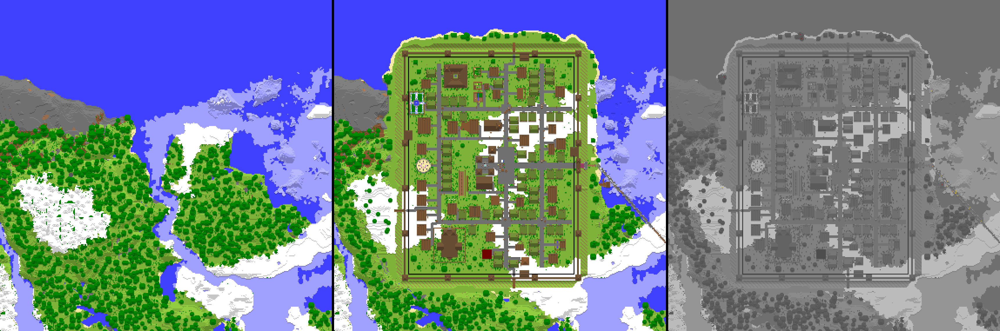

## Summary

| site | result |
|---|---|
| frozen_river | 51 findings |

# KingdomQuest field test

Seed 20261117. Positions in details are relative to the heart (x, y, z).

## frozen_river

minecraft:frozen_river at 4216, 64, 8004, facing COUNTERCLOCKWISE_90, relief 50, walkable out before founding: true, style frozen, ground grass_block. Gate approach cost per side (* = used): south 94, west 113, north 66, east 42*.

| stage | ms | float built | float land | floating feet | buried | destroyed | doors unreached | walk out | breach | wet inside | wet moat | new cliffs | tall walls | pits | road gaps | road steps | wall gaps | cut trees | foreign ground | snow lost | road steep | stumps | road high | road bank | road moved |
|---|---|---|---|---|---|---|---|---|---|---|---|---|---|---|---|---|---|---|---|---|---|---|---|---|---|
Founded as flat castle: plateau at 0 (relative to the heart), site shaped in 495 ms.

| tent_1 | 454 | 0 | 0 | 0 | 0 | 0 | 0 | 1 | 0 | 0 | 0 | 0 | 0 | 0 | 0 | 0 | 0 | 0 | 0 | 1 | 0 | 0 | 0 | 0 | 0 |
Country road to 4409, 63, 8096 (74 blocks of water on the way).

Lord's changes: broke 2 blocks before tent_2; repair leaves them.

Lord's changes after tent_2: unchanged spot kept broken, changed spot rebuilt by the new plan, 1 change(s) remembered.

| tent_2 | 373 | 0 | 0 | 0 | 0 | 1 | 0 | 1 | 0 | 0 | 0 | 12 | 0 | 1 | 0 | 0 | 0 | 0 | 0 | 34 | 0 | 0 | 0 | 0 | 0 |
| tent_3 | 270 | 0 | 0 | 0 | 0 | 0 | 0 | 1 | 0 | 0 | 0 | 12 | 0 | 1 | 0 | 0 | 0 | 0 | 0 | 36 | 0 | 0 | 0 | 0 | 0 |
| hamlet_1 | 650 | 0 | 0 | 0 | 0 | 0 | 0 | 1 | 0 | 0 | 0 | 12 | 0 | 1 | 0 | 0 | 0 | 0 | 0 | 61 | 0 | 0 | 0 | 0 | 0 |
| hamlet_2 | 295 | 3 | 0 | 0 | 0 | 0 | 0 | 1 | 0 | 0 | 0 | 12 | 0 | 1 | 0 | 0 | 0 | 0 | 0 | 64 | 0 | 0 | 0 | 0 | 0 |
| hamlet_3 | 340 | 1 | 0 | 0 | 0 | 0 | 0 | 1 | 0 | 0 | 0 | 12 | 0 | 1 | 0 | 0 | 0 | 0 | 0 | 63 | 0 | 0 | 0 | 0 | 0 |
| village_1 | 867 | 1 | 0 | 0 | 0 | 1 | 0 | 1 | 0 | 0 | 0 | 13 | 0 | 1 | 0 | 0 | 0 | 0 | 0 | 84 | 0 | 0 | 0 | 0 | 0 |
| town_1 | 741 | 1 | 4 | 0 | 0 | 1 | 0 | 1 | 0 | 1 | 0 | 18 | 0 | 3 | 0 | 0 | 0 | 0 | 0 | 201 | 0 | 0 | 0 | 0 | 0 |
| castle_1 | 1120 | 1 | 4 | 0 | 0 | 0 | 0 | 1 | 0 | 0 | 0 | 25 | 0 | 2 | 0 | 0 | 0 | 0 | 0 | 190 | 0 | 0 | 0 | 0 | 0 |
| castle_2 | 1173 | 1 | 4 | 0 | 0 | 0 | 0 | 1 | 0 | 0 | 0 | 14 | 0 | 2 | 0 | 0 | 0 | 0 | 0 | 190 | 0 | 0 | 0 | 0 | 0 |
| citadel_1 | 1317 | 1 | 4 | 0 | 0 | 0 | 0 | 1 | 0 | 0 | 0 | 14 | 0 | 2 | 0 | 0 | 0 | 0 | 0 | 190 | 0 | 0 | 0 | 0 | 0 |
| final | 0 | 1 | 4 | 0 | 0 | 0 | 0 | 1 | 0 | 0 | 0 | 14 | 0 | 2 | 0 | 0 | 0 | 0 | 0 | 190 | 0 | 0 | 0 | 0 | 0 |
Country road at the end: 10 of 10 cells near the castle intact.

Gate (land relative to the heart, before -> after) at 0/5/10/15/20/30/40 blocks out of the gate: -1->-2 0->-2 0->-2 1->-2 3->-2 -2->-2 -2->-10. Moat columns per side {back=2521, gate=2851, left=713, right=774}. Way-out road none.

Production: level 1 made 16102 items in a game day, 48327 in three (store 4320 stacks); level 5 with every milestone 141571 items of 239 kinds a day. Storehouse goods shown: 14 blocks; unloaded 15552 items into the chests.

Tram: 880 rails, stops [gate, west, north, east]
Signal fires: 20 on 13 towers, lit 20, put out 20; tower guard posts 20.

- tent_1: snow lost 1 [(-1,0,8) on grass_block at air light 0]
- tent_2: destroyed 1 [main (-8,0,2) spruce_planks->air]
- tent_2: new cliffs 12 [(123,2,12) to -4, (130,-2,18) to 4, (130,-2,24) to 3, (139,-2,32) to 3, (140,2,29) to 3]
- tent_2: pits 1 [(136,-2,30) hole]
- tent_2: snow lost 34 [(-1,0,8) on grass_block at air light 8]
- tent_3: new cliffs 12 [(123,2,12) to -4, (130,-2,18) to 4, (130,-2,24) to 3, (139,-2,32) to 3, (140,2,29) to 3]
- tent_3: pits 1 [(136,-2,30) hole]
- tent_3: snow lost 36 [(-2,0,10) on grass_block at air light 7]
- hamlet_1: new cliffs 12 [(123,2,12) to -4, (130,-2,18) to 4, (130,-2,24) to 3, (139,-2,32) to 3, (140,2,29) to 3]
- hamlet_1: pits 1 [(136,-2,30) hole]
- hamlet_1: snow lost 61 [(-66,24,57) on grass_block at air light 0, (25,0,18) on grass_block at air light 0]
- hamlet_2: float built 3 [lamps (-53,0,-62) spruce_fence, lamps (-53,1,-62) torch, dock (119,1,22) lantern]
- hamlet_2: new cliffs 12 [(123,2,12) to -4, (130,-2,18) to 4, (130,-2,24) to 3, (139,-2,32) to 3, (140,2,29) to 3]
- hamlet_2: pits 1 [(136,-2,30) hole]
- hamlet_2: snow lost 64 [(-66,24,57) on grass_block at air light 0, (18,0,16) on grass_block at short_grass light 1]
- hamlet_3: float built 1 [dock (119,1,22) lantern]
- hamlet_3: new cliffs 12 [(123,2,12) to -4, (130,-2,18) to 4, (130,-2,24) to 3, (139,-2,32) to 3, (140,2,29) to 3]
- hamlet_3: pits 1 [(136,-2,30) hole]
- hamlet_3: snow lost 63 [(-66,24,57) on grass_block at air light 0, (29,0,6) on grass_block at short_grass light 0]
- village_1: float built 1 [dock (124,1,22) lantern]
- village_1: destroyed 1 [quarry (-7,8,209) spruce_log->air]
- village_1: new cliffs 13 [(-134,27,64) to -3, (123,2,12) to -4, (130,-2,18) to 4, (130,-2,24) to 3, (139,-2,32) to 3]
- village_1: pits 1 [(136,-2,30) hole]
- village_1: snow lost 84 [(-131,24,93) on grass_block at air light 0, (12,0,23) on grass_block at oxeye_daisy light 8]
- town_1: float built 1 [dock (124,1,22) lantern]
- town_1: float land 4 [(-126,10,-102) oak_log, (-39,6,-151) oak_log, (-38,5,-146) oak_log, (-37,5,-146) oak_log]
- town_1: destroyed 1 [quarry (-7,8,209) spruce_log->air]
- town_1: wet inside 1 [(66,3,-82)]
- town_1: new cliffs 18 [(-128,4,25) to -3, (65,-1,-82) to 4, (66,-1,-83) to 4, (66,3,-82) to -4, (66,3,-82) to -4]
- town_1: pits 3 [(66,3,-82) spike, (113,1,1) spike, (136,-2,30) hole]
- town_1: snow lost 201 [(-154,38,28) on spruce_leaves at air light 0, (-141,11,12) on grass_block at air light 0, (-92,0,85) on grass_block at air light 1, (54,0,117) on grass_block at air light 3, (105,6,106) on spruce_leaves at air light 0]
- castle_1: float built 1 [dock (124,1,22) lantern]
- castle_1: float land 4 [(-126,10,-102) oak_log, (-39,6,-151) oak_log, (-38,5,-146) oak_log, (-37,5,-146) oak_log]
- castle_1: new cliffs 25 [(-128,4,25) to -3, (-118,4,138) to -5, (-118,-1,139) to 5, (-117,3,138) to -4, (-117,-1,139) to 5]
- castle_1: pits 2 [(113,1,1) spike, (136,-2,30) hole]
- castle_1: snow lost 190 [(-154,38,28) on spruce_leaves at air light 0, (-141,11,12) on grass_block at air light 0, (-91,0,88) on grass_block at short_grass light 0, (60,0,-73) on grass_block at air light 2]
- castle_2: float built 1 [dock (124,1,22) lantern]
- castle_2: float land 4 [(-126,10,-102) oak_log, (-39,6,-151) oak_log, (-38,5,-146) oak_log, (-37,5,-146) oak_log]
- castle_2: new cliffs 14 [(-128,4,25) to -3, (112,2,-86) to 3, (123,2,12) to -4, (130,-2,18) to 4, (130,-2,24) to 3]
- castle_2: pits 2 [(113,1,1) spike, (136,-2,30) hole]
- castle_2: snow lost 190 [(-154,38,28) on spruce_leaves at air light 0, (-141,11,12) on grass_block at air light 0, (-91,0,88) on grass_block at short_grass light 0, (60,0,-73) on grass_block at air light 2]
- citadel_1: float built 1 [dock (124,1,22) lantern]
- citadel_1: float land 4 [(-126,10,-102) oak_log, (-39,6,-151) oak_log, (-38,5,-146) oak_log, (-37,5,-146) oak_log]
- citadel_1: new cliffs 14 [(-128,4,25) to -3, (112,2,-86) to 3, (123,2,12) to -4, (130,-2,18) to 4, (130,-2,24) to 3]
- citadel_1: pits 2 [(113,1,1) spike, (136,-2,30) hole]
- citadel_1: snow lost 190 [(-154,38,28) on spruce_leaves at air light 0, (-141,11,12) on grass_block at air light 0, (-91,0,88) on grass_block at short_grass light 0, (60,0,-73) on grass_block at air light 2]
- final: float built 1 [dock (124,1,22) lantern]
- final: float land 4 [(-126,10,-102) oak_log, (-39,6,-151) oak_log, (-38,5,-146) oak_log, (-37,5,-146) oak_log]
- final: new cliffs 14 [(-128,4,25) to -3, (112,2,-86) to 3, (123,2,12) to -4, (130,-2,18) to 4, (130,-2,24) to 3]
- final: pits 2 [(113,1,1) spike, (136,-2,30) hole]
- final: snow lost 190 [(-154,38,28) on spruce_leaves at air light 0, (-141,11,12) on grass_block at air light 0, (-91,0,88) on grass_block at short_grass light 0, (60,0,-73) on grass_block at air light 2]

