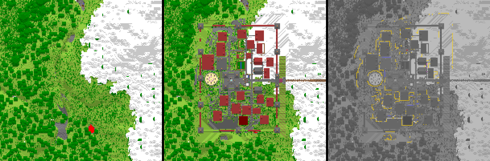

## Summary

| site | result |
|---|---|
| high_meadow | 85 findings |

# KingdomQuest field test

Seed 1813296525. Positions in details are relative to the heart (x, y, z).

## high_meadow

minecraft:meadow at 2932, 127, -1164, facing COUNTERCLOCKWISE_90, relief 94, walkable out before founding: true, style temperate, ground grass_block. Gate approach cost per side (* = used): south 315, west 122, north 21, east 6*.

| stage | ms | float built | float land | floating feet | buried | destroyed | doors unreached | walk out | breach | wet inside | wet moat | new cliffs | tall walls | pits | road gaps | road steps | wall gaps | cut trees | foreign ground | snow lost | road steep | stumps | road high | road bank | road moved |
|---|---|---|---|---|---|---|---|---|---|---|---|---|---|---|---|---|---|---|---|---|---|---|---|---|---|
| tent_1 | 770 | 0 | 0 | 0 | 0 | 0 | 0 | 1 | 0 | 0 | 0 | 27 | 0 | 0 | 0 | 0 | 0 | 0 | 0 | 4 | 0 | 0 | 0 | 0 | 0 |
Country road to 3113, -64, -1164 (0 blocks of water on the way).

Lord's changes: broke 2 blocks before tent_2; repair leaves them.

Lord's changes after tent_2: unchanged spot kept broken, changed spot rebuilt by the new plan, 1 change(s) remembered.

| tent_2 | 379 | 0 | 0 | 0 | 0 | 1 | 0 | 1 | 0 | 0 | 0 | 94 | 0 | 1 | 0 | 0 | 0 | 0 | 0 | 52 | 0 | 0 | 0 | 0 | 0 |
| tent_3 | 319 | 0 | 0 | 0 | 0 | 0 | 0 | 1 | 0 | 0 | 0 | 139 | 1 | 2 | 0 | 0 | 0 | 0 | 0 | 54 | 0 | 0 | 0 | 0 | 0 |
| hamlet_1 | 1007 | 0 | 0 | 0 | 0 | 2 | 0 | 1 | 0 | 0 | 0 | 542 | 0 | 4 | 0 | 0 | 0 | 0 | 0 | 123 | 0 | 0 | 0 | 0 | 0 |
| dock 1 not built |
| hamlet_2 | 456 | 0 | 0 | 0 | 0 | 0 | 0 | 1 | 0 | 0 | 0 | 559 | 17 | 5 | 0 | 0 | 0 | 0 | 0 | 112 | 3 | 0 | 0 | 4 | 0 |
| hamlet_3 | 462 | 0 | 0 | 0 | 0 | 11 | 0 | 1 | 0 | 0 | 0 | 601 | 29 | 20 | 0 | 0 | 0 | 0 | 0 | 80 | 6 | 0 | 1 | 1 | 0 |
| village_1 | 629 | 0 | 0 | 0 | 0 | 11 | 0 | 1 | 0 | 0 | 0 | 698 | 49 | 20 | 0 | 0 | 0 | 0 | 0 | 78 | 16 | 0 | 3 | 1 | 0 |
| town_1 | 435 | 5 | 0 | 0 | 0 | 12 | 0 | 1 | 0 | 0 | 0 | 672 | 74 | 9 | 0 | 0 | 23 | 0 | 0 | 88 | 29 | 0 | 3 | 7 | 1 |
| castle_1 | 663 | 5 | 0 | 0 | 0 | 5 | 0 | 1 | 0 | 0 | 0 | 673 | 51 | 8 | 0 | 0 | 0 | 0 | 0 | 82 | 33 | 0 | 3 | 7 | 0 |
| castle_2 | 643 | 5 | 0 | 0 | 0 | 3 | 0 | 1 | 0 | 0 | 0 | 697 | 53 | 6 | 0 | 0 | 0 | 0 | 0 | 82 | 33 | 0 | 4 | 7 | 0 |
| citadel_1 | 747 | 5 | 0 | 0 | 0 | 3 | 0 | 1 | 0 | 0 | 0 | 701 | 53 | 6 | 0 | 0 | 0 | 0 | 0 | 82 | 33 | 0 | 4 | 7 | 0 |
| final | 0 | 5 | 0 | 0 | 0 | 3 | 0 | 1 | 0 | 0 | 0 | 808 | 53 | 6 | 0 | 0 | 0 | 0 | 0 | 85 | 42 | 0 | 4 | 7 | 0 |
Country road at the end: 60 of 60 cells near the castle intact.

Gate (land relative to the heart, before -> after) at 0/5/10/15/20/30/40 blocks out of the gate: -4->-9 -2->-7 -1->-2 1->1 3->3 6->6 7->7. Moat columns per side {gate=768}. Way-out road none.

- tent_1: new cliffs 27 [(-24,-23,0) to 13, (-23,-21,-2) to 11, (-23,-21,-1) to 11, (-23,-21,-1) to 11, (-23,-10,0) to -12]
- tent_1: snow lost 4 [(5,0,-4) on grass_block at air light 0]
- tent_2: destroyed 1 [main (-8,0,2) white_wool->air]
- tent_2: new cliffs 94 [(-30,-30,-3) to 3, (-30,-31,0) to 3, (-30,-31,1) to 3, (-30,-32,2) to 3, (-29,-28,-2) to 3]
- tent_2: pits 1 [(-24,-38,25) hole]
- tent_2: snow lost 52 [(-1,1,-10) on grass_block at air light 3, (70,7,0) on dirt_path at air light 0]
- tent_3: new cliffs 139 [(-30,-26,-13) to 3, (-30,-27,-11) to 3, (-30,-27,-10) to 3, (-30,-28,-9) to 3, (-30,-28,-8) to 3]
- tent_3: tall walls 1 [(-24,-17,2) 7 cap unowned low unowned:stone]
- tent_3: pits 2 [(-27,-35,14) hole, (-23,-38,27) hole]
- tent_3: snow lost 54 [(-1,1,-10) on grass_block at air light 3, (69,7,0) on dirt_path at air light 0]
- hamlet_1: destroyed 2 [main (-8,0,-4) rose_bush->air, main (-8,1,-4) rose_bush->air]
- hamlet_1: new cliffs 542 [(-42,-13,-28) to 3, (-42,-13,-27) to 3, (-42,-13,-26) to 3, (-42,-13,-25) to 3, (-42,-13,-24) to 3]
- hamlet_1: pits 4 [(-37,-15,21) hole, (-35,-13,17) hole, (-33,-5,-33) spike, (-25,-43,34) spike]
- hamlet_1: snow lost 123 [(-1,0,-10) on grass_block at air light 4, (31,3,-1) on spruce_leaves at snow light 0, (60,5,-1) on dirt_path at air light 0]
- hamlet_2: new cliffs 559 [(-43,-14,-28) to 4, (-43,-14,-27) to 4, (-43,-14,-26) to 4, (-43,-14,-25) to 4, (-43,-14,-24) to 4]
- hamlet_2: tall walls 17 [(-21,-27,32) 13 cap unowned low unowned:stone, (-21,-27,33) 13 cap unowned low unowned:stone, (-21,-27,34) 13 cap unowned low unowned:tuff, (-20,-14,34) -14 cap unowned low unowned:tuff, (-19,-14,34) -14 cap unowned low unowned:stone]
- hamlet_2: pits 5 [(-32,-15,-43) hole, (-22,-17,-63) hole, (-22,-16,-57) hole, (-19,-15,-62) hole, (5,-21,49) hole]
- hamlet_2: snow lost 112 [(-1,0,-52) on grass_block at air light 9, (30,17,-42) on spruce_leaves at snow light 0, (65,6,0) on dirt_path at air light 0]
- hamlet_2: road steep 3 [(3,-7,19) to 3 in 3, (4,-6,19) to 3 in 3, (5,-5,19) to 3 in 3]
- hamlet_2: road bank 4 [(8,-6,31) over 2/2, (8,-13,50) over 4/4, (40,-1,0) over 3/2, (9,-12,49) over 5/2]
- hamlet_3: destroyed 11 [tavern (-35,1,-17) vine->air, tavern (-35,1,-18) vine->air, tavern (-35,1,-22) vine->air, tavern (-35,1,-26) vine->air, tavern (-35,2,-17) vine->air]
- hamlet_3: new cliffs 601 [(-50,-16,-28) to 3, (-50,-16,-27) to 3, (-50,-16,-26) to 3, (-50,-16,-25) to 3, (-50,-16,-24) to 3]
- hamlet_3: tall walls 29 [(-41,-13,-29) 8 cap unowned low unowned:stone_bricks, (-21,-11,-60) -7 cap unowned low unowned:stone, (-21,-27,32) 16 cap unowned low unowned:stone, (-21,-27,33) 17 cap unowned low unowned:andesite, (-21,-27,34) 17 cap unowned low unowned:stone]
- hamlet_3: pits 20 [(-46,-14,-27) hole, (-46,-14,-14) hole, (-45,-14,-10) hole, (-44,-8,-28) spike, (-43,-14,-27) hole]
- hamlet_3: snow lost 80 [(-1,0,-52) on grass_block at air light 6, (56,2,1) on dirt_path at air light 0]
- hamlet_3: road steep 6 [(10,-13,49) to -3 in 3, (11,-14,49) to -3 in 3, (9,-12,49) to -3 in 3, (4,-6,19) to 3 in 3, (5,-5,19) to 3 in 3]
- hamlet_3: road high 1 [(22,5,-16) above main step (21,4,-16)]
- hamlet_3: road bank 1 [(10,-13,49) over 2/2]
- village_1: destroyed 11 [tavern (-35,1,-17) vine->air, tavern (-35,1,-18) vine->air, tavern (-35,1,-22) vine->air, tavern (-35,1,-26) vine->air, tavern (-35,2,-17) vine->air]
- village_1: new cliffs 698 [(-68,-27,-32) to 6, (-68,-26,-31) to 5, (-68,-26,-30) to 5, (-68,-25,-28) to 3, (-68,-25,-27) to 3]
- village_1: tall walls 49 [(-39,-10,23) -7 cap unowned low unowned:stone, (-39,-17,24) 7 cap unowned low unowned:stone, (-38,-11,25) -7 cap unowned low unowned:dirt, (-38,-11,26) -7 cap unowned low unowned:stone, (-37,-18,25) 7 cap unowned low unowned:tuff]
- village_1: pits 20 [(-60,-22,-32) hole, (-59,-19,-28) hole, (-43,-14,-7) hole, (-37,-15,21) hole, (-37,-18,25) hole]
- village_1: snow lost 78 [(-1,0,-52) on grass_block at air light 6, (58,4,-1) on dirt_path at air light 0]
- village_1: road steep 16 [(10,-13,49) to -3 in 3, (11,-14,49) to -3 in 3, (-24,-5,-29) to 3 in 3, (9,-12,49) to -3 in 3, (-26,-7,-29) to 3 in 3]
- village_1: road high 3 [(22,6,-21) above main step (21,5,-21), (22,6,-20) above main step (21,4,-20), (22,5,-16) above main step (21,4,-16)]
- village_1: road bank 1 [(10,-13,49) over 2/2]
- town_1: float built 5 [apiary (-3,-1,-38) spruce_hanging_sign, apiary (-3,0,-38) spruce_fence, apiary (-2,-2,-38) spruce_fence, apiary (-2,-1,-38) spruce_fence, apiary (-2,0,-38) spruce_fence]
- town_1: destroyed 12 [walls (-56,-24,62) coarse_dirt->oak_log, walls (-56,-24,61) coarse_dirt->oak_log, walls (-55,-24,63) coarse_dirt->oak_log, walls (-54,-24,63) coarse_dirt->oak_log, walls (40,-3,7) coarse_dirt->oak_log]
- town_1: new cliffs 672 [(-68,-27,-32) to 6, (-68,-26,-31) to 5, (-68,-26,-30) to 5, (-68,-25,-28) to 3, (-68,-25,-27) to 3]
- town_1: tall walls 74 [(-42,-16,47) -13 cap unowned low unowned:stone, (-39,-10,23) -7 cap unowned low unowned:stone, (-39,-17,24) 7 cap unowned low unowned:stone, (-38,-11,26) -7 cap unowned low unowned:stone, (-37,-13,-15) 11 cap unowned low unowned:stone]
- town_1: pits 9 [(-60,-22,-32) hole, (-59,-19,-28) hole, (-39,-13,-48) hole, (-37,-15,21) hole, (-35,-13,17) hole]
- town_1: wall gaps 23 [(-22,-41,63) over air, (42,1,-4) over snow, (-21,-41,63) over air, (-24,-41,63) over air, (-23,-41,63) over air]
- town_1: snow lost 88 [(-1,0,-52) on grass_block at air light 6, (53,1,-1) on dirt_path at air light 0]
- town_1: road steep 29 [(10,-13,49) to -3 in 3, (-24,-14,44) to 3 in 3, (-24,-5,-29) to 3 in 3, (9,-3,23) to -3 in 3, (-23,-13,44) to 3 in 3]
- town_1: road high 3 [(22,7,-21) above main step (21,5,-21), (22,6,-20) above main step (21,4,-20), (22,5,-16) above main step (21,4,-16)]
- town_1: road bank 7 [(-22,-12,44) over 6/6, (10,-13,49) over 2/2, (-21,-11,44) over 8/8, (-21,-5,-39) over 2/2, (-24,-14,44) over 3/3]
- town_1: road moved 1 [(10,-14,49) from -13]
- castle_1: float built 5 [apiary (-3,-1,-38) spruce_hanging_sign, apiary (-3,0,-38) spruce_fence, apiary (-2,-2,-38) spruce_fence, apiary (-2,-1,-38) spruce_fence, apiary (-2,0,-38) spruce_fence]
- castle_1: destroyed 5 [tavern (-35,1,-17) vine->air, tavern (-35,1,-18) vine->air, tavern (-35,2,-17) vine->air, tavern (-35,2,-18) vine->air, tavern (-24,3,-19) dark_oak_hanging_sign->air]
- castle_1: new cliffs 673 [(-68,-27,-32) to 6, (-68,-26,-31) to 5, (-68,-26,-30) to 5, (-68,-25,-28) to 3, (-68,-25,-27) to 3]
- castle_1: tall walls 51 [(-42,-16,47) -13 cap unowned low unowned:stone, (-40,-11,27) -7 cap unowned low unowned:andesite, (-39,-16,25) 7 cap unowned low unowned:andesite, (-33,-12,28) -7 cap unowned low unowned:stone, (-32,-1,-13) -8 cap unowned low unowned:stone]
- castle_1: pits 8 [(-41,-17,24) hole, (-39,-17,31) hole, (-38,-18,28) hole, (-35,-13,17) hole, (-33,-19,29) hole]
- castle_1: snow lost 82 [(-1,0,-52) on grass_block at air light 6, (56,3,-1) on dirt_path at air light 3]
- castle_1: road steep 33 [(10,-6,29) to -3 in 3, (10,-13,49) to -3 in 3, (11,-7,29) to -3 in 3, (-24,-14,44) to 3 in 3, (-24,-5,-29) to 3 in 3]
- castle_1: road high 3 [(22,7,-21) above main step (21,5,-21), (22,6,-20) above main step (21,4,-20), (22,5,-16) above main step (21,4,-16)]
- castle_1: road bank 7 [(-22,-12,44) over 6/6, (10,-13,49) over 2/2, (-21,-11,44) over 8/8, (-21,-5,-39) over 2/2, (-24,-14,44) over 3/3]
- castle_2: float built 5 [apiary (-3,-1,-38) spruce_hanging_sign, apiary (-3,0,-38) spruce_fence, apiary (-2,-2,-38) spruce_fence, apiary (-2,-1,-38) spruce_fence, apiary (-2,0,-38) spruce_fence]
- castle_2: destroyed 3 [tavern (-35,1,-17) vine->air, tavern (-35,1,-18) vine->air, tavern (-35,2,-17) vine->air]
- castle_2: new cliffs 697 [(-68,-27,-32) to 6, (-68,-26,-31) to 5, (-68,-26,-30) to 5, (-68,-25,-28) to 3, (-68,-25,-27) to 3]
- castle_2: tall walls 53 [(-42,-16,47) -13 cap unowned low unowned:stone, (-41,-29,48) 12 cap unowned low unowned:stone, (-41,-30,49) 13 cap unowned low unowned:andesite, (-40,-11,27) -7 cap unowned low unowned:andesite, (-39,-11,26) -7 cap unowned low unowned:grass_block]
- castle_2: pits 6 [(-41,-17,24) hole, (-39,-18,27) hole, (-35,-13,17) hole, (-33,-18,29) hole, (-25,-48,74) hole]
- castle_2: snow lost 82 [(-1,0,-52) on grass_block at air light 6, (56,3,-1) on dirt_path at air light 3]
- castle_2: road steep 33 [(10,-6,29) to -3 in 3, (10,-13,49) to -3 in 3, (11,-7,29) to -3 in 3, (-24,-14,44) to 3 in 3, (-24,-5,-29) to 3 in 3]
- castle_2: road high 4 [(22,7,-21) above main step (21,5,-21), (22,4,-11) above tannery step (23,3,-11), (22,6,-20) above main step (21,4,-20), (22,5,-16) above main step (21,4,-16)]
- castle_2: road bank 7 [(-22,-12,44) over 6/6, (10,-13,49) over 2/2, (-21,-11,44) over 8/8, (-21,-5,-39) over 2/2, (-24,-14,44) over 3/3]
- citadel_1: float built 5 [apiary (-3,-1,-38) spruce_hanging_sign, apiary (-3,0,-38) spruce_fence, apiary (-2,-2,-38) spruce_fence, apiary (-2,-1,-38) spruce_fence, apiary (-2,0,-38) spruce_fence]
- citadel_1: destroyed 3 [tavern (-35,1,-17) vine->air, tavern (-35,1,-18) vine->air, tavern (-35,2,-17) vine->air]
- citadel_1: new cliffs 701 [(-68,-27,-32) to 6, (-68,-26,-31) to 5, (-68,-26,-30) to 5, (-68,-25,-28) to 3, (-68,-25,-27) to 3]
- citadel_1: tall walls 53 [(-42,-16,47) -13 cap unowned low unowned:stone, (-41,-29,48) 12 cap unowned low unowned:stone, (-41,-30,49) 13 cap unowned low unowned:andesite, (-40,-11,27) -7 cap unowned low unowned:andesite, (-39,-11,26) -7 cap unowned low unowned:grass_block]
- citadel_1: pits 6 [(-41,-17,24) hole, (-39,-18,27) hole, (-35,-13,17) hole, (-33,-18,29) hole, (-25,-48,74) hole]
- citadel_1: snow lost 82 [(-1,0,-52) on grass_block at air light 6, (56,3,-1) on dirt_path at air light 3]
- citadel_1: road steep 33 [(10,-6,29) to -3 in 3, (10,-13,49) to -3 in 3, (11,-7,29) to -3 in 3, (-24,-14,44) to 3 in 3, (-24,-5,-29) to 3 in 3]
- citadel_1: road high 4 [(22,7,-21) above main step (21,5,-21), (22,4,-11) above tannery step (23,3,-11), (22,6,-20) above main step (21,4,-20), (22,5,-16) above main step (21,4,-16)]
- citadel_1: road bank 7 [(-22,-12,44) over 6/6, (10,-13,49) over 2/2, (-21,-11,44) over 8/8, (-21,-5,-39) over 2/2, (-24,-14,44) over 3/3]
- final: tall by [{unowned/unowned=53}]
- final: float built 5 [apiary (-3,-1,-38) spruce_hanging_sign, apiary (-3,0,-38) spruce_fence, apiary (-2,-2,-38) spruce_fence, apiary (-2,-1,-38) spruce_fence, apiary (-2,0,-38) spruce_fence]
- final: destroyed 3 [tavern (-35,1,-17) vine->air, tavern (-35,1,-18) vine->air, tavern (-35,2,-17) vine->air]
- final: new cliffs 808 [(-68,-27,-32) to 6, (-68,-26,-31) to 5, (-68,-26,-30) to 5, (-68,-25,-28) to 3, (-67,-26,-34) to 5]
- final: tall walls 53 [(-42,-16,47) -13 cap unowned low unowned:stone, (-41,-29,48) 12 cap unowned low unowned:stone, (-41,-30,49) 13 cap unowned low unowned:andesite, (-40,-11,27) -7 cap unowned low unowned:andesite, (-39,-11,26) -7 cap unowned low unowned:grass_block]
- final: pits 6 [(-41,-17,24) hole, (-39,-18,27) hole, (-35,-13,17) hole, (-33,-18,29) hole, (-25,-48,74) hole]
- final: snow lost 85 [(-1,0,-52) on grass_block at air light 6, (54,1,0) on dirt_path at air light 2]
- final: road steep 42 [(10,-6,29) to -3 in 3, (10,-13,49) to -3 in 3, (11,-7,29) to -3 in 3, (-24,-14,44) to 3 in 3, (-24,-5,-29) to 3 in 3]
- final: road high 4 [(22,7,-21) above main step (21,5,-21), (22,4,-11) above tannery step (23,3,-11), (22,6,-20) above main step (21,4,-20), (22,5,-16) above main step (21,4,-16)]
- final: road bank 7 [(-22,-12,44) over 6/6, (10,-13,49) over 2/2, (-21,-11,44) over 8/8, (-21,-5,-39) over 2/2, (-24,-14,44) over 3/3]
- not at the last level: dock 0/2, 

