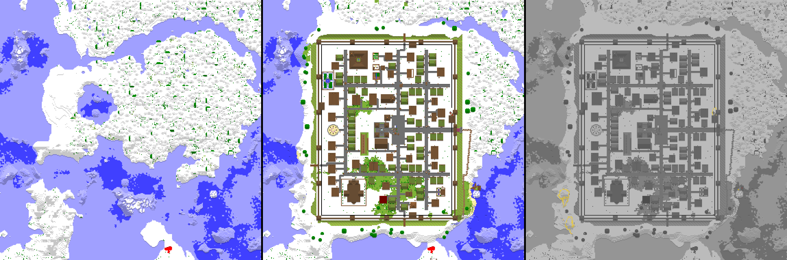

## Summary

| site | result |
|---|---|
| hill | 56 findings |

# KingdomQuest field test

Seed 20261117. Positions in details are relative to the heart (x, y, z).

## hill

minecraft:snowy_taiga at -4784, 82, 10192, facing COUNTERCLOCKWISE_90, relief 89, walkable out before founding: true, style frozen, ground grass_block. Shape hill (score 8.4), land relative to the heart, directions S SE E NE N NW W SW: 24 out [-1, -9, -4, -5, -10, -8, -7, -21]; 48 out [-29, -7, -11, -5, -8, -31, -15, -30]; 72 out [-32, -21, -7, -4, -13, -30, -13, -34]; 96 out [-33, -15, -4, -5, -17, -24, -18, -29]. Gate approach cost per side (* = used): south 48, west 207, north 211, east 10*.

| stage | ms | float built | float land | floating feet | buried | destroyed | doors unreached | walk out | breach | wet inside | wet moat | new cliffs | tall walls | pits | road gaps | road steps | wall gaps | cut trees | foreign ground | snow lost | road steep | stumps | road high | road bank | road moved |
|---|---|---|---|---|---|---|---|---|---|---|---|---|---|---|---|---|---|---|---|---|---|---|---|---|---|
Founded as flat castle: plateau at 0 (relative to the heart), site shaped in 1065 ms.

| tent_1 | 753 | 0 | 0 | 0 | 0 | 0 | 0 | 1 | 0 | 0 | 0 | 99 | 0 | 1 | 0 | 0 | 0 | 0 | 0 | 734 | 0 | 0 | 0 | 0 | 0 |
Country road to -4683, 63, 10322 (38 blocks of water on the way).

Lord's changes: broke 2 blocks before tent_2; repair leaves them.

Lord's changes after tent_2: unchanged spot kept broken, changed spot rebuilt by the new plan, 1 change(s) remembered.

| tent_2 | 892 | 0 | 0 | 0 | 0 | 1 | 0 | 1 | 0 | 0 | 0 | 104 | 0 | 2 | 0 | 0 | 0 | 0 | 0 | 855 | 0 | 0 | 0 | 0 | 0 |
| tent_3 | 633 | 0 | 0 | 0 | 0 | 0 | 0 | 1 | 0 | 0 | 0 | 104 | 0 | 2 | 0 | 0 | 0 | 0 | 0 | 857 | 0 | 0 | 0 | 0 | 0 |
| hamlet_1 | 1191 | 0 | 0 | 0 | 0 | 0 | 0 | 1 | 0 | 0 | 0 | 104 | 0 | 2 | 0 | 0 | 0 | 0 | 0 | 855 | 0 | 0 | 0 | 0 | 0 |
| hamlet_2 | 520 | 1 | 0 | 0 | 0 | 0 | 0 | 1 | 0 | 0 | 0 | 108 | 0 | 4 | 0 | 0 | 0 | 0 | 0 | 851 | 0 | 0 | 0 | 195 | 0 |
| hamlet_3 | 566 | 1 | 0 | 0 | 0 | 18 | 0 | 1 | 0 | 0 | 0 | 108 | 0 | 3 | 0 | 0 | 0 | 0 | 0 | 861 | 0 | 0 | 0 | 0 | 0 |
| village_1 | 1509 | 1 | 0 | 0 | 0 | 18 | 0 | 1 | 0 | 0 | 0 | 138 | 0 | 4 | 0 | 0 | 0 | 0 | 0 | 741 | 0 | 0 | 0 | 0 | 0 |
| town_1 | 812 | 1 | 0 | 0 | 0 | 0 | 0 | 1 | 0 | 2 | 0 | 278 | 0 | 3 | 0 | 0 | 0 | 0 | 0 | 482 | 0 | 0 | 0 | 0 | 0 |
| castle_1 | 1594 | 1 | 0 | 0 | 0 | 0 | 0 | 1 | 0 | 2 | 0 | 280 | 0 | 3 | 0 | 0 | 0 | 0 | 0 | 477 | 0 | 0 | 0 | 0 | 1 |
| castle_2 | 2098 | 1 | 0 | 0 | 0 | 0 | 0 | 1 | 0 | 1 | 0 | 264 | 0 | 2 | 0 | 0 | 0 | 0 | 0 | 368 | 0 | 0 | 0 | 0 | 1 |
| citadel_1 | 1782 | 1 | 0 | 0 | 0 | 0 | 0 | 1 | 0 | 0 | 0 | 258 | 0 | 2 | 0 | 0 | 0 | 0 | 0 | 368 | 0 | 0 | 0 | 0 | 1 |
| final | 0 | 1 | 0 | 0 | 0 | 0 | 0 | 1 | 0 | 0 | 0 | 258 | 0 | 2 | 0 | 0 | 0 | 0 | 0 | 367 | 0 | 0 | 0 | 0 | 0 |
Country road at the end: 103 of 104 cells near the castle intact, cut at [100, -1, 66].

Gate (land relative to the heart, before -> after) at 0/5/10/15/20/30/40 blocks out of the gate: 1->-2 0->-2 1->-2 1->-2 1->-2 3->-2 5->-2. Moat columns per side {back=2319, gate=2735, left=714, right=638}. Way-out road none.

Production: level 1 made 16102 items in a game day, 48327 in three (store 4320 stacks); level 5 with every milestone 141571 items of 239 kinds a day. Storehouse goods shown: 14 blocks; unloaded 15552 items into the chests.

Tram: 880 rails, stops [gate, west, north, east]
Signal fires: 20 on 13 towers, lit 20, put out 20; tower guard posts 20.

- tent_1: new cliffs 99 [(-141,26,88) to 4, (-141,26,89) to 4, (-137,30,105) to -34, (-137,-4,106) to 34, (-136,30,110) to -26]
- tent_1: pits 1 [(-115,17,128) hole]
- tent_1: snow lost 734 [(-144,32,95) on grass_block at snow light 0, (-121,42,106) on grass_block at snow light 0, (-117,35,126) on grass_block at snow light 0, (-116,38,127) on grass_block at snow light 0, (-115,36,123) on grass_block at snow light 0]
- tent_2: destroyed 1 [main (0,1,5) spruce_log->air]
- tent_2: new cliffs 104 [(-141,26,88) to 4, (-141,26,89) to 4, (-137,30,105) to -34, (-137,-4,106) to 34, (-136,30,110) to -26]
- tent_2: pits 2 [(-115,17,128) hole, (113,-12,-13) hole]
- tent_2: snow lost 855 [(-144,32,95) on grass_block at snow light 0, (-121,42,106) on grass_block at snow light 0, (-117,35,126) on grass_block at snow light 0, (-116,38,127) on grass_block at snow light 0, (-115,36,123) on grass_block at snow light 0]
- tent_3: new cliffs 104 [(-141,26,88) to 4, (-141,26,89) to 4, (-137,30,105) to -34, (-137,-4,106) to 34, (-136,30,110) to -26]
- tent_3: pits 2 [(-115,17,128) hole, (113,-12,-13) hole]
- tent_3: snow lost 857 [(-144,32,95) on grass_block at snow light 0, (-121,42,106) on grass_block at snow light 0, (-117,35,126) on grass_block at snow light 0, (-116,38,127) on grass_block at snow light 0, (-115,36,123) on grass_block at snow light 0]
- hamlet_1: new cliffs 104 [(-141,26,88) to 4, (-141,26,89) to 4, (-137,30,105) to -34, (-137,-4,106) to 34, (-136,30,110) to -26]
- hamlet_1: pits 2 [(-115,17,128) hole, (113,-12,-13) hole]
- hamlet_1: snow lost 855 [(-144,32,95) on grass_block at snow light 0, (-121,42,106) on grass_block at snow light 0, (-117,35,126) on grass_block at snow light 0, (-116,38,127) on grass_block at snow light 0, (-115,36,123) on grass_block at snow light 0]
- hamlet_2: float built 1 [dock (120,-5,85) lantern]
- hamlet_2: new cliffs 108 [(-141,26,88) to 4, (-141,26,89) to 4, (-137,30,105) to -34, (-137,-4,106) to 34, (-136,30,110) to -26]
- hamlet_2: pits 4 [(-115,17,128) hole, (-3,10,101) spike, (18,10,109) spike, (113,-12,-13) hole]
- hamlet_2: snow lost 851 [(-144,32,95) on grass_block at snow light 0, (-121,42,106) on grass_block at snow light 0, (-117,35,126) on grass_block at snow light 0, (-116,38,127) on grass_block at snow light 0, (-115,36,123) on grass_block at snow light 0]
- hamlet_2: road bank 195 [(-58,-1,-65) over 7/7, (5,-1,82) over 2/3, (37,-1,67) over 7/7, (37,-1,66) over 7/7, (37,-1,64) over 7/7]
- hamlet_3: float built 1 [dock (120,-5,85) lantern]
- hamlet_3: destroyed 18 [lumbercamp (-31,-1,-192) spruce_log->air, lumbercamp (-31,-1,-193) spruce_log->air, lumbercamp (-31,-1,-194) spruce_log->air, lumbercamp (-31,-1,-195) spruce_log->air, lumbercamp (-31,-1,-196) spruce_log->air]
- hamlet_3: new cliffs 108 [(-141,26,88) to 4, (-141,26,89) to 4, (-137,30,105) to -34, (-137,-4,106) to 34, (-136,30,110) to -26]
- hamlet_3: pits 3 [(-115,17,128) hole, (-3,10,101) spike, (113,-12,-13) hole]
- hamlet_3: snow lost 861 [(-144,32,95) on grass_block at snow light 0, (-121,42,106) on grass_block at snow light 0, (-117,35,126) on grass_block at snow light 0, (-116,38,127) on grass_block at snow light 0, (-115,36,123) on grass_block at snow light 0]
- village_1: float built 1 [dock (125,-5,85) lantern]
- village_1: destroyed 18 [lumbercamp (-31,-1,-192) spruce_log->air, lumbercamp (-31,-1,-193) spruce_log->air, lumbercamp (-31,-1,-194) spruce_log->air, lumbercamp (-31,-1,-195) spruce_log->air, lumbercamp (-31,-1,-196) spruce_log->air]
- village_1: new cliffs 138 [(-141,26,88) to 4, (-141,26,89) to 4, (-137,30,105) to -34, (-137,-4,106) to 34, (-136,30,110) to -26]
- village_1: pits 4 [(-122,30,111) spike, (-115,17,128) hole, (-3,10,101) spike, (113,-12,-13) hole]
- village_1: snow lost 741 [(-144,32,95) on grass_block at snow light 0, (-117,37,130) on grass_block at snow light 0, (-116,38,157) on grass_block at snow light 0, (-114,35,123) on grass_block at snow light 0, (-113,38,152) on grass_block at snow light 0]
- walls 1 took 4899 ms
- town_1: float built 1 [dock (125,-5,85) lantern]
- town_1: wet inside 2 [(-3,10,101), (18,10,109)]
- town_1: new cliffs 278 [(-144,15,96) to 6, (-143,13,95) to 4, (-143,13,95) to 8, (-143,21,96) to 3, (-143,21,96) to -7]
- town_1: pits 3 [(-136,15,132) spike, (-124,18,152) spike, (-3,10,101) spike]
- town_1: snow lost 482 [(-133,7,119) on spruce_leaves at air light 0, (-126,3,35) on spruce_leaves at air light 0, (-105,13,152) on spruce_leaves at air light 0, (-7,0,109) on grass_block at air light 0, (-2,0,107) on grass_block at air light 0]
- castle_1: float built 1 [dock (125,-5,85) lantern]
- castle_1: wet inside 2 [(-3,10,101), (18,10,109)]
- castle_1: new cliffs 280 [(-144,15,96) to 6, (-143,13,95) to 4, (-143,13,95) to 8, (-143,21,96) to 3, (-143,21,96) to -7]
- castle_1: pits 3 [(-136,15,132) spike, (-124,18,152) spike, (-3,10,101) spike]
- castle_1: snow lost 477 [(-133,7,119) on spruce_leaves at air light 0, (-126,3,35) on spruce_leaves at air light 0, (-105,13,152) on spruce_leaves at air light 0, (-7,0,109) on grass_block at air light 0, (-2,0,107) on grass_block at air light 0]
- castle_1: road moved 1 [(-70,-1,-70) from 0]
- castle_2: float built 1 [dock (125,-5,85) lantern]
- castle_2: wet inside 1 [(18,10,109)]
- castle_2: new cliffs 264 [(-144,15,96) to 6, (-143,13,95) to 4, (-143,13,95) to 8, (-143,21,96) to 3, (-143,21,96) to -7]
- castle_2: pits 2 [(-136,15,132) spike, (-124,18,152) spike]
- castle_2: snow lost 368 [(-133,7,119) on spruce_leaves at air light 0, (-126,3,35) on spruce_leaves at air light 0, (-105,13,152) on spruce_leaves at air light 0, (0,0,118) on grass_block at air light 4, (104,0,0) on dirt_path at air light 1]
- castle_2: road moved 1 [(-70,0,-70) from -1]
- citadel_1: float built 1 [dock (125,-5,85) lantern]
- citadel_1: new cliffs 258 [(-144,15,96) to 6, (-143,13,95) to 4, (-143,13,95) to 8, (-143,21,96) to 3, (-143,21,96) to -7]
- citadel_1: pits 2 [(-136,15,132) spike, (-124,18,152) spike]
- citadel_1: snow lost 368 [(-133,7,119) on spruce_leaves at air light 0, (-126,3,35) on spruce_leaves at air light 0, (-105,13,152) on spruce_leaves at air light 0, (-1,0,95) on grass_block at air light 2, (104,0,0) on dirt_path at air light 1]
- citadel_1: road moved 1 [(-70,-1,-70) from 0]
- final: float built 1 [dock (125,-5,85) lantern]
- final: new cliffs 258 [(-144,15,96) to 6, (-143,13,95) to 4, (-143,13,95) to 8, (-143,21,96) to 3, (-143,21,96) to -7]
- final: pits 2 [(-136,15,132) spike, (-124,18,152) spike]
- final: snow lost 367 [(-133,7,119) on spruce_leaves at air light 0, (-126,3,35) on spruce_leaves at air light 0, (-105,13,152) on spruce_leaves at air light 0, (-1,0,118) on grass_block at fern light 5, (104,0,65) on dirt_path at air light 0]
- country road cut in 1 cells, e.g. [100, -1, 66]

