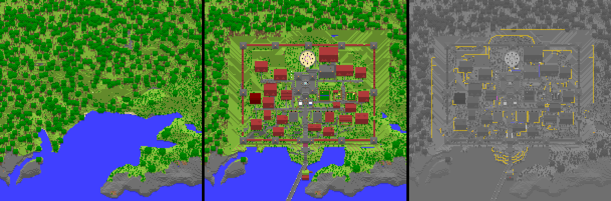

## Summary

| site | result |
|---|---|
| hillside_down | 85 findings |

# KingdomQuest field test

Seed 1813296525. Positions in details are relative to the heart (x, y, z).

## hillside_down

minecraft:forest at 1116, 76, 9168, facing NONE, relief 55, walkable out before founding: true, style temperate, ground grass_block. Shape hillside_down (score 7.5), land relative to the heart, directions S SE E NE N NW W SW, gate toward S: 24 out [-24, -20, -8, 20, 27, 8, -6, -12]; 48 out [-38, -28, 0, 20, 31, 27, 1, -13]; 72 out [-22, -11, -1, 27, 34, 34, 11, -18]; 96 out [-14, -9, 15, 41, 35, 35, 19, -8]. Gate approach cost per side (* = used): south 167*, west 20, north 560, east 8.

| stage | ms | float built | float land | floating feet | buried | destroyed | doors unreached | walk out | breach | wet inside | wet moat | new cliffs | tall walls | pits | road gaps | road steps | wall gaps | cut trees | foreign ground | snow lost | road steep | stumps | road high | road bank | road moved |
|---|---|---|---|---|---|---|---|---|---|---|---|---|---|---|---|---|---|---|---|---|---|---|---|---|---|
| tent_1 | 641 | 0 | 0 | 0 | 0 | 0 | 0 | 1 | 0 | 0 | 0 | 112 | 0 | 0 | 0 | 0 | 0 | 0 | 0 | 0 | 0 | 0 | 0 | 0 | 0 |
Country road to 1066, -64, 9339 (110 blocks of water on the way).

Lord's changes: broke 2 blocks before tent_2; repair leaves them.

Lord's changes after tent_2: unchanged spot kept broken, changed spot rebuilt by the new plan, 1 change(s) remembered.

| tent_2 | 272 | 0 | 0 | 0 | 0 | 1 | 0 | 1 | 0 | 0 | 0 | 157 | 0 | 1 | 0 | 0 | 0 | 0 | 0 | 0 | 0 | 0 | 0 | 0 | 0 |
| tent_3 | 175 | 0 | 0 | 0 | 0 | 0 | 0 | 1 | 0 | 0 | 0 | 188 | 0 | 2 | 0 | 0 | 0 | 0 | 0 | 0 | 0 | 0 | 0 | 0 | 0 |
| hamlet_1 | 598 | 0 | 0 | 0 | 0 | 2 | 0 | 1 | 0 | 0 | 0 | 429 | 0 | 0 | 0 | 0 | 0 | 0 | 0 | 0 | 0 | 0 | 0 | 0 | 0 |
| hamlet_2 | 382 | 1 | 0 | 0 | 0 | 0 | 0 | 1 | 0 | 0 | 0 | 439 | 9 | 4 | 0 | 1 | 0 | 0 | 0 | 0 | 3 | 0 | 0 | 14 | 0 |
| hamlet_3 | 356 | 1 | 0 | 0 | 0 | 11 | 0 | 1 | 0 | 0 | 0 | 638 | 11 | 4 | 9 | 1 | 0 | 0 | 0 | 0 | 11 | 0 | 5 | 0 | 0 |
| village_1 | 314 | 1 | 1 | 0 | 0 | 11 | 0 | 1 | 0 | 0 | 0 | 807 | 12 | 5 | 1 | 1 | 0 | 0 | 0 | 0 | 25 | 0 | 7 | 1 | 0 |
| town_1 | 344 | 1 | 2 | 0 | 0 | 7 | 0 | 1 | 0 | 0 | 0 | 861 | 25 | 5 | 2 | 1 | 99 | 0 | 0 | 0 | 29 | 0 | 2 | 0 | 14 |
| castle_1 | 541 | 1 | 2 | 0 | 0 | 8 | 0 | 1 | 0 | 0 | 0 | 996 | 17 | 5 | 0 | 1 | 0 | 0 | 0 | 0 | 29 | 0 | 2 | 0 | 0 |
| castle_2 | 479 | 1 | 0 | 0 | 0 | 6 | 0 | 1 | 0 | 0 | 0 | 950 | 17 | 6 | 0 | 1 | 0 | 0 | 0 | 0 | 29 | 0 | 1 | 0 | 0 |
| citadel_1 | 568 | 1 | 0 | 0 | 0 | 6 | 0 | 1 | 0 | 0 | 0 | 950 | 17 | 6 | 0 | 1 | 0 | 0 | 0 | 0 | 29 | 0 | 3 | 0 | 0 |
| final | 0 | 1 | 0 | 0 | 0 | 6 | 0 | 1 | 0 | 0 | 0 | 981 | 24 | 6 | 0 | 1 | 0 | 0 | 0 | 0 | 38 | 0 | 5 | 3 | 0 |
Country road at the end: 0 of 0 cells near the castle intact.

Gate (land relative to the heart, before -> after) at 0/5/10/15/20/30/40 blocks out of the gate: -14->-7 -14->-7 -14->-2 -14->-4 -14->-9 -14->-10 -14->-14. Moat columns per side {gate=622}. Way-out road 12 blocks.

- tent_1: new cliffs 112 [(-45,-9,28) to -4, (-44,12,-19) to -7, (-44,-10,27) to -3, (-43,-10,27) to -3, (-17,18,-22) to -8]
- tent_2: destroyed 1 [main (-2,0,-8) white_wool->air]
- tent_2: new cliffs 157 [(-45,-9,28) to -4, (-44,12,-19) to -7, (-44,-10,27) to -3, (-43,-10,27) to -3, (-20,13,-20) to -3]
- tent_2: pits 1 [(9,-8,6) hole]
- tent_3: new cliffs 188 [(-45,-9,28) to -4, (-44,12,-19) to -7, (-44,-10,27) to -3, (-43,-10,27) to -3, (-22,21,-26) to -3]
- tent_3: pits 2 [(9,-8,6) hole, (12,-6,1) hole]
- hamlet_1: destroyed 2 [main (4,0,-8) rose_bush->air, main (4,1,-8) rose_bush->air]
- hamlet_1: new cliffs 429 [(-45,-9,28) to -4, (-44,12,-19) to -7, (-44,-10,27) to -3, (-43,-10,27) to -3, (-31,21,-28) to -14]
- hamlet_2: float built 1 [dock (0,-11,72) lantern]
- hamlet_2: new cliffs 439 [(-60,-7,8) to -3, (-57,-7,15) to -3, (-57,-7,16) to -3, (-57,-7,17) to -3, (-56,-5,12) to -4]
- hamlet_2: tall walls 9 [(42,-8,-1) 8 cap unowned low unowned:stone, (43,-8,-1) 8 cap unowned low unowned:stone, (44,-8,-1) 8 cap unowned low unowned:stone, (45,-8,-1) 8 cap unowned low unowned:tuff, (46,-8,-1) 7 cap unowned low unowned:stone]
- hamlet_2: pits 4 [(-42,-11,26) hole, (-38,-14,32) hole, (-37,-14,31) hole, (-28,-8,16) hole]
- hamlet_2: road steps 1 [(38,-5,10) to -2]
- hamlet_2: road steep 3 [(-19,-6,4) to 3 in 3, (-19,-5,5) to 3 in 3, (38,-5,9) to -3 in 3]
- hamlet_2: road bank 14 [(37,1,1) over 10/2, (38,1,1) over 10/10, (0,-2,35) over 7/7, (0,-2,33) over 6/6, (0,-3,32) over 4/4]
- hamlet_3: float built 1 [dock (0,-11,72) lantern]
- hamlet_3: destroyed 11 [tavern (17,1,-35) vine->air, tavern (18,1,-35) vine->air, tavern (22,1,-35) vine->air, tavern (26,1,-35) vine->air, tavern (17,2,-35) vine->air]
- hamlet_3: new cliffs 638 [(-67,2,11) to -12, (-66,2,10) to -12, (-65,2,10) to -12, (-65,-1,11) to -8, (-65,-1,12) to -8]
- hamlet_3: tall walls 11 [(-3,-9,33) 7 cap unowned low unowned:stone, (-3,-9,34) 7 cap unowned low unowned:andesite, (-3,-9,35) 7 cap unowned low unowned:stone_bricks, (2,-3,31) -7 cap unowned low unowned:stone, (2,-3,32) -7 cap unowned low unowned:andesite]
- hamlet_3: pits 4 [(-66,-10,11) hole, (-63,-16,37) hole, (-22,-13,31) hole, (39,-13,26) hole]
- hamlet_3: road gaps 9 [(7,-7,22) dirt_path over air, (8,-7,22) dirt_path over air, (9,-7,22) dirt_path over air, (10,-8,22) dirt_path over air, (11,-9,22) dirt_path over air]
- hamlet_3: road steps 1 [(38,-5,10) to -2]
- hamlet_3: road steep 11 [(12,-10,22) to -3 in 3, (-19,-6,4) to 3 in 3, (-19,-5,5) to 3 in 3, (13,-11,22) to -3 in 3, (2,-2,22) to -3 in 3]
- hamlet_3: road high 5 [(46,-1,2) above kennel step (46,-5,3), (47,-1,2) above kennel step (47,-5,3), (48,-1,2) above kennel step (48,-5,3), (49,-1,2) above kennel step (49,-5,3), (50,-1,2) above kennel step (50,-5,3)]
- village_1: float built 1 [dock (0,-11,77) lantern]
- village_1: float land 1 [(0,-11,72) grass_block]
- village_1: destroyed 11 [tavern (17,1,-35) vine->air, tavern (18,1,-35) vine->air, tavern (22,1,-35) vine->air, tavern (26,1,-35) vine->air, tavern (17,2,-35) vine->air]
- village_1: new cliffs 807 [(-67,2,11) to -12, (-66,2,10) to -12, (-65,2,10) to -12, (-65,-1,11) to -8, (-65,-1,12) to -8]
- village_1: tall walls 12 [(-3,-9,33) 7 cap unowned low unowned:stone, (-3,-9,34) 7 cap unowned low unowned:andesite, (-3,-9,35) 7 cap unowned low unowned:stone_bricks, (2,-3,31) -7 cap unowned low unowned:stone, (2,-3,32) -7 cap unowned low unowned:andesite]
- village_1: pits 5 [(-66,-10,11) hole, (-63,-16,37) hole, (-22,-13,31) hole, (-17,-13,33) hole, (39,-13,26) hole]
- village_1: road gaps 1 [(-1,-2,22) dirt_path over air]
- village_1: road steps 1 [(38,-5,10) to -2]
- village_1: road steep 25 [(12,-10,22) to -3 in 3, (29,4,-25) to -3 in 3, (29,7,-28) to -3 in 3, (29,6,-27) to -3 in 3, (29,8,-29) to -3 in 3]
- village_1: road high 7 [(29,11,-32) above tavern step (28,9,-32), (29,12,-33) above tavern step (28,8,-33), (46,-1,2) above kennel step (46,-5,3), (47,-1,2) above kennel step (47,-5,3), (48,-1,2) above kennel step (48,-5,3)]
- village_1: road bank 1 [(29,15,-36) over 4/4]
- market_1 destroyed 2 blocks of tavern []
- town_1: float built 1 [dock (0,-11,77) lantern]
- town_1: float land 2 [(0,-11,72) grass_block, (47,34,-56) grass_block]
- town_1: destroyed 7 [tavern (17,1,-35) vine->air, tavern (18,1,-35) vine->air, tavern (26,1,-35) vine->air, tavern (17,2,-35) vine->air, tavern (18,2,-35) vine->air]
- town_1: new cliffs 861 [(-78,26,-27) to -3, (-78,25,-26) to -4, (-78,24,-25) to -4, (-78,23,-24) to -4, (-78,22,-23) to -3]
- town_1: tall walls 25 [(-45,0,-18) 8 cap unowned low unowned:stone_bricks, (-40,0,-22) 7 cap unowned low unowned:stone, (-3,-11,33) 9 cap unowned low unowned:stone, (-3,-12,34) 10 cap unowned low unowned:andesite, (-3,-13,35) 11 cap unowned low unowned:stone]
- town_1: pits 5 [(-69,-23,29) hole, (-37,-14,31) hole, (-19,-13,32) hole, (39,-13,26) hole, (84,2,32) spike]
- town_1: road gaps 2 [(-13,-1,-12) polished_andesite over air, (-12,-1,1) cracked_stone_bricks over air]
- town_1: road steps 1 [(38,-5,10) to -2]
- town_1: wall gaps 99 [(44,-14,40) over water, (-20,-14,40) over water, (12,-14,40) over water, (13,-14,40) over water, (45,-14,40) over water]
- town_1: road steep 29 [(12,-10,22) to -3 in 3, (-19,-5,5) to 3 in 3, (13,-11,22) to -3 in 3, (4,-4,22) to -3 in 3, (38,-4,8) to -3 in 3]
- town_1: road high 2 [(29,11,-32) above tavern step (28,9,-32), (29,12,-33) above tavern step (28,8,-33)]
- town_1: road moved 14 [(29,5,-27) from 6, (29,0,-22) from 1, (29,3,-25) from 4, (29,6,-28) from 7, (29,7,-29) from 8]
- royal_2 destroyed 1 blocks of tavern [tavern (17,1,-35) vine->air, tavern (18,1,-35) vine->air, tavern (26,1,-35) vine->air, tavern (17,2,-35) vine->air]
- castle_1: float built 1 [dock (0,-11,77) lantern]
- castle_1: float land 2 [(49,34,-56) grass_block, (50,34,-56) grass_block]
- castle_1: destroyed 8 [tavern (17,1,-35) vine->air, tavern (18,1,-35) vine->air, tavern (26,1,-35) vine->air, tavern (17,2,-35) vine->air, tavern (18,2,-35) vine->air]
- castle_1: new cliffs 996 [(-78,30,-42) to -6, (-78,30,-41) to -6, (-78,30,-40) to -6, (-78,30,-39) to -6, (-78,30,-38) to -6]
- castle_1: tall walls 17 [(-45,0,-18) 8 cap unowned low unowned:stone_bricks, (-3,-10,33) 8 cap unowned low unowned:stone, (-3,-10,34) 8 cap unowned low unowned:andesite, (-3,-10,35) 8 cap unowned low unowned:stone, (-3,-10,36) 9 cap unowned low unowned:stone]
- castle_1: pits 5 [(-69,-13,29) hole, (-66,-23,35) hole, (-37,-14,31) hole, (39,-13,26) hole, (84,2,32) spike]
- castle_1: road steps 1 [(38,-5,10) to -2]
- castle_1: road steep 29 [(12,-10,22) to -3 in 3, (-19,-5,5) to 3 in 3, (13,-11,22) to -3 in 3, (4,-4,22) to -3 in 3, (38,-4,8) to -3 in 3]
- castle_1: road high 2 [(29,11,-32) above tavern step (28,9,-32), (29,12,-33) above tavern step (28,8,-33)]
- market_3 destroyed 2 blocks of tavern [tavern (17,1,-35) vine->air, tavern (18,1,-35) vine->air, tavern (26,1,-35) vine->air, tavern (17,2,-35) vine->air]
- castle_2: float built 1 [dock (0,-11,77) lantern]
- castle_2: destroyed 6 [tavern (17,1,-35) vine->air, tavern (18,1,-35) vine->air, tavern (26,1,-35) vine->air, tavern (17,2,-35) vine->air, tavern (18,2,-35) vine->air]
- castle_2: new cliffs 950 [(-78,30,-42) to -6, (-78,30,-41) to -6, (-78,30,-40) to -6, (-78,30,-39) to -6, (-78,30,-38) to -6]
- castle_2: tall walls 17 [(-45,0,-18) 8 cap unowned low unowned:stone_bricks, (-3,-10,33) 8 cap unowned low unowned:stone, (-3,-10,34) 8 cap unowned low unowned:andesite, (-3,-10,35) 8 cap unowned low unowned:stone, (-3,-10,36) 9 cap unowned low unowned:stone]
- castle_2: pits 6 [(-69,-13,29) hole, (-66,-23,35) hole, (-37,-14,31) hole, (-20,-13,32) hole, (39,-13,26) hole]
- castle_2: road steps 1 [(38,-5,10) to -2]
- castle_2: road steep 29 [(12,-10,22) to -3 in 3, (-19,-5,5) to 3 in 3, (13,-11,22) to -3 in 3, (4,-4,22) to -3 in 3, (38,-4,8) to -3 in 3]
- castle_2: road high 1 [(29,14,-35) above tavern step (28,11,-35)]
- citadel_1: float built 1 [dock (0,-11,77) lantern]
- citadel_1: destroyed 6 [tavern (17,1,-35) vine->air, tavern (18,1,-35) vine->air, tavern (26,1,-35) vine->air, tavern (17,2,-35) vine->air, tavern (18,2,-35) vine->air]
- citadel_1: new cliffs 950 [(-78,30,-42) to -6, (-78,30,-41) to -6, (-78,30,-40) to -6, (-78,30,-39) to -6, (-78,30,-38) to -6]
- citadel_1: tall walls 17 [(-45,0,-18) 8 cap unowned low unowned:stone_bricks, (-3,-10,33) 8 cap unowned low unowned:stone, (-3,-10,34) 8 cap unowned low unowned:andesite, (-3,-10,35) 8 cap unowned low unowned:stone, (-3,-10,36) 9 cap unowned low unowned:stone]
- citadel_1: pits 6 [(-69,-13,29) hole, (-66,-23,35) hole, (-37,-14,31) hole, (-20,-13,32) hole, (39,-13,26) hole]
- citadel_1: road steps 1 [(38,-5,10) to -2]
- citadel_1: road steep 29 [(12,-10,22) to -3 in 3, (-19,-5,5) to 3 in 3, (13,-11,22) to -3 in 3, (4,-4,22) to -3 in 3, (38,-4,8) to -3 in 3]
- citadel_1: road high 3 [(-13,-1,-3) above smith step (-14,-2,-3), (-13,-1,-2) above smith step (-14,-2,-2), (29,14,-35) above tavern step (28,11,-35)]
- final: tall by [{unowned/unowned=24}]
- final: float built 1 [dock (0,-11,77) lantern]
- final: destroyed 6 [tavern (17,1,-35) vine->air, tavern (18,1,-35) vine->air, tavern (26,1,-35) vine->air, tavern (17,2,-35) vine->air, tavern (18,2,-35) vine->air]
- final: new cliffs 981 [(-78,30,-42) to -6, (-78,30,-41) to -6, (-78,30,-40) to -6, (-78,30,-39) to -6, (-78,30,-38) to -6]
- final: tall walls 24 [(-45,0,-18) 8 cap unowned low unowned:stone_bricks, (-3,-10,33) 8 cap unowned low unowned:stone, (-3,-10,34) 8 cap unowned low unowned:andesite, (-3,-10,35) 8 cap unowned low unowned:stone, (-3,-10,36) 9 cap unowned low unowned:stone]
- final: pits 6 [(-69,-13,29) hole, (-66,-23,35) hole, (-37,-14,31) hole, (-20,-13,32) hole, (39,-13,26) hole]
- final: road steps 1 [(38,-5,10) to -2]
- final: road steep 38 [(12,-10,22) to -3 in 3, (-19,-5,5) to 3 in 3, (13,-11,22) to -3 in 3, (4,10,-30) to -3 in 3, (4,-4,22) to -3 in 3]
- final: road high 5 [(-13,-1,-3) above smith step (-14,-2,-3), (-13,-1,-4) above smith step (-14,-2,-4), (-13,-1,-1) above smith step (-14,-3,-1), (-13,-1,-2) above smith step (-14,-2,-2), (29,14,-35) above tavern step (28,11,-35)]
- final: road bank 3 [(2,13,-32) over 2/2, (2,13,-31) over 2/2, (2,13,-33) over 2/2]

