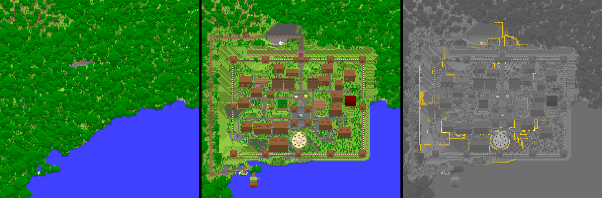

## Summary

| site | result |
|---|---|
| hillside_up | 60 findings |

# KingdomQuest field test

Seed 1813296525. Positions in details are relative to the heart (x, y, z).

## hillside_up

minecraft:jungle at 600, 78, 9328, facing CLOCKWISE_180, relief 62, walkable out before founding: true, style wild, ground grass_block. Shape hillside_up (score 4.3), land relative to the heart, directions S SE E NE N NW W SW, gate toward NW: 24 out [-7, -22, -4, 10, 13, 19, 9, 0]; 48 out [-32, -24, -8, 7, 24, 35, 19, 0]; 72 out [-32, -27, -8, 4, 30, 39, 19, -9]; 96 out [-31, -46, -15, -1, 32, 39, 20, -20]. Gate approach cost per side (* = used): south 206, west 189, north 428*, east 34.

| stage | ms | float built | float land | floating feet | buried | destroyed | doors unreached | walk out | breach | wet inside | wet moat | new cliffs | tall walls | pits | road gaps | road steps | wall gaps | cut trees | foreign ground | snow lost | road steep | stumps | road high | road bank | road moved |
|---|---|---|---|---|---|---|---|---|---|---|---|---|---|---|---|---|---|---|---|---|---|---|---|---|---|
| tent_1 | 576 | 0 | 0 | 0 | 0 | 0 | 0 | 1 | 0 | 0 | 0 | 79 | 0 | 3 | 0 | 0 | 0 | 0 | 0 | 0 | 0 | 0 | 0 | 0 | 0 |
Country road to 550, 64, 9397 (20 blocks of water on the way).

Lord's changes: broke 2 blocks before tent_2; repair leaves them.

Lord's changes after tent_2: unchanged spot kept broken, changed spot rebuilt by the new plan, 1 change(s) remembered.

| tent_2 | 287 | 0 | 0 | 0 | 0 | 1 | 0 | 1 | 0 | 0 | 0 | 150 | 0 | 2 | 0 | 0 | 0 | 0 | 0 | 0 | 0 | 0 | 0 | 0 | 0 |
| tent_3 | 253 | 0 | 0 | 0 | 0 | 0 | 0 | 1 | 0 | 0 | 0 | 192 | 0 | 3 | 0 | 0 | 0 | 0 | 0 | 0 | 0 | 0 | 0 | 0 | 0 |
| hamlet_1 | 810 | 0 | 0 | 0 | 0 | 0 | 0 | 1 | 0 | 0 | 0 | 498 | 0 | 4 | 0 | 0 | 0 | 0 | 0 | 0 | 0 | 0 | 0 | 0 | 0 |
| hamlet_2 | 386 | 1 | 0 | 0 | 0 | 0 | 0 | 1 | 0 | 0 | 0 | 548 | 0 | 12 | 0 | 0 | 0 | 0 | 0 | 0 | 4 | 0 | 0 | 2 | 0 |
| hamlet_3 | 336 | 1 | 0 | 0 | 0 | 0 | 0 | 1 | 0 | 0 | 0 | 618 | 1 | 14 | 0 | 0 | 0 | 0 | 0 | 0 | 4 | 0 | 0 | 0 | 0 |
| village_1 | 479 | 1 | 1 | 0 | 0 | 0 | 0 | 1 | 0 | 0 | 0 | 804 | 1 | 14 | 0 | 0 | 0 | 0 | 0 | 0 | 4 | 0 | 0 | 0 | 0 |
| town_1 | 433 | 6 | 1 | 0 | 0 | 2 | 0 | 1 | 0 | 0 | 0 | 752 | 25 | 8 | 0 | 0 | 134 | 0 | 0 | 0 | 13 | 0 | 0 | 4 | 0 |
| castle_1 | 443 | 6 | 3 | 0 | 0 | 0 | 0 | 1 | 0 | 0 | 0 | 809 | 8 | 0 | 0 | 0 | 0 | 0 | 0 | 0 | 13 | 0 | 0 | 4 | 0 |
| castle_2 | 412 | 6 | 1 | 0 | 0 | 0 | 0 | 1 | 0 | 0 | 0 | 790 | 19 | 0 | 0 | 0 | 0 | 0 | 0 | 0 | 13 | 0 | 0 | 4 | 0 |
| citadel_1 | 373 | 6 | 1 | 0 | 0 | 0 | 0 | 1 | 0 | 0 | 0 | 819 | 19 | 0 | 0 | 0 | 0 | 0 | 0 | 0 | 13 | 0 | 0 | 4 | 0 |
| final | 0 | 1 | 1 | 0 | 0 | 0 | 0 | 1 | 0 | 0 | 0 | 916 | 19 | 2 | 0 | 0 | 0 | 0 | 0 | 0 | 13 | 0 | 0 | 4 | 0 |
Country road at the end: 280 of 280 cells near the castle intact.

Gate (land relative to the heart, before -> after) at 0/5/10/15/20/30/40 blocks out of the gate: 21->-2 24->-7 24->-2 24->2 24->6 27->14 30->30. Moat columns per side {back=508, gate=1004, left=441}. Way-out road none.

- tent_1: new cliffs 79 [(-23,12,-12) to -3, (-19,15,-12) to -5, (-18,16,-13) to -6, (-17,17,-14) to -7, (-17,16,-13) to -6]
- tent_1: pits 3 [(-3,-3,-7) hole, (-1,30,-50) spike, (-1,-4,-7) hole]
- tent_2: destroyed 1 [main (2,0,8) bamboo_planks->air]
- tent_2: new cliffs 150 [(-21,13,-9) to -3, (-20,16,-18) to 3, (-20,16,-16) to 3, (-20,16,-13) to -6, (-20,6,21) to -3]
- tent_2: pits 2 [(-1,30,-50) spike, (11,-8,10) hole]
- tent_3: new cliffs 192 [(-23,19,-15) to -3, (-22,19,-19) to -3, (-22,16,-15) to 3, (-22,14,-9) to -4, (-22,13,-8) to -3]
- tent_3: pits 3 [(-1,30,-50) spike, (14,-7,7) hole, (14,-13,17) hole]
- hamlet_1: new cliffs 498 [(-49,27,-13) to -18, (-48,27,-14) to -18, (-46,14,-12) to -4, (-45,10,-14) to 5, (-45,15,-12) to -5]
- hamlet_1: pits 4 [(-48,9,-13) hole, (-1,30,-50) spike, (7,-5,-40) hole, (9,-3,-40) hole]
- hamlet_2: float built 1 [dock (-48,-13,82) lantern]
- hamlet_2: new cliffs 548 [(-78,23,-15) to -4, (-78,22,-14) to -3, (-78,22,-13) to -3, (-77,25,-16) to -6, (-77,3,0) to 3]
- hamlet_2: pits 12 [(-76,-1,13) hole, (-74,-6,17) hole, (-72,7,-12) hole, (-69,-27,21) hole, (-46,6,-13) hole]
- hamlet_2: road steep 4 [(-38,5,-12) to -3 in 3, (-43,10,-12) to -3 in 3, (-41,8,-12) to -3 in 3, (-42,9,-12) to -3 in 3]
- hamlet_2: road bank 2 [(-37,1,-1) over 2/2, (-38,2,-1) over 3/3]
- hamlet_3: float built 1 [dock (-48,-13,82) lantern]
- hamlet_3: new cliffs 618 [(-78,23,-15) to -4, (-78,22,-14) to -3, (-78,22,-13) to -3, (-77,25,-16) to -6, (-77,3,0) to 3]
- hamlet_3: tall walls 1 [(-68,-2,21) -21 cap unowned low unowned:tuff]
- hamlet_3: pits 14 [(-76,-1,13) hole, (-74,-6,17) hole, (-72,7,-12) hole, (-69,-27,21) hole, (-44,0,19) hole]
- hamlet_3: road steep 4 [(-43,10,-12) to -3 in 3, (-41,8,-12) to -3 in 3, (-42,9,-12) to -3 in 3, (-38,5,-12) to -3 in 3]
- village_1: float built 1 [dock (-48,-13,87) lantern]
- village_1: float land 1 [(-48,-13,82) grass_block]
- village_1: new cliffs 804 [(-78,23,-15) to -4, (-78,22,-14) to -3, (-78,22,-13) to -3, (-77,25,-16) to -6, (-77,3,0) to 3]
- village_1: tall walls 1 [(-68,-2,21) -21 cap unowned low unowned:tuff]
- village_1: pits 14 [(-76,-1,13) hole, (-74,-6,17) hole, (-72,7,-12) hole, (-69,-27,21) hole, (-44,0,19) hole]
- village_1: road steep 4 [(-43,10,-12) to -3 in 3, (-41,8,-12) to -3 in 3, (-42,9,-12) to -3 in 3, (-38,5,-12) to -3 in 3]
- town_1: float built 6 [dock (-48,-13,87) lantern, smith (12,3,2) spruce_hanging_sign, smith (12,4,2) spruce_fence, smith (12,2,3) spruce_fence, smith (12,3,3) spruce_fence]
- town_1: float land 1 [(-48,-13,82) grass_block]
- town_1: destroyed 2 [walls (-7,2,-40) coarse_dirt->jungle_log, walls (-8,3,-40) coarse_dirt->jungle_log]
- town_1: new cliffs 752 [(-84,30,-27) to -3, (-84,30,-26) to -4, (-84,30,-25) to -5, (-84,30,-24) to -6, (-84,30,-23) to -7]
- town_1: tall walls 25 [(-66,-27,17) -9 cap unowned low unowned:coal_ore, (-65,-26,16) -10 cap unowned low unowned:coal_ore, (-65,-36,17) 9 cap unowned low unowned:dirt, (-65,-36,17) 8 cap unowned low unowned:dirt, (-64,-27,17) -17 cap unowned low unowned:dirt]
- town_1: pits 8 [(-65,-36,17) hole, (-63,-44,17) hole, (-62,-45,18) hole, (-60,-46,19) hole, (-59,-48,21) hole]
- town_1: wall gaps 134 [(49,-16,56) over water, (17,-16,56) over water, (-47,-16,56) over water, (48,-16,56) over water, (16,-16,56) over water]
- town_1: road steep 13 [(-43,10,-12) to -3 in 3, (-41,8,-12) to -3 in 3, (-42,9,-12) to -3 in 3, (-56,14,-8) to -3 in 3, (-56,13,-7) to -3 in 3]
- town_1: road bank 4 [(44,-14,24) over 2/2, (44,-11,21) over 5/4, (44,-13,23) over 3/3, (44,-12,22) over 4/4]
- castle_1: float built 6 [dock (-48,-13,87) lantern, smith (12,3,2) spruce_hanging_sign, smith (12,4,2) spruce_fence, smith (12,2,3) spruce_fence, smith (12,3,3) spruce_fence]
- castle_1: float land 3 [(-69,7,15) tuff, (-69,8,15) grass_block, (-48,-13,82) grass_block]
- castle_1: new cliffs 809 [(-84,30,-33) to -3, (-84,30,-32) to -3, (-84,30,-31) to -3, (-84,30,-30) to -3, (-84,30,-29) to -6]
- castle_1: tall walls 8 [(-57,-10,20) -12 cap unowned low unowned:stone_bricks, (-54,-19,36) 21 cap unowned low unowned:stone, (-54,-21,39) 21 cap unowned low unowned:andesite, (-54,-19,41) 15 cap unowned low unowned:stone, (-54,-19,44) 12 cap unowned low unowned:stone]
- castle_1: road steep 13 [(-43,10,-12) to -3 in 3, (-41,8,-12) to -3 in 3, (-42,9,-12) to -3 in 3, (-56,14,-8) to -3 in 3, (-56,13,-7) to -3 in 3]
- castle_1: road bank 4 [(44,-14,24) over 2/2, (44,-11,21) over 5/4, (44,-13,23) over 3/3, (44,-12,22) over 4/4]
- castle_2: float built 6 [dock (-48,-13,87) lantern, smith (12,3,2) spruce_hanging_sign, smith (12,4,2) spruce_fence, smith (12,2,3) spruce_fence, smith (12,3,3) spruce_fence]
- castle_2: float land 1 [(-48,-13,82) grass_block]
- castle_2: new cliffs 790 [(-84,30,-33) to -3, (-84,30,-32) to -3, (-84,30,-31) to -3, (-84,30,-30) to -3, (-84,30,-29) to -6]
- castle_2: tall walls 19 [(-62,-27,23) 28 cap unowned low unowned:stone, (-62,-27,24) 28 cap unowned low unowned:andesite, (-62,-27,25) 28 cap unowned low unowned:stone, (-62,-27,31) 28 cap unowned low unowned:andesite, (-62,-27,32) 28 cap unowned low unowned:stone]
- castle_2: road steep 13 [(-43,10,-12) to -3 in 3, (-41,8,-12) to -3 in 3, (-42,9,-12) to -3 in 3, (-56,14,-8) to -3 in 3, (-56,13,-7) to -3 in 3]
- castle_2: road bank 4 [(44,-14,24) over 2/2, (44,-11,21) over 5/4, (44,-13,23) over 3/3, (44,-12,22) over 4/4]
- citadel_1: float built 6 [dock (-48,-13,87) lantern, smith (12,3,2) spruce_hanging_sign, smith (12,4,2) spruce_fence, smith (12,2,3) spruce_fence, smith (12,3,3) spruce_fence]
- citadel_1: float land 1 [(-48,-13,82) grass_block]
- citadel_1: new cliffs 819 [(-84,30,-33) to -3, (-84,30,-32) to -3, (-84,30,-31) to -3, (-84,30,-30) to -3, (-84,30,-29) to -6]
- citadel_1: tall walls 19 [(-62,-27,23) 28 cap unowned low unowned:stone, (-62,-27,24) 28 cap unowned low unowned:andesite, (-62,-27,25) 28 cap unowned low unowned:stone, (-62,-27,31) 28 cap unowned low unowned:andesite, (-62,-27,32) 28 cap unowned low unowned:stone]
- citadel_1: road steep 13 [(-43,10,-12) to -3 in 3, (-41,8,-12) to -3 in 3, (-42,9,-12) to -3 in 3, (-56,14,-8) to -3 in 3, (-56,13,-7) to -3 in 3]
- citadel_1: road bank 4 [(44,-14,24) over 2/2, (44,-11,21) over 5/4, (44,-13,23) over 3/3, (44,-12,22) over 4/4]
- final: tall by [{unowned/unowned=19}]
- final: float built 1 [dock (-48,-13,87) lantern]
- final: float land 1 [(-48,-13,82) grass_block]
- final: new cliffs 916 [(-84,30,-33) to -3, (-84,30,-32) to -3, (-84,30,-31) to -3, (-84,30,-30) to -3, (-84,30,-29) to -6]
- final: tall walls 19 [(-62,-27,23) 28 cap unowned low unowned:stone, (-62,-27,24) 28 cap unowned low unowned:andesite, (-62,-27,25) 28 cap unowned low unowned:stone, (-62,-27,31) 28 cap unowned low unowned:andesite, (-62,-27,32) 28 cap unowned low unowned:stone]
- final: pits 2 [(19,-13,40) hole, (23,-10,37) hole]
- final: road steep 13 [(-43,10,-12) to -3 in 3, (-41,8,-12) to -3 in 3, (-42,9,-12) to -3 in 3, (-56,14,-8) to -3 in 3, (-56,13,-7) to -3 in 3]
- final: road bank 4 [(44,-14,24) over 2/2, (44,-11,21) over 5/4, (44,-13,23) over 3/3, (44,-12,22) over 4/4]

