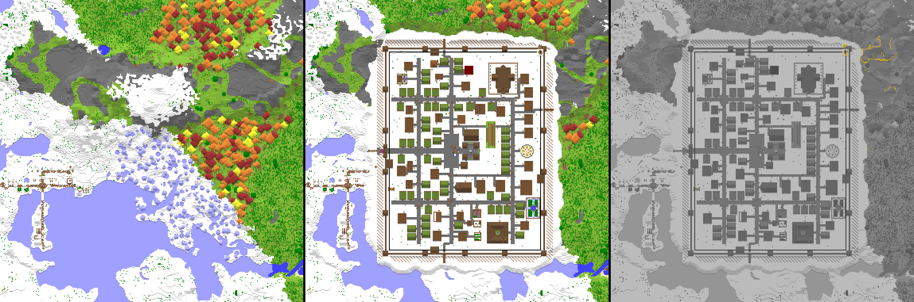

## Summary

| site | result |
|---|---|
| ice_spikes | 54 findings |

# KingdomQuest field test

Seed 20261117. Positions in details are relative to the heart (x, y, z).

## ice_spikes

minecraft:ice_spikes at 1396, 69, 6304, facing CLOCKWISE_90, relief 71, walkable out before founding: true, style frozen, ground snow_block. Gate approach cost per side (* = used): south 22, west 7*, north 404, east 9.

| stage | ms | float built | float land | floating feet | buried | destroyed | doors unreached | walk out | breach | wet inside | wet moat | new cliffs | tall walls | pits | road gaps | road steps | wall gaps | cut trees | foreign ground | snow lost | road steep | stumps | road high | road bank | road moved |
|---|---|---|---|---|---|---|---|---|---|---|---|---|---|---|---|---|---|---|---|---|---|---|---|---|---|
Founded as flat castle: plateau at 0 (relative to the heart), site shaped in 1149 ms.

| tent_1 | 947 | 0 | 0 | 0 | 0 | 0 | 0 | 1 | 0 | 0 | 0 | 205 | 0 | 21 | 0 | 0 | 0 | 0 | 0 | 1 | 0 | 0 | 0 | 0 | 0 |
Country road to 1425, 67, 6304 (0 blocks of water on the way).

Lord's changes: broke 2 blocks before tent_2; repair leaves them.

Lord's changes after tent_2: unchanged spot kept broken, changed spot rebuilt by the new plan, 1 change(s) remembered.

| tent_2 | 1310 | 0 | 0 | 0 | 0 | 1 | 0 | 1 | 0 | 0 | 0 | 194 | 0 | 15 | 0 | 0 | 0 | 0 | 0 | 243 | 0 | 0 | 0 | 0 | 0 |
| tent_3 | 592 | 0 | 0 | 0 | 0 | 0 | 0 | 1 | 0 | 0 | 0 | 194 | 0 | 15 | 0 | 0 | 0 | 0 | 0 | 243 | 0 | 0 | 0 | 0 | 0 |
| hamlet_1 | 1692 | 0 | 0 | 0 | 0 | 0 | 0 | 1 | 0 | 0 | 0 | 214 | 0 | 12 | 0 | 0 | 0 | 0 | 0 | 251 | 0 | 0 | 0 | 0 | 0 |
| hamlet_2 | 620 | 0 | 0 | 0 | 0 | 0 | 0 | 1 | 0 | 0 | 0 | 266 | 0 | 15 | 0 | 0 | 0 | 0 | 0 | 199 | 0 | 0 | 0 | 29 | 0 |
| hamlet_3 | 671 | 0 | 0 | 0 | 0 | 0 | 0 | 1 | 0 | 0 | 0 | 233 | 0 | 17 | 0 | 0 | 0 | 0 | 0 | 136 | 0 | 0 | 0 | 0 | 0 |
| village_1 | 1613 | 0 | 0 | 0 | 0 | 0 | 0 | 1 | 0 | 0 | 0 | 207 | 0 | 20 | 0 | 0 | 0 | 0 | 0 | 133 | 0 | 0 | 0 | 0 | 0 |
| town_1 | 831 | 0 | 1 | 0 | 0 | 0 | 0 | 1 | 0 | 1 | 0 | 300 | 2 | 5 | 0 | 0 | 0 | 0 | 0 | 107 | 0 | 0 | 0 | 0 | 0 |
| castle_1 | 1741 | 0 | 1 | 0 | 0 | 0 | 0 | 1 | 0 | 1 | 0 | 305 | 2 | 5 | 0 | 0 | 0 | 0 | 0 | 67 | 0 | 0 | 0 | 0 | 0 |
| castle_2 | 1849 | 0 | 1 | 0 | 0 | 0 | 0 | 1 | 0 | 1 | 0 | 276 | 2 | 4 | 0 | 0 | 0 | 0 | 0 | 54 | 0 | 0 | 0 | 0 | 0 |
| citadel_1 | 2022 | 0 | 1 | 0 | 0 | 0 | 0 | 1 | 0 | 0 | 0 | 276 | 2 | 4 | 0 | 0 | 0 | 0 | 0 | 54 | 0 | 0 | 0 | 0 | 0 |
| final | 0 | 0 | 1 | 0 | 0 | 0 | 0 | 1 | 0 | 0 | 0 | 276 | 2 | 4 | 0 | 0 | 0 | 0 | 0 | 54 | 0 | 0 | 0 | 0 | 0 |
Country road at the end: 135 of 150 cells near the castle intact, cut at [-96, -1, 0, -95, -1, 0, -94, -1, 0, -93, -1, 0, -92, -1, 0].

Gate (land relative to the heart, before -> after) at 0/5/10/15/20/30/40 blocks out of the gate: -1->-2 -1->-2 -2->-2 2->-2 4->-2 3->-2 5->-2. Moat columns per side {back=2398, gate=2825, left=729, right=634}. Way-out road none.

Production: level 1 made 16102 items in a game day, 48327 in three (store 4320 stacks); level 5 with every milestone 141571 items of 239 kinds a day. Storehouse goods shown: 14 blocks; unloaded 15552 items into the chests.

Tram: 880 rails, stops [gate, west, north, east]
Signal fires: 20 on 13 towers, lit 20, put out 20; tower guard posts 20.

- tent_1: new cliffs 205 [(-32,15,-21) to 3, (-22,2,12) to -9, (-22,2,14) to -10, (-21,30,-44) to -4, (-21,-7,12) to 9]
- tent_1: pits 21 [(-21,-7,12) hole, (-21,-8,14) hole, (-15,9,3) spike, (-14,0,9) spike, (-13,0,10) spike]
- tent_1: snow lost 1 [(19,13,-28) on grass_block at air light 0]
- tent_2: destroyed 1 [main (8,0,-2) spruce_planks->air]
- tent_2: new cliffs 194 [(-92,25,-42) to -3, (-90,23,-40) to -3, (-80,30,-43) to -4, (-80,30,-42) to -4, (-80,29,-41) to -5]
- tent_2: pits 15 [(-39,6,-5) spike, (-38,-4,17) spike, (-37,5,-8) spike, (-37,6,-6) spike, (-34,-4,17) spike]
- tent_2: snow lost 243 [(-113,-1,1) on cracked_stone_bricks at air light 0, (-90,0,-1) on dirt_path at air light 0, (-69,0,0) on dirt_path at air light 0, (-47,0,0) on dirt_path at air light 0, (-16,8,-33) on gravel at air light 0]
- tent_3: new cliffs 194 [(-92,25,-42) to -3, (-90,23,-40) to -3, (-80,30,-43) to -4, (-80,30,-42) to -4, (-80,29,-41) to -5]
- tent_3: pits 15 [(-39,6,-5) spike, (-38,-4,17) spike, (-37,5,-8) spike, (-37,6,-6) spike, (-34,-4,17) spike]
- tent_3: snow lost 243 [(-113,-1,1) on cracked_stone_bricks at air light 0, (-90,0,-1) on dirt_path at air light 0, (-69,0,0) on dirt_path at air light 0, (-47,0,0) on dirt_path at air light 0, (-16,8,-33) on gravel at air light 0]
- hamlet_1: new cliffs 214 [(-92,25,-42) to -3, (-90,23,-40) to -3, (-80,30,-43) to -4, (-80,30,-42) to -4, (-80,29,-41) to -5]
- hamlet_1: pits 12 [(-53,13,-40) spike, (-44,-3,29) spike, (-44,-3,31) spike, (-43,-2,32) spike, (-43,-1,35) spike]
- hamlet_1: snow lost 251 [(-113,-1,1) on cracked_stone_bricks at air light 0, (-90,0,-1) on dirt_path at air light 0, (-69,0,0) on dirt_path at air light 0, (-50,0,0) on dirt_path at air light 0, (-22,0,1) on dirt_path at air light 0]
- hamlet_2: new cliffs 266 [(-98,17,-57) to 3, (-53,7,-68) to 3, (-51,4,-125) to 13, (-51,9,-67) to 3, (-51,8,-66) to 3]
- hamlet_2: pits 15 [(-44,-3,29) spike, (-44,-3,31) spike, (-43,-2,32) spike, (-43,-1,35) spike, (-39,6,-5) spike]
- hamlet_2: snow lost 199 [(-113,-1,1) on cracked_stone_bricks at air light 0, (-89,0,-1) on dirt_path at air light 0, (-69,0,-1) on dirt_path at air light 0, (-28,0,1) on dirt_path at air light 0]
- hamlet_2: road bank 29 [(48,-1,65) over 2/2, (46,-1,65) over 3/3, (47,-1,65) over 2/2, (44,-1,65) over 3/4, (45,-1,65) over 3/4]
- hamlet_3: new cliffs 233 [(-98,17,-57) to 3, (-53,7,-68) to 3, (-43,-2,28) to -3, (-43,-1,35) to -3, (-42,2,29) to -7]
- hamlet_3: pits 17 [(-43,-1,35) spike, (-39,6,-5) spike, (27,-4,42) spike, (38,2,77) spike, (43,4,105) spike]
- hamlet_3: snow lost 136 [(-113,-1,1) on cracked_stone_bricks at air light 0, (-86,7,-40) on grass_block at air light 0, (-37,2,-41) on grass_block at air light 0]
- village_1: new cliffs 207 [(-98,17,-57) to 3, (-53,7,-68) to 3, (0,8,-116) to 3, (1,10,-115) to 3, (1,7,-111) to 3]
- village_1: pits 20 [(38,2,77) spike, (43,4,105) spike, (43,4,107) spike, (44,4,124) spike, (45,30,-95) spike]
- village_1: snow lost 133 [(-113,-1,1) on cracked_stone_bricks at air light 0, (-86,7,-40) on grass_block at air light 0, (18,0,-1) on dirt_path at air light 0]
- walls 1 took 5530 ms
- town_1: float land 1 [(13,16,-167) oak_log]
- town_1: wet inside 1 [(68,1,71)]
- town_1: new cliffs 300 [(-83,1,48) to -6, (-82,0,47) to -5, (-82,-5,48) to 6, (-82,-5,48) to 5, (101,-1,-132) to 17]
- town_1: tall walls 2 [(130,2,-128) 12 cap unowned low unowned:stone, (131,3,-129) 11 cap unowned low unowned:stone]
- town_1: pits 5 [(-102,-3,20) hole, (-82,-5,48) hole, (106,-1,-123) hole, (122,18,-152) spike, (133,-6,-2) hole]
- town_1: snow lost 107 [(-113,-1,1) on cracked_stone_bricks at air light 0, (-95,0,0) on dirt_path at air light 0, (26,0,0) on dirt_path at air light 0]
- castle_1: float land 1 [(13,16,-167) oak_log]
- castle_1: wet inside 1 [(68,1,71)]
- castle_1: new cliffs 305 [(-101,-1,123) to -3, (-101,-2,124) to -3, (-101,-2,125) to -3, (-99,-3,127) to -4, (-99,-4,128) to -3]
- castle_1: tall walls 2 [(130,2,-128) 12 cap unowned low unowned:stone, (131,3,-129) 11 cap unowned low unowned:stone]
- castle_1: pits 5 [(-102,-3,20) hole, (-82,-5,48) hole, (106,-1,-123) hole, (122,18,-152) spike, (133,-6,-2) hole]
- castle_1: snow lost 67 [(-113,-1,1) on cracked_stone_bricks at air light 0, (-83,2,48) on spruce_planks at air light 8]
- castle_2: float land 1 [(13,16,-167) oak_log]
- castle_2: wet inside 1 [(68,1,71)]
- castle_2: new cliffs 276 [(-83,1,48) to -6, (-82,0,47) to -5, (-82,-5,48) to 6, (-82,-5,48) to 5, (101,-1,-132) to 17]
- castle_2: tall walls 2 [(130,2,-128) 12 cap unowned low unowned:stone, (131,3,-129) 11 cap unowned low unowned:stone]
- castle_2: pits 4 [(-102,-3,20) hole, (-82,-5,48) hole, (122,18,-152) spike, (133,-6,-2) hole]
- castle_2: snow lost 54 [(-113,-1,1) on cracked_stone_bricks at air light 0, (-80,2,48) on spruce_planks at air light 7]
- citadel_1: float land 1 [(13,16,-167) oak_log]
- citadel_1: new cliffs 276 [(-83,1,48) to -6, (-82,0,47) to -5, (-82,-5,48) to 6, (-82,-5,48) to 5, (101,-1,-132) to 17]
- citadel_1: tall walls 2 [(130,2,-128) 12 cap unowned low unowned:stone, (131,3,-129) 11 cap unowned low unowned:stone]
- citadel_1: pits 4 [(-102,-3,20) hole, (-82,-5,48) hole, (122,18,-152) spike, (133,-6,-2) hole]
- citadel_1: snow lost 54 [(-113,-1,1) on cracked_stone_bricks at air light 0, (-80,2,48) on spruce_planks at air light 7]
- final: tall by [{unowned/unowned=2}]
- final: float land 1 [(13,16,-167) oak_log]
- final: new cliffs 276 [(-83,1,48) to -6, (-82,0,47) to -5, (-82,-5,48) to 6, (-82,-5,48) to 5, (101,-1,-132) to 17]
- final: tall walls 2 [(130,2,-128) 12 cap unowned low unowned:stone, (131,3,-129) 11 cap unowned low unowned:stone]
- final: pits 4 [(-102,-3,20) hole, (-82,-5,48) hole, (122,18,-152) spike, (133,-6,-2) hole]
- final: snow lost 54 [(-113,-1,1) on cracked_stone_bricks at air light 0, (-80,2,48) on spruce_planks at air light 7]
- country road cut in 15 cells, e.g. [-96, -1, 0, -95, -1, 0, -94, -1, 0, -93, -1, 0, -92, -1, 0]

