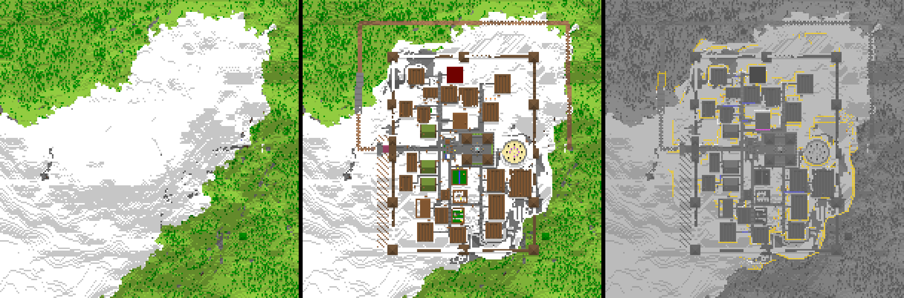

## Summary

| site | result |
|---|---|
| jagged_peaks | 73 findings |

# KingdomQuest field test

Seed 1813296525. Positions in details are relative to the heart (x, y, z).

## jagged_peaks

minecraft:jagged_peaks at 3744, 176, 5304, facing CLOCKWISE_90, relief 103, walkable out before founding: true, style frozen, ground snow_block. Gate approach cost per side (* = used): south 385, west 31*, north 463, east 618.

| stage | ms | float built | float land | floating feet | buried | destroyed | doors unreached | walk out | breach | wet inside | wet moat | new cliffs | tall walls | pits | road gaps | road steps | wall gaps | cut trees | foreign ground | snow lost | road steep | stumps | road high | road bank | road moved |
|---|---|---|---|---|---|---|---|---|---|---|---|---|---|---|---|---|---|---|---|---|---|---|---|---|---|
| tent_1 | 970 | 0 | 0 | 0 | 0 | 0 | 0 | 1 | 0 | 0 | 0 | 70 | 0 | 0 | 0 | 0 | 0 | 0 | 0 | 0 | 0 | 0 | 0 | 0 | 0 |
Country road to 3823, 109, 5304 (0 blocks of water on the way).

Lord's changes: broke 2 blocks before tent_2; repair leaves them.

Lord's changes after tent_2: unchanged spot kept broken, changed spot rebuilt by the new plan, 1 change(s) remembered.

| tent_2 | 557 | 0 | 0 | 0 | 0 | 1 | 0 | 1 | 0 | 0 | 0 | 88 | 6 | 2 | 0 | 0 | 0 | 0 | 0 | 62 | 0 | 0 | 0 | 0 | 0 |
| tent_3 | 391 | 0 | 0 | 0 | 0 | 0 | 0 | 1 | 0 | 0 | 0 | 94 | 6 | 2 | 0 | 0 | 0 | 0 | 0 | 62 | 0 | 0 | 0 | 0 | 0 |
| hamlet_1 | 845 | 0 | 0 | 0 | 0 | 0 | 0 | 1 | 0 | 0 | 0 | 642 | 6 | 2 | 0 | 0 | 0 | 0 | 0 | 62 | 0 | 0 | 0 | 0 | 0 |
| hamlet_2 | 541 | 0 | 0 | 0 | 0 | 0 | 0 | 1 | 0 | 0 | 0 | 1123 | 33 | 7 | 1 | 0 | 0 | 0 | 0 | 114 | 4 | 0 | 0 | 4 | 0 |
| hamlet_3 | 514 | 0 | 0 | 0 | 0 | 0 | 0 | 1 | 0 | 0 | 0 | 1264 | 94 | 6 | 2 | 0 | 0 | 0 | 0 | 151 | 10 | 0 | 0 | 2 | 0 |
| village_1 | 570 | 0 | 0 | 0 | 0 | 0 | 0 | 1 | 0 | 0 | 0 | 1472 | 81 | 9 | 3 | 0 | 0 | 0 | 0 | 141 | 23 | 0 | 0 | 2 | 0 |
| town_1 | 532 | 355 | 14 | 0 | 0 | 6 | 0 | 1 | 0 | 0 | 0 | 1146 | 149 | 9 | 2 | 0 | 70 | 0 | 0 | 320 | 37 | 0 | 0 | 4 | 20 |
| castle_1 | 844 | 0 | 0 | 0 | 0 | 0 | 0 | 1 | 0 | 0 | 0 | 1095 | 109 | 8 | 0 | 0 | 0 | 0 | 0 | 340 | 47 | 0 | 0 | 4 | 0 |
| castle_2 | 760 | 0 | 0 | 0 | 0 | 0 | 0 | 1 | 0 | 0 | 0 | 1134 | 100 | 10 | 0 | 0 | 0 | 0 | 0 | 321 | 47 | 0 | 0 | 4 | 0 |
| citadel_1 | 707 | 0 | 0 | 0 | 0 | 0 | 0 | 1 | 0 | 0 | 0 | 1138 | 101 | 10 | 0 | 0 | 0 | 0 | 0 | 321 | 47 | 0 | 0 | 4 | 0 |
| final | 0 | 0 | 0 | 0 | 0 | 0 | 0 | 1 | 0 | 0 | 0 | 1174 | 111 | 14 | 0 | 0 | 0 | 0 | 0 | 297 | 47 | 0 | 10 | 4 | 0 |
Country road at the end: 323 of 323 cells near the castle intact.

Gate (land relative to the heart, before -> after) at 0/5/10/15/20/30/40 blocks out of the gate: 2->-2 -2->-7 -3->-2 3->2 2->2 9->9 13->13. Moat columns per side {gate=792}. Way-out road none.

- tent_1: new cliffs 70 [(-19,13,19) to -3, (-18,10,19) to 4, (-17,10,19) to 3, (-16,-13,-7) to 3, (-16,-13,-6) to 3]
- tent_2: destroyed 1 [main (8,0,-2) spruce_planks->air]
- tent_2: new cliffs 88 [(-66,-1,-42) to -40, (-66,-1,-41) to -40, (-65,-1,-51) to -47, (-65,-1,-50) to -46, (-65,-1,-49) to -46]
- tent_2: tall walls 6 [(-66,-48,-40) 8 cap unowned low unowned:stone_bricks, (-66,-46,-39) 7 cap unowned low unowned:stone_bricks, (-66,-45,-38) 7 cap unowned low unowned:grass_block, (-66,-42,-34) 7 cap unowned low unowned:grass_block, (-61,-41,-41) -7 cap unowned low unowned:stone_bricks]
- tent_2: pits 2 [(-66,-48,-40) hole, (-17,-25,-19) hole]
- tent_2: snow lost 62 [(-64,-28,-26) on stone_brick_slab at air light 0, (-56,4,0) on dirt_path at air light 0]
- tent_3: new cliffs 94 [(-66,-1,-42) to -40, (-66,-1,-41) to -40, (-65,-1,-51) to -47, (-65,-1,-50) to -46, (-65,-1,-49) to -46]
- tent_3: tall walls 6 [(-66,-48,-40) 8 cap unowned low unowned:stone_bricks, (-66,-46,-39) 7 cap unowned low unowned:stone_bricks, (-66,-45,-38) 7 cap unowned low unowned:grass_block, (-66,-42,-34) 7 cap unowned low unowned:grass_block, (-61,-41,-41) -7 cap unowned low unowned:stone_bricks]
- tent_3: pits 2 [(-66,-48,-40) hole, (-16,-27,-21) hole]
- tent_3: snow lost 62 [(-64,-28,-26) on stone_brick_slab at air light 0, (-56,4,0) on dirt_path at air light 0]
- hamlet_1: new cliffs 642 [(-66,-1,-42) to -40, (-66,-1,-41) to -40, (-65,-1,-51) to -47, (-65,-1,-50) to -46, (-65,-1,-49) to -46]
- hamlet_1: tall walls 6 [(-66,-48,-40) 8 cap unowned low unowned:stone_bricks, (-66,-46,-39) 7 cap unowned low unowned:stone_bricks, (-66,-45,-38) 7 cap unowned low unowned:grass_block, (-66,-42,-34) 7 cap unowned low unowned:grass_block, (-61,-41,-41) -7 cap unowned low unowned:stone_bricks]
- hamlet_1: pits 2 [(-66,-48,-40) hole, (33,-5,33) spike]
- hamlet_1: snow lost 62 [(-64,-28,-26) on stone_brick_slab at air light 0, (-56,4,0) on dirt_path at air light 0]
- hamlet_2: new cliffs 1123 [(-66,-1,-42) to -40, (-66,-1,-41) to -40, (-65,-1,-51) to -47, (-65,-1,-50) to -46, (-65,-1,-49) to -46]
- hamlet_2: tall walls 33 [(-66,-48,-40) 8 cap unowned low unowned:stone_bricks, (-66,-46,-39) 7 cap unowned low unowned:stone_bricks, (-66,-45,-38) 7 cap unowned low unowned:grass_block, (-66,-42,-34) 7 cap unowned low unowned:grass_block, (-61,-41,-41) -7 cap unowned low unowned:stone_bricks]
- hamlet_2: pits 7 [(-66,-48,-40) hole, (-13,-8,46) hole, (-12,-12,-32) hole, (-7,-38,-55) hole, (7,-48,78) hole]
- hamlet_2: road gaps 1 [(-22,-2,0) dirt_path over air]
- hamlet_2: snow lost 114 [(-64,-28,-26) on stone_brick_slab at air light 0, (-56,4,0) on dirt_path at air light 0, (4,-10,66) on cobblestone at air light 6]
- hamlet_2: road steep 4 [(-7,-3,-19) to -3 in 3, (-8,-2,-19) to -3 in 3, (-5,-5,-19) to -3 in 3, (-6,-4,-19) to -3 in 3]
- hamlet_2: road bank 4 [(-9,-6,-29) over 4/6, (-9,-12,-49) over 3/6, (-8,-6,-31) over 3/3, (-8,-13,-50) over 5/5]
- hamlet_3: new cliffs 1264 [(-66,-1,-42) to -40, (-66,-1,-41) to -40, (-65,-1,-51) to -47, (-65,-1,-50) to -46, (-65,-1,-49) to -46]
- hamlet_3: tall walls 94 [(-66,-48,-40) 8 cap unowned low unowned:stone_bricks, (-66,-46,-39) 7 cap unowned low unowned:stone_bricks, (-66,-45,-38) 7 cap unowned low unowned:grass_block, (-66,-42,-34) 7 cap unowned low unowned:grass_block, (-61,-41,-41) -7 cap unowned low unowned:stone_bricks]
- hamlet_3: pits 6 [(-66,-48,-40) hole, (-12,-12,-32) hole, (7,-48,78) hole, (15,-19,60) hole, (16,-13,46) hole]
- hamlet_3: road gaps 2 [(-22,-2,0) dirt_path over air, (-22,-2,-1) dirt_path over air]
- hamlet_3: snow lost 151 [(-64,-28,-26) on stone_brick_slab at air light 0, (-56,4,0) on dirt_path at air light 0, (-7,-5,-34) on cobblestone_wall at air light 9, (44,-7,20) on cobblestone at air light 0]
- hamlet_3: road steep 10 [(-12,-15,-49) to 3 in 3, (-13,-16,-49) to 3 in 3, (-14,-17,-49) to 3 in 3, (-7,-3,-19) to -3 in 3, (-23,3,20) to 3 in 3]
- hamlet_3: road bank 2 [(-11,-14,-49) over 2/2, (-10,-13,-49) over 3/3]
- village_1: new cliffs 1472 [(-66,-1,-42) to -40, (-66,-1,-41) to -40, (-65,-1,-51) to -47, (-65,-1,-50) to -46, (-65,-1,-49) to -46]
- village_1: tall walls 81 [(-66,-48,-40) 8 cap unowned low unowned:stone_bricks, (-66,-46,-39) 7 cap unowned low unowned:stone_bricks, (-66,-45,-38) 7 cap unowned low unowned:grass_block, (-66,-42,-34) 7 cap unowned low unowned:grass_block, (-61,-41,-41) -7 cap unowned low unowned:stone_bricks]
- village_1: pits 9 [(-66,-48,-40) hole, (-12,-12,-32) hole, (7,-48,78) hole, (15,-19,60) hole, (16,-13,46) hole]
- village_1: road gaps 3 [(-22,-2,0) dirt_path over air, (-22,-2,-1) dirt_path over air, (26,-9,29) cobblestone over air]
- village_1: snow lost 141 [(-64,-28,-26) on stone_brick_slab at air light 0, (-56,4,0) on dirt_path at air light 0, (-7,-5,-34) on cobblestone_wall at air light 9]
- village_1: road steep 23 [(21,-2,29) to -3 in 3, (-12,-15,-49) to 3 in 3, (23,-4,29) to -3 in 3, (22,-3,29) to -3 in 3, (33,-14,29) to -3 in 3]
- village_1: road bank 2 [(-11,-14,-49) over 2/2, (-10,-13,-49) over 3/3]
- town_1: float built 355 [walls (42,-1,69) coarse_dirt, walls (42,0,69) spruce_log, walls (42,1,69) spruce_log, walls (42,2,69) spruce_log, walls (42,3,69) spruce_fence]
- town_1: float land 14 [(28,-1,69) snow_block, (29,-1,69) snow_block, (30,-1,69) snow_block, (31,-1,69) snow_block, (32,-1,69) snow_block]
- town_1: destroyed 6 [walls (-40,-6,-8) coarse_dirt->spruce_log, walls (-40,-5,-7) coarse_dirt->spruce_log, walls (-40,-7,-5) coarse_dirt->spruce_log, walls (-40,-6,-4) coarse_dirt->spruce_log, walls (-40,2,7) coarse_dirt->spruce_log]
- town_1: new cliffs 1146 [(-66,-1,-42) to -40, (-66,-1,-41) to -40, (-65,-1,-51) to -47, (-65,-1,-50) to -46, (-65,-1,-49) to -46]
- town_1: tall walls 149 [(-66,-48,-40) 8 cap unowned low unowned:stone_bricks, (-66,-46,-39) 7 cap unowned low unowned:stone_bricks, (-66,-45,-38) 7 cap unowned low unowned:grass_block, (-66,-42,-34) 7 cap unowned low unowned:grass_block, (-61,-41,-41) -7 cap unowned low unowned:stone_bricks]
- town_1: pits 9 [(-66,-48,-40) hole, (-12,-12,-32) hole, (-10,-38,-60) hole, (7,-48,78) hole, (14,-14,47) hole]
- town_1: road gaps 2 [(12,-3,-13) cobblestone over air, (-1,-3,-12) cobblestone over air]
- town_1: wall gaps 70 [(1,-33,-63) over air, (0,-34,-63) over air, (45,-1,69) over air, (44,-1,69) over air, (47,-1,69) over air]
- town_1: snow lost 320 [(-64,-28,-26) on stone_brick_slab at air light 0, (-56,4,0) on dirt_path at air light 0, (-10,-10,-46) on cobblestone at air light 12, (4,-7,44) on cobblestone at air light 13, (21,-3,-35) on cobblestone_wall at air light 4]
- town_1: road steep 37 [(33,-14,29) to -3 in 3, (0,-14,-31) to -3 in 3, (32,-13,29) to -3 in 3, (-23,3,20) to 3 in 3, (-23,2,19) to 3 in 3]
- town_1: road bank 4 [(21,-7,-44) over 2/2, (-11,-14,-49) over 2/2, (21,-5,39) over 2/2, (-10,-13,-49) over 3/3]
- town_1: road moved 20 [(36,-18,29) from -17, (33,-15,29) from -14, (32,-14,29) from -13, (35,-17,29) from -16, (34,-16,29) from -15]
- castle_1: new cliffs 1095 [(-66,-1,-42) to -40, (-66,-1,-41) to -40, (-65,-1,-51) to -47, (-65,-1,-50) to -46, (-65,-1,-49) to -46]
- castle_1: tall walls 109 [(-66,-48,-40) 8 cap unowned low unowned:stone_bricks, (-66,-46,-39) 7 cap unowned low unowned:stone_bricks, (-66,-45,-38) 7 cap unowned low unowned:grass_block, (-66,-42,-34) 7 cap unowned low unowned:grass_block, (-61,-41,-41) -7 cap unowned low unowned:stone_bricks]
- castle_1: pits 8 [(-66,-48,-40) hole, (-12,-12,-32) hole, (-5,-38,-56) hole, (7,-48,78) hole, (14,-14,47) hole]
- castle_1: snow lost 340 [(-64,-28,-26) on stone_brick_slab at air light 0, (-56,4,0) on dirt_path at air light 3, (-37,1,-2) on cobblestone_wall at air light 6, (-11,1,-2) on cobblestone_wall at air light 5, (-3,-5,-20) on cobblestone_wall at air light 4]
- castle_1: road steep 47 [(33,-14,29) to -3 in 3, (0,-14,-31) to -3 in 3, (32,-13,29) to -3 in 3, (-19,-15,-29) to 3 in 3, (-20,-16,-29) to 3 in 3]
- castle_1: road bank 4 [(21,-7,-44) over 2/2, (-11,-14,-49) over 2/2, (21,-5,39) over 2/2, (-10,-13,-49) over 3/3]
- castle_2: new cliffs 1134 [(-66,-1,-42) to -40, (-66,-1,-41) to -40, (-65,-1,-51) to -47, (-65,-1,-50) to -46, (-65,-1,-49) to -46]
- castle_2: tall walls 100 [(-66,-48,-40) 8 cap unowned low unowned:stone_bricks, (-66,-46,-39) 7 cap unowned low unowned:stone_bricks, (-66,-45,-38) 7 cap unowned low unowned:grass_block, (-66,-42,-34) 7 cap unowned low unowned:grass_block, (-61,-41,-41) -7 cap unowned low unowned:stone_bricks]
- castle_2: pits 10 [(-66,-48,-40) hole, (-25,-22,-25) hole, (-22,-23,-35) hole, (-21,-17,-35) spike, (-12,-12,-32) hole]
- castle_2: snow lost 321 [(-64,-28,-26) on stone_brick_slab at air light 0, (-56,4,0) on dirt_path at air light 3, (-37,1,-2) on cobblestone_wall at air light 6, (-10,-10,-46) on cobblestone at air light 12, (3,-7,44) on cobblestone at air light 14]
- castle_2: road steep 47 [(33,-14,29) to -3 in 3, (0,-14,-31) to -3 in 3, (32,-13,29) to -3 in 3, (-19,-15,-29) to 3 in 3, (-20,-16,-29) to 3 in 3]
- castle_2: road bank 4 [(21,-7,-44) over 2/2, (-11,-14,-49) over 2/2, (21,-5,39) over 2/2, (-10,-13,-49) over 3/3]
- citadel_1: new cliffs 1138 [(-66,-1,-42) to -40, (-66,-1,-41) to -40, (-65,-1,-51) to -47, (-65,-1,-50) to -46, (-65,-1,-49) to -46]
- citadel_1: tall walls 101 [(-66,-48,-40) 8 cap unowned low unowned:stone_bricks, (-66,-46,-39) 7 cap unowned low unowned:stone_bricks, (-66,-45,-38) 7 cap unowned low unowned:grass_block, (-66,-42,-34) 7 cap unowned low unowned:grass_block, (-61,-41,-41) -7 cap unowned low unowned:stone_bricks]
- citadel_1: pits 10 [(-66,-48,-40) hole, (-25,-22,-25) hole, (-22,-23,-35) hole, (-21,-17,-35) spike, (-12,-12,-32) hole]
- citadel_1: snow lost 321 [(-64,-28,-26) on stone_brick_slab at air light 0, (-56,4,0) on dirt_path at air light 3, (-37,1,-2) on cobblestone_wall at air light 6, (-10,-10,-46) on cobblestone at air light 12, (3,-7,44) on cobblestone at air light 14]
- citadel_1: road steep 47 [(33,-14,29) to -3 in 3, (0,-14,-31) to -3 in 3, (32,-13,29) to -3 in 3, (-19,-15,-29) to 3 in 3, (-20,-16,-29) to 3 in 3]
- citadel_1: road bank 4 [(21,-7,-44) over 2/2, (-11,-14,-49) over 2/2, (21,-5,39) over 2/2, (-10,-13,-49) over 3/3]
- final: tall by [{unowned/unowned=111}]
- final: new cliffs 1174 [(-66,-1,-42) to -40, (-66,-1,-41) to -40, (-65,-1,-51) to -47, (-65,-1,-50) to -46, (-65,-1,-49) to -46]
- final: tall walls 111 [(-66,-48,-40) 8 cap unowned low unowned:stone_bricks, (-66,-46,-39) 7 cap unowned low unowned:stone_bricks, (-66,-45,-38) 7 cap unowned low unowned:grass_block, (-66,-42,-34) 7 cap unowned low unowned:grass_block, (-61,-41,-41) -7 cap unowned low unowned:stone_bricks]
- final: pits 14 [(-66,-48,-40) hole, (-25,-22,-25) hole, (-22,-23,-35) hole, (-21,-17,-35) spike, (-12,-12,-32) hole]
- final: snow lost 297 [(-64,-28,-26) on stone_brick_slab at air light 0, (-56,4,0) on dirt_path at air light 3, (-37,1,-2) on cobblestone_wall at air light 6, (-10,-10,-46) on cobblestone at air light 12, (18,-3,-34) on cobblestone_wall at air light 6]
- final: road steep 47 [(33,-14,29) to -3 in 3, (0,-14,-31) to -3 in 3, (32,-13,29) to -3 in 3, (-19,-15,-29) to 3 in 3, (-20,-16,-29) to 3 in 3]
- final: road high 10 [(5,-1,-13) above smith step (5,-3,-14), (4,-1,-13) above smith step (4,-4,-14), (7,-1,-13) above smith step (7,-3,-14), (6,-1,-13) above smith step (6,-3,-14), (1,-1,-13) above smith step (1,-5,-14)]
- final: road bank 4 [(21,-7,-44) over 2/2, (-11,-14,-49) over 2/2, (21,-5,39) over 2/2, (-10,-13,-49) over 3/3]

