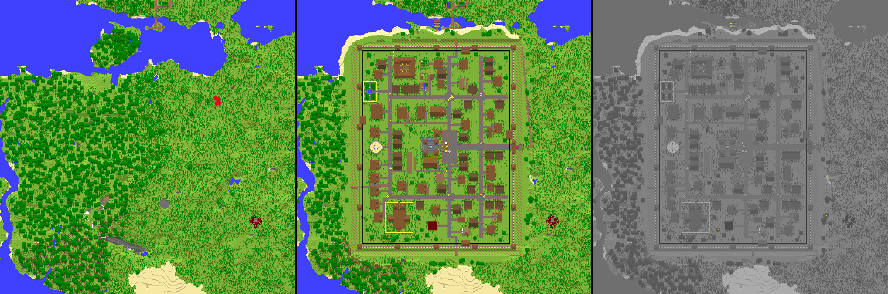

## Summary

| site | result |
|---|---|
| jungle | 26 findings |

# KingdomQuest field test

Seed 20261117. Positions in details are relative to the heart (x, y, z).

## jungle

minecraft:sparse_jungle at -6216, 69, 2596, facing COUNTERCLOCKWISE_90, relief 29, walkable out before founding: true, style wild, ground grass_block. Gate approach cost per side (* = used): south 9, west 17, north 61, east 4*.

| stage | ms | float built | float land | floating feet | buried | destroyed | doors unreached | walk out | breach | wet inside | wet moat | new cliffs | tall walls | pits | road gaps | road steps | wall gaps | cut trees | foreign ground | snow lost | road steep | stumps | road high | road bank | road moved |
|---|---|---|---|---|---|---|---|---|---|---|---|---|---|---|---|---|---|---|---|---|---|---|---|---|---|
Founded as flat castle: plateau at 0 (relative to the heart), site shaped in 512 ms.

| tent_1 | 574 | 0 | 0 | 0 | 0 | 0 | 0 | 1 | 0 | 0 | 0 | 0 | 0 | 0 | 0 | 0 | 0 | 0 | 0 | 0 | 0 | 0 | 0 | 0 | 0 |
Country road to -6115, 63, 2466 (8 blocks of water on the way).

Lord's changes: broke 2 blocks before tent_2; repair leaves them.

Lord's changes after tent_2: unchanged spot kept broken, changed spot rebuilt by the new plan, 1 change(s) remembered.

| tent_2 | 653 | 0 | 0 | 0 | 0 | 1 | 0 | 1 | 0 | 0 | 0 | 0 | 0 | 0 | 0 | 0 | 0 | 0 | 0 | 0 | 0 | 0 | 0 | 0 | 0 |
| tent_3 | 453 | 0 | 0 | 0 | 0 | 0 | 0 | 1 | 0 | 0 | 0 | 0 | 0 | 0 | 0 | 0 | 0 | 0 | 0 | 0 | 0 | 0 | 0 | 0 | 0 |
| hamlet_1 | 786 | 0 | 0 | 0 | 0 | 0 | 0 | 1 | 0 | 0 | 0 | 0 | 0 | 0 | 0 | 0 | 0 | 0 | 0 | 0 | 0 | 0 | 0 | 0 | 0 |
| hamlet_2 | 519 | 1 | 0 | 0 | 0 | 0 | 0 | 1 | 0 | 0 | 0 | 0 | 0 | 1 | 0 | 0 | 0 | 0 | 0 | 0 | 0 | 0 | 0 | 25 | 0 |
| hamlet_3 | 455 | 1 | 0 | 0 | 0 | 10 | 0 | 1 | 0 | 0 | 0 | 0 | 0 | 1 | 0 | 0 | 0 | 0 | 0 | 0 | 0 | 0 | 0 | 0 | 0 |
| village_1 | 1032 | 1 | 0 | 0 | 0 | 10 | 0 | 1 | 0 | 0 | 0 | 13 | 0 | 1 | 0 | 0 | 0 | 0 | 0 | 0 | 0 | 0 | 0 | 0 | 0 |
| town_1 | 667 | 1 | 0 | 0 | 0 | 0 | 0 | 1 | 0 | 0 | 0 | 24 | 0 | 2 | 0 | 0 | 0 | 0 | 0 | 0 | 0 | 0 | 0 | 0 | 0 |
| castle_1 | 1225 | 1 | 0 | 0 | 0 | 0 | 0 | 1 | 0 | 0 | 0 | 24 | 0 | 2 | 0 | 0 | 0 | 0 | 0 | 0 | 0 | 0 | 0 | 0 | 0 |
| castle_2 | 1511 | 1 | 0 | 0 | 0 | 0 | 0 | 1 | 0 | 0 | 0 | 24 | 0 | 2 | 0 | 0 | 0 | 0 | 0 | 0 | 0 | 0 | 0 | 0 | 0 |
| citadel_1 | 1351 | 1 | 0 | 0 | 0 | 0 | 0 | 1 | 0 | 0 | 0 | 24 | 0 | 2 | 0 | 0 | 0 | 0 | 0 | 0 | 0 | 0 | 0 | 0 | 0 |
| final | 0 | 1 | 0 | 0 | 0 | 0 | 0 | 1 | 0 | 0 | 0 | 24 | 0 | 2 | 0 | 0 | 0 | 0 | 0 | 0 | 0 | 0 | 0 | 0 | 0 |
Country road at the end: 93 of 93 cells near the castle intact.

Gate (land relative to the heart, before -> after) at 0/5/10/15/20/30/40 blocks out of the gate: 0->-2 0->-2 0->-2 0->-2 0->-2 1->-2 2->-2. Moat columns per side {back=2851, gate=3038, left=776, right=743}. Way-out road none.

Production: level 1 made 16102 items in a game day, 48327 in three (store 4320 stacks); level 5 with every milestone 141571 items of 241 kinds a day. Storehouse goods shown: 14 blocks; unloaded 15552 items into the chests.

Tram: 880 rails, stops [gate, west, north, east]
Signal fires: 20 on 13 towers, lit 20, put out 20; tower guard posts 20.

- tent_2: destroyed 1 [main (0,1,5) jungle_log->air]
- hamlet_2: float built 1 [dock (-9,-2,-158) lantern]
- hamlet_2: pits 1 [(-6,-7,-132) hole]
- hamlet_2: road bank 25 [(7,-1,116) over 2/3, (7,-1,-48) over 2/2, (7,-1,-49) over 2/2, (7,-1,-50) over 2/2, (7,-1,-51) over 2/2]
- hamlet_3: float built 1 [dock (-9,-2,-158) lantern]
- hamlet_3: destroyed 10 [lumbercamp (-32,-1,-200) jungle_log->air, lumbercamp (-32,-1,-201) jungle_log->air, lumbercamp (-32,-1,-202) jungle_log->air, lumbercamp (-32,-1,-203) jungle_log->air, lumbercamp (-32,-1,-204) jungle_log->air]
- hamlet_3: pits 1 [(-6,-7,-132) hole]
- village_1: float built 1 [dock (-9,-2,-163) lantern]
- village_1: destroyed 10 [lumbercamp (-32,-1,-200) jungle_log->air, lumbercamp (-32,-1,-201) jungle_log->air, lumbercamp (-32,-1,-202) jungle_log->air, lumbercamp (-32,-1,-203) jungle_log->air, lumbercamp (-32,-1,-204) jungle_log->air]
- village_1: new cliffs 13 [(-13,-5,-160) to 4, (-13,-5,-156) to 4, (-12,-1,-160) to -4, (-12,-5,-157) to 3, (-12,-5,-157) to 4]
- village_1: pits 1 [(-6,-7,-132) hole]
- town_1: float built 1 [dock (-9,-2,-163) lantern]
- town_1: new cliffs 24 [(-29,-1,107) to 3, (-28,-1,106) to 3, (-28,2,107) to -3, (-28,2,107) to -3, (-13,-5,-160) to 4]
- town_1: pits 2 [(-28,2,107) spike, (45,1,150) spike]
- castle_1: float built 1 [dock (-9,-2,-163) lantern]
- castle_1: new cliffs 24 [(-29,-1,107) to 3, (-28,-1,106) to 3, (-28,2,107) to -3, (-28,2,107) to -3, (-13,-5,-160) to 4]
- castle_1: pits 2 [(-28,2,107) spike, (45,1,150) spike]
- castle_2: float built 1 [dock (-9,-2,-163) lantern]
- castle_2: new cliffs 24 [(-29,-1,107) to 3, (-28,-1,106) to 3, (-28,2,107) to -3, (-28,2,107) to -3, (-13,-5,-160) to 4]
- castle_2: pits 2 [(-28,2,107) spike, (45,1,150) spike]
- citadel_1: float built 1 [dock (-9,-2,-163) lantern]
- citadel_1: new cliffs 24 [(-29,-1,107) to 3, (-28,-1,106) to 3, (-28,2,107) to -3, (-28,2,107) to -3, (-13,-5,-160) to 4]
- citadel_1: pits 2 [(-28,2,107) spike, (45,1,150) spike]
- final: float built 1 [dock (-9,-2,-163) lantern]
- final: new cliffs 24 [(-29,-1,107) to 3, (-28,-1,106) to 3, (-28,2,107) to -3, (-28,2,107) to -3, (-13,-5,-160) to 4]
- final: pits 2 [(-28,2,107) spike, (45,1,150) spike]

