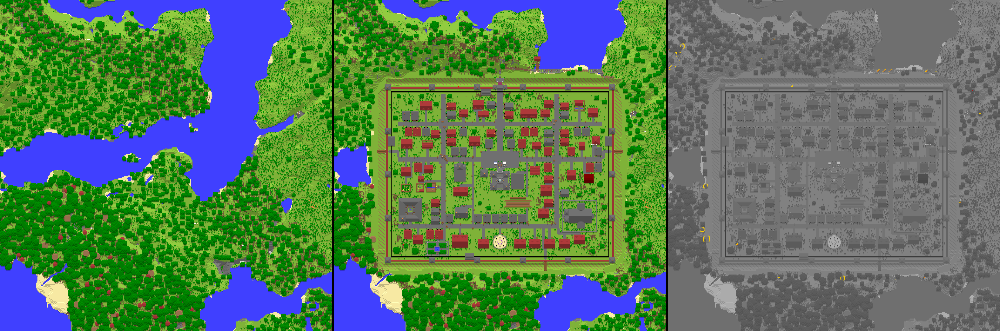

## Summary

| site | result |
|---|---|
| knoll | 41 findings |

# KingdomQuest field test

Seed 20261117. Positions in details are relative to the heart (x, y, z).

## knoll

minecraft:birch_forest at 7684, 71, 5996, facing CLOCKWISE_180, relief 57, walkable out before founding: true, style temperate, ground grass_block. Shape knoll (score 7.8), land relative to the heart, directions S SE E NE N NW W SW: 24 out [-9, -9, -9, -14, -11, -11, -9, -8]; 48 out [-8, -9, -14, -10, -11, -8, -11, -7]; 72 out [-4, -9, -14, -26, -4, -8, -13, -1]; 96 out [8, -4, -8, -17, 0, -3, -15, 2]. Gate approach cost per side (* = used): south 58, west 97, north 10*, east 34.

| stage | ms | float built | float land | floating feet | buried | destroyed | doors unreached | walk out | breach | wet inside | wet moat | new cliffs | tall walls | pits | road gaps | road steps | wall gaps | cut trees | foreign ground | snow lost | road steep | stumps | road high | road bank | road moved |
|---|---|---|---|---|---|---|---|---|---|---|---|---|---|---|---|---|---|---|---|---|---|---|---|---|---|
Founded as flat castle: plateau at 0 (relative to the heart), site shaped in 520 ms.

| tent_1 | 614 | 0 | 0 | 0 | 0 | 0 | 0 | 1 | 0 | 0 | 0 | 49 | 0 | 2 | 0 | 0 | 0 | 0 | 0 | 0 | 0 | 0 | 0 | 0 | 0 |
Country road to 7814, 67, 5895 (74 blocks of water on the way).

Lord's changes: broke 2 blocks before tent_2; repair leaves them.

Lord's changes after tent_2: unchanged spot kept broken, changed spot rebuilt by the new plan, 1 change(s) remembered.

| tent_2 | 847 | 0 | 0 | 0 | 0 | 1 | 0 | 1 | 0 | 0 | 0 | 75 | 0 | 3 | 0 | 0 | 0 | 0 | 0 | 0 | 0 | 0 | 0 | 0 | 0 |
| tent_3 | 637 | 0 | 0 | 0 | 0 | 0 | 0 | 1 | 0 | 0 | 0 | 75 | 0 | 3 | 0 | 0 | 0 | 0 | 0 | 0 | 0 | 0 | 0 | 0 | 0 |
| hamlet_1 | 999 | 0 | 0 | 0 | 0 | 2 | 0 | 1 | 0 | 0 | 0 | 75 | 0 | 3 | 0 | 0 | 0 | 0 | 0 | 0 | 0 | 0 | 0 | 0 | 0 |
| hamlet_2 | 625 | 5 | 0 | 0 | 0 | 0 | 0 | 1 | 0 | 0 | 0 | 75 | 0 | 3 | 0 | 0 | 0 | 0 | 0 | 0 | 0 | 0 | 0 | 0 | 0 |
| hamlet_3 | 604 | 1 | 0 | 0 | 0 | 11 | 0 | 1 | 0 | 0 | 0 | 74 | 0 | 3 | 0 | 0 | 0 | 0 | 0 | 0 | 0 | 0 | 0 | 0 | 0 |
| village_1 | 1073 | 0 | 0 | 0 | 0 | 11 | 0 | 1 | 0 | 0 | 0 | 95 | 0 | 4 | 0 | 0 | 0 | 0 | 0 | 0 | 0 | 0 | 0 | 0 | 0 |
| town_1 | 618 | 0 | 7 | 0 | 0 | 5 | 0 | 1 | 0 | 0 | 0 | 197 | 0 | 17 | 0 | 0 | 0 | 0 | 0 | 0 | 0 | 0 | 0 | 0 | 0 |
| castle_1 | 1159 | 0 | 5 | 0 | 0 | 5 | 0 | 1 | 0 | 0 | 0 | 194 | 0 | 16 | 0 | 0 | 0 | 0 | 0 | 0 | 0 | 0 | 0 | 0 | 0 |
| castle_2 | 1323 | 0 | 5 | 0 | 0 | 3 | 0 | 1 | 0 | 0 | 0 | 194 | 0 | 16 | 0 | 0 | 0 | 0 | 0 | 0 | 0 | 0 | 0 | 0 | 0 |
| citadel_1 | 1387 | 0 | 5 | 0 | 0 | 3 | 0 | 1 | 0 | 0 | 0 | 194 | 0 | 16 | 0 | 0 | 0 | 0 | 0 | 0 | 0 | 0 | 0 | 0 | 0 |
| final | 0 | 0 | 5 | 0 | 0 | 3 | 0 | 1 | 0 | 0 | 0 | 194 | 0 | 16 | 0 | 0 | 0 | 0 | 0 | 0 | 0 | 0 | 0 | 0 | 0 |
Country road at the end: 62 of 72 cells near the castle intact, cut at [0, 0, -104, 0, 0, -105, 0, 1, -108, 45, -1, -109, 47, 0, -109].

Gate (land relative to the heart, before -> after) at 0/5/10/15/20/30/40 blocks out of the gate: -2->-2 -2->-2 -2->-4 -2->-2 -2->-2 5->-2 7->-2. Moat columns per side {back=2699, gate=2829, left=684, right=756}. Way-out road none.

Production: level 1 made 16102 items in a game day, 48327 in three (store 4320 stacks); level 5 with every milestone 141571 items of 239 kinds a day. Storehouse goods shown: 14 blocks; unloaded 15552 items into the chests.

Tram: 880 rails, stops [gate, west, north, east]
Signal fires: 20 on 13 towers, lit 20, put out 20; tower guard posts 20.

- tent_1: new cliffs 49 [(-189,27,-133) to 3, (-189,30,-113) to -5, (-189,30,-113) to -5, (-189,25,-111) to 5, (-189,30,-110) to -5]
- tent_1: pits 2 [(-71,24,-143) hole, (-69,24,-145) hole]
- tent_2: destroyed 1 [main (2,0,8) white_wool->air]
- tent_2: new cliffs 75 [(-189,27,-133) to 3, (-189,30,-113) to -5, (-189,30,-113) to -5, (-189,25,-111) to 5, (-189,30,-110) to -5]
- tent_2: pits 3 [(-71,24,-143) hole, (-69,24,-145) hole, (1,-27,-121) hole]
- tent_3: new cliffs 75 [(-189,27,-133) to 3, (-189,30,-113) to -5, (-189,30,-113) to -5, (-189,25,-111) to 5, (-189,30,-110) to -5]
- tent_3: pits 3 [(-71,24,-143) hole, (-69,24,-145) hole, (1,-27,-121) hole]
- hamlet_1: destroyed 2 [main (-4,0,8) rose_bush->air, main (-4,1,8) rose_bush->air]
- hamlet_1: new cliffs 75 [(-189,27,-133) to 3, (-189,30,-113) to -5, (-189,30,-113) to -5, (-189,25,-111) to 5, (-189,30,-110) to -5]
- hamlet_1: pits 3 [(-71,24,-143) hole, (-69,24,-145) hole, (1,-27,-121) hole]
- hamlet_2: float built 5 [lamps (-53,0,-4) spruce_fence, lamps (-53,1,-4) torch, dock (43,1,-118) lantern, lamps (62,0,-13) spruce_fence, lamps (62,1,-13) torch]
- hamlet_2: new cliffs 75 [(-189,27,-133) to 3, (-189,30,-113) to -5, (-189,30,-113) to -5, (-189,25,-111) to 5, (-189,30,-110) to -5]
- hamlet_2: pits 3 [(-71,24,-143) hole, (-69,24,-145) hole, (1,-27,-121) hole]
- hamlet_3: float built 1 [dock (43,1,-118) lantern]
- hamlet_3: destroyed 11 [tavern (-40,1,60) vine->air, tavern (-41,1,60) vine->lilac, tavern (-45,1,60) vine->air, tavern (-49,1,60) vine->air, tavern (-40,2,60) vine->air]
- hamlet_3: new cliffs 74 [(-189,27,-133) to 3, (-189,30,-113) to -5, (-189,30,-113) to -5, (-189,25,-111) to 5, (-189,30,-110) to -5]
- hamlet_3: pits 3 [(-71,24,-143) hole, (-69,24,-145) hole, (1,-27,-121) hole]
- village_1: destroyed 11 [tavern (-40,1,60) vine->air, tavern (-41,1,60) vine->air, tavern (-45,1,60) vine->air, tavern (-49,1,60) vine->air, tavern (-40,2,60) vine->air]
- village_1: new cliffs 95 [(-189,27,-133) to 3, (-189,30,-113) to -5, (-189,30,-113) to -5, (-189,25,-111) to 5, (-189,30,-110) to -5]
- village_1: pits 4 [(-84,-20,72) hole, (-71,24,-143) hole, (-69,24,-145) hole, (1,-27,-121) hole]
- town_1: float land 7 [(-94,6,134) oak_log, (9,13,133) dark_oak_log, (9,14,133) dark_oak_log, (148,9,-37) oak_log, (149,9,-38) oak_log]
- town_1: destroyed 5 [tavern (-40,1,60) vine->air, tavern (-41,1,60) vine->air, tavern (-40,2,60) vine->air, tavern (-41,2,60) vine->air, tavern (-42,3,49) dark_oak_hanging_sign->air]
- town_1: new cliffs 197 [(-189,27,-133) to 3, (-189,30,-113) to -5, (-189,30,-113) to -5, (-189,25,-111) to 5, (-189,30,-110) to -5]
- town_1: pits 17 [(-115,2,112) spike, (-111,8,91) spike, (-69,24,-145) hole, (50,1,-108) spike, (51,2,-109) spike]
- castle_1: float land 5 [(-94,6,134) oak_log, (9,13,133) dark_oak_log, (9,14,133) dark_oak_log, (154,15,-20) oak_log, (159,17,-86) oak_log]
- castle_1: destroyed 5 [tavern (-40,1,60) vine->air, tavern (-41,1,60) vine->air, tavern (-40,2,60) vine->air, tavern (-41,2,60) vine->air, tavern (-42,3,49) dark_oak_hanging_sign->air]
- castle_1: new cliffs 194 [(-189,27,-133) to 3, (-189,30,-113) to -5, (-189,30,-113) to -5, (-189,25,-111) to 5, (-189,30,-110) to -5]
- castle_1: pits 16 [(-111,8,91) spike, (-69,24,-145) hole, (50,1,-108) spike, (51,2,-109) spike, (52,2,-110) spike]
- castle_2: float land 5 [(-94,6,134) oak_log, (9,13,133) dark_oak_log, (9,14,133) dark_oak_log, (154,15,-20) oak_log, (159,17,-86) oak_log]
- castle_2: destroyed 3 [tavern (-40,1,60) vine->air, tavern (-41,1,60) vine->air, tavern (-40,2,60) vine->air]
- castle_2: new cliffs 194 [(-189,27,-133) to 3, (-189,30,-113) to -5, (-189,30,-113) to -5, (-189,25,-111) to 5, (-189,30,-110) to -5]
- castle_2: pits 16 [(-111,8,91) spike, (-69,24,-145) hole, (50,1,-108) spike, (51,2,-109) spike, (52,2,-110) spike]
- citadel_1: float land 5 [(-94,6,134) oak_log, (9,13,133) dark_oak_log, (9,14,133) dark_oak_log, (154,15,-20) oak_log, (159,17,-86) oak_log]
- citadel_1: destroyed 3 [tavern (-40,1,60) vine->air, tavern (-41,1,60) vine->air, tavern (-40,2,60) vine->air]
- citadel_1: new cliffs 194 [(-189,27,-133) to 3, (-189,30,-113) to -5, (-189,30,-113) to -5, (-189,25,-111) to 5, (-189,30,-110) to -5]
- citadel_1: pits 16 [(-111,8,91) spike, (-69,24,-145) hole, (50,1,-108) spike, (51,2,-109) spike, (52,2,-110) spike]
- final: float land 5 [(-94,6,134) oak_log, (9,13,133) dark_oak_log, (9,14,133) dark_oak_log, (154,15,-20) oak_log, (159,17,-86) oak_log]
- final: destroyed 3 [tavern (-40,1,60) vine->air, tavern (-41,1,60) vine->air, tavern (-40,2,60) vine->air]
- final: new cliffs 194 [(-189,27,-133) to 3, (-189,30,-113) to -5, (-189,30,-113) to -5, (-189,25,-111) to 5, (-189,30,-110) to -5]
- final: pits 16 [(-111,8,91) spike, (-69,24,-145) hole, (50,1,-108) spike, (51,2,-109) spike, (52,2,-110) spike]
- country road cut in 10 cells, e.g. [0, 0, -104, 0, 0, -105, 0, 1, -108, 45, -1, -109, 47, 0, -109]

