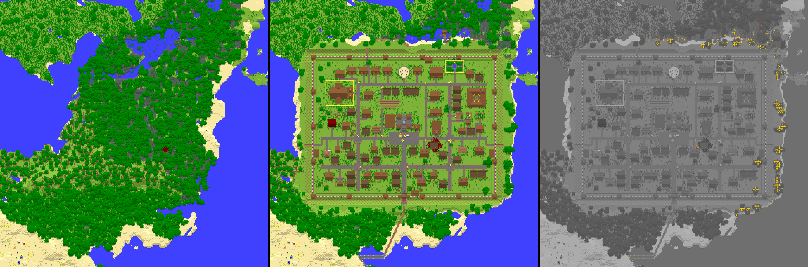

## Summary

| site | result |
|---|---|
| mangrove | 43 findings |

# KingdomQuest field test

Seed 20261117. Positions in details are relative to the heart (x, y, z).

## mangrove

minecraft:mangrove_swamp at -8, 69, 1476, facing NONE, relief 26, walkable out before founding: true, style wild, ground grass_block. Gate approach cost per side (* = used): south 19*, west 67, north 62, east 30.

| stage | ms | float built | float land | floating feet | buried | destroyed | doors unreached | walk out | breach | wet inside | wet moat | new cliffs | tall walls | pits | road gaps | road steps | wall gaps | cut trees | foreign ground | snow lost | road steep | stumps | road high | road bank | road moved |
|---|---|---|---|---|---|---|---|---|---|---|---|---|---|---|---|---|---|---|---|---|---|---|---|---|---|
Founded as flat castle: plateau at 0 (relative to the heart), site shaped in 914 ms.

| tent_1 | 337 | 0 | 0 | 0 | 0 | 0 | 0 | 1 | 0 | 0 | 0 | 201 | 0 | 23 | 0 | 0 | 0 | 0 | 0 | 0 | 0 | 0 | 0 | 0 | 0 |
Country road to -58, 68, 1697 (40 blocks of water on the way).

Lord's changes: broke 2 blocks before tent_2; repair leaves them.

Lord's changes after tent_2: unchanged spot kept broken, changed spot rebuilt by the new plan, 1 change(s) remembered.

| tent_2 | 576 | 0 | 0 | 0 | 0 | 1 | 0 | 1 | 0 | 0 | 0 | 355 | 0 | 48 | 0 | 0 | 0 | 0 | 0 | 0 | 0 | 0 | 0 | 0 | 0 |
| tent_3 | 215 | 0 | 0 | 0 | 0 | 0 | 0 | 1 | 0 | 0 | 0 | 355 | 0 | 48 | 0 | 0 | 0 | 0 | 0 | 0 | 0 | 0 | 0 | 0 | 0 |
| hamlet_1 | 973 | 0 | 30 | 0 | 0 | 0 | 0 | 1 | 0 | 0 | 0 | 341 | 0 | 63 | 0 | 0 | 0 | 0 | 0 | 0 | 0 | 0 | 0 | 0 | 0 |
| hamlet_2 | 226 | 1 | 0 | 0 | 0 | 0 | 0 | 1 | 0 | 0 | 0 | 450 | 0 | 87 | 0 | 0 | 0 | 0 | 0 | 0 | 0 | 0 | 0 | 74 | 0 |
| hamlet_3 | 262 | 1 | 4 | 0 | 0 | 0 | 0 | 1 | 0 | 0 | 0 | 641 | 0 | 112 | 0 | 0 | 0 | 0 | 0 | 0 | 0 | 0 | 0 | 0 | 0 |
| village_1 | 569 | 1 | 19 | 0 | 0 | 0 | 0 | 1 | 0 | 0 | 0 | 585 | 0 | 99 | 4 | 0 | 0 | 0 | 0 | 0 | 0 | 0 | 0 | 0 | 0 |
| town_1 | 413 | 1 | 26 | 0 | 0 | 0 | 0 | 1 | 0 | 0 | 0 | 1137 | 0 | 32 | 0 | 0 | 0 | 0 | 0 | 0 | 0 | 0 | 0 | 0 | 0 |
| castle_1 | 879 | 1 | 26 | 0 | 0 | 0 | 0 | 1 | 0 | 0 | 0 | 1095 | 0 | 29 | 0 | 0 | 0 | 0 | 0 | 0 | 0 | 0 | 0 | 0 | 0 |
| castle_2 | 927 | 1 | 26 | 0 | 0 | 0 | 0 | 1 | 0 | 0 | 0 | 1010 | 0 | 29 | 0 | 0 | 0 | 0 | 0 | 0 | 0 | 0 | 0 | 0 | 0 |
| citadel_1 | 1030 | 1 | 26 | 0 | 0 | 0 | 0 | 1 | 0 | 0 | 0 | 1010 | 0 | 29 | 0 | 0 | 0 | 0 | 0 | 0 | 0 | 0 | 0 | 0 | 0 |
| final | 0 | 1 | 26 | 0 | 0 | 0 | 0 | 1 | 0 | 0 | 0 | 1010 | 0 | 29 | 0 | 0 | 0 | 0 | 0 | 0 | 0 | 0 | 0 | 0 | 0 |
Country road at the end: 10 of 10 cells near the castle intact.

Gate (land relative to the heart, before -> after) at 0/5/10/15/20/30/40 blocks out of the gate: 6->-2 9->-2 12->-2 14->-2 14->-2 14->-2 2->-2. Moat columns per side {back=2978, gate=2955, left=742, right=774}. Way-out road none.

Production: level 1 made 16102 items in a game day, 48327 in three (store 4320 stacks); level 5 with every milestone 141571 items of 241 kinds a day. Storehouse goods shown: 14 blocks; unloaded 15552 items into the chests.

Tram: 880 rails, stops [gate, west, north, east]
Signal fires: 20 on 13 towers, lit 20, put out 20; tower guard posts 20.

- tent_1: new cliffs 201 [(-33,3,2) to -4, (-31,8,19) to -3, (-29,1,-15) to -3, (-28,-2,-7) to 9, (-28,7,-6) to -9]
- tent_1: pits 23 [(-28,7,-6) spike, (-27,13,25) spike, (-25,5,6) spike, (-25,2,10) spike, (-21,6,20) hole]
- tent_2: destroyed 1 [main (-5,1,0) jungle_log->air]
- tent_2: new cliffs 355 [(-64,-5,177) to 3, (-63,-2,177) to -3, (-62,-1,176) to -4, (-53,-7,-30) to 4, (-52,0,-16) to -3]
- tent_2: pits 48 [(-47,-2,-20) hole, (-46,-3,-22) hole, (-37,12,17) spike, (-36,7,-13) spike, (-36,8,5) spike]
- tent_3: new cliffs 355 [(-64,-5,177) to 3, (-63,-2,177) to -3, (-62,-1,176) to -4, (-53,-7,-30) to 4, (-52,0,-16) to -3]
- tent_3: pits 48 [(-47,-2,-20) hole, (-46,-3,-22) hole, (-37,12,17) spike, (-36,7,-13) spike, (-36,8,5) spike]
- hamlet_1: float land 30 [(65,10,22) mangrove_log, (65,11,22) mangrove_log, (65,12,22) mangrove_log, (65,13,22) mangrove_log, (65,14,22) mangrove_log]
- hamlet_1: new cliffs 341 [(-64,-5,177) to 3, (-63,-2,177) to -3, (-62,-1,176) to -4, (-53,-7,-30) to 4, (-52,0,-16) to -3]
- hamlet_1: pits 63 [(-50,4,-6) spike, (-48,3,10) spike, (-47,-2,-20) hole, (-46,-3,-22) hole, (-45,3,-28) spike]
- hamlet_2: float built 1 [dock (58,-2,-140) lantern]
- hamlet_2: new cliffs 450 [(-64,-5,177) to 3, (-63,-2,177) to -3, (-62,-1,176) to -4, (-53,-7,-30) to 4, (-51,-6,-30) to 3]
- hamlet_2: pits 87 [(-93,1,80) spike, (-46,-2,-22) hole, (-46,-1,12) hole, (-45,3,-28) spike, (-45,-2,9) hole]
- hamlet_2: road bank 74 [(-64,-1,7) over 2/2, (49,-1,7) over 3/3, (-66,-1,7) over 2/2, (-65,-1,5) over 2/2, (-65,-1,8) over 2/2]
- hamlet_3: float built 1 [dock (58,-2,-140) lantern]
- hamlet_3: float land 4 [(50,6,-84) dirt, (50,7,-84) dirt, (50,8,-84) dirt, (50,9,-84) grass_block]
- hamlet_3: new cliffs 641 [(-64,-5,177) to 3, (-63,-2,177) to -3, (-62,-1,176) to -4, (-53,-7,-30) to 4, (-51,-6,-30) to 3]
- hamlet_3: pits 112 [(-93,1,80) spike, (-46,-2,-22) hole, (-46,-1,12) hole, (-45,3,-28) spike, (-42,1,-33) spike]
- village_1: float built 1 [dock (58,-2,-145) lantern]
- village_1: float land 19 [(-43,11,-104) mangrove_log, (-43,10,-103) mangrove_log, (-43,9,-102) mangrove_log, (-43,5,-101) mangrove_log, (-43,6,-101) mangrove_log]
- village_1: new cliffs 585 [(-71,-4,-56) to -4, (-70,-12,-58) to 3, (-64,-5,177) to 3, (-63,-2,177) to -3, (-62,-4,-71) to -4]
- village_1: pits 99 [(-93,1,80) spike, (-70,-12,-58) hole, (-60,-8,-50) hole, (-59,1,-38) spike, (-59,-5,-37) hole]
- village_1: road gaps 4 [(-63,-1,-41) dirt_path over air, (-64,-1,-34) dirt_path over air, (-64,-1,-33) dirt_path over air, (-65,-1,-32) dirt_path over air]
- town_1: float built 1 [dock (58,-2,-145) lantern]
- town_1: float land 26 [(-103,14,110) oak_log, (-102,12,109) oak_log, (-72,8,110) oak_log, (124,10,-158) mangrove_log, (124,9,-157) mangrove_log]
- town_1: new cliffs 1137 [(-64,-5,177) to 3, (-63,-2,177) to -3, (-62,-1,176) to -4, (-40,-8,-136) to 5, (-39,-8,-136) to 5]
- town_1: pits 32 [(4,-7,-135) hole, (7,-11,-137) hole, (7,-10,-134) hole, (15,-10,-133) hole, (32,2,17) spike]
- castle_1: float built 1 [dock (58,-2,-145) lantern]
- castle_1: float land 26 [(-103,14,110) oak_log, (-102,12,109) oak_log, (-72,8,110) oak_log, (124,10,-158) mangrove_log, (124,9,-157) mangrove_log]
- castle_1: new cliffs 1095 [(-64,-5,177) to 3, (-63,-2,177) to -3, (-62,-1,176) to -4, (-40,-8,-136) to 5, (-39,-8,-136) to 5]
- castle_1: pits 29 [(4,-7,-135) hole, (7,-11,-137) hole, (7,-10,-134) hole, (15,-10,-133) hole, (32,2,17) spike]
- castle_2: float built 1 [dock (58,-2,-145) lantern]
- castle_2: float land 26 [(-103,14,110) oak_log, (-102,12,109) oak_log, (-72,8,110) oak_log, (124,10,-158) mangrove_log, (124,9,-157) mangrove_log]
- castle_2: new cliffs 1010 [(-64,-5,177) to 3, (-63,-2,177) to -3, (-62,-1,176) to -4, (-40,-8,-136) to 5, (-39,-8,-136) to 5]
- castle_2: pits 29 [(4,-7,-135) hole, (7,-11,-137) hole, (7,-10,-134) hole, (15,-10,-133) hole, (32,2,17) spike]
- citadel_1: float built 1 [dock (58,-2,-145) lantern]
- citadel_1: float land 26 [(-103,14,110) oak_log, (-102,12,109) oak_log, (-72,8,110) oak_log, (124,10,-158) mangrove_log, (124,9,-157) mangrove_log]
- citadel_1: new cliffs 1010 [(-64,-5,177) to 3, (-63,-2,177) to -3, (-62,-1,176) to -4, (-40,-8,-136) to 5, (-39,-8,-136) to 5]
- citadel_1: pits 29 [(4,-7,-135) hole, (7,-11,-137) hole, (7,-10,-134) hole, (15,-10,-133) hole, (32,2,17) spike]
- final: float built 1 [dock (58,-2,-145) lantern]
- final: float land 26 [(-103,14,110) oak_log, (-102,12,109) oak_log, (-72,8,110) oak_log, (124,10,-158) mangrove_log, (124,9,-157) mangrove_log]
- final: new cliffs 1010 [(-64,-5,177) to 3, (-63,-2,177) to -3, (-62,-1,176) to -4, (-40,-8,-136) to 5, (-39,-8,-136) to 5]
- final: pits 29 [(4,-7,-135) hole, (7,-11,-137) hole, (7,-10,-134) hole, (15,-10,-133) hole, (32,2,17) spike]

