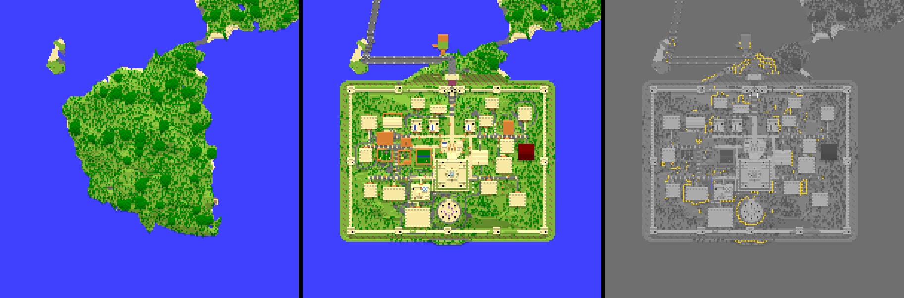

## Summary

| site | result |
|---|---|
| mesa | 48 findings |

# KingdomQuest field test

Seed 1813296525. Positions in details are relative to the heart (x, y, z).

## mesa

minecraft:savanna at 2300, 76, 13588, facing CLOCKWISE_180, relief 18, walkable out before founding: true, style arid, ground grass_block. Shape mesa (score 1.3), land relative to the heart, directions S SE E NE N NW W SW: 24 out [0, -1, -2, -3, 3, 1, 1, -1]; 48 out [-13, -3, -22, -10, -6, -5, -9, -19]; 72 out [-25, -19, -27, -27, -12, -12, -22, -26]; 96 out [-26, -23, -27, -17, -26, -12, -26, -26]. Gate approach cost per side (* = used): south 138, west 159, north 109*, east 170.

| stage | ms | float built | float land | floating feet | buried | destroyed | doors unreached | walk out | breach | wet inside | wet moat | new cliffs | tall walls | pits | road gaps | road steps | wall gaps | cut trees | foreign ground | snow lost | road steep | stumps | road high | road bank | road moved |
|---|---|---|---|---|---|---|---|---|---|---|---|---|---|---|---|---|---|---|---|---|---|---|---|---|---|
| tent_1 | 433 | 0 | 0 | 0 | 0 | 0 | 0 | 1 | 0 | 0 | 0 | 1 | 0 | 0 | 0 | 0 | 0 | 0 | 0 | 0 | 0 | 0 | 0 | 0 | 0 |
Country road to 2250, -64, 13417 (98 blocks of water on the way).

Lord's changes: broke 2 blocks before tent_2; repair leaves them.

Lord's changes after tent_2: unchanged spot kept broken, changed spot rebuilt by the new plan, 1 change(s) remembered.

| tent_2 | 185 | 0 | 0 | 0 | 0 | 1 | 0 | 1 | 0 | 0 | 0 | 10 | 20 | 0 | 0 | 0 | 0 | 0 | 0 | 0 | 0 | 0 | 0 | 0 | 0 |
| tent_3 | 113 | 0 | 0 | 0 | 0 | 0 | 0 | 1 | 0 | 0 | 0 | 10 | 20 | 0 | 0 | 0 | 0 | 0 | 0 | 0 | 0 | 0 | 0 | 0 | 0 |
| hamlet_1 | 250 | 0 | 0 | 0 | 0 | 0 | 0 | 1 | 0 | 0 | 0 | 255 | 20 | 0 | 0 | 0 | 0 | 0 | 0 | 0 | 0 | 0 | 0 | 0 | 0 |
| hamlet_2 | 181 | 0 | 0 | 0 | 0 | 0 | 0 | 1 | 0 | 0 | 0 | 145 | 20 | 1 | 0 | 0 | 0 | 0 | 0 | 0 | 0 | 0 | 0 | 11 | 0 |
| hamlet_3 | 180 | 0 | 0 | 0 | 0 | 0 | 0 | 1 | 0 | 0 | 0 | 197 | 20 | 2 | 0 | 0 | 0 | 0 | 0 | 0 | 0 | 0 | 0 | 0 | 0 |
| village_1 | 181 | 0 | 0 | 0 | 0 | 0 | 0 | 1 | 0 | 0 | 0 | 283 | 21 | 6 | 0 | 0 | 0 | 0 | 0 | 0 | 7 | 0 | 0 | 0 | 0 |
| town_1 | 200 | 0 | 0 | 0 | 0 | 0 | 0 | 0 | 0 | 0 | 0 | 355 | 20 | 3 | 0 | 0 | 303 | 0 | 0 | 0 | 8 | 0 | 0 | 2 | 3 |
| castle_1 | 289 | 0 | 0 | 0 | 0 | 0 | 0 | 1 | 0 | 0 | 0 | 387 | 7 | 3 | 0 | 0 | 0 | 0 | 0 | 0 | 8 | 0 | 0 | 2 | 0 |
| castle_2 | 276 | 0 | 0 | 0 | 0 | 0 | 0 | 1 | 0 | 0 | 0 | 434 | 7 | 2 | 0 | 0 | 0 | 0 | 0 | 0 | 8 | 0 | 0 | 2 | 0 |
| citadel_1 | 227 | 0 | 0 | 0 | 0 | 0 | 0 | 1 | 0 | 0 | 0 | 434 | 7 | 2 | 0 | 0 | 0 | 0 | 0 | 0 | 8 | 0 | 0 | 2 | 0 |
| final | 0 | 0 | 0 | 0 | 0 | 0 | 0 | 1 | 0 | 0 | 0 | 522 | 6 | 2 | 0 | 0 | 0 | 0 | 0 | 0 | 8 | 0 | 0 | 2 | 0 |
Country road at the end: 27 of 27 cells near the castle intact.

Gate (land relative to the heart, before -> after) at 0/5/10/15/20/30/40 blocks out of the gate: -6->-11 -8->-7 -10->-2 -13->-4 -14->-8 -14->-14 -14->-14. Moat columns per side {back=274, gate=605, left=194, right=194}. Way-out road 13 blocks.

- tent_1: new cliffs 1 [(23,-4,33) to -3]
- tent_2: destroyed 1 [main (2,0,8) orange_terracotta->air]
- tent_2: new cliffs 10 [(-59,-14,-66) to 3, (-59,-14,-59) to 3, (-55,-14,-73) to 3, (-55,-14,-72) to 3, (-54,-11,-70) to -4]
- tent_2: tall walls 20 [(-3,-14,-57) 9 cap unowned low unowned:stone_bricks, (-3,-14,-56) 9 cap unowned low unowned:stone_bricks, (-3,-14,-55) 10 cap unowned low unowned:stone_bricks, (-3,-14,-54) 11 cap unowned low unowned:stone_bricks, (-3,-13,-53) 11 cap unowned low unowned:stone_bricks]
- tent_3: new cliffs 10 [(-59,-14,-66) to 3, (-59,-14,-59) to 3, (-55,-14,-73) to 3, (-55,-14,-72) to 3, (-54,-11,-70) to -4]
- tent_3: tall walls 20 [(-3,-14,-57) 9 cap unowned low unowned:stone_bricks, (-3,-14,-56) 9 cap unowned low unowned:stone_bricks, (-3,-14,-55) 10 cap unowned low unowned:stone_bricks, (-3,-14,-54) 11 cap unowned low unowned:stone_bricks, (-3,-13,-53) 11 cap unowned low unowned:stone_bricks]
- hamlet_1: new cliffs 255 [(-59,-14,-66) to 3, (-59,-14,-59) to 3, (-55,-14,-73) to 3, (-55,-14,-72) to 3, (-54,-11,-70) to -4]
- hamlet_1: tall walls 20 [(-3,-14,-57) 9 cap unowned low unowned:stone_bricks, (-3,-14,-56) 9 cap unowned low unowned:stone_bricks, (-3,-14,-55) 10 cap unowned low unowned:stone_bricks, (-3,-14,-54) 11 cap unowned low unowned:stone_bricks, (-3,-13,-53) 11 cap unowned low unowned:stone_bricks]
- hamlet_2: new cliffs 145 [(-59,-14,-66) to 3, (-59,-14,-59) to 3, (-55,-14,-73) to 3, (-55,-14,-72) to 3, (-54,-11,-70) to -4]
- hamlet_2: tall walls 20 [(-3,-14,-57) 9 cap unowned low unowned:stone_bricks, (-3,-14,-56) 9 cap unowned low unowned:stone_bricks, (-3,-14,-55) 10 cap unowned low unowned:stone_bricks, (-3,-14,-54) 11 cap unowned low unowned:stone_bricks, (-3,-13,-53) 11 cap unowned low unowned:stone_bricks]
- hamlet_2: pits 1 [(-16,-8,37) hole]
- hamlet_2: road bank 11 [(49,-12,-9) over 2/2, (0,-1,-38) over 4/4, (0,-1,-39) over 4/4, (0,-1,-40) over 5/4, (0,-1,-37) over 4/4]
- hamlet_3: new cliffs 197 [(-63,-11,10) to -3, (-62,-11,9) to -3, (-62,-14,10) to 3, (-62,-11,11) to -3, (-61,-14,11) to 3]
- hamlet_3: tall walls 20 [(-3,-14,-57) 9 cap unowned low unowned:stone_bricks, (-3,-14,-56) 9 cap unowned low unowned:stone_bricks, (-3,-14,-55) 10 cap unowned low unowned:stone_bricks, (-3,-14,-54) 11 cap unowned low unowned:stone_bricks, (-3,-13,-53) 11 cap unowned low unowned:stone_bricks]
- hamlet_3: pits 2 [(-55,-14,10) hole, (-45,-13,19) hole]
- village_1: new cliffs 283 [(-63,-11,10) to -3, (-62,-11,9) to -3, (-62,-14,10) to 3, (-62,-11,11) to -3, (-61,-14,11) to 3]
- village_1: tall walls 21 [(-14,-1,32) -7 cap unowned low unowned:tuff, (-3,-14,-57) 9 cap unowned low unowned:stone_bricks, (-3,-14,-56) 9 cap unowned low unowned:stone_bricks, (-3,-14,-55) 10 cap unowned low unowned:stone_bricks, (-3,-14,-54) 11 cap unowned low unowned:stone_bricks]
- village_1: pits 6 [(-55,-14,10) hole, (-45,-13,19) hole, (-41,-13,21) hole, (-41,-13,27) hole, (-39,-13,31) hole]
- village_1: road steep 7 [(-29,-8,27) to -3 in 3, (-29,-5,24) to -3 in 3, (-29,-6,25) to -3 in 3, (-29,-7,26) to -3 in 3, (-29,-4,23) to -3 in 3]
- town_1: walk out no way out of the settlement []
- town_1: new cliffs 355 [(-61,-13,23) to 3, (-60,-13,22) to 3, (-59,-14,-66) to 3, (-59,-14,-59) to 3, (-59,-14,21) to 4]
- town_1: tall walls 20 [(-43,-6,21) -7 cap unowned low unowned:stone, (-14,-1,32) -7 cap unowned low unowned:tuff, (-3,-14,-57) 9 cap unowned low unowned:stone_bricks, (-3,-14,-56) 9 cap unowned low unowned:stone_bricks, (-3,-14,-55) 10 cap unowned low unowned:stone_bricks]
- town_1: pits 3 [(-50,-13,22) hole, (-46,-13,16) hole, (-29,-5,-12) hole]
- town_1: wall gaps 303 [(-47,-14,-40) over water, (49,-14,-40) over water, (-47,-14,56) over water, (49,-14,56) over water, (17,-14,56) over water]
- town_1: road steep 8 [(-29,-8,27) to -3 in 3, (-29,-5,24) to -3 in 3, (-29,-6,25) to -3 in 3, (-29,-7,26) to -3 in 3, (-29,-1,20) to -3 in 3]
- town_1: road bank 2 [(49,-12,-10) over 2/2, (-39,-5,21) over 2/2]
- town_1: road moved 3 [(-29,-9,27) from -8, (-29,-10,28) from -9, (-38,-7,-10) from -6]
- castle_1: new cliffs 387 [(-63,-11,10) to -3, (-62,-11,9) to -3, (-62,-14,10) to 3, (-62,-11,11) to -3, (-61,-11,9) to -3]
- castle_1: tall walls 7 [(-14,-1,32) -7 cap unowned low unowned:tuff, (-3,-11,-37) 10 cap unowned low unowned:stone, (-3,-10,-36) 9 cap unowned low unowned:tuff, (-3,-9,-35) 7 cap unowned low unowned:andesite, (2,-1,-37) -10 cap unowned low unowned:stone]
- castle_1: pits 3 [(-55,-14,10) hole, (-46,-13,16) hole, (-29,-5,-12) hole]
- castle_1: road steep 8 [(-29,-8,27) to -3 in 3, (-29,-5,24) to -3 in 3, (-29,-6,25) to -3 in 3, (-29,-7,26) to -3 in 3, (-29,-1,20) to -3 in 3]
- castle_1: road bank 2 [(49,-12,-10) over 2/2, (-39,-5,21) over 2/2]
- castle_2: new cliffs 434 [(-63,-11,10) to -3, (-62,-11,9) to -3, (-62,-14,10) to 3, (-62,-11,11) to -3, (-61,-11,9) to -3]
- castle_2: tall walls 7 [(-14,-1,32) -7 cap unowned low unowned:tuff, (-3,-11,-37) 10 cap unowned low unowned:stone, (-3,-10,-36) 9 cap unowned low unowned:tuff, (-3,-9,-35) 7 cap unowned low unowned:andesite, (2,-1,-37) -10 cap unowned low unowned:stone]
- castle_2: pits 2 [(-55,-14,10) hole, (-29,-5,-12) hole]
- castle_2: road steep 8 [(-29,-8,27) to -3 in 3, (-29,-5,24) to -3 in 3, (-29,-6,25) to -3 in 3, (-29,-7,26) to -3 in 3, (-29,-1,20) to -3 in 3]
- castle_2: road bank 2 [(49,-12,-10) over 2/2, (-39,-5,21) over 2/2]
- citadel_1: new cliffs 434 [(-63,-11,10) to -3, (-62,-11,9) to -3, (-62,-14,10) to 3, (-62,-11,11) to -3, (-61,-11,9) to -3]
- citadel_1: tall walls 7 [(-14,-1,32) -7 cap unowned low unowned:tuff, (-3,-11,-37) 10 cap unowned low unowned:stone, (-3,-10,-36) 9 cap unowned low unowned:tuff, (-3,-9,-35) 7 cap unowned low unowned:andesite, (2,-1,-37) -10 cap unowned low unowned:stone]
- citadel_1: pits 2 [(-55,-14,10) hole, (-29,-5,-12) hole]
- citadel_1: road steep 8 [(-29,-8,27) to -3 in 3, (-29,-5,24) to -3 in 3, (-29,-6,25) to -3 in 3, (-29,-7,26) to -3 in 3, (-29,-1,20) to -3 in 3]
- citadel_1: road bank 2 [(49,-12,-10) over 2/2, (-39,-5,21) over 2/2]
- final: tall by [{unowned/unowned=6}]
- final: new cliffs 522 [(-63,-11,10) to -3, (-62,-11,9) to -3, (-62,-14,10) to 3, (-62,-11,11) to -3, (-61,-11,9) to -3]
- final: tall walls 6 [(-3,-11,-37) 10 cap unowned low unowned:stone, (-3,-10,-36) 9 cap unowned low unowned:tuff, (-3,-9,-35) 7 cap unowned low unowned:andesite, (2,-1,-37) -10 cap unowned low unowned:stone, (2,-1,-36) -9 cap unowned low unowned:stone]
- final: pits 2 [(-55,-14,10) hole, (-29,-5,-12) hole]
- final: road steep 8 [(-29,-8,27) to -3 in 3, (-29,-5,24) to -3 in 3, (-29,-6,25) to -3 in 3, (-29,-7,26) to -3 in 3, (-29,-1,20) to -3 in 3]
- final: road bank 2 [(49,-12,-10) over 2/2, (-39,-5,21) over 2/2]

