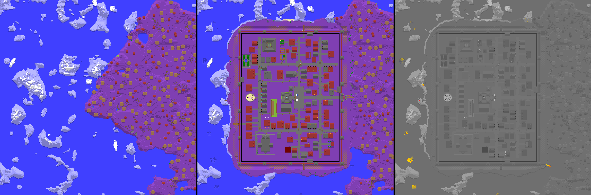

## Summary

| site | result |
|---|---|
| mushroom_fields | 58 findings |

# KingdomQuest field test

Seed 20261117. Positions in details are relative to the heart (x, y, z).

## mushroom_fields

minecraft:mushroom_fields at 5788, 70, 10076, facing COUNTERCLOCKWISE_90, relief 44, walkable out before founding: true, style temperate, ground mycelium. Gate approach cost per side (* = used): south 94, west 60, north 94, east 7*.

| stage | ms | float built | float land | floating feet | buried | destroyed | doors unreached | walk out | breach | wet inside | wet moat | new cliffs | tall walls | pits | road gaps | road steps | wall gaps | cut trees | foreign ground | snow lost | road steep | stumps | road high | road bank | road moved |
|---|---|---|---|---|---|---|---|---|---|---|---|---|---|---|---|---|---|---|---|---|---|---|---|---|---|
Founded as flat castle: plateau at 0 (relative to the heart), site shaped in 756 ms.

| tent_1 | 463 | 0 | 0 | 0 | 0 | 0 | 0 | 1 | 0 | 0 | 0 | 204 | 0 | 32 | 0 | 0 | 0 | 0 | 0 | 60 | 0 | 0 | 0 | 0 | 0 |
Country road to 5769, 69, 10026 (4 blocks of water on the way).

Lord's changes: broke 2 blocks before tent_2; repair leaves them.

Lord's changes after tent_2: unchanged spot kept broken, changed spot rebuilt by the new plan, 1 change(s) remembered.

| tent_2 | 516 | 0 | 0 | 0 | 0 | 1 | 0 | 1 | 0 | 0 | 0 | 240 | 0 | 41 | 0 | 0 | 0 | 0 | 0 | 83 | 0 | 0 | 0 | 0 | 0 |
| tent_3 | 199 | 0 | 0 | 0 | 0 | 0 | 0 | 1 | 0 | 0 | 0 | 240 | 0 | 41 | 0 | 0 | 0 | 0 | 0 | 83 | 0 | 0 | 0 | 0 | 0 |
| hamlet_1 | 724 | 0 | 0 | 0 | 0 | 2 | 0 | 1 | 0 | 0 | 0 | 270 | 0 | 38 | 0 | 0 | 0 | 0 | 0 | 144 | 0 | 0 | 0 | 0 | 0 |
| hamlet_2 | 194 | 2 | 0 | 0 | 0 | 0 | 0 | 1 | 0 | 0 | 0 | 381 | 0 | 55 | 0 | 0 | 0 | 0 | 0 | 173 | 0 | 0 | 0 | 0 | 0 |
| hamlet_3 | 235 | 0 | 0 | 0 | 0 | 11 | 0 | 1 | 0 | 0 | 0 | 394 | 0 | 52 | 0 | 0 | 0 | 0 | 0 | 223 | 0 | 0 | 0 | 0 | 0 |
| village_1 | 777 | 1 | 0 | 0 | 0 | 11 | 0 | 1 | 0 | 0 | 0 | 282 | 0 | 38 | 0 | 0 | 0 | 0 | 0 | 289 | 0 | 0 | 0 | 0 | 0 |
| town_1 | 606 | 1 | 0 | 0 | 0 | 5 | 0 | 1 | 0 | 2 | 0 | 404 | 0 | 50 | 0 | 0 | 0 | 0 | 0 | 747 | 0 | 0 | 0 | 0 | 0 |
| castle_1 | 1169 | 1 | 0 | 0 | 0 | 5 | 0 | 1 | 0 | 1 | 0 | 404 | 0 | 49 | 0 | 0 | 0 | 0 | 0 | 628 | 0 | 0 | 0 | 0 | 0 |
| castle_2 | 1150 | 1 | 0 | 0 | 0 | 5 | 0 | 1 | 0 | 1 | 0 | 404 | 0 | 49 | 0 | 0 | 0 | 0 | 0 | 627 | 0 | 0 | 0 | 0 | 0 |
| citadel_1 | 1092 | 1 | 0 | 0 | 0 | 5 | 0 | 1 | 0 | 0 | 0 | 402 | 0 | 48 | 0 | 0 | 0 | 0 | 0 | 501 | 0 | 0 | 0 | 0 | 0 |
| final | 0 | 1 | 0 | 0 | 0 | 5 | 0 | 1 | 0 | 0 | 0 | 402 | 0 | 48 | 0 | 0 | 0 | 0 | 0 | 501 | 0 | 0 | 0 | 0 | 0 |
Country road at the end: 131 of 143 cells near the castle intact, cut at [100, -1, -5, 99, -1, -5, 98, -1, -6, 97, -1, -6, 96, -1, -6].

Gate (land relative to the heart, before -> after) at 0/5/10/15/20/30/40 blocks out of the gate: 3->-2 3->-2 3->-2 3->-2 3->-2 8->-2 3->-2. Moat columns per side {back=2597, gate=2807, left=709, right=747}. Way-out road none.

Production: level 1 made 16102 items in a game day, 48327 in three (store 4320 stacks); level 5 with every milestone 141571 items of 239 kinds a day. Storehouse goods shown: 14 blocks; unloaded 15552 items into the chests.

Tram: 880 rails, stops [gate, west, north, east]
Signal fires: 20 on 13 towers, lit 20, put out 20; tower guard posts 20.

- tent_1: new cliffs 204 [(-60,-2,-11) to -3, (-59,-2,-13) to -4, (-59,-2,-12) to -3, (-59,-5,-11) to 3, (-58,-2,-14) to -4]
- tent_1: pits 32 [(-58,-13,-12) hole, (-57,-16,-10) hole, (-57,-6,43) hole, (-57,-2,49) spike, (-56,-10,-6) hole]
- tent_1: snow lost 60 [(-137,35,-26) on snow_block at air light 0, (-59,36,-57) on snow_block at air light 0]
- tent_2: destroyed 1 [main (-8,0,2) white_wool->air]
- tent_2: new cliffs 240 [(-60,-2,-11) to -3, (-59,27,-64) to -3, (-59,-2,-13) to -4, (-59,-2,-12) to -3, (-59,-5,-11) to 3]
- tent_2: pits 41 [(-58,-13,-12) hole, (-57,-16,-10) hole, (-57,-6,43) hole, (-57,-2,49) spike, (-56,-10,-6) hole]
- tent_2: snow lost 83 [(-137,35,-26) on snow_block at air light 0, (-11,0,-50) on mycelium at air light 0]
- tent_3: new cliffs 240 [(-60,-2,-11) to -3, (-59,27,-64) to -3, (-59,-2,-13) to -4, (-59,-2,-12) to -3, (-59,-5,-11) to 3]
- tent_3: pits 41 [(-58,-13,-12) hole, (-57,-16,-10) hole, (-57,-6,43) hole, (-57,-2,49) spike, (-56,-10,-6) hole]
- tent_3: snow lost 83 [(-137,35,-26) on snow_block at air light 0, (-11,0,-50) on mycelium at air light 0]
- hamlet_1: destroyed 2 [main (-8,0,-4) rose_bush->air, main (-8,1,-4) rose_bush->air]
- hamlet_1: new cliffs 270 [(-88,-2,-22) to -9, (-88,-2,-21) to -7, (-87,-2,-23) to -9, (-87,-9,-21) to 7, (-86,-12,-22) to 3]
- hamlet_1: pits 38 [(-85,-3,-21) spike, (-84,-11,-18) hole, (-83,-14,-20) hole, (-82,-8,-17) hole, (-81,-12,-19) hole]
- hamlet_1: snow lost 144 [(-137,35,-26) on snow_block at air light 0, (-22,0,-30) on mycelium at air light 0, (-14,0,-33) on mycelium at air light 0]
- hamlet_2: float built 2 [lamps (13,0,62) spruce_fence, lamps (13,1,62) torch]
- hamlet_2: new cliffs 381 [(-88,-2,-22) to -9, (-88,-2,-21) to -7, (-87,-2,-23) to -9, (-87,-9,-21) to 7, (-86,-12,-22) to 3]
- hamlet_2: pits 55 [(-85,-3,-21) spike, (-84,-11,-18) hole, (-83,-14,-20) hole, (-82,-8,-17) hole, (-81,-12,-19) hole]
- hamlet_2: snow lost 173 [(-137,35,-26) on snow_block at air light 0, (-21,0,-34) on mycelium at air light 0, (-14,0,-29) on mycelium at air light 0, (32,0,89) on mycelium at air light 0]
- hamlet_3: destroyed 11 [tavern (-60,1,-40) vine->air, tavern (-60,1,-41) vine->air, tavern (-60,1,-45) vine->air, tavern (-60,1,-49) vine->air, tavern (-60,2,-40) vine->air]
- hamlet_3: new cliffs 394 [(-88,-2,-22) to -9, (-88,-2,-21) to -7, (-87,-2,-23) to -9, (-87,-9,-21) to 7, (-86,-12,-22) to 3]
- hamlet_3: pits 52 [(-85,-3,-21) spike, (-84,-11,-18) hole, (-83,-14,-20) hole, (-82,-8,-17) hole, (-81,-12,-19) hole]
- hamlet_3: snow lost 223 [(-137,35,-26) on snow_block at air light 0, (-63,0,-46) on mycelium at air light 1, (-51,0,-55) on mycelium at air light 4, (-10,0,-48) on dirt_path at air light 0, (33,0,92) on mycelium at air light 0]
- village_1: float built 1 [dock (-143,1,6) lantern]
- village_1: destroyed 11 [tavern (-60,1,-40) vine->air, tavern (-60,1,-41) vine->air, tavern (-60,1,-45) vine->air, tavern (-60,1,-49) vine->air, tavern (-60,2,-40) vine->air]
- village_1: new cliffs 282 [(-137,29,-26) to -3, (-130,24,-28) to -3, (-128,23,-22) to -3, (-127,25,-23) to -3, (-127,25,-23) to -5]
- village_1: pits 38 [(-127,25,-23) spike, (-121,18,-14) spike, (-120,-5,109) hole, (-111,-2,-112) spike, (-64,11,-74) spike]
- village_1: snow lost 289 [(-139,25,-26) on packed_ice at air light 0, (-61,0,-55) on mycelium at air light 0, (-21,0,-34) on mycelium at air light 4, (-10,0,-48) on dirt_path at air light 0, (-4,0,-56) on mycelium at air light 2]
- walls 1 took 4358 ms
- town_1: float built 1 [dock (-143,1,6) lantern]
- town_1: destroyed 5 [tavern (-60,1,-40) vine->air, tavern (-60,1,-41) vine->air, tavern (-60,2,-40) vine->air, tavern (-60,2,-41) vine->air, tavern (-49,3,-42) dark_oak_hanging_sign->air]
- town_1: wet inside 2 [(-64,11,-74), (-60,1,60)]
- town_1: new cliffs 404 [(-182,-3,-73) to -5, (-182,-3,-71) to -5, (-182,-4,-70) to -3, (-182,-3,-69) to -4, (-181,-3,-74) to -5]
- town_1: pits 50 [(-179,-13,-68) hole, (-178,-15,-73) hole, (-168,-11,70) hole, (-166,-11,121) hole, (-165,-12,119) hole]
- town_1: snow lost 747 [(-151,17,-39) on packed_ice at air light 0, (-136,1,-29) on packed_ice at air light 0, (-130,0,-34) on mycelium at air light 0, (-126,0,-21) on mycelium at air light 0, (-120,0,-18) on mycelium at air light 0]
- castle_1: float built 1 [dock (-143,1,6) lantern]
- castle_1: destroyed 5 [tavern (-60,1,-40) vine->air, tavern (-60,1,-41) vine->air, tavern (-60,2,-40) vine->air, tavern (-60,2,-41) vine->air, tavern (-49,3,-42) dark_oak_hanging_sign->air]
- castle_1: wet inside 1 [(-64,11,-74)]
- castle_1: new cliffs 404 [(-182,-3,-73) to -5, (-182,-3,-71) to -5, (-182,-4,-70) to -3, (-182,-3,-69) to -4, (-181,-3,-74) to -5]
- castle_1: pits 49 [(-179,-13,-68) hole, (-178,-15,-73) hole, (-168,-11,70) hole, (-166,-11,121) hole, (-165,-12,119) hole]
- castle_1: snow lost 628 [(-151,17,-39) on packed_ice at air light 0, (-136,1,-29) on packed_ice at air light 0, (-130,0,-34) on mycelium at air light 0, (-126,0,-21) on mycelium at air light 0, (-119,0,-12) on mycelium at air light 0]
- castle_2: float built 1 [dock (-143,1,6) lantern]
- castle_2: destroyed 5 [tavern (-60,1,-40) vine->air, tavern (-60,1,-41) vine->air, tavern (-60,2,-40) vine->air, tram (85,0,-10) rail->air, tram (85,0,-11) rail->air]
- castle_2: wet inside 1 [(-64,11,-74)]
- castle_2: new cliffs 404 [(-182,-3,-73) to -5, (-182,-3,-71) to -5, (-182,-4,-70) to -3, (-182,-3,-69) to -4, (-181,-3,-74) to -5]
- castle_2: pits 49 [(-179,-13,-68) hole, (-178,-15,-73) hole, (-168,-11,70) hole, (-166,-11,121) hole, (-165,-12,119) hole]
- castle_2: snow lost 627 [(-151,17,-39) on packed_ice at air light 0, (-136,1,-29) on packed_ice at air light 0, (-130,0,-34) on mycelium at air light 0, (-126,0,-21) on mycelium at air light 0, (-119,0,-12) on mycelium at air light 0]
- citadel_1: float built 1 [dock (-143,1,6) lantern]
- citadel_1: destroyed 5 [tavern (-60,1,-40) vine->air, tavern (-60,1,-41) vine->air, tavern (-60,2,-40) vine->air, tram (85,0,-10) rail->air, tram (85,0,-11) rail->air]
- citadel_1: new cliffs 402 [(-182,-3,-73) to -5, (-182,-3,-71) to -5, (-182,-4,-70) to -3, (-182,-3,-69) to -4, (-181,-3,-74) to -5]
- citadel_1: pits 48 [(-179,-13,-68) hole, (-178,-15,-73) hole, (-168,-11,70) hole, (-166,-11,121) hole, (-165,-12,119) hole]
- citadel_1: snow lost 501 [(-151,17,-39) on packed_ice at air light 0, (-136,1,-29) on packed_ice at air light 0, (-130,0,-34) on mycelium at air light 0, (-126,0,-21) on mycelium at air light 0, (-119,0,-12) on mycelium at air light 0]
- final: float built 1 [dock (-143,1,6) lantern]
- final: destroyed 5 [tavern (-60,1,-40) vine->air, tavern (-60,1,-41) vine->air, tavern (-60,2,-40) vine->air, tram (85,0,-10) rail->air, tram (85,0,-11) rail->air]
- final: new cliffs 402 [(-182,-3,-73) to -5, (-182,-3,-71) to -5, (-182,-4,-70) to -3, (-182,-3,-69) to -4, (-181,-3,-74) to -5]
- final: pits 48 [(-179,-13,-68) hole, (-178,-15,-73) hole, (-168,-11,70) hole, (-166,-11,121) hole, (-165,-12,119) hole]
- final: snow lost 501 [(-151,17,-39) on packed_ice at air light 0, (-136,1,-29) on packed_ice at air light 0, (-130,0,-34) on mycelium at air light 0, (-126,0,-21) on mycelium at air light 0, (-119,0,-12) on mycelium at air light 0]
- country road cut in 12 cells, e.g. [100, -1, -5, 99, -1, -5, 98, -1, -6, 97, -1, -6, 96, -1, -6]
- tram: rails missing at [85, 0, -11, 85, 0, -10]

