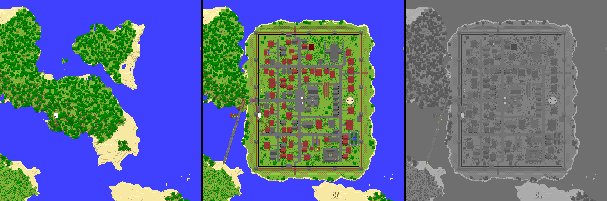

## Summary

| site | result |
|---|---|
| old_birch | 30 findings |

# KingdomQuest field test

Seed 20261117. Positions in details are relative to the heart (x, y, z).

## old_birch

minecraft:old_growth_birch_forest at -6600, 64, 4496, facing CLOCKWISE_90, relief 17, walkable out before founding: true, style temperate, ground grass_block. Gate approach cost per side (* = used): south 30, west 0*, north 2, east 66.

| stage | ms | float built | float land | floating feet | buried | destroyed | doors unreached | walk out | breach | wet inside | wet moat | new cliffs | tall walls | pits | road gaps | road steps | wall gaps | cut trees | foreign ground | snow lost | road steep | stumps | road high | road bank | road moved |
|---|---|---|---|---|---|---|---|---|---|---|---|---|---|---|---|---|---|---|---|---|---|---|---|---|---|
Founded as flat castle: plateau at 0 (relative to the heart), site shaped in 577 ms.

| tent_1 | 280 | 0 | 0 | 0 | 0 | 0 | 0 | 1 | 0 | 0 | 0 | 0 | 0 | 0 | 0 | 0 | 0 | 0 | 0 | 0 | 0 | 0 | 0 | 0 | 0 |
Country road to -6751, 64, 4616 (106 blocks of water on the way).

Lord's changes: broke 2 blocks before tent_2; repair leaves them.

Lord's changes after tent_2: unchanged spot kept broken, changed spot rebuilt by the new plan, 1 change(s) remembered.

| tent_2 | 392 | 0 | 0 | 0 | 0 | 1 | 0 | 1 | 0 | 0 | 0 | 1 | 0 | 0 | 0 | 0 | 0 | 0 | 0 | 0 | 0 | 0 | 0 | 0 | 0 |
| tent_3 | 309 | 0 | 0 | 0 | 0 | 0 | 0 | 1 | 0 | 0 | 0 | 1 | 0 | 0 | 0 | 0 | 0 | 0 | 0 | 0 | 0 | 0 | 0 | 0 | 0 |
| hamlet_1 | 740 | 0 | 0 | 0 | 0 | 2 | 0 | 1 | 0 | 0 | 0 | 1 | 0 | 0 | 0 | 0 | 0 | 0 | 0 | 0 | 0 | 0 | 0 | 0 | 0 |
| hamlet_2 | 273 | 13 | 0 | 0 | 0 | 0 | 0 | 1 | 0 | 0 | 0 | 1 | 0 | 0 | 0 | 0 | 0 | 0 | 0 | 0 | 0 | 0 | 0 | 0 | 0 |
| hamlet_3 | 314 | 1 | 0 | 0 | 0 | 11 | 0 | 1 | 0 | 0 | 0 | 1 | 0 | 0 | 0 | 0 | 0 | 0 | 0 | 0 | 0 | 0 | 0 | 0 | 0 |
| village_1 | 923 | 1 | 0 | 0 | 0 | 11 | 0 | 1 | 0 | 0 | 0 | 1 | 0 | 0 | 0 | 0 | 0 | 0 | 0 | 0 | 0 | 0 | 0 | 0 | 0 |
| town_1 | 587 | 1 | 0 | 0 | 0 | 5 | 0 | 1 | 0 | 0 | 0 | 11 | 0 | 0 | 0 | 0 | 0 | 0 | 0 | 0 | 0 | 0 | 0 | 0 | 0 |
| castle_1 | 1359 | 1 | 0 | 0 | 0 | 5 | 0 | 1 | 0 | 0 | 0 | 11 | 0 | 0 | 0 | 0 | 0 | 0 | 0 | 0 | 0 | 0 | 0 | 0 | 0 |
| castle_2 | 1704 | 1 | 0 | 0 | 0 | 9 | 0 | 1 | 0 | 0 | 0 | 11 | 0 | 0 | 0 | 0 | 0 | 0 | 0 | 0 | 0 | 0 | 0 | 0 | 0 |
| citadel_1 | 1679 | 1 | 0 | 0 | 0 | 9 | 0 | 1 | 0 | 0 | 0 | 11 | 0 | 0 | 0 | 0 | 0 | 0 | 0 | 0 | 0 | 0 | 0 | 0 | 0 |
| final | 0 | 1 | 0 | 0 | 0 | 9 | 0 | 1 | 0 | 0 | 0 | 11 | 0 | 0 | 0 | 0 | 0 | 0 | 0 | 0 | 0 | 0 | 0 | 0 | 0 |
Country road at the end: 10 of 10 cells near the castle intact.

Gate (land relative to the heart, before -> after) at 0/5/10/15/20/30/40 blocks out of the gate: 1->-2 -1->-2 0->-2 0->-2 0->-2 0->-2 0->-2. Moat columns per side {back=2600, gate=2585, left=724, right=744}. Way-out road none.

Production: level 1 made 16102 items in a game day, 48327 in three (store 4320 stacks); level 5 with every milestone 141571 items of 239 kinds a day. Storehouse goods shown: 14 blocks; unloaded 15552 items into the chests.

Tram: 880 rails, stops [gate, west, north, east]
Signal fires: 20 on 13 towers, lit 20, put out 20; tower guard posts 20.

- tent_2: destroyed 1 [main (0,1,-5) spruce_log->air]
- tent_2: new cliffs 1 [(-149,1,118) to -3]
- tent_3: new cliffs 1 [(-149,1,118) to -3]
- hamlet_1: destroyed 2 [main (8,0,4) rose_bush->air, main (8,1,4) rose_bush->air]
- hamlet_1: new cliffs 1 [(-149,1,118) to -3]
- hamlet_2: float built 13 [dock (-132,1,28) lantern, lamps (-78,0,-68) spruce_fence, lamps (-78,1,-68) torch, lamps (-65,0,-62) spruce_fence, lamps (-65,1,-62) torch]
- hamlet_2: new cliffs 1 [(-149,1,118) to -3]
- hamlet_3: float built 1 [dock (-132,1,28) lantern]
- hamlet_3: destroyed 11 [tavern (60,1,40) vine->air, tavern (60,1,41) vine->rose_bush, tavern (60,1,45) vine->air, tavern (60,1,49) vine->air, tavern (60,2,40) vine->air]
- hamlet_3: new cliffs 1 [(-149,1,118) to -3]
- village_1: float built 1 [dock (-137,1,28) lantern]
- village_1: destroyed 11 [tavern (60,1,40) vine->air, tavern (60,1,41) vine->air, tavern (60,1,45) vine->air, tavern (60,1,49) vine->air, tavern (60,2,40) vine->air]
- village_1: new cliffs 1 [(-149,1,118) to -3]
- walls 1 took 4032 ms
- town_1: float built 1 [dock (-137,1,28) lantern]
- town_1: destroyed 5 [tavern (60,1,40) vine->air, tavern (60,1,41) vine->air, tavern (60,2,40) vine->air, tavern (60,2,41) vine->air, tavern (49,3,42) dark_oak_hanging_sign->air]
- town_1: new cliffs 11 [(-149,1,118) to -3, (-128,2,48) to -4, (-127,-2,46) to 4, (-127,2,47) to -4, (-127,2,47) to -4]
- castle_1: float built 1 [dock (-137,1,28) lantern]
- castle_1: destroyed 5 [tavern (60,1,40) vine->air, tavern (60,1,41) vine->air, tavern (60,2,40) vine->air, tavern (60,2,41) vine->air, tavern (49,3,42) dark_oak_hanging_sign->air]
- castle_1: new cliffs 11 [(-149,1,118) to -3, (-128,2,48) to -4, (-127,-2,46) to 4, (-127,2,47) to -4, (-127,2,47) to -4]
- castle_2: float built 1 [dock (-137,1,28) lantern]
- castle_2: destroyed 9 [tavern (60,1,40) vine->air, tavern (60,1,41) vine->air, tavern (60,2,40) vine->air, tram (-85,0,31) rail->air, tram (-85,0,32) rail->air]
- castle_2: new cliffs 11 [(-149,1,118) to -3, (-128,2,48) to -4, (-127,-2,46) to 4, (-127,2,47) to -4, (-127,2,47) to -4]
- citadel_1: float built 1 [dock (-137,1,28) lantern]
- citadel_1: destroyed 9 [tavern (60,1,40) vine->air, tavern (60,1,41) vine->air, tavern (60,2,40) vine->air, tram (-85,0,31) rail->air, tram (-85,0,32) rail->air]
- citadel_1: new cliffs 11 [(-149,1,118) to -3, (-128,2,48) to -4, (-127,-2,46) to 4, (-127,2,47) to -4, (-127,2,47) to -4]
- final: float built 1 [dock (-137,1,28) lantern]
- final: destroyed 9 [tavern (60,1,40) vine->air, tavern (60,1,41) vine->air, tavern (60,2,40) vine->air, tram (-85,0,31) rail->air, tram (-85,0,32) rail->air]
- final: new cliffs 11 [(-149,1,118) to -3, (-128,2,48) to -4, (-127,-2,46) to 4, (-127,2,47) to -4, (-127,2,47) to -4]
- tram: rails missing at [-85, 0, 36, -85, 0, 35, -85, 0, 34, -85, 0, 33]

