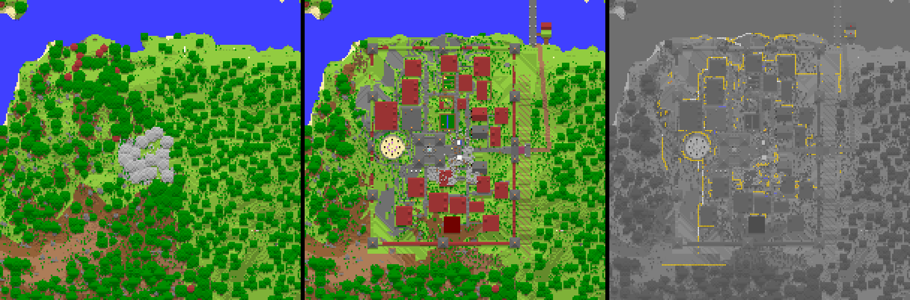

## Summary

| site | result |
|---|---|
| pale_garden | 72 findings |

# KingdomQuest field test

Seed 1813296525. Positions in details are relative to the heart (x, y, z).

## pale_garden

minecraft:pale_garden at -780, 107, 1896, facing COUNTERCLOCKWISE_90, relief 59, walkable out before founding: true, style temperate, ground grass_block. Gate approach cost per side (* = used): south 92, west 280, north 321, east 8*.

| stage | ms | float built | float land | floating feet | buried | destroyed | doors unreached | walk out | breach | wet inside | wet moat | new cliffs | tall walls | pits | road gaps | road steps | wall gaps | cut trees | foreign ground | snow lost | road steep | stumps | road high | road bank | road moved |
|---|---|---|---|---|---|---|---|---|---|---|---|---|---|---|---|---|---|---|---|---|---|---|---|---|---|
| tent_1 | 484 | 0 | 0 | 0 | 0 | 0 | 0 | 1 | 0 | 0 | 0 | 16 | 0 | 2 | 0 | 0 | 0 | 0 | 0 | 0 | 0 | 0 | 0 | 0 | 0 |
Country road to -729, 103, 1766 (40 blocks of water on the way).

Lord's changes: broke 2 blocks before tent_2; repair leaves them.

Lord's changes after tent_2: unchanged spot kept broken, changed spot rebuilt by the new plan, 1 change(s) remembered.

| tent_2 | 207 | 0 | 0 | 0 | 0 | 1 | 0 | 1 | 0 | 0 | 0 | 43 | 0 | 2 | 0 | 0 | 0 | 0 | 0 | 0 | 0 | 0 | 0 | 0 | 0 |
| tent_3 | 166 | 0 | 0 | 0 | 0 | 0 | 0 | 1 | 0 | 0 | 0 | 53 | 0 | 2 | 0 | 0 | 0 | 0 | 0 | 0 | 0 | 0 | 0 | 0 | 0 |
| hamlet_1 | 812 | 0 | 0 | 0 | 0 | 2 | 0 | 1 | 0 | 0 | 0 | 324 | 0 | 7 | 0 | 0 | 0 | 0 | 0 | 0 | 0 | 0 | 0 | 0 | 0 |
| hamlet_2 | 238 | 1 | 0 | 0 | 0 | 0 | 0 | 1 | 0 | 0 | 0 | 521 | 4 | 4 | 0 | 0 | 0 | 0 | 0 | 0 | 2 | 0 | 1 | 0 | 0 |
| hamlet_3 | 262 | 1 | 0 | 0 | 0 | 11 | 0 | 1 | 0 | 0 | 0 | 550 | 20 | 8 | 0 | 0 | 0 | 0 | 0 | 0 | 2 | 0 | 0 | 0 | 0 |
| village_1 | 247 | 1 | 1 | 0 | 0 | 11 | 0 | 1 | 0 | 0 | 0 | 731 | 18 | 9 | 0 | 0 | 0 | 0 | 0 | 0 | 7 | 0 | 0 | 0 | 0 |
| town_1 | 275 | 1 | 1 | 0 | 0 | 8 | 0 | 1 | 0 | 0 | 0 | 736 | 69 | 7 | 0 | 0 | 39 | 0 | 0 | 0 | 12 | 0 | 0 | 1 | 2 |
| castle_1 | 435 | 1 | 1 | 0 | 0 | 5 | 0 | 1 | 0 | 0 | 0 | 714 | 88 | 7 | 0 | 0 | 0 | 0 | 0 | 0 | 14 | 0 | 0 | 1 | 0 |
| castle_2 | 409 | 1 | 1 | 0 | 0 | 3 | 0 | 1 | 0 | 0 | 0 | 743 | 85 | 9 | 0 | 0 | 0 | 0 | 0 | 0 | 14 | 0 | 0 | 1 | 0 |
| citadel_1 | 386 | 1 | 1 | 0 | 0 | 3 | 0 | 1 | 0 | 0 | 0 | 742 | 85 | 9 | 0 | 0 | 0 | 0 | 0 | 0 | 14 | 0 | 0 | 1 | 0 |
| final | 0 | 1 | 1 | 0 | 0 | 3 | 0 | 1 | 0 | 0 | 0 | 793 | 75 | 9 | 0 | 0 | 0 | 0 | 0 | 0 | 17 | 0 | 0 | 1 | 0 |
Country road at the end: 88 of 88 cells near the castle intact.

Gate (land relative to the heart, before -> after) at 0/5/10/15/20/30/40 blocks out of the gate: 1->-2 2->-7 2->-2 2->2 2->2 1->1 -2->-2. Moat columns per side {gate=928}. Way-out road none.

- tent_1: new cliffs 16 [(-7,-1,-7) to -3, (-6,-4,-7) to 3, (1,2,7) to -3, (1,0,10) to 3, (2,-1,7) to 3]
- tent_1: pits 2 [(-6,-4,-7) hole, (-1,0,10) hole]
- tent_2: destroyed 1 [main (0,1,5) spruce_log->air]
- tent_2: new cliffs 43 [(-22,-3,6) to 3, (-21,-2,7) to 3, (-21,-2,8) to 4, (-21,-1,9) to 3, (-21,-1,10) to 3]
- tent_2: pits 2 [(-8,-8,-14) hole, (-1,0,10) hole]
- tent_3: new cliffs 53 [(-23,0,19) to 3, (-22,-3,6) to 3, (-21,-2,7) to 3, (-21,-2,8) to 4, (-21,-1,9) to 3]
- tent_3: pits 2 [(-8,-8,-14) hole, (-1,-1,10) hole]
- hamlet_1: destroyed 2 [main (-8,0,-4) rose_bush->air, main (-8,1,-4) rose_bush->air]
- hamlet_1: new cliffs 324 [(-43,-17,-43) to 3, (-43,-16,-42) to 3, (-43,-13,-28) to 4, (-43,-13,-27) to 4, (-43,-13,-26) to 4]
- hamlet_1: pits 7 [(-41,-12,-21) hole, (-19,-3,-1) hole, (-7,0,21) hole, (-6,-4,-7) hole, (-5,0,21) hole]
- hamlet_2: float built 1 [dock (61,-42,-78) lantern]
- hamlet_2: new cliffs 521 [(-45,-16,-40) to 3, (-45,-16,-39) to 3, (-44,-16,-41) to 3, (-43,-18,-44) to 3, (-43,-18,-43) to 4]
- hamlet_2: tall walls 4 [(-43,-20,16) 10 cap unowned low unowned:dirt, (-42,-10,16) -9 cap unowned low unowned:dirt, (-42,-19,17) 9 cap unowned low unowned:grass_block, (-42,-17,18) 7 cap unowned low unowned:stone]
- hamlet_2: pits 4 [(-41,-12,-21) hole, (-19,-3,-1) hole, (-1,-1,10) hole, (4,-5,-13) hole]
- hamlet_2: road steep 2 [(4,4,19) to -3 in 3, (5,3,19) to -3 in 3]
- hamlet_2: road high 1 [(0,5,19) above smith step (-1,2,19)]
- hamlet_3: float built 1 [dock (61,-42,-78) lantern]
- hamlet_3: destroyed 11 [tavern (-35,1,-17) vine->air, tavern (-35,1,-18) vine->air, tavern (-35,1,-22) vine->air, tavern (-35,1,-26) vine->air, tavern (-35,2,-17) vine->air]
- hamlet_3: new cliffs 550 [(-54,-25,-33) to 3, (-50,-16,-28) to 3, (-50,-16,-27) to 3, (-50,-16,-26) to 3, (-50,-16,-25) to 3]
- hamlet_3: tall walls 20 [(-43,-20,16) 10 cap unowned low unowned:dirt, (-42,-10,16) -9 cap unowned low unowned:dirt, (-42,-19,17) 9 cap unowned low unowned:grass_block, (-42,-17,18) 7 cap unowned low unowned:stone, (-39,-8,-29) 7 cap unowned low unowned:stone]
- hamlet_3: pits 8 [(-44,-12,-22) hole, (-43,-11,-15) hole, (-21,-30,-64) hole, (-19,-3,-1) hole, (-15,-19,-60) hole]
- hamlet_3: road steep 2 [(4,4,19) to -3 in 3, (5,3,19) to -3 in 3]
- village_1: float built 1 [dock (61,-42,-83) lantern]
- village_1: float land 1 [(61,-42,-78) grass_block]
- village_1: destroyed 11 [tavern (-35,1,-17) vine->air, tavern (-35,1,-18) vine->air, tavern (-35,1,-22) vine->air, tavern (-35,1,-26) vine->air, tavern (-35,2,-17) vine->air]
- village_1: new cliffs 731 [(-68,-29,-32) to 6, (-68,-30,-31) to 7, (-68,-29,-29) to 6, (-68,-28,-28) to 5, (-68,-28,-27) to 5]
- village_1: tall walls 18 [(-43,-20,16) 10 cap unowned low unowned:dirt, (-42,-10,16) -9 cap unowned low unowned:dirt, (-42,-19,17) 9 cap unowned low unowned:grass_block, (-42,-17,18) 7 cap unowned low unowned:stone, (-23,-33,-65) 8 cap unowned low unowned:stone]
- village_1: pits 9 [(-62,-23,-25) hole, (-55,-26,-49) spike, (-55,-27,-43) hole, (-21,-30,-64) hole, (-19,-3,-1) hole]
- village_1: road steep 7 [(-24,-5,-29) to 3 in 3, (-26,-7,-29) to 3 in 3, (-25,-6,-29) to 3 in 3, (4,4,19) to -3 in 3, (-28,-9,-29) to 3 in 3]
- town_1: float built 1 [dock (61,-42,-83) lantern]
- town_1: float land 1 [(61,-42,-78) grass_block]
- town_1: destroyed 8 [walls (-54,-9,63) coarse_dirt->oak_log, walls (40,2,8) coarse_dirt->oak_log, walls (40,2,7) coarse_dirt->oak_log, tavern (-35,1,-17) vine->air, tavern (-35,1,-18) vine->air]
- town_1: new cliffs 736 [(-68,-29,-32) to 6, (-68,-30,-31) to 7, (-68,-29,-29) to 6, (-68,-28,-28) to 5, (-68,-28,-27) to 5]
- town_1: tall walls 69 [(-52,-22,-34) 8 cap unowned low unowned:grass_block, (-46,-21,-34) 10 cap unowned low unowned:stone, (-45,-21,-34) 10 cap unowned low unowned:stone, (-44,-21,-34) 10 cap unowned low unowned:stone, (-43,-21,-34) 10 cap unowned low unowned:stone]
- town_1: pits 7 [(-62,-23,-25) hole, (-19,-3,-1) hole, (-17,-37,-63) hole, (-14,-9,-54) spike, (-11,-3,10) hole]
- town_1: wall gaps 39 [(-54,-9,61) over air, (42,4,65) over air, (42,2,-8) over air, (42,2,-4) over air, (42,2,4) over air]
- town_1: road steep 12 [(-24,-5,-29) to 3 in 3, (-23,-4,-29) to 3 in 3, (-26,-7,-29) to 3 in 3, (-25,-6,-29) to 3 in 3, (4,8,31) to -3 in 3]
- town_1: road bank 1 [(-21,-5,-39) over 2/2]
- town_1: road moved 2 [(7,0,19) from 1, (5,2,19) from 3]
- castle_1: float built 1 [dock (61,-42,-83) lantern]
- castle_1: float land 1 [(61,-42,-78) grass_block]
- castle_1: destroyed 5 [tavern (-35,1,-17) vine->air, tavern (-35,1,-18) vine->air, tavern (-35,2,-17) vine->air, tavern (-35,2,-18) vine->air, tavern (-24,3,-19) dark_oak_hanging_sign->air]
- castle_1: new cliffs 714 [(-68,-29,-32) to 6, (-68,-30,-31) to 7, (-68,-29,-29) to 6, (-68,-28,-28) to 5, (-68,-28,-27) to 5]
- castle_1: tall walls 88 [(-67,-29,-30) 7 cap unowned low unowned:dirt, (-46,-25,-34) 14 cap unowned low unowned:stone, (-45,-25,-34) 14 cap unowned low unowned:stone, (-44,-25,-34) 14 cap unowned low unowned:stone, (-43,-24,-34) 13 cap unowned low unowned:stone]
- castle_1: pits 7 [(-62,-23,-25) hole, (-60,-41,-45) hole, (-59,-45,-46) hole, (-38,-14,2) hole, (-14,-9,-54) spike]
- castle_1: road steep 14 [(10,4,29) to 3 in 3, (11,5,29) to 3 in 3, (-24,-5,-29) to 3 in 3, (-23,-4,-29) to 3 in 3, (-26,-7,-29) to 3 in 3]
- castle_1: road bank 1 [(-21,-5,-39) over 2/2]
- castle_2: float built 1 [dock (61,-42,-83) lantern]
- castle_2: float land 1 [(61,-42,-78) grass_block]
- castle_2: destroyed 3 [tavern (-35,1,-17) vine->air, tavern (-35,1,-18) vine->air, tavern (-35,2,-17) vine->air]
- castle_2: new cliffs 743 [(-68,-29,-32) to 6, (-68,-30,-31) to 7, (-68,-29,-29) to 6, (-68,-28,-28) to 5, (-68,-28,-27) to 5]
- castle_2: tall walls 85 [(-67,-29,-30) 7 cap unowned low unowned:dirt, (-46,-25,-34) 14 cap unowned low unowned:stone, (-45,-25,-34) 14 cap unowned low unowned:stone, (-44,-25,-34) 14 cap unowned low unowned:stone, (-43,-24,-34) 13 cap unowned low unowned:stone]
- castle_2: pits 9 [(-62,-23,-25) hole, (-60,-41,-45) hole, (-59,-45,-46) hole, (-38,-14,2) hole, (-35,1,14) spike]
- castle_2: road steep 14 [(10,4,29) to 3 in 3, (11,5,29) to 3 in 3, (-24,-5,-29) to 3 in 3, (-23,-4,-29) to 3 in 3, (-26,-7,-29) to 3 in 3]
- castle_2: road bank 1 [(-21,-5,-39) over 2/2]
- citadel_1: float built 1 [dock (61,-42,-83) lantern]
- citadel_1: float land 1 [(61,-42,-78) grass_block]
- citadel_1: destroyed 3 [tavern (-35,1,-17) vine->air, tavern (-35,1,-18) vine->air, tavern (-35,2,-17) vine->air]
- citadel_1: new cliffs 742 [(-68,-29,-32) to 6, (-68,-30,-31) to 7, (-68,-29,-29) to 6, (-68,-28,-28) to 5, (-68,-28,-27) to 5]
- citadel_1: tall walls 85 [(-67,-29,-30) 7 cap unowned low unowned:dirt, (-46,-25,-34) 14 cap unowned low unowned:stone, (-45,-25,-34) 14 cap unowned low unowned:stone, (-44,-25,-34) 14 cap unowned low unowned:stone, (-43,-24,-34) 13 cap unowned low unowned:stone]
- citadel_1: pits 9 [(-62,-23,-25) hole, (-60,-41,-45) hole, (-59,-45,-46) hole, (-38,-14,2) hole, (-35,1,14) spike]
- citadel_1: road steep 14 [(10,4,29) to 3 in 3, (11,5,29) to 3 in 3, (-24,-5,-29) to 3 in 3, (-23,-4,-29) to 3 in 3, (-26,-7,-29) to 3 in 3]
- citadel_1: road bank 1 [(-21,-5,-39) over 2/2]
- final: tall by [{unowned/unowned=75}]
- final: float built 1 [dock (61,-42,-83) lantern]
- final: float land 1 [(61,-42,-78) grass_block]
- final: destroyed 3 [tavern (-35,1,-17) vine->air, tavern (-35,1,-18) vine->air, tavern (-35,2,-17) vine->air]
- final: new cliffs 793 [(-68,-29,-32) to 6, (-68,-30,-31) to 7, (-68,-29,-29) to 6, (-68,-26,-25) to 3, (-67,-29,-33) to 6]
- final: tall walls 75 [(-67,-29,-30) 7 cap unowned low unowned:dirt, (-65,-22,-10) 7 cap unowned low unowned:stone, (-46,-25,-34) 14 cap unowned low unowned:stone, (-45,-25,-34) 14 cap unowned low unowned:stone, (-44,-25,-34) 14 cap unowned low unowned:stone]
- final: pits 9 [(-62,-23,-25) hole, (-60,-41,-45) hole, (-59,-45,-46) hole, (-36,-4,10) hole, (-35,1,14) spike]
- final: road steep 17 [(10,4,29) to 3 in 3, (11,5,29) to 3 in 3, (-24,-5,-29) to 3 in 3, (-23,-4,-29) to 3 in 3, (-26,-7,-29) to 3 in 3]
- final: road bank 1 [(-21,-5,-39) over 2/2]

