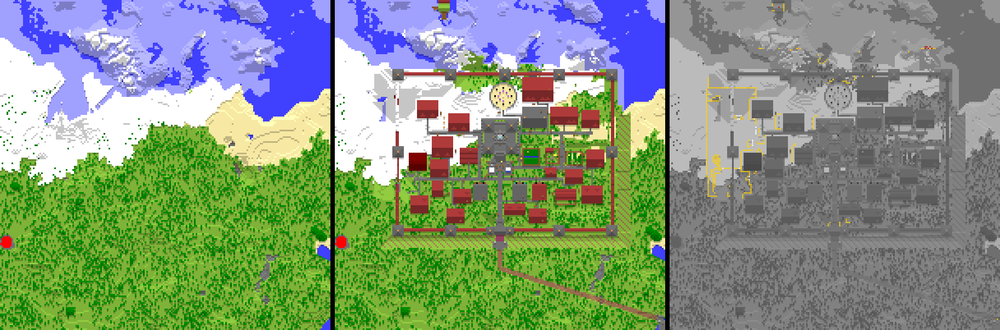

## Summary

| site | result |
|---|---|
| plains | 58 findings |

# KingdomQuest field test

Seed 1813296525. Positions in details are relative to the heart (x, y, z).

## plains

minecraft:plains at -5544, 69, -1964, facing NONE, relief 87, walkable out before founding: true, style temperate, ground grass_block. Gate approach cost per side (* = used): south 3*, west 41, north 31, east 39.

| stage | ms | float built | float land | floating feet | buried | destroyed | doors unreached | walk out | breach | wet inside | wet moat | new cliffs | tall walls | pits | road gaps | road steps | wall gaps | cut trees | foreign ground | snow lost | road steep | stumps | road high | road bank | road moved |
|---|---|---|---|---|---|---|---|---|---|---|---|---|---|---|---|---|---|---|---|---|---|---|---|---|---|
| tent_1 | 682 | 0 | 0 | 0 | 0 | 0 | 0 | 1 | 0 | 0 | 0 | 14 | 0 | 1 | 0 | 0 | 0 | 0 | 0 | 0 | 0 | 0 | 0 | 0 | 0 |
Country road to -5424, 64, -1863 (12 blocks of water on the way).

Lord's changes: broke 2 blocks before tent_2; repair leaves them.

Lord's changes after tent_2: unchanged spot kept broken, changed spot rebuilt by the new plan, 1 change(s) remembered.

| tent_2 | 331 | 0 | 0 | 0 | 0 | 1 | 0 | 1 | 0 | 0 | 0 | 17 | 0 | 1 | 0 | 0 | 0 | 0 | 0 | 8 | 0 | 0 | 0 | 0 | 0 |
| tent_3 | 183 | 0 | 0 | 0 | 0 | 0 | 0 | 1 | 0 | 0 | 0 | 17 | 0 | 1 | 0 | 0 | 0 | 0 | 0 | 8 | 0 | 0 | 0 | 0 | 0 |
| hamlet_1 | 425 | 0 | 0 | 0 | 0 | 2 | 0 | 1 | 0 | 0 | 0 | 34 | 0 | 2 | 0 | 0 | 0 | 0 | 0 | 16 | 0 | 0 | 0 | 0 | 0 |
| hamlet_2 | 244 | 1 | 0 | 0 | 0 | 0 | 0 | 1 | 0 | 0 | 0 | 46 | 0 | 1 | 0 | 0 | 0 | 0 | 0 | 33 | 0 | 0 | 0 | 0 | 0 |
| hamlet_3 | 253 | 1 | 0 | 0 | 0 | 11 | 0 | 1 | 0 | 0 | 0 | 77 | 0 | 1 | 0 | 0 | 0 | 0 | 0 | 35 | 0 | 0 | 0 | 0 | 0 |
| village_1 | 396 | 0 | 1 | 0 | 0 | 11 | 0 | 1 | 0 | 0 | 0 | 93 | 0 | 0 | 0 | 0 | 0 | 0 | 0 | 32 | 0 | 0 | 0 | 0 | 0 |
| town_1 | 298 | 0 | 22 | 0 | 0 | 6 | 0 | 1 | 0 | 0 | 0 | 333 | 44 | 6 | 0 | 0 | 84 | 0 | 0 | 80 | 0 | 0 | 0 | 0 | 0 |
| castle_1 | 593 | 0 | 23 | 0 | 0 | 5 | 0 | 1 | 0 | 0 | 0 | 381 | 55 | 5 | 0 | 0 | 0 | 0 | 0 | 82 | 0 | 0 | 0 | 0 | 0 |
| castle_2 | 481 | 0 | 23 | 0 | 0 | 3 | 0 | 1 | 0 | 0 | 0 | 422 | 21 | 5 | 0 | 0 | 0 | 0 | 0 | 83 | 0 | 0 | 0 | 0 | 0 |
| citadel_1 | 415 | 0 | 23 | 0 | 0 | 3 | 0 | 1 | 0 | 0 | 0 | 431 | 21 | 4 | 0 | 0 | 0 | 0 | 0 | 83 | 0 | 0 | 0 | 0 | 0 |
| final | 0 | 0 | 22 | 0 | 0 | 3 | 0 | 1 | 0 | 0 | 0 | 448 | 21 | 3 | 0 | 0 | 0 | 0 | 0 | 93 | 0 | 0 | 0 | 0 | 0 |
Country road at the end: 121 of 121 cells near the castle intact.

Gate (land relative to the heart, before -> after) at 0/5/10/15/20/30/40 blocks out of the gate: 1->-2 0->-7 -2->-2 -2->-2 -2->-2 -1->-1 3->3. Moat columns per side {gate=1176, right=575}. Way-out road none.

- tent_1: new cliffs 14 [(-48,-10,-25) to 3, (-30,8,-53) to 6, (-19,8,-54) to 3, (-18,10,-50) to -3, (-16,8,-45) to -4]
- tent_1: pits 1 [(17,-9,-54) hole]
- tent_2: destroyed 1 [main (-5,1,0) spruce_log->air]
- tent_2: new cliffs 17 [(-48,-10,-25) to 3, (-30,8,-53) to 6, (-18,10,-50) to -3, (-16,8,-45) to -4, (-15,4,-46) to -4]
- tent_2: pits 1 [(17,-12,-54) hole]
- tent_2: snow lost 8 [(-20,-2,-5) on grass_block at air light 0]
- tent_3: new cliffs 17 [(-48,-10,-25) to 3, (-30,8,-53) to 6, (-18,10,-50) to -3, (-16,8,-45) to -4, (-15,4,-46) to -4]
- tent_3: pits 1 [(17,-12,-54) hole]
- tent_3: snow lost 8 [(-20,-2,-5) on grass_block at air light 0]
- hamlet_1: destroyed 2 [main (4,0,-8) rose_bush->air, main (4,1,-8) rose_bush->air]
- hamlet_1: new cliffs 34 [(-48,-10,-25) to 3, (-30,8,-53) to 6, (-23,5,-44) to -3, (-21,22,-47) to -3, (-20,22,-47) to -4]
- hamlet_1: pits 2 [(17,-12,-54) hole, (44,-21,6) hole]
- hamlet_1: snow lost 16 [(-28,-3,0) on grass_block at air light 0]
- hamlet_2: float built 1 [dock (-34,-4,-96) lantern]
- hamlet_2: new cliffs 46 [(-60,-40,-10) to 3, (-57,-46,-10) to 3, (-57,-15,-6) to -18, (-56,-44,-9) to 3, (-56,-33,-6) to 18]
- hamlet_2: pits 1 [(17,-12,-54) hole]
- hamlet_2: snow lost 33 [(-57,-8,0) on grass_block at air light 0]
- hamlet_3: float built 1 [dock (-34,-4,-96) lantern]
- hamlet_3: destroyed 11 [tavern (17,1,-35) vine->air, tavern (18,1,-35) vine->air, tavern (22,1,-35) vine->air, tavern (26,1,-35) vine->air, tavern (17,2,-35) vine->air]
- hamlet_3: new cliffs 77 [(-63,-8,6) to -15, (-62,-8,5) to -15, (-62,-23,6) to 16, (-61,-39,-9) to 4, (-61,-38,-8) to 3]
- hamlet_3: pits 1 [(17,-12,-54) hole]
- hamlet_3: snow lost 35 [(-58,-9,0) on grass_block at air light 0]
- village_1: float land 1 [(-34,-4,-96) grass_block]
- village_1: destroyed 11 [tavern (17,1,-35) vine->air, tavern (18,1,-35) vine->air, tavern (22,1,-35) vine->air, tavern (26,1,-35) vine->air, tavern (17,2,-35) vine->air]
- village_1: new cliffs 93 [(-63,-8,6) to -15, (-62,-8,5) to -15, (-62,-23,6) to 16, (-61,-39,-9) to 4, (-61,-38,-8) to 3]
- village_1: snow lost 32 [(-58,-9,0) on grass_block at air light 0]
- town_1: float land 22 [(-34,-4,-96) grass_block, (54,13,-71) packed_ice, (54,14,-71) packed_ice, (54,15,-71) packed_ice, (54,16,-71) packed_ice]
- town_1: destroyed 6 [walls (-7,1,40) coarse_dirt->oak_log, tavern (17,1,-35) vine->air, tavern (18,1,-35) vine->air, tavern (17,2,-35) vine->air, tavern (18,2,-35) vine->air]
- town_1: new cliffs 333 [(-78,-7,-44) to -12, (-78,-6,-43) to -14, (-78,-6,-42) to -15, (-78,-6,-41) to -16, (-78,-6,-40) to -17]
- town_1: tall walls 44 [(-70,-48,0) 14 cap unowned low unowned:air, (-69,-36,-2) -11 cap unowned low unowned:dirt, (-69,-36,-2) -11 cap unowned low unowned:dirt, (-69,-47,-1) 13 cap unowned low unowned:air, (-68,-37,-3) -10 cap unowned low unowned:dirt]
- town_1: pits 6 [(-60,-44,-27) hole, (-57,-1,-27) spike, (-48,-28,5) hole, (-26,0,-70) hole, (-25,-3,-65) hole]
- town_1: wall gaps 84 [(9,-7,-56) over water, (-55,-7,-56) over water, (8,-7,-56) over water, (-56,-7,-56) over water, (11,-7,-56) over water]
- town_1: snow lost 80 [(-70,-20,-41) on water at air light 0, (-22,1,-46) on grass_block at air light 0]
- castle_1: float land 23 [(-34,-4,-96) grass_block, (-25,17,-56) snow_block, (54,13,-71) packed_ice, (54,14,-71) packed_ice, (54,15,-71) packed_ice]
- castle_1: destroyed 5 [tavern (17,1,-35) vine->air, tavern (18,1,-35) vine->air, tavern (17,2,-35) vine->air, tavern (18,2,-35) vine->air, tavern (19,3,-24) dark_oak_hanging_sign->air]
- castle_1: new cliffs 381 [(-78,-6,-46) to -15, (-78,-6,-45) to -15, (-78,-7,-44) to -14, (-78,-6,-43) to -15, (-78,-6,-42) to -19]
- castle_1: tall walls 55 [(-70,-48,0) 14 cap unowned low unowned:air, (-69,-36,-2) -11 cap unowned low unowned:dirt, (-69,-36,-2) -11 cap unowned low unowned:dirt, (-69,-47,-1) 13 cap unowned low unowned:air, (-68,-37,-3) -10 cap unowned low unowned:dirt]
- castle_1: pits 5 [(-48,-29,5) hole, (-44,-13,-17) hole, (-26,0,-70) hole, (-25,-3,-65) hole, (-22,21,-71) spike]
- castle_1: snow lost 82 [(-70,-20,-41) on water at air light 0, (-21,0,-47) on grass_block at air light 0]
- castle_2: float land 23 [(-34,-4,-96) grass_block, (-25,17,-56) snow_block, (54,13,-71) packed_ice, (54,14,-71) packed_ice, (54,15,-71) packed_ice]
- castle_2: destroyed 3 [tavern (17,1,-35) vine->air, tavern (18,1,-35) vine->air, tavern (17,2,-35) vine->air]
- castle_2: new cliffs 422 [(-78,-6,-46) to -15, (-78,-6,-45) to -15, (-78,-7,-44) to -14, (-78,-6,-43) to -15, (-78,-6,-42) to -19]
- castle_2: tall walls 21 [(-68,-29,2) 11 cap unowned low unowned:stone, (-60,-37,-30) -7 cap unowned low unowned:stone, (-59,-37,-30) -11 cap unowned low unowned:air, (-59,-47,-28) 7 cap unowned low unowned:dirt, (-58,-37,-30) -11 cap unowned low unowned:air]
- castle_2: pits 5 [(-48,-9,5) hole, (-44,-13,-17) hole, (-26,0,-70) hole, (-25,-3,-65) hole, (-22,21,-71) spike]
- castle_2: snow lost 83 [(-70,-20,-41) on water at air light 0, (-21,-4,-51) on grass_block at air light 0]
- citadel_1: float land 23 [(-34,-4,-96) grass_block, (-25,17,-56) snow_block, (54,13,-71) packed_ice, (54,14,-71) packed_ice, (54,15,-71) packed_ice]
- citadel_1: destroyed 3 [tavern (17,1,-35) vine->air, tavern (18,1,-35) vine->air, tavern (17,2,-35) vine->air]
- citadel_1: new cliffs 431 [(-78,-6,-46) to -15, (-78,-6,-45) to -15, (-78,-7,-44) to -14, (-78,-6,-43) to -15, (-78,-6,-42) to -19]
- citadel_1: tall walls 21 [(-68,-29,2) 11 cap unowned low unowned:stone, (-60,-37,-30) -7 cap unowned low unowned:stone, (-59,-37,-30) -11 cap unowned low unowned:air, (-59,-47,-28) 7 cap unowned low unowned:dirt, (-58,-37,-30) -11 cap unowned low unowned:air]
- citadel_1: pits 4 [(-48,-9,5) hole, (-26,0,-70) hole, (-25,-3,-65) hole, (-22,21,-71) spike]
- citadel_1: snow lost 83 [(-70,-20,-41) on water at air light 0, (-21,-4,-51) on grass_block at air light 0]
- final: tall by [{unowned/unowned=21}]
- final: float land 22 [(-34,-4,-96) grass_block, (54,13,-71) packed_ice, (54,14,-71) packed_ice, (54,15,-71) packed_ice, (54,16,-71) packed_ice]
- final: destroyed 3 [tavern (17,1,-35) vine->air, tavern (18,1,-35) vine->air, tavern (17,2,-35) vine->air]
- final: new cliffs 448 [(-78,-6,-46) to -15, (-78,-6,-45) to -15, (-78,-7,-44) to -14, (-78,-6,-43) to -15, (-78,-6,-42) to -19]
- final: tall walls 21 [(-68,-29,2) 11 cap unowned low unowned:stone, (-60,-37,-30) -7 cap unowned low unowned:stone, (-59,-37,-30) -11 cap unowned low unowned:air, (-59,-47,-28) 7 cap unowned low unowned:dirt, (-58,-37,-30) -11 cap unowned low unowned:air]
- final: pits 3 [(-48,-9,5) hole, (-26,0,-70) hole, (-22,21,-71) spike]
- final: snow lost 93 [(-70,-20,-41) on water at air light 0, (-21,-4,-60) on grass_block at air light 0]

