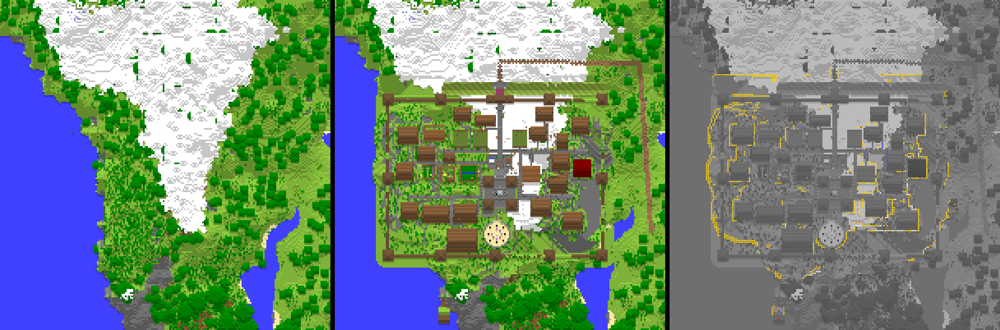

## Summary

| site | result |
|---|---|
| ridge | 79 findings |

# KingdomQuest field test

Seed 1813296525. Positions in details are relative to the heart (x, y, z).

## ridge

minecraft:grove at 3072, 112, 11216, facing CLOCKWISE_180, relief 62, walkable out before founding: true, style frozen, ground grass_block. Shape ridge (score 8.5), land relative to the heart, directions S SE E NE N NW W SW, gate toward N: 24 out [-1, -12, -19, -3, -6, 2, 9, 4]; 48 out [-4, -27, -41, -9, 3, 11, -65, 10]; 72 out [-16, -39, -41, -9, 7, 11, -65, -67]; 96 out [-25, -49, -44, -9, 13, 12, -67, -68]. Gate approach cost per side (* = used): south 41, west 993, north 16*, east 617.

| stage | ms | float built | float land | floating feet | buried | destroyed | doors unreached | walk out | breach | wet inside | wet moat | new cliffs | tall walls | pits | road gaps | road steps | wall gaps | cut trees | foreign ground | snow lost | road steep | stumps | road high | road bank | road moved |
|---|---|---|---|---|---|---|---|---|---|---|---|---|---|---|---|---|---|---|---|---|---|---|---|---|---|
| tent_1 | 594 | 0 | 0 | 0 | 0 | 0 | 0 | 1 | 0 | 0 | 0 | 15 | 0 | 0 | 0 | 0 | 0 | 0 | 0 | 38 | 0 | 0 | 0 | 0 | 0 |
Country road to 3164, 72, 11257 (2 blocks of water on the way).

Lord's changes: broke 2 blocks before tent_2; repair leaves them.

Lord's changes after tent_2: unchanged spot kept broken, changed spot rebuilt by the new plan, 1 change(s) remembered.

| tent_2 | 294 | 0 | 0 | 0 | 0 | 1 | 0 | 1 | 0 | 0 | 0 | 46 | 0 | 0 | 0 | 0 | 0 | 0 | 0 | 217 | 0 | 0 | 0 | 0 | 0 |
| tent_3 | 249 | 0 | 0 | 0 | 0 | 0 | 0 | 1 | 0 | 0 | 0 | 66 | 0 | 0 | 0 | 0 | 0 | 0 | 0 | 222 | 0 | 0 | 0 | 0 | 0 |
| hamlet_1 | 666 | 0 | 0 | 0 | 0 | 0 | 0 | 1 | 0 | 0 | 0 | 470 | 0 | 0 | 0 | 0 | 0 | 0 | 0 | 344 | 0 | 0 | 0 | 0 | 0 |
| hamlet_2 | 279 | 1 | 0 | 0 | 0 | 0 | 0 | 1 | 0 | 0 | 0 | 844 | 22 | 6 | 0 | 0 | 0 | 0 | 0 | 355 | 4 | 0 | 0 | 3 | 0 |
| hamlet_3 | 404 | 1 | 0 | 0 | 0 | 0 | 0 | 1 | 0 | 0 | 0 | 893 | 22 | 11 | 0 | 0 | 0 | 0 | 0 | 354 | 8 | 0 | 0 | 1 | 0 |
| village_1 | 421 | 1 | 1 | 0 | 0 | 0 | 0 | 1 | 0 | 0 | 0 | 929 | 22 | 12 | 0 | 0 | 0 | 0 | 0 | 347 | 10 | 0 | 0 | 1 | 0 |
| town_1 | 294 | 277 | 2 | 0 | 0 | 2 | 0 | 1 | 0 | 0 | 0 | 1110 | 109 | 9 | 0 | 0 | 116 | 0 | 0 | 264 | 23 | 0 | 0 | 6 | 5 |
| castle_1 | 576 | 1 | 2 | 0 | 0 | 0 | 0 | 1 | 0 | 0 | 0 | 1077 | 72 | 10 | 0 | 1 | 0 | 0 | 0 | 263 | 26 | 0 | 0 | 6 | 0 |
| castle_2 | 449 | 1 | 2 | 0 | 0 | 0 | 0 | 1 | 0 | 0 | 0 | 1085 | 78 | 8 | 0 | 1 | 0 | 0 | 0 | 257 | 26 | 0 | 0 | 6 | 0 |
| citadel_1 | 416 | 1 | 2 | 0 | 0 | 0 | 0 | 1 | 0 | 0 | 0 | 1087 | 78 | 8 | 0 | 1 | 0 | 0 | 0 | 257 | 26 | 0 | 0 | 6 | 0 |
| final | 0 | 1 | 2 | 0 | 0 | 0 | 0 | 1 | 0 | 0 | 0 | 1093 | 70 | 10 | 0 | 1 | 0 | 0 | 0 | 258 | 26 | 0 | 0 | 6 | 0 |
Country road at the end: 201 of 201 cells near the castle intact.

Gate (land relative to the heart, before -> after) at 0/5/10/15/20/30/40 blocks out of the gate: 2->-2 2->-7 3->-2 5->2 6->6 7->7 7->7. Moat columns per side {gate=892}. Way-out road none.

- tent_1: new cliffs 15 [(-35,-11,-4) to 3, (-7,3,46) to -6, (-6,3,45) to -6, (-4,1,45) to -4, (13,-8,-39) to -5]
- tent_1: snow lost 38 [(-8,3,-10) on grass_block at air light 0]
- tent_2: destroyed 1 [main (2,0,8) spruce_planks->air]
- tent_2: new cliffs 46 [(-35,-11,-4) to 3, (-7,3,46) to -6, (-6,3,45) to -6, (-4,1,45) to -4, (-3,1,-51) to 3]
- tent_2: snow lost 217 [(-16,4,-14) on grass_block at air light 0, (0,2,-53) on mud_brick_slab at air light 0, (16,9,-63) on dirt_path at air light 0, (23,-11,0) on spruce_leaves at snow light 0, (44,-2,-61) on dirt_path at air light 0]
- tent_3: new cliffs 66 [(-35,-11,-4) to 3, (-23,6,-17) to -3, (-22,9,-7) to -3, (-22,9,-7) to -3, (-21,2,-15) to 3]
- tent_3: snow lost 222 [(-16,4,-14) on grass_block at air light 0, (1,7,-64) on dirt_path at air light 0, (17,9,-63) on dirt_path at air light 0, (24,-11,0) on spruce_leaves at snow light 0, (42,0,-64) on dirt_path at air light 0]
- hamlet_1: new cliffs 470 [(-48,-29,-31) to 4, (-48,-43,-29) to 3, (-48,-46,-24) to 3, (-48,-45,-23) to 3, (-48,-44,-22) to 3]
- hamlet_1: snow lost 344 [(-17,0,-16) on grass_block at air light 0, (0,3,-55) on dirt_path at air light 0, (6,5,-34) on spruce_leaves at snow light 0, (13,-5,38) on spruce_leaves at snow light 0, (23,-4,-32) on spruce_leaves at snow light 0]
- hamlet_2: float built 1 [dock (-34,-47,89) lantern]
- hamlet_2: new cliffs 844 [(-78,-1,-1) to -15, (-78,-1,0) to -15, (-78,-1,1) to -15, (-78,-1,2) to -15, (-78,-1,3) to -15]
- hamlet_2: tall walls 22 [(-46,-43,-26) 24 cap unowned low unowned:andesite, (-45,-41,-26) 22 cap unowned low unowned:stone, (-44,-40,-26) 21 cap unowned low unowned:stone, (-43,-40,-26) 21 cap unowned low unowned:andesite, (-42,-26,-26) 7 cap unowned low unowned:stone]
- hamlet_2: pits 6 [(-47,-16,20) hole, (-43,-19,-22) hole, (11,-10,38) hole, (22,-11,-30) hole, (52,-22,-19) hole]
- hamlet_2: snow lost 355 [(-17,0,-16) on grass_block at air light 0, (1,7,-63) on dirt_path at air light 0, (10,5,-64) on dirt_path at air light 0, (17,1,-31) on spruce_leaves at snow light 0, (23,-4,-28) on spruce_leaves at snow light 0]
- hamlet_2: road steep 4 [(19,-5,-5) to -3 in 3, (19,-4,-6) to -3 in 3, (19,-3,-7) to -3 in 3, (19,-2,-8) to -3 in 3]
- hamlet_2: road bank 3 [(50,-13,-8) over 4/4, (49,-12,-9) over 5/2, (31,-6,-8) over 2/2]
- hamlet_3: float built 1 [dock (-34,-47,89) lantern]
- hamlet_3: new cliffs 893 [(-78,-1,-1) to -15, (-78,-1,0) to -15, (-78,-1,1) to -15, (-78,-1,2) to -15, (-78,-1,3) to -15]
- hamlet_3: tall walls 22 [(32,-11,20) -22 cap unowned low unowned:tuff, (33,-10,20) -24 cap unowned low unowned:stone, (34,-10,18) -21 cap unowned low unowned:stone, (34,-10,19) -21 cap unowned low unowned:andesite, (34,-10,20) -21 cap unowned low unowned:stone]
- hamlet_3: pits 11 [(-39,-19,38) hole, (-37,-4,30) hole, (11,-10,38) hole, (22,-11,-30) hole, (31,-11,-5) hole]
- hamlet_3: snow lost 354 [(-23,7,-40) on grass_block at air light 1, (0,0,-51) on dirt_path at air light 0, (9,0,-31) on spruce_leaves at snow light 6, (17,9,-63) on dirt_path at air light 0, (23,-1,-30) on spruce_leaves at snow light 0]
- hamlet_3: road steep 8 [(-21,4,-23) to -3 in 3, (19,-5,-5) to -3 in 3, (19,-4,-6) to -3 in 3, (19,-3,-7) to -3 in 3, (19,-2,-8) to -3 in 3]
- hamlet_3: road bank 1 [(49,-13,-10) over 2/2]
- village_1: float built 1 [dock (-34,-47,94) lantern]
- village_1: float land 1 [(-34,-47,89) grass_block]
- village_1: new cliffs 929 [(-78,-1,-1) to -15, (-78,-1,0) to -15, (-78,-1,1) to -15, (-78,-1,2) to -15, (-78,-1,3) to -15]
- village_1: tall walls 22 [(32,-11,20) -22 cap unowned low unowned:tuff, (33,-10,20) -24 cap unowned low unowned:stone, (34,-10,18) -21 cap unowned low unowned:stone, (34,-10,19) -21 cap unowned low unowned:andesite, (34,-10,20) -21 cap unowned low unowned:stone]
- village_1: pits 12 [(-41,-38,64) hole, (-37,-4,30) hole, (11,-10,38) hole, (22,-11,-30) hole, (31,-11,-5) hole]
- village_1: snow lost 347 [(-23,7,-40) on grass_block at air light 1, (1,3,-55) on dirt_path at air light 0, (10,0,-32) on spruce_leaves at snow light 4, (18,10,-63) on dirt_path at air light 0, (24,10,-64) on dirt_path at air light 0]
- village_1: road steep 10 [(-21,4,-23) to -3 in 3, (-29,-2,20) to 3 in 3, (-29,-1,21) to 3 in 3, (19,-5,-5) to -3 in 3, (19,-4,-6) to -3 in 3]
- village_1: road bank 1 [(49,-13,-10) over 2/2]
- town_1: float built 277 [dock (-34,-47,94) lantern, walls (53,-1,56) coarse_dirt, walls (53,0,56) spruce_log, walls (53,1,56) spruce_log, walls (53,2,56) spruce_log]
- town_1: float land 2 [(-34,-47,89) grass_block, (63,-1,39) grass_block]
- town_1: destroyed 2 [walls (4,-5,-40) coarse_dirt->spruce_log, walls (-8,2,-40) coarse_dirt->spruce_log]
- town_1: new cliffs 1110 [(-78,-1,-1) to -12, (-78,-1,0) to -12, (-78,-1,1) to -12, (-78,-1,2) to -12, (-78,-1,3) to -12]
- town_1: tall walls 109 [(-53,-25,-25) 19 cap unowned low unowned:dirt, (-52,-25,-25) 19 cap unowned low unowned:stone_bricks, (-51,-25,-25) 19 cap unowned low unowned:stone_bricks, (-49,-25,-25) 19 cap unowned low unowned:stone, (-48,-25,-25) 19 cap unowned low unowned:stone]
- town_1: pits 9 [(-58,-1,-30) spike, (-47,-17,49) hole, (-41,-40,50) hole, (-41,-38,64) hole, (22,-11,-30) hole]
- town_1: wall gaps 116 [(-53,-1,56) over air, (-54,-1,56) over air, (-55,-1,56) over air, (8,-5,-42) over snow, (8,-5,-38) over snow]
- town_1: snow lost 264 [(-61,-27,-53) on grass_block at air light 0, (1,3,-55) on dirt_path at air light 0, (15,6,-62) on dirt_path at air light 0, (23,-11,25) on grass_block at air light 0, (29,-11,-3) on grass_block at air light 1]
- town_1: road steep 23 [(-21,4,-23) to -3 in 3, (44,-12,22) to -3 in 3, (44,-13,23) to -3 in 3, (44,-10,20) to -3 in 3, (44,-11,21) to -3 in 3]
- town_1: road bank 6 [(44,-12,22) over 6/6, (44,-15,25) over 2/2, (44,-13,23) over 5/5, (44,-14,24) over 3/3, (44,-11,21) over 8/8]
- town_1: road moved 5 [(-29,1,25) from 2, (-29,0,23) from 1, (-29,2,26) from 3, (49,-14,-10) from -13, (49,-16,-12) from -15]
- castle_1: float built 1 [dock (-34,-47,94) lantern]
- castle_1: float land 2 [(-56,7,-40) dirt, (-34,-47,89) grass_block]
- castle_1: new cliffs 1077 [(-78,-1,-1) to -12, (-78,-1,0) to -12, (-78,-1,1) to -12, (-78,-1,2) to -12, (-78,-1,3) to -12]
- castle_1: tall walls 72 [(-47,-12,48) 8 cap unowned low unowned:stone, (-41,-18,49) -22 cap unowned low unowned:stone, (-30,5,36) -10 cap unowned low unowned:stone_bricks, (-30,-5,37) 10 cap unowned low unowned:stone_bricks, (-17,-3,67) -11 cap unowned low unowned:stone]
- castle_1: pits 10 [(-43,-13,-29) hole, (-41,-40,50) hole, (-41,-38,64) hole, (-16,-14,64) hole, (11,-10,38) hole]
- castle_1: road steps 1 [(29,-7,-10) to 2]
- castle_1: snow lost 263 [(-61,-27,-53) on grass_block at air light 0, (1,5,-57) on mud_brick_slab at air light 2, (12,4,-62) on dirt_path at air light 0, (20,-2,-6) on stone_brick_wall at air light 10, (29,-4,-7) on stone_brick_wall at air light 9]
- castle_1: road steep 26 [(-21,4,-23) to -3 in 3, (44,-12,22) to -3 in 3, (44,-13,23) to -3 in 3, (44,-10,20) to -3 in 3, (44,-11,21) to -3 in 3]
- castle_1: road bank 6 [(44,-12,22) over 6/6, (44,-15,25) over 2/2, (44,-13,23) over 5/5, (44,-14,24) over 3/3, (44,-11,21) over 8/8]
- castle_2: float built 1 [dock (-34,-47,94) lantern]
- castle_2: float land 2 [(-56,7,-40) dirt, (-34,-47,89) grass_block]
- castle_2: new cliffs 1085 [(-78,-1,-1) to -12, (-78,-1,0) to -12, (-78,-1,1) to -12, (-78,-1,2) to -12, (-78,-1,3) to -12]
- castle_2: tall walls 78 [(-47,-12,48) 8 cap unowned low unowned:stone, (-30,5,36) -10 cap unowned low unowned:stone_bricks, (-30,-5,37) 10 cap unowned low unowned:stone_bricks, (-17,-3,67) -11 cap unowned low unowned:stone, (-13,4,46) -7 cap unowned low unowned:stone]
- castle_2: pits 8 [(-43,-13,-29) hole, (-41,-38,64) hole, (-16,-14,64) hole, (11,-10,38) hole, (29,-20,33) hole]
- castle_2: road steps 1 [(29,-7,-10) to 2]
- castle_2: snow lost 257 [(-61,-27,-53) on grass_block at air light 0, (1,6,-58) on mud_brick_slab at air light 0, (13,-15,38) on mossy_stone_bricks at air light 0, (21,-5,-14) on stone_bricks at air light 12, (30,-4,-7) on stone_brick_wall at air light 10]
- castle_2: road steep 26 [(-21,4,-23) to -3 in 3, (44,-12,22) to -3 in 3, (44,-13,23) to -3 in 3, (44,-10,20) to -3 in 3, (44,-11,21) to -3 in 3]
- castle_2: road bank 6 [(44,-12,22) over 6/6, (44,-15,25) over 2/2, (44,-13,23) over 5/5, (44,-14,24) over 3/3, (44,-11,21) over 8/8]
- citadel_1: float built 1 [dock (-34,-47,94) lantern]
- citadel_1: float land 2 [(-56,7,-40) dirt, (-34,-47,89) grass_block]
- citadel_1: new cliffs 1087 [(-78,-1,-1) to -12, (-78,-1,0) to -12, (-78,-1,1) to -12, (-78,-1,2) to -12, (-78,-1,3) to -12]
- citadel_1: tall walls 78 [(-47,-12,48) 8 cap unowned low unowned:stone, (-30,5,36) -10 cap unowned low unowned:stone_bricks, (-30,-5,37) 10 cap unowned low unowned:stone_bricks, (-17,-3,67) -11 cap unowned low unowned:stone, (-13,4,46) -7 cap unowned low unowned:stone]
- citadel_1: pits 8 [(-43,-13,-29) hole, (-41,-38,64) hole, (-16,-14,64) hole, (11,-10,38) hole, (29,-20,33) hole]
- citadel_1: road steps 1 [(29,-7,-10) to 2]
- citadel_1: snow lost 257 [(-61,-27,-53) on grass_block at air light 0, (1,6,-58) on mud_brick_slab at air light 0, (13,-15,38) on mossy_stone_bricks at air light 0, (21,-5,-14) on stone_bricks at air light 12, (30,-4,-7) on stone_brick_wall at air light 10]
- citadel_1: road steep 26 [(-21,4,-23) to -3 in 3, (44,-12,22) to -3 in 3, (44,-13,23) to -3 in 3, (44,-10,20) to -3 in 3, (44,-11,21) to -3 in 3]
- citadel_1: road bank 6 [(44,-12,22) over 6/6, (44,-15,25) over 2/2, (44,-13,23) over 5/5, (44,-14,24) over 3/3, (44,-11,21) over 8/8]
- final: tall by [{unowned/unowned=70}]
- final: float built 1 [dock (-34,-47,94) lantern]
- final: float land 2 [(-56,7,-40) dirt, (-34,-47,89) grass_block]
- final: new cliffs 1093 [(-78,-1,-1) to -12, (-78,-1,0) to -12, (-78,-1,1) to -12, (-78,-1,2) to -12, (-78,-1,3) to -12]
- final: tall walls 70 [(-47,-12,48) 8 cap unowned low unowned:stone, (-30,5,36) -10 cap unowned low unowned:stone_bricks, (-30,-5,37) 10 cap unowned low unowned:stone_bricks, (-17,-3,67) -11 cap unowned low unowned:stone, (-15,-4,67) -10 cap unowned low unowned:stone]
- final: pits 10 [(-43,-13,-29) hole, (-41,-38,64) hole, (-11,-14,63) hole, (13,-7,35) hole, (15,-7,35) hole]
- final: road steps 1 [(29,-7,-10) to 2]
- final: snow lost 258 [(-61,-27,-53) on grass_block at air light 0, (1,6,-58) on mud_brick_slab at air light 0, (13,5,-62) on dirt_path at air light 0, (21,11,-64) on dirt_path at air light 0, (30,-5,-10) on grass_block at air light 12]
- final: road steep 26 [(-21,4,-23) to -3 in 3, (44,-12,22) to -3 in 3, (44,-13,23) to -3 in 3, (44,-10,20) to -3 in 3, (44,-11,21) to -3 in 3]
- final: road bank 6 [(44,-12,22) over 6/6, (44,-15,25) over 2/2, (44,-13,23) over 5/5, (44,-14,24) over 3/3, (44,-11,21) over 8/8]

