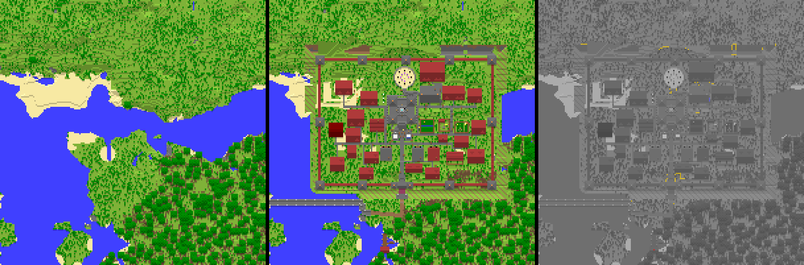

## Summary

| site | result |
|---|---|
| river_bank | 47 findings |

# KingdomQuest field test

Seed 1813296525. Positions in details are relative to the heart (x, y, z).

## river_bank

minecraft:river at 4088, 63, 2540, facing NONE, relief 10, walkable out before founding: true, style temperate, ground grass_block. Gate approach cost per side (* = used): south 6*, west 57, north 55, east 63.

| stage | ms | float built | float land | floating feet | buried | destroyed | doors unreached | walk out | breach | wet inside | wet moat | new cliffs | tall walls | pits | road gaps | road steps | wall gaps | cut trees | foreign ground | snow lost | road steep | stumps | road high | road bank | road moved |
|---|---|---|---|---|---|---|---|---|---|---|---|---|---|---|---|---|---|---|---|---|---|---|---|---|---|
| tent_1 | 420 | 0 | 0 | 0 | 0 | 0 | 0 | 1 | 0 | 0 | 0 | 4 | 0 | 1 | 0 | 0 | 0 | 0 | 0 | 0 | 0 | 0 | 0 | 0 | 0 |
Country road to 3958, 66, 2591 (68 blocks of water on the way).

Lord's changes: broke 2 blocks before tent_2; repair leaves them.

Lord's changes after tent_2: unchanged spot kept broken, changed spot rebuilt by the new plan, 1 change(s) remembered.

| tent_2 | 213 | 0 | 0 | 0 | 0 | 1 | 0 | 1 | 0 | 0 | 0 | 9 | 0 | 1 | 0 | 0 | 0 | 0 | 0 | 0 | 0 | 0 | 0 | 0 | 0 |
| tent_3 | 134 | 0 | 0 | 0 | 0 | 0 | 0 | 1 | 0 | 0 | 0 | 5 | 0 | 1 | 0 | 0 | 0 | 0 | 0 | 0 | 0 | 0 | 0 | 0 | 0 |
| hamlet_1 | 319 | 0 | 0 | 0 | 0 | 2 | 0 | 1 | 0 | 0 | 0 | 2 | 0 | 0 | 0 | 0 | 0 | 0 | 0 | 0 | 0 | 0 | 0 | 0 | 0 |
| hamlet_2 | 191 | 1 | 0 | 0 | 0 | 0 | 0 | 1 | 0 | 0 | 0 | 4 | 0 | 0 | 0 | 0 | 0 | 0 | 0 | 0 | 0 | 0 | 0 | 0 | 0 |
| hamlet_3 | 410 | 1 | 0 | 0 | 0 | 11 | 0 | 1 | 0 | 0 | 0 | 7 | 0 | 0 | 0 | 0 | 0 | 0 | 0 | 0 | 0 | 0 | 0 | 0 | 0 |
| village_1 | 396 | 1 | 0 | 0 | 0 | 11 | 0 | 1 | 0 | 0 | 0 | 40 | 0 | 0 | 0 | 0 | 0 | 0 | 0 | 0 | 4 | 0 | 0 | 0 | 0 |
| town_1 | 326 | 1 | 0 | 0 | 0 | 8 | 0 | 1 | 0 | 0 | 0 | 46 | 0 | 0 | 0 | 0 | 94 | 0 | 0 | 0 | 3 | 0 | 0 | 0 | 4 |
| castle_1 | 386 | 1 | 0 | 0 | 0 | 8 | 0 | 1 | 0 | 0 | 0 | 82 | 0 | 0 | 0 | 0 | 0 | 0 | 921 | 0 | 3 | 0 | 0 | 0 | 0 |
| castle_2 | 381 | 1 | 0 | 0 | 0 | 6 | 0 | 1 | 0 | 0 | 0 | 75 | 0 | 0 | 0 | 0 | 0 | 0 | 893 | 0 | 3 | 0 | 0 | 0 | 0 |
| citadel_1 | 338 | 1 | 0 | 0 | 0 | 6 | 0 | 1 | 0 | 0 | 0 | 75 | 0 | 0 | 0 | 0 | 0 | 0 | 893 | 0 | 3 | 0 | 0 | 0 | 0 |
| final | 0 | 1 | 0 | 0 | 0 | 6 | 0 | 1 | 0 | 0 | 0 | 74 | 0 | 0 | 0 | 0 | 0 | 0 | 265 | 0 | 3 | 0 | 0 | 0 | 0 |
Country road at the end: 55 of 55 cells near the castle intact.

Gate (land relative to the heart, before -> after) at 0/5/10/15/20/30/40 blocks out of the gate: 1->-2 1->-7 1->-2 1->1 1->1 1->1 -1->-1. Moat columns per side {back=88, gate=935, left=392, right=489}. Way-out road none.

- tent_1: new cliffs 4 [(11,-1,-2) to -3, (12,-1,-3) to -3, (12,-4,-2) to 3, (12,-4,-2) to 3]
- tent_1: pits 1 [(12,-4,-2) hole]
- tent_2: destroyed 1 [main (-2,0,-8) white_wool->air]
- tent_2: new cliffs 9 [(-30,2,52) to -3, (4,2,-20) to -3, (11,-1,-2) to -3, (12,-1,-3) to -3, (12,-4,-2) to 3]
- tent_2: pits 1 [(12,-4,-2) hole]
- tent_3: new cliffs 5 [(-30,2,52) to -3, (4,2,-20) to -3, (14,2,-17) to -3, (15,2,-17) to -3, (16,2,-17) to -3]
- tent_3: pits 1 [(12,-3,-2) hole]
- hamlet_1: destroyed 2 [main (4,0,-8) rose_bush->air, main (4,1,-8) rose_bush->air]
- hamlet_1: new cliffs 2 [(-30,2,52) to -3, (36,0,-17) to 3]
- hamlet_2: float built 1 [dock (-13,2,84) lantern]
- hamlet_2: new cliffs 4 [(-30,2,52) to -3, (-19,0,-46) to 3, (-19,0,-44) to 3, (-19,0,-43) to 3]
- hamlet_3: float built 1 [dock (-13,2,84) lantern]
- hamlet_3: destroyed 11 [tavern (17,1,-35) vine->air, tavern (18,1,-35) vine->air, tavern (22,1,-35) vine->air, tavern (26,1,-35) vine->air, tavern (17,2,-35) vine->air]
- hamlet_3: new cliffs 7 [(-30,2,52) to -3, (-19,0,-46) to 3, (-19,0,-44) to 3, (-19,0,-43) to 3, (19,-1,-15) to 3]
- village_1: float built 1 [dock (-13,2,89) lantern]
- village_1: destroyed 11 [tavern (17,1,-35) vine->air, tavern (18,1,-35) vine->air, tavern (22,1,-35) vine->air, tavern (26,1,-35) vine->air, tavern (17,2,-35) vine->air]
- village_1: new cliffs 40 [(-30,2,52) to -3, (-19,0,-46) to 3, (-19,0,-44) to 3, (-19,0,-43) to 3, (12,3,-42) to 3]
- village_1: road steep 4 [(29,4,-25) to -3 in 3, (29,5,-26) to -3 in 3, (29,3,-24) to -3 in 3, (29,2,-23) to -3 in 3]
- market_1 destroyed 2 blocks of tavern []
- town_1: float built 1 [dock (-13,2,89) lantern]
- town_1: destroyed 8 [walls (8,2,40) coarse_dirt->oak_log, tavern (17,1,-35) vine->air, tavern (18,1,-35) vine->air, tavern (26,1,-35) vine->air, tavern (17,2,-35) vine->air]
- town_1: new cliffs 46 [(-30,2,52) to -3, (-11,-1,2) to -3, (-10,-2,-9) to -3, (-10,-2,-8) to -3, (-10,-2,-7) to -3]
- town_1: wall gaps 94 [(-54,-1,40) over water, (-53,-1,40) over water, (-56,-1,40) over water, (-55,-1,40) over water, (-50,-1,40) over water]
- town_1: road steep 3 [(29,4,-25) to -3 in 3, (29,5,-26) to -3 in 3, (29,3,-24) to -3 in 3]
- town_1: road moved 4 [(29,3,-25) from 4, (29,0,-22) from 1, (29,2,-24) from 3, (29,1,-23) from 2]
- royal_2 destroyed 1 blocks of tavern [tavern (17,1,-35) vine->air, tavern (18,1,-35) vine->air, tavern (26,1,-35) vine->air, tavern (17,2,-35) vine->air]
- castle_1: float built 1 [dock (-13,2,89) lantern]
- castle_1: destroyed 8 [tavern (17,1,-35) vine->air, tavern (18,1,-35) vine->air, tavern (26,1,-35) vine->air, tavern (17,2,-35) vine->air, tavern (18,2,-35) vine->air]
- castle_1: new cliffs 82 [(-74,4,-50) to -3, (-74,3,-48) to -3, (-74,3,-47) to -3, (-74,3,-46) to -3, (-74,2,-45) to -3]
- castle_1: foreign ground 921 [dirt 409 of 13078 columns (was 59), stone 512 of 13078 columns (was 19)]
- castle_1: road steep 3 [(29,4,-25) to -3 in 3, (29,5,-26) to -3 in 3, (29,3,-24) to -3 in 3]
- market_3 destroyed 2 blocks of tavern [tavern (17,1,-35) vine->air, tavern (18,1,-35) vine->air, tavern (26,1,-35) vine->air, tavern (17,2,-35) vine->air]
- castle_2: float built 1 [dock (-13,2,89) lantern]
- castle_2: destroyed 6 [tavern (17,1,-35) vine->air, tavern (18,1,-35) vine->air, tavern (26,1,-35) vine->air, tavern (17,2,-35) vine->air, tavern (18,2,-35) vine->air]
- castle_2: new cliffs 75 [(-68,12,-67) to -3, (-67,12,-67) to -3, (-66,12,-67) to -3, (-65,12,-67) to -3, (-64,12,-67) to -3]
- castle_2: foreign ground 893 [dirt 402 of 12615 columns (was 59), stone 491 of 12615 columns (was 19)]
- castle_2: road steep 3 [(29,4,-25) to -3 in 3, (29,5,-26) to -3 in 3, (29,3,-24) to -3 in 3]
- citadel_1: float built 1 [dock (-13,2,89) lantern]
- citadel_1: destroyed 6 [tavern (17,1,-35) vine->air, tavern (18,1,-35) vine->air, tavern (26,1,-35) vine->air, tavern (17,2,-35) vine->air, tavern (18,2,-35) vine->air]
- citadel_1: new cliffs 75 [(-68,12,-67) to -3, (-67,12,-67) to -3, (-66,12,-67) to -3, (-65,12,-67) to -3, (-64,12,-67) to -3]
- citadel_1: foreign ground 893 [dirt 402 of 12615 columns (was 59), stone 491 of 12615 columns (was 19)]
- citadel_1: road steep 3 [(29,4,-25) to -3 in 3, (29,5,-26) to -3 in 3, (29,3,-24) to -3 in 3]
- final: float built 1 [dock (-13,2,89) lantern]
- final: destroyed 6 [tavern (17,1,-35) vine->air, tavern (18,1,-35) vine->air, tavern (26,1,-35) vine->air, tavern (17,2,-35) vine->air, tavern (18,2,-35) vine->air]
- final: new cliffs 74 [(-68,12,-67) to -3, (-67,12,-67) to -3, (-66,12,-67) to -3, (-65,12,-67) to -3, (-64,12,-67) to -3]
- final: foreign ground 265 [stone 265 of 12364 columns (was 19)]
- final: road steep 3 [(29,4,-25) to -3 in 3, (29,5,-26) to -3 in 3, (29,3,-24) to -3 in 3]

