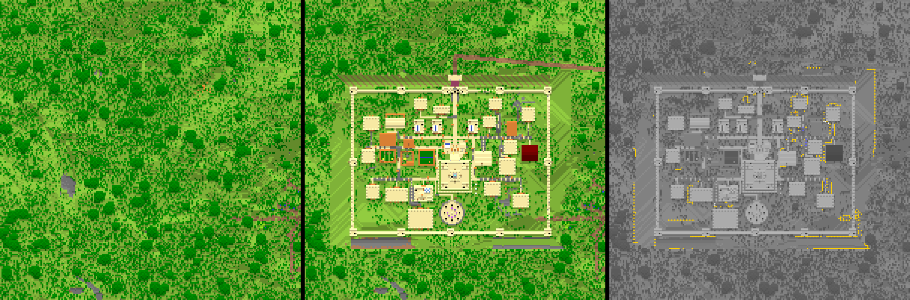

## Summary

| site | result |
|---|---|
| rolling | 52 findings |

# KingdomQuest field test

Seed 1813296525. Positions in details are relative to the heart (x, y, z).

## rolling

minecraft:savanna at 4224, 94, 12596, facing CLOCKWISE_180, relief 39, walkable out before founding: true, style arid, ground grass_block. Shape rolling (score 6.0), land relative to the heart, directions S SE E NE N NW W SW: 24 out [1, 0, 7, 1, 1, 1, 0, 1]; 48 out [2, 9, 20, 4, 1, 3, 2, 11]; 72 out [5, 11, 24, 8, 8, 2, 6, 16]; 96 out [2, 3, 17, 24, 16, 4, 10, 14]. Gate approach cost per side (* = used): south 10, west 28, north 4*, east 259.

| stage | ms | float built | float land | floating feet | buried | destroyed | doors unreached | walk out | breach | wet inside | wet moat | new cliffs | tall walls | pits | road gaps | road steps | wall gaps | cut trees | foreign ground | snow lost | road steep | stumps | road high | road bank | road moved |
|---|---|---|---|---|---|---|---|---|---|---|---|---|---|---|---|---|---|---|---|---|---|---|---|---|---|
| tent_1 | 592 | 0 | 0 | 0 | 0 | 0 | 0 | 1 | 0 | 0 | 0 | 10 | 0 | 0 | 0 | 0 | 0 | 0 | 0 | 0 | 0 | 0 | 0 | 0 | 0 |
Country road to 4354, 139, 12545 (0 blocks of water on the way).

Lord's changes: broke 2 blocks before tent_2; repair leaves them.

Lord's changes after tent_2: unchanged spot kept broken, changed spot rebuilt by the new plan, 1 change(s) remembered.

| tent_2 | 338 | 0 | 0 | 0 | 0 | 1 | 0 | 1 | 0 | 0 | 0 | 7 | 0 | 0 | 0 | 0 | 0 | 0 | 0 | 0 | 0 | 0 | 0 | 0 | 0 |
| tent_3 | 289 | 0 | 0 | 0 | 0 | 0 | 0 | 1 | 0 | 0 | 0 | 7 | 0 | 0 | 0 | 0 | 0 | 0 | 0 | 0 | 0 | 0 | 0 | 0 | 0 |
| hamlet_1 | 657 | 0 | 0 | 0 | 0 | 0 | 0 | 1 | 0 | 0 | 0 | 36 | 0 | 0 | 0 | 0 | 0 | 0 | 0 | 0 | 0 | 0 | 0 | 0 | 0 |
| dock 1 not built |
| hamlet_2 | 285 | 0 | 0 | 0 | 0 | 0 | 0 | 1 | 0 | 0 | 0 | 51 | 0 | 3 | 0 | 0 | 0 | 0 | 0 | 0 | 0 | 0 | 0 | 2 | 0 |
| hamlet_3 | 314 | 0 | 0 | 0 | 0 | 0 | 0 | 1 | 0 | 0 | 0 | 81 | 0 | 2 | 0 | 0 | 0 | 0 | 0 | 0 | 2 | 0 | 0 | 0 | 0 |
| village_1 | 330 | 0 | 0 | 0 | 0 | 0 | 0 | 1 | 0 | 0 | 0 | 92 | 2 | 2 | 0 | 0 | 0 | 0 | 0 | 0 | 2 | 0 | 0 | 0 | 0 |
| town_1 | 279 | 5 | 0 | 0 | 0 | 4 | 0 | 1 | 0 | 0 | 0 | 368 | 2 | 2 | 0 | 0 | 9 | 0 | 0 | 0 | 12 | 0 | 0 | 1 | 0 |
| castle_1 | 582 | 5 | 1 | 0 | 0 | 0 | 0 | 1 | 0 | 0 | 0 | 569 | 2 | 0 | 0 | 0 | 0 | 0 | 613 | 0 | 15 | 0 | 0 | 1 | 0 |
| castle_2 | 435 | 5 | 0 | 0 | 0 | 0 | 0 | 1 | 0 | 0 | 0 | 568 | 6 | 1 | 0 | 0 | 0 | 0 | 615 | 0 | 15 | 0 | 0 | 1 | 0 |
| citadel_1 | 408 | 5 | 0 | 0 | 0 | 0 | 0 | 1 | 0 | 0 | 0 | 574 | 6 | 1 | 0 | 0 | 0 | 0 | 615 | 0 | 15 | 0 | 0 | 1 | 0 |
| final | 0 | 0 | 0 | 0 | 0 | 0 | 0 | 1 | 0 | 0 | 0 | 526 | 6 | 1 | 0 | 0 | 0 | 0 | 375 | 0 | 15 | 0 | 0 | 1 | 0 |
Country road at the end: 123 of 123 cells near the castle intact.

Gate (land relative to the heart, before -> after) at 0/5/10/15/20/30/40 blocks out of the gate: -1->-2 0->-7 0->-2 1->1 5->5 7->7 14->14. Moat columns per side {gate=1080}. Way-out road none.

- tent_1: new cliffs 10 [(-57,0,-6) to -13, (-56,-5,34) to 3, (-54,2,-25) to -5, (-52,-13,31) to 3, (-27,-5,-19) to 4]
- tent_2: destroyed 1 [main (2,0,8) orange_terracotta->air]
- tent_2: new cliffs 7 [(-57,0,-6) to -13, (-56,-5,34) to 3, (-54,2,-25) to -5, (-52,-13,31) to 3, (-27,-5,-19) to 4]
- tent_3: new cliffs 7 [(-57,0,-6) to -13, (-56,-5,34) to 3, (-54,2,-25) to -5, (-52,-13,31) to 3, (-27,-5,-19) to 4]
- hamlet_1: new cliffs 36 [(-57,0,-6) to -13, (-56,-5,34) to 3, (-54,2,-25) to -5, (-52,-13,31) to 3, (-41,10,33) to -3]
- hamlet_2: new cliffs 51 [(-77,11,22) to -3, (-76,7,10) to -3, (-76,8,22) to 3, (-75,7,12) to -3, (-75,8,22) to 3]
- hamlet_2: pits 3 [(-71,-7,-17) hole, (-69,-14,-14) hole, (-68,-14,-13) hole]
- hamlet_2: road bank 2 [(-38,1,-1) over 2/2, (-37,1,-1) over 2/2]
- hamlet_3: new cliffs 81 [(-77,11,22) to -3, (-76,7,10) to -3, (-76,8,22) to 3, (-75,7,12) to -3, (-75,8,22) to 3]
- hamlet_3: pits 2 [(-71,-7,-17) hole, (-69,-10,-14) hole]
- hamlet_3: road steep 2 [(49,14,-13) to -3 in 3, (49,13,-12) to -3 in 3]
- village_1: new cliffs 92 [(-77,11,22) to -3, (-76,7,10) to -3, (-76,8,22) to 3, (-75,7,12) to -3, (-75,8,22) to 3]
- village_1: tall walls 2 [(-30,6,36) -7 cap unowned low unowned:stone_bricks, (-30,-1,37) 7 cap unowned low unowned:stone_bricks]
- village_1: pits 2 [(-71,-7,-17) hole, (-69,-10,-14) hole]
- village_1: road steep 2 [(49,14,-13) to -3 in 3, (49,13,-12) to -3 in 3]
- town_1: float built 5 [smith (12,3,2) spruce_hanging_sign, smith (12,4,2) spruce_fence, smith (12,2,3) spruce_fence, smith (12,3,3) spruce_fence, smith (12,4,3) spruce_fence]
- town_1: destroyed 4 [walls (62,7,56) coarse_dirt->acacia_log, walls (61,7,56) coarse_dirt->acacia_log, walls (63,7,55) coarse_dirt->acacia_log, walls (63,7,54) coarse_dirt->acacia_log]
- town_1: new cliffs 368 [(-84,5,-2) to -3, (-84,5,-1) to -3, (-84,6,0) to -4, (-84,13,22) to -3, (-84,14,23) to -3]
- town_1: tall walls 2 [(-30,6,36) -7 cap unowned low unowned:stone, (-30,-1,37) 7 cap unowned low unowned:stone_bricks]
- town_1: pits 2 [(-17,2,38) spike, (45,-3,60) hole]
- town_1: wall gaps 9 [(65,7,54) over air, (65,7,58) over air, (-4,1,-42) over air, (-4,1,-38) over air, (61,18,-38) over air]
- town_1: road steep 12 [(44,10,22) to 3 in 3, (44,9,21) to 3 in 3, (31,4,-8) to 3 in 3, (31,5,-7) to 3 in 3, (31,6,-6) to 3 in 3]
- town_1: road bank 1 [(-56,-1,-4) over 2/2]
- castle_1: float built 5 [smith (12,3,2) spruce_hanging_sign, smith (12,4,2) spruce_fence, smith (12,2,3) spruce_fence, smith (12,3,3) spruce_fence, smith (12,4,3) spruce_fence]
- castle_1: float land 1 [(63,14,26) andesite]
- castle_1: new cliffs 569 [(-84,5,-2) to -3, (-84,5,-1) to -3, (-84,6,0) to -4, (-84,13,22) to -3, (-84,14,23) to -4]
- castle_1: tall walls 2 [(-30,6,36) -7 cap unowned low unowned:stone, (-30,-1,37) 7 cap unowned low unowned:stone_bricks]
- castle_1: foreign ground 613 [stone 613 of 13707 columns (was 48)]
- castle_1: road steep 15 [(44,10,22) to 3 in 3, (44,9,21) to 3 in 3, (29,9,-15) to -3 in 3, (29,7,-13) to -3 in 3, (29,8,-14) to -3 in 3]
- castle_1: road bank 1 [(-56,-1,-4) over 2/2]
- castle_2: float built 5 [smith (12,3,2) spruce_hanging_sign, smith (12,4,2) spruce_fence, smith (12,2,3) spruce_fence, smith (12,3,3) spruce_fence, smith (12,4,3) spruce_fence]
- castle_2: new cliffs 568 [(-84,5,-2) to -3, (-84,5,-1) to -3, (-84,6,0) to -4, (-84,13,22) to -3, (-84,14,23) to -4]
- castle_2: tall walls 6 [(-30,6,36) -7 cap unowned low unowned:stone, (-30,-1,37) 7 cap unowned low unowned:stone_bricks, (43,5,-19) 9 cap unowned low unowned:stone, (44,14,-19) -9 cap unowned low unowned:stone, (45,6,-18) 8 cap unowned low unowned:stone]
- castle_2: pits 1 [(24,7,-25) spike]
- castle_2: foreign ground 615 [stone 615 of 13525 columns (was 48)]
- castle_2: road steep 15 [(44,10,22) to 3 in 3, (44,9,21) to 3 in 3, (29,9,-15) to -3 in 3, (29,7,-13) to -3 in 3, (29,8,-14) to -3 in 3]
- castle_2: road bank 1 [(-56,-1,-4) over 2/2]
- citadel_1: float built 5 [smith (12,3,2) spruce_hanging_sign, smith (12,4,2) spruce_fence, smith (12,2,3) spruce_fence, smith (12,3,3) spruce_fence, smith (12,4,3) spruce_fence]
- citadel_1: new cliffs 574 [(-84,5,-2) to -3, (-84,5,-1) to -3, (-84,6,0) to -4, (-84,13,22) to -3, (-84,14,23) to -4]
- citadel_1: tall walls 6 [(-30,6,36) -7 cap unowned low unowned:stone, (-30,-1,37) 7 cap unowned low unowned:stone_bricks, (43,5,-19) 9 cap unowned low unowned:stone, (44,14,-19) -9 cap unowned low unowned:stone, (45,6,-18) 8 cap unowned low unowned:stone]
- citadel_1: pits 1 [(24,7,-25) spike]
- citadel_1: foreign ground 615 [stone 615 of 13522 columns (was 48)]
- citadel_1: road steep 15 [(44,10,22) to 3 in 3, (44,9,21) to 3 in 3, (29,9,-15) to -3 in 3, (29,7,-13) to -3 in 3, (29,8,-14) to -3 in 3]
- citadel_1: road bank 1 [(-56,-1,-4) over 2/2]
- final: tall by [{unowned/unowned=6}]
- final: new cliffs 526 [(-84,5,-2) to -3, (-84,5,-1) to -3, (-84,6,0) to -4, (-84,13,22) to -3, (-84,14,23) to -4]
- final: tall walls 6 [(-30,6,36) -7 cap unowned low unowned:stone, (-30,-1,37) 7 cap unowned low unowned:stone_bricks, (43,5,-19) 9 cap unowned low unowned:stone, (44,14,-19) -9 cap unowned low unowned:stone, (45,6,-18) 8 cap unowned low unowned:stone]
- final: pits 1 [(24,7,-25) spike]
- final: foreign ground 375 [stone 375 of 13271 columns (was 48)]
- final: road steep 15 [(44,10,22) to 3 in 3, (44,9,21) to 3 in 3, (29,9,-15) to -3 in 3, (29,7,-13) to -3 in 3, (29,8,-14) to -3 in 3]
- final: road bank 1 [(-56,-1,-4) over 2/2]
- not at the last level: dock 0/2, 

