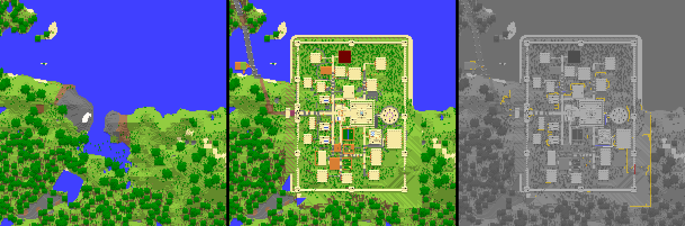

## Summary

| site | result |
|---|---|
| savanna_plateau | 54 findings |

# KingdomQuest field test

Seed 1813296525. Positions in details are relative to the heart (x, y, z).

## savanna_plateau

minecraft:windswept_savanna at 6788, 70, -392, facing CLOCKWISE_90, relief 55, walkable out before founding: false, style arid, ground grass_block. Gate approach cost per side (* = used): south 32, west 24*, north 94, east 237.

| stage | ms | float built | float land | floating feet | buried | destroyed | doors unreached | walk out | breach | wet inside | wet moat | new cliffs | tall walls | pits | road gaps | road steps | wall gaps | cut trees | foreign ground | snow lost | road steep | stumps | road high | road bank | road moved |
|---|---|---|---|---|---|---|---|---|---|---|---|---|---|---|---|---|---|---|---|---|---|---|---|---|---|
| tent_1 | 984 | 0 | 0 | 0 | 0 | 0 | 0 | 1 | 0 | 0 | 0 | 88 | 0 | 0 | 0 | 0 | 0 | 0 | 0 | 0 | 0 | 0 | 0 | 0 | 0 |
Country road to 6687, 64, -512 (62 blocks of water on the way).

Lord's changes: broke 2 blocks before tent_2; repair leaves them.

Lord's changes after tent_2: unchanged spot kept broken, changed spot rebuilt by the new plan, 1 change(s) remembered.

| tent_2 | 566 | 0 | 0 | 0 | 0 | 1 | 0 | 1 | 0 | 0 | 0 | 59 | 0 | 2 | 0 | 0 | 0 | 0 | 0 | 0 | 0 | 0 | 0 | 0 | 0 |
| tent_3 | 219 | 0 | 0 | 0 | 0 | 0 | 0 | 1 | 0 | 0 | 0 | 71 | 0 | 2 | 0 | 0 | 0 | 0 | 0 | 0 | 0 | 0 | 0 | 0 | 0 |
| hamlet_1 | 749 | 0 | 0 | 0 | 0 | 0 | 0 | 1 | 0 | 0 | 0 | 296 | 0 | 3 | 0 | 0 | 0 | 0 | 0 | 0 | 0 | 0 | 0 | 0 | 0 |
| hamlet_2 | 515 | 0 | 0 | 0 | 0 | 0 | 0 | 1 | 0 | 0 | 0 | 169 | 0 | 4 | 0 | 0 | 0 | 0 | 0 | 0 | 4 | 0 | 0 | 1 | 0 |
| hamlet_3 | 480 | 0 | 0 | 0 | 0 | 0 | 0 | 1 | 0 | 0 | 0 | 194 | 0 | 4 | 0 | 0 | 0 | 0 | 0 | 0 | 4 | 0 | 0 | 0 | 0 |
| village_1 | 613 | 0 | 0 | 0 | 0 | 0 | 0 | 1 | 0 | 0 | 0 | 339 | 15 | 4 | 0 | 0 | 0 | 0 | 0 | 0 | 18 | 0 | 0 | 4 | 0 |
| town_1 | 366 | 0 | 0 | 0 | 0 | 3 | 0 | 1 | 0 | 0 | 0 | 389 | 9 | 7 | 0 | 0 | 224 | 0 | 0 | 0 | 17 | 0 | 0 | 4 | 14 |
| castle_1 | 586 | 0 | 64 | 0 | 0 | 0 | 0 | 1 | 0 | 0 | 0 | 384 | 5 | 2 | 0 | 0 | 0 | 0 | 0 | 0 | 17 | 0 | 0 | 2 | 0 |
| castle_2 | 549 | 0 | 64 | 0 | 0 | 0 | 0 | 1 | 0 | 0 | 0 | 375 | 5 | 2 | 0 | 0 | 0 | 0 | 0 | 0 | 17 | 0 | 0 | 2 | 0 |
| citadel_1 | 576 | 0 | 64 | 0 | 0 | 0 | 0 | 1 | 0 | 0 | 0 | 375 | 5 | 2 | 0 | 0 | 0 | 0 | 0 | 0 | 17 | 0 | 0 | 2 | 0 |
| final | 0 | 0 | 64 | 0 | 0 | 0 | 0 | 1 | 0 | 0 | 0 | 407 | 21 | 2 | 0 | 0 | 0 | 0 | 0 | 0 | 26 | 0 | 0 | 5 | 0 |
Country road at the end: 77 of 78 cells near the castle intact, cut at [-63, 9, -1].

Gate (land relative to the heart, before -> after) at 0/5/10/15/20/30/40 blocks out of the gate: 0->-2 3->-7 4->-2 3->2 2->2 2->2 4->4. Moat columns per side {back=2, gate=704, left=194}. Way-out road none.

- tent_1: new cliffs 88 [(-12,-6,38) to 10, (-10,-7,-4) to 3, (-10,-7,-3) to 3, (-10,-7,-1) to 3, (-10,-7,1) to 3]
- tent_2: destroyed 1 [main (8,0,-2) orange_terracotta->air]
- tent_2: new cliffs 59 [(-82,-8,-41) to 3, (-81,-5,-41) to -3, (-80,-5,-41) to -3, (-73,-8,-31) to 3, (-52,4,5) to -7]
- tent_2: pits 2 [(-79,-8,-41) hole, (-51,-3,5) hole]
- tent_3: new cliffs 71 [(-82,-8,-41) to 3, (-81,-5,-41) to -3, (-80,-5,-41) to -3, (-73,-8,-31) to 3, (-52,4,5) to -7]
- tent_3: pits 2 [(-79,-8,-41) hole, (-51,-3,5) hole]
- hamlet_1: new cliffs 296 [(-82,-8,-41) to 3, (-81,-5,-41) to -3, (-80,-5,-41) to -3, (-73,-8,-31) to 3, (-52,4,5) to -7]
- hamlet_1: pits 3 [(-79,-8,-41) hole, (-51,-3,5) hole, (39,26,36) spike]
- hamlet_2: new cliffs 169 [(-80,-5,-41) to -3, (-73,-8,-31) to 3, (-52,4,5) to -7, (-51,4,-6) to 3, (-51,3,-5) to 3]
- hamlet_2: pits 4 [(-79,-8,-41) hole, (-51,-3,5) hole, (-4,-8,73) hole, (13,-8,47) hole]
- hamlet_2: road steep 4 [(-5,-5,-19) to -3 in 3, (-6,-4,-19) to -3 in 3, (-7,-3,-19) to -3 in 3, (-8,-2,-19) to -3 in 3]
- hamlet_2: road bank 1 [(-8,-6,-31) over 2/2]
- hamlet_3: new cliffs 194 [(-80,-5,-41) to -3, (-73,-8,-31) to 3, (-52,4,5) to -3, (-52,-7,14) to 3, (-51,4,-6) to 3]
- hamlet_3: pits 4 [(-79,-8,-41) hole, (-51,1,5) hole, (-4,-8,73) hole, (13,-8,47) hole]
- hamlet_3: road steep 4 [(-5,-5,-19) to -3 in 3, (-6,-4,-19) to -3 in 3, (-7,-3,-19) to -3 in 3, (-8,-2,-19) to -3 in 3]
- village_1: new cliffs 339 [(-90,-8,-46) to 4, (-90,-4,-39) to -4, (-89,-8,-46) to 4, (-89,-4,-39) to -4, (-88,-8,-46) to 4]
- village_1: tall walls 15 [(27,6,30) -7 cap unowned low unowned:stone_bricks, (28,7,30) -8 cap unowned low unowned:stone_bricks, (29,8,30) -9 cap unowned low unowned:stone_bricks, (30,9,30) -10 cap unowned low unowned:stone_bricks, (31,10,30) -10 cap unowned low unowned:stone_bricks]
- village_1: pits 4 [(-79,-8,-41) hole, (-51,1,5) hole, (-4,-8,73) hole, (13,-8,47) hole]
- village_1: road steep 18 [(27,6,29) to 3 in 3, (-5,-5,-19) to -3 in 3, (26,5,29) to 3 in 3, (-6,-4,-19) to -3 in 3, (25,4,29) to 3 in 3]
- village_1: road bank 4 [(36,15,25) over 4/4, (36,15,26) over 4/4, (36,15,27) over 4/4, (36,15,28) over 4/4]
- town_1: destroyed 3 [walls (56,21,67) coarse_dirt->acacia_log, walls (-40,2,-8) coarse_dirt->acacia_log, walls (-40,1,-7) coarse_dirt->acacia_log]
- town_1: new cliffs 389 [(-90,-8,-46) to 4, (-90,-4,-39) to -4, (-89,-8,-46) to 4, (-89,-4,-39) to -4, (-88,-8,-46) to 4]
- town_1: tall walls 9 [(35,-1,22) 16 cap unowned low unowned:stone, (35,-1,22) 16 cap unowned low unowned:andesite, (36,-1,21) 16 cap unowned low unowned:stone, (36,14,30) -15 cap unowned low unowned:stone_bricks, (37,11,29) -12 cap unowned low unowned:stone_bricks]
- town_1: pits 7 [(-79,-8,-41) hole, (13,-8,47) hole, (60,16,52) hole, (61,17,54) hole, (62,17,53) hole]
- town_1: wall gaps 224 [(-37,-8,69) over water, (-5,-8,-63) over water, (-37,-8,-63) over water, (27,-8,-63) over water, (-38,1,8) over air]
- town_1: road steep 17 [(27,6,29) to 3 in 3, (26,5,29) to 3 in 3, (-6,-4,-19) to -3 in 3, (25,4,29) to 3 in 3, (-7,-3,-19) to -3 in 3]
- town_1: road bank 4 [(36,15,25) over 4/4, (36,15,26) over 4/4, (36,15,27) over 4/4, (36,15,28) over 4/4]
- town_1: road moved 14 [(27,5,29) from 6, (26,4,29) from 5, (25,3,29) from 4, (24,2,29) from 3, (23,1,29) from 2]
- castle_1: float land 64 [(56,34,46) stone, (56,35,46) stone, (56,36,46) stone, (56,37,46) gravel, (56,38,46) gravel]
- castle_1: new cliffs 384 [(-90,-8,-46) to 4, (-90,-4,-39) to -4, (-89,-8,-46) to 4, (-89,-4,-39) to -4, (-88,-8,-46) to 4]
- castle_1: tall walls 5 [(35,-1,22) 16 cap unowned low unowned:stone, (35,-1,22) 16 cap unowned low unowned:andesite, (36,-1,21) 16 cap unowned low unowned:stone, (36,14,30) -15 cap unowned low unowned:stone_bricks, (37,11,29) -12 cap unowned low unowned:stone_bricks]
- castle_1: pits 2 [(-79,-8,-41) hole, (13,-8,47) hole]
- castle_1: road steep 17 [(27,6,29) to 3 in 3, (26,5,29) to 3 in 3, (-6,-4,-19) to -3 in 3, (25,4,29) to 3 in 3, (-7,-3,-19) to -3 in 3]
- castle_1: road bank 2 [(36,15,27) over 4/4, (36,15,28) over 4/4]
- castle_2: float land 64 [(56,34,46) stone, (56,35,46) stone, (56,36,46) stone, (56,37,46) gravel, (56,38,46) gravel]
- castle_2: new cliffs 375 [(-90,-8,-46) to 4, (-90,-4,-39) to -4, (-89,-8,-46) to 4, (-89,-4,-39) to -4, (-88,-8,-46) to 4]
- castle_2: tall walls 5 [(35,-1,22) 16 cap unowned low unowned:stone, (35,-1,22) 16 cap unowned low unowned:andesite, (36,-1,21) 16 cap unowned low unowned:stone, (36,15,30) -16 cap unowned low unowned:stone_bricks, (37,11,29) -12 cap unowned low unowned:stone_bricks]
- castle_2: pits 2 [(-79,-8,-41) hole, (13,-8,47) hole]
- castle_2: road steep 17 [(27,6,29) to 3 in 3, (26,5,29) to 3 in 3, (-6,-4,-19) to -3 in 3, (25,4,29) to 3 in 3, (-7,-3,-19) to -3 in 3]
- castle_2: road bank 2 [(36,15,27) over 4/4, (36,15,28) over 4/4]
- citadel_1: float land 64 [(56,34,46) stone, (56,35,46) stone, (56,36,46) stone, (56,37,46) gravel, (56,38,46) gravel]
- citadel_1: new cliffs 375 [(-90,-8,-46) to 4, (-90,-4,-39) to -4, (-89,-8,-46) to 4, (-89,-4,-39) to -4, (-88,-8,-46) to 4]
- citadel_1: tall walls 5 [(35,-1,22) 16 cap unowned low unowned:stone, (35,-1,22) 16 cap unowned low unowned:andesite, (36,-1,21) 16 cap unowned low unowned:stone, (36,15,30) -16 cap unowned low unowned:stone_bricks, (37,11,29) -12 cap unowned low unowned:stone_bricks]
- citadel_1: pits 2 [(-79,-8,-41) hole, (13,-8,47) hole]
- citadel_1: road steep 17 [(27,6,29) to 3 in 3, (26,5,29) to 3 in 3, (-6,-4,-19) to -3 in 3, (25,4,29) to 3 in 3, (-7,-3,-19) to -3 in 3]
- citadel_1: road bank 2 [(36,15,27) over 4/4, (36,15,28) over 4/4]
- final: tall by [{unowned/unowned=21}]
- final: float land 64 [(56,34,46) stone, (56,35,46) stone, (56,36,46) stone, (56,37,46) gravel, (56,38,46) gravel]
- final: new cliffs 407 [(-90,-8,-46) to 4, (-90,-4,-39) to -4, (-89,-8,-46) to 4, (-89,-4,-39) to -4, (-88,-8,-46) to 4]
- final: tall walls 21 [(28,7,30) -7 cap unowned low unowned:stone, (29,-1,1) 12 cap unowned low unowned:stone_bricks, (29,-1,1) 12 cap unowned low unowned:stone_bricks, (29,8,30) -8 cap unowned low unowned:stone, (30,9,30) -9 cap unowned low unowned:andesite]
- final: pits 2 [(-79,-8,-41) hole, (13,-8,47) hole]
- final: road steep 26 [(27,6,29) to 3 in 3, (26,5,29) to 3 in 3, (-6,-4,-19) to -3 in 3, (25,4,29) to 3 in 3, (-7,-3,-19) to -3 in 3]
- final: road bank 5 [(36,15,27) over 4/4, (36,15,28) over 4/4, (33,13,2) over 2/2, (32,13,2) over 2/2, (31,13,2) over 2/2]
- country road cut in 1 cells, e.g. [-63, 9, -1]

