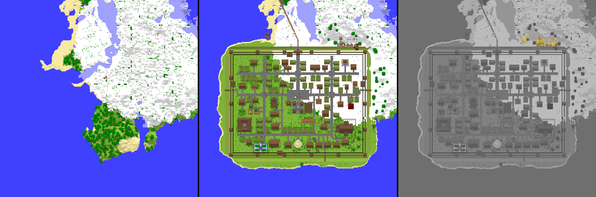

## Summary

| site | result |
|---|---|
| snowy_beach | 59 findings |

# KingdomQuest field test

Seed 20261117. Positions in details are relative to the heart (x, y, z).

## snowy_beach

minecraft:snowy_beach at -6448, 64, 6796, facing CLOCKWISE_180, relief 76, walkable out before founding: true, style frozen, ground grass_block. Gate approach cost per side (* = used): south 36, west 66, north 0*, east 554.

| stage | ms | float built | float land | floating feet | buried | destroyed | doors unreached | walk out | breach | wet inside | wet moat | new cliffs | tall walls | pits | road gaps | road steps | wall gaps | cut trees | foreign ground | snow lost | road steep | stumps | road high | road bank | road moved |
|---|---|---|---|---|---|---|---|---|---|---|---|---|---|---|---|---|---|---|---|---|---|---|---|---|---|
Founded as flat castle: plateau at 0 (relative to the heart), site shaped in 840 ms.

| tent_1 | 258 | 0 | 0 | 0 | 0 | 0 | 0 | 1 | 0 | 0 | 0 | 61 | 0 | 3 | 0 | 0 | 0 | 0 | 0 | 1 | 0 | 0 | 0 | 0 | 0 |
Country road to -6498, 157, 6575 (10 blocks of water on the way).

Lord's changes: broke 2 blocks before tent_2; repair leaves them.

Lord's changes after tent_2: unchanged spot kept broken, changed spot rebuilt by the new plan, 1 change(s) remembered.

| tent_2 | 433 | 0 | 173 | 0 | 0 | 1 | 0 | 1 | 0 | 0 | 0 | 66 | 0 | 5 | 0 | 0 | 0 | 0 | 0 | 200 | 0 | 0 | 0 | 0 | 0 |
| tent_3 | 168 | 0 | 173 | 0 | 0 | 0 | 0 | 1 | 0 | 0 | 0 | 66 | 0 | 5 | 0 | 0 | 0 | 0 | 0 | 200 | 0 | 0 | 0 | 0 | 0 |
| hamlet_1 | 926 | 0 | 173 | 0 | 0 | 0 | 0 | 1 | 0 | 0 | 0 | 56 | 0 | 1 | 0 | 0 | 0 | 0 | 0 | 222 | 0 | 0 | 0 | 0 | 0 |
| hamlet_2 | 245 | 3 | 0 | 0 | 0 | 0 | 0 | 1 | 0 | 0 | 0 | 391 | 0 | 5 | 0 | 0 | 0 | 0 | 0 | 278 | 0 | 0 | 0 | 0 | 0 |
| hamlet_3 | 263 | 1 | 0 | 0 | 0 | 0 | 0 | 1 | 0 | 0 | 0 | 362 | 0 | 4 | 0 | 0 | 0 | 0 | 0 | 275 | 0 | 0 | 0 | 0 | 0 |
| village_1 | 806 | 1 | 0 | 0 | 0 | 0 | 0 | 1 | 0 | 0 | 0 | 386 | 0 | 4 | 0 | 0 | 0 | 0 | 0 | 279 | 0 | 0 | 0 | 0 | 0 |
| town_1 | 459 | 1 | 0 | 0 | 0 | 0 | 0 | 1 | 0 | 2 | 0 | 596 | 1 | 52 | 0 | 0 | 0 | 0 | 0 | 787 | 0 | 0 | 0 | 0 | 0 |
| castle_1 | 1063 | 1 | 0 | 0 | 0 | 0 | 0 | 1 | 0 | 1 | 0 | 520 | 1 | 47 | 0 | 0 | 0 | 0 | 0 | 740 | 0 | 0 | 0 | 0 | 0 |
| castle_2 | 1244 | 1 | 0 | 0 | 0 | 0 | 0 | 1 | 0 | 1 | 0 | 520 | 1 | 47 | 0 | 0 | 0 | 0 | 0 | 737 | 0 | 0 | 0 | 0 | 0 |
| citadel_1 | 1271 | 1 | 0 | 0 | 0 | 0 | 0 | 1 | 0 | 1 | 0 | 520 | 1 | 47 | 0 | 0 | 0 | 0 | 0 | 735 | 0 | 0 | 0 | 0 | 0 |
| final | 0 | 1 | 0 | 0 | 0 | 0 | 0 | 1 | 0 | 1 | 0 | 520 | 1 | 47 | 0 | 0 | 0 | 0 | 0 | 731 | 0 | 0 | 0 | 0 | 0 |
Country road at the end: 10 of 10 cells near the castle intact.

Gate (land relative to the heart, before -> after) at 0/5/10/15/20/30/40 blocks out of the gate: 0->-2 0->-2 -1->-2 -1->-2 -1->-2 -2->-2 -1->-2. Moat columns per side {back=2814, gate=2788, left=704, right=776}. Way-out road none.

Production: level 1 made 16102 items in a game day, 48327 in three (store 4320 stacks); level 5 with every milestone 141571 items of 239 kinds a day. Storehouse goods shown: 14 blocks; unloaded 15552 items into the chests.

Tram: 880 rails, stops [gate, west, north, east]
Signal fires: 20 on 13 towers, lit 20, put out 20; tower guard posts 20.

- tent_1: new cliffs 61 [(35,14,2) to 3, (35,14,3) to 3, (35,14,4) to 3, (35,14,5) to 3, (35,12,19) to 15]
- tent_1: pits 3 [(44,30,20) spike, (47,30,27) spike, (48,30,26) spike]
- tent_1: snow lost 1 [(26,11,24) on grass_block at air light 0]
- tent_2: float land 173 [(48,57,-118) dirt, (48,58,-118) dirt, (48,59,-118) dirt, (48,60,-118) dirt, (48,61,-118) dirt]
- tent_2: destroyed 1 [main (5,1,0) spruce_log->air]
- tent_2: new cliffs 66 [(35,7,19) to 4, (35,8,20) to 4, (36,5,12) to 3, (36,8,18) to 3, (36,12,20) to -3]
- tent_2: pits 5 [(-31,-2,-180) hole, (42,21,20) spike, (44,27,20) spike, (47,30,27) spike, (48,30,26) spike]
- tent_2: snow lost 200 [(-27,1,-170) on coarse_dirt at air light 4, (-19,-1,-152) on coarse_dirt at air light 0, (-11,0,-136) on dirt_path at air light 0, (-2,0,-115) on dirt_path at air light 0]
- tent_3: float land 173 [(48,57,-118) dirt, (48,58,-118) dirt, (48,59,-118) dirt, (48,60,-118) dirt, (48,61,-118) dirt]
- tent_3: new cliffs 66 [(35,7,19) to 4, (35,8,20) to 4, (36,5,12) to 3, (36,8,18) to 3, (36,12,20) to -3]
- tent_3: pits 5 [(-31,-2,-180) hole, (42,21,20) spike, (44,27,20) spike, (47,30,27) spike, (48,30,26) spike]
- tent_3: snow lost 200 [(-27,1,-170) on coarse_dirt at air light 4, (-19,-1,-152) on coarse_dirt at air light 0, (-11,0,-136) on dirt_path at air light 0, (-2,0,-118) on dirt_path at air light 0]
- hamlet_1: float land 173 [(48,57,-118) dirt, (48,58,-118) dirt, (48,59,-118) dirt, (48,60,-118) dirt, (48,61,-118) dirt]
- hamlet_1: new cliffs 56 [(45,3,28) to 3, (45,3,29) to 3, (46,3,27) to 4, (46,3,27) to 3, (46,4,30) to 3]
- hamlet_1: pits 1 [(-31,-2,-180) hole]
- hamlet_1: snow lost 222 [(-27,1,-170) on coarse_dirt at air light 4, (-19,-1,-152) on coarse_dirt at air light 0, (-11,0,-139) on coarse_dirt at air light 0, (-1,0,-115) on dirt_path at air light 0, (26,0,24) on grass_block at air light 0]
- hamlet_2: float built 3 [lamps (-98,0,-10) spruce_fence, lamps (-98,1,-10) torch, dock (-58,1,-120) lantern]
- hamlet_2: new cliffs 391 [(45,3,28) to 3, (45,3,29) to 3, (46,3,27) to 3, (46,3,27) to 3, (46,4,30) to 3]
- hamlet_2: pits 5 [(-31,-2,-180) hole, (56,12,28) spike, (82,12,-99) spike, (109,17,-73) spike, (120,24,16) spike]
- hamlet_2: snow lost 278 [(-27,1,-170) on coarse_dirt at air light 4, (-19,-1,-152) on coarse_dirt at air light 0, (-11,0,-139) on coarse_dirt at air light 0, (-1,0,-115) on dirt_path at air light 0, (29,1,-67) on spruce_leaves at air light 0]
- hamlet_3: float built 1 [dock (-58,1,-120) lantern]
- hamlet_3: new cliffs 362 [(45,3,28) to 3, (45,3,29) to 3, (46,3,27) to 3, (46,3,27) to 3, (46,4,30) to 3]
- hamlet_3: pits 4 [(-31,-2,-180) hole, (56,12,28) spike, (82,12,-99) spike, (109,17,-73) spike]
- hamlet_3: snow lost 275 [(-37,0,-65) on grass_block at leaf_litter light 2, (-19,-1,-155) on dirt_path at air light 0, (-11,0,-140) on dirt_path at air light 0, (-1,0,-116) on dirt_path at air light 0, (33,0,21) on grass_block at air light 0]
- village_1: float built 1 [dock (-58,1,-125) lantern]
- village_1: new cliffs 386 [(48,30,-102) to -4, (48,26,-101) to 4, (48,26,-100) to -7, (48,19,-99) to 6, (48,15,-96) to 3]
- village_1: pits 4 [(-31,-2,-180) hole, (82,12,-99) spike, (96,12,68) spike, (109,17,-73) spike]
- village_1: snow lost 279 [(-37,0,-65) on grass_block at leaf_litter light 2, (-19,-1,-155) on dirt_path at air light 0, (-11,0,-138) on dirt_path at air light 0, (-1,0,-113) on dirt_path at air light 0, (40,0,27) on grass_block at air light 0]
- town_1: float built 1 [dock (-58,1,-125) lantern]
- town_1: wet inside 2 [(109,17,-73), (114,35,40)]
- town_1: new cliffs 596 [(48,3,-105) to -4, (49,12,-120) to 3, (49,15,-119) to 4, (49,14,-118) to 5, (49,13,-117) to 5]
- town_1: tall walls 1 [(51,13,-113) -7 cap unowned low unowned:stone]
- town_1: pits 52 [(-31,-2,-180) hole, (71,10,-111) spike, (73,10,-110) spike, (74,11,-111) spike, (76,10,-112) spike]
- town_1: snow lost 787 [(-42,1,-81) on spruce_leaves at air light 0, (-20,-1,-153) on dirt_path at air light 0, (-12,0,-138) on dirt_path at air light 0, (-2,0,-117) on dirt_path at air light 0, (39,1,-79) on spruce_leaves at air light 0]
- castle_1: float built 1 [dock (-58,1,-125) lantern]
- castle_1: wet inside 1 [(109,17,-73)]
- castle_1: new cliffs 520 [(48,3,-105) to -4, (49,12,-120) to 3, (49,15,-119) to 4, (49,14,-118) to 5, (49,13,-117) to 5]
- castle_1: tall walls 1 [(51,13,-113) -7 cap unowned low unowned:stone]
- castle_1: pits 47 [(-31,-2,-180) hole, (71,10,-111) spike, (73,10,-110) spike, (74,11,-111) spike, (76,10,-112) spike]
- castle_1: snow lost 740 [(-42,1,-81) on spruce_leaves at air light 0, (-19,-1,-157) on coarse_dirt at air light 0, (-12,0,-137) on dirt_path at air light 0, (-2,0,-115) on dirt_path at air light 0, (40,1,26) on spruce_leaves at air light 5]
- castle_2: float built 1 [dock (-58,1,-125) lantern]
- castle_2: wet inside 1 [(109,17,-73)]
- castle_2: new cliffs 520 [(48,3,-105) to -4, (49,12,-120) to 3, (49,15,-119) to 4, (49,14,-118) to 5, (49,13,-117) to 5]
- castle_2: tall walls 1 [(51,13,-113) -7 cap unowned low unowned:stone]
- castle_2: pits 47 [(-31,-2,-180) hole, (71,10,-111) spike, (73,10,-110) spike, (74,11,-111) spike, (76,10,-112) spike]
- castle_2: snow lost 737 [(-42,1,-81) on spruce_leaves at air light 0, (-19,-1,-157) on coarse_dirt at air light 0, (-12,0,-137) on dirt_path at air light 0, (-2,0,-115) on dirt_path at air light 0, (40,1,26) on spruce_leaves at air light 5]
- citadel_1: float built 1 [dock (-58,1,-125) lantern]
- citadel_1: wet inside 1 [(109,17,-73)]
- citadel_1: new cliffs 520 [(48,3,-105) to -4, (49,12,-120) to 3, (49,15,-119) to 4, (49,14,-118) to 5, (49,13,-117) to 5]
- citadel_1: tall walls 1 [(51,13,-113) -7 cap unowned low unowned:stone]
- citadel_1: pits 47 [(-31,-2,-180) hole, (71,10,-111) spike, (73,10,-110) spike, (74,11,-111) spike, (76,10,-112) spike]
- citadel_1: snow lost 735 [(-42,1,-81) on spruce_leaves at air light 0, (-19,-1,-157) on coarse_dirt at air light 0, (-12,0,-137) on dirt_path at air light 0, (-2,0,-115) on dirt_path at air light 0, (40,1,26) on spruce_leaves at air light 5]
- final: tall by [{unowned/unowned=1}]
- final: float built 1 [dock (-58,1,-125) lantern]
- final: wet inside 1 [(109,17,-73)]
- final: new cliffs 520 [(48,3,-105) to -4, (49,12,-120) to 3, (49,15,-119) to 4, (49,14,-118) to 5, (49,13,-117) to 5]
- final: tall walls 1 [(51,13,-113) -7 cap unowned low unowned:stone]
- final: pits 47 [(-31,-2,-180) hole, (71,10,-111) spike, (73,10,-110) spike, (74,11,-111) spike, (76,10,-112) spike]
- final: snow lost 731 [(-42,1,-81) on spruce_leaves at air light 0, (-19,-1,-157) on coarse_dirt at air light 0, (-12,0,-137) on dirt_path at air light 0, (-2,0,-115) on dirt_path at air light 0, (40,1,26) on spruce_leaves at air light 5]

