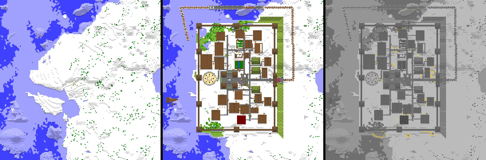

## Summary

| site | result |
|---|---|
| snowy_plains | 53 findings |

# KingdomQuest field test

Seed 1813296525. Positions in details are relative to the heart (x, y, z).

## snowy_plains

minecraft:snowy_plains at 4144, 62, -2348, facing COUNTERCLOCKWISE_90, relief 26, walkable out before founding: true, style frozen, ground grass_block. Gate approach cost per side (* = used): south 28, west 9, north 44, east 5*.

| stage | ms | float built | float land | floating feet | buried | destroyed | doors unreached | walk out | breach | wet inside | wet moat | new cliffs | tall walls | pits | road gaps | road steps | wall gaps | cut trees | foreign ground | snow lost | road steep | stumps | road high | road bank | road moved |
|---|---|---|---|---|---|---|---|---|---|---|---|---|---|---|---|---|---|---|---|---|---|---|---|---|---|
| tent_1 | 512 | 0 | 0 | 0 | 0 | 0 | 0 | 1 | 0 | 0 | 0 | 14 | 0 | 1 | 0 | 0 | 0 | 0 | 0 | 23 | 0 | 0 | 0 | 0 | 0 |
Country road to 4075, 63, -2398 (10 blocks of water on the way).

Lord's changes: broke 2 blocks before tent_2; repair leaves them.

Lord's changes after tent_2: unchanged spot kept broken, changed spot rebuilt by the new plan, 1 change(s) remembered.

| tent_2 | 320 | 0 | 0 | 0 | 0 | 1 | 0 | 1 | 0 | 0 | 0 | 17 | 0 | 0 | 0 | 0 | 0 | 0 | 0 | 190 | 0 | 0 | 0 | 0 | 0 |
| tent_3 | 199 | 0 | 0 | 0 | 0 | 0 | 0 | 1 | 0 | 0 | 0 | 17 | 0 | 0 | 0 | 0 | 0 | 0 | 0 | 184 | 0 | 0 | 0 | 0 | 0 |
| hamlet_1 | 600 | 0 | 0 | 0 | 0 | 0 | 0 | 1 | 0 | 0 | 0 | 40 | 0 | 0 | 0 | 0 | 0 | 0 | 0 | 215 | 0 | 0 | 0 | 0 | 0 |
| hamlet_2 | 384 | 1 | 0 | 0 | 0 | 0 | 0 | 1 | 0 | 0 | 0 | 44 | 0 | 1 | 0 | 0 | 0 | 0 | 0 | 239 | 0 | 0 | 0 | 2 | 0 |
| hamlet_3 | 268 | 1 | 0 | 0 | 0 | 0 | 0 | 1 | 0 | 0 | 0 | 57 | 0 | 1 | 0 | 0 | 0 | 0 | 0 | 230 | 2 | 0 | 0 | 0 | 0 |
| village_1 | 301 | 1 | 0 | 0 | 0 | 0 | 0 | 1 | 0 | 0 | 0 | 66 | 0 | 1 | 0 | 0 | 0 | 0 | 0 | 225 | 5 | 0 | 0 | 0 | 0 |
| town_1 | 329 | 1 | 0 | 0 | 0 | 2 | 0 | 1 | 0 | 0 | 0 | 97 | 0 | 0 | 0 | 0 | 153 | 0 | 0 | 213 | 7 | 0 | 0 | 0 | 3 |
| castle_1 | 455 | 1 | 1 | 0 | 0 | 0 | 0 | 1 | 0 | 0 | 0 | 196 | 0 | 1 | 0 | 0 | 0 | 0 | 0 | 222 | 7 | 0 | 0 | 0 | 0 |
| castle_2 | 430 | 1 | 0 | 0 | 0 | 0 | 0 | 1 | 0 | 0 | 0 | 197 | 0 | 2 | 0 | 0 | 0 | 0 | 0 | 217 | 7 | 0 | 0 | 0 | 0 |
| citadel_1 | 419 | 1 | 0 | 0 | 0 | 0 | 0 | 1 | 0 | 0 | 0 | 191 | 0 | 2 | 0 | 0 | 0 | 0 | 0 | 217 | 7 | 0 | 0 | 0 | 0 |
| final | 0 | 1 | 0 | 0 | 0 | 0 | 0 | 1 | 0 | 0 | 0 | 186 | 0 | 2 | 0 | 0 | 0 | 0 | 0 | 229 | 9 | 0 | 0 | 0 | 0 |
Country road at the end: 248 of 248 cells near the castle intact.

Gate (land relative to the heart, before -> after) at 0/5/10/15/20/30/40 blocks out of the gate: 5->-2 0->-7 1->-2 1->1 0->0 0->0 0->0. Moat columns per side {back=17, gate=1176, right=185}. Way-out road none.

- tent_1: new cliffs 14 [(-47,5,-44) to 4, (-43,9,-43) to -9, (-39,0,-49) to 6, (-38,10,-48) to -4, (-37,6,-48) to -3]
- tent_1: pits 1 [(-38,10,-48) spike]
- tent_1: snow lost 23 [(-4,0,-3) on grass_block at air light 12]
- tent_2: destroyed 1 [main (-8,0,2) spruce_planks->air]
- tent_2: new cliffs 17 [(-47,5,-44) to 4, (-43,9,-43) to -9, (-39,0,-49) to 6, (-37,6,-48) to -3, (-15,-3,18) to 3]
- tent_2: snow lost 190 [(-4,0,-3) on grass_block at air light 12, (61,8,-51) on dirt_path at air light 0, (62,4,-14) on dirt_path at air light 0, (63,11,-16) on dirt_path at air light 0]
- tent_3: new cliffs 17 [(-47,5,-44) to 4, (-43,9,-43) to -9, (-39,0,-49) to 6, (-37,6,-48) to -3, (-14,-3,22) to 3]
- tent_3: snow lost 184 [(-3,0,4) on grass_block at air light 12, (61,1,1) on dirt_path at air light 0, (62,1,-3) on dirt_path at air light 0, (63,1,-10) on dirt_path at air light 0]
- hamlet_1: new cliffs 40 [(-43,10,-46) to 4, (-43,5,-43) to -4, (-39,0,-49) to 6, (-38,3,-26) to -3, (-37,6,-48) to -3]
- hamlet_1: snow lost 215 [(-37,1,-29) on water at air light 0, (54,2,-1) on dirt_path at air light 0, (62,7,-52) on dirt_path at air light 0, (63,10,-43) on dirt_path at air light 0, (64,8,-28) on dirt_path at air light 0]
- hamlet_2: float built 1 [dock (-89,3,25) lantern]
- hamlet_2: new cliffs 44 [(-39,0,-49) to 6, (-38,3,-26) to -3, (-37,6,-48) to -3, (-37,3,-30) to -3, (-16,-1,-61) to 3]
- hamlet_2: pits 1 [(41,-4,21) hole]
- hamlet_2: snow lost 239 [(-37,1,-29) on water at air light 0, (8,4,-66) on grass_block at air light 0, (61,8,-50) on dirt_path at air light 0, (62,1,-12) on dirt_path at air light 0, (63,8,-15) on dirt_path at air light 0]
- hamlet_2: road bank 2 [(1,2,-38) over 3/3, (1,2,-37) over 3/3]
- hamlet_3: float built 1 [dock (-89,3,25) lantern]
- hamlet_3: new cliffs 57 [(-39,0,-49) to 6, (-37,6,-48) to -3, (-16,2,-20) to -3, (-15,-1,-23) to 3, (-15,2,-22) to -3]
- hamlet_3: pits 1 [(41,-4,21) hole]
- hamlet_3: snow lost 230 [(-22,0,-31) on grass_block at air light 12, (18,0,-2) on grass_block at air light 12, (62,12,-67) on dirt_path at air light 0, (63,12,-67) on dirt_path at air light 0, (63,1,-6) on dirt_path at air light 0]
- hamlet_3: road steep 2 [(23,5,-22) to -3 in 3, (23,4,-21) to -3 in 3]
- village_1: float built 1 [dock (-94,3,25) lantern]
- village_1: new cliffs 66 [(-56,0,-12) to 3, (-47,0,-36) to 3, (-46,0,-36) to 3, (-39,0,-49) to 5, (-39,3,-13) to -3]
- village_1: pits 1 [(41,-4,21) hole]
- village_1: snow lost 225 [(-23,2,-31) on grass_block at air light 13, (34,10,68) on ice at air light 5, (62,11,-62) on dirt_path at air light 0, (63,8,-59) on dirt_path at air light 0, (63,1,-1) on dirt_path at air light 0]
- village_1: road steep 5 [(-23,2,-29) to -3 in 3, (-24,3,-29) to -3 in 3, (-25,4,-29) to -3 in 3, (23,5,-22) to -3 in 3, (23,4,-21) to -3 in 3]
- town_1: float built 1 [dock (-94,3,25) lantern]
- town_1: destroyed 2 [walls (40,2,-7) coarse_dirt->spruce_log, walls (40,3,-8) coarse_dirt->spruce_log]
- town_1: new cliffs 97 [(-54,0,-34) to 3, (-54,3,-13) to -3, (-53,3,-13) to -3, (-47,0,-36) to 3, (-46,0,-36) to 3]
- town_1: wall gaps 153 [(-51,0,63) over water, (-19,0,-69) over water, (-51,0,-69) over water, (-20,0,63) over water, (-52,0,63) over water]
- town_1: snow lost 213 [(-23,2,-31) on grass_block at air light 12, (54,2,1) on dirt_path at air light 0, (62,8,-50) on dirt_path at air light 0, (63,10,-39) on dirt_path at air light 0, (64,10,-25) on dirt_path at air light 0]
- town_1: road steep 7 [(-24,3,-29) to -3 in 3, (-25,4,-29) to -3 in 3, (-26,5,-29) to -3 in 3, (23,5,-22) to -3 in 3, (23,4,-21) to -3 in 3]
- town_1: road moved 3 [(-23,1,-29) from 2, (-24,2,-29) from 3, (-22,0,-29) from 1]
- castle_1: float built 1 [dock (-94,3,25) lantern]
- castle_1: float land 1 [(-30,18,63) packed_ice]
- castle_1: new cliffs 196 [(-54,3,-13) to -3, (-53,3,-13) to -3, (-41,2,67) to -3, (-41,2,68) to -3, (-40,-1,68) to 4]
- castle_1: pits 1 [(-31,7,73) spike]
- castle_1: snow lost 222 [(-25,0,66) on grass_block at air light 0, (51,0,0) on dirt_path at air light 4, (62,8,-59) on dirt_path at air light 0, (63,6,-53) on dirt_path at air light 0, (64,10,-44) on dirt_path at air light 0]
- castle_1: road steep 7 [(-24,3,-29) to -3 in 3, (-25,4,-29) to -3 in 3, (-26,5,-29) to -3 in 3, (23,5,-22) to -3 in 3, (23,4,-21) to -3 in 3]
- castle_2: float built 1 [dock (-94,3,25) lantern]
- castle_2: new cliffs 197 [(-54,3,-13) to -3, (-53,3,-13) to -3, (-41,2,67) to -3, (-41,2,68) to -3, (-40,-1,68) to 4]
- castle_2: pits 2 [(-31,7,73) spike, (25,3,24) spike]
- castle_2: snow lost 217 [(-23,2,-31) on grass_block at air light 12, (53,2,0) on mud_brick_slab at air light 4, (62,6,-54) on dirt_path at air light 0, (63,10,-45) on dirt_path at air light 0, (64,7,-32) on dirt_path at air light 0]
- castle_2: road steep 7 [(-24,3,-29) to -3 in 3, (-25,4,-29) to -3 in 3, (-26,5,-29) to -3 in 3, (23,5,-22) to -3 in 3, (23,4,-21) to -3 in 3]
- citadel_1: float built 1 [dock (-94,3,25) lantern]
- citadel_1: new cliffs 191 [(-54,3,-13) to -3, (-53,3,-13) to -3, (-41,2,67) to -3, (-41,2,68) to -3, (-40,-1,68) to 4]
- citadel_1: pits 2 [(-31,7,73) spike, (25,3,24) spike]
- citadel_1: snow lost 217 [(-23,2,-31) on grass_block at air light 12, (53,2,0) on mud_brick_slab at air light 4, (62,6,-54) on dirt_path at air light 0, (63,10,-45) on dirt_path at air light 0, (64,7,-32) on dirt_path at air light 0]
- citadel_1: road steep 7 [(-24,3,-29) to -3 in 3, (-25,4,-29) to -3 in 3, (-26,5,-29) to -3 in 3, (23,5,-22) to -3 in 3, (23,4,-21) to -3 in 3]
- final: float built 1 [dock (-94,3,25) lantern]
- final: new cliffs 186 [(-41,2,67) to -3, (-41,2,68) to -3, (-40,-1,68) to 4, (-40,3,69) to -4, (-39,-1,69) to 4]
- final: pits 2 [(-31,7,73) spike, (25,3,24) spike]
- final: snow lost 229 [(-33,5,-4) on grass_block at air light 12, (34,1,-2) on stone_brick_wall at air light 5, (62,12,-66) on dirt_path at air light 0, (63,12,-66) on dirt_path at air light 0, (63,1,-5) on dirt_path at air light 0]
- final: road steep 9 [(-24,3,-29) to -3 in 3, (-25,4,-29) to -3 in 3, (-26,5,-29) to -3 in 3, (-30,1,-13) to 3 in 3, (-30,2,-12) to 3 in 3]

