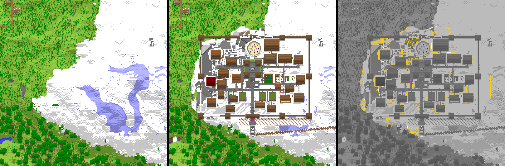

## Summary

| site | result |
|---|---|
| snowy_slopes | 81 findings |

# KingdomQuest field test

Seed 1813296525. Positions in details are relative to the heart (x, y, z).

## snowy_slopes

minecraft:snowy_slopes at 6628, 144, -2476, facing NONE, relief 88, walkable out before founding: true, style frozen, ground snow_block. Gate approach cost per side (* = used): south 156*, west 637, north 459, east 409.

| stage | ms | float built | float land | floating feet | buried | destroyed | doors unreached | walk out | breach | wet inside | wet moat | new cliffs | tall walls | pits | road gaps | road steps | wall gaps | cut trees | foreign ground | snow lost | road steep | stumps | road high | road bank | road moved |
|---|---|---|---|---|---|---|---|---|---|---|---|---|---|---|---|---|---|---|---|---|---|---|---|---|---|
| tent_1 | 676 | 0 | 0 | 0 | 0 | 0 | 0 | 1 | 0 | 0 | 0 | 162 | 0 | 0 | 0 | 0 | 0 | 0 | 0 | 23 | 0 | 0 | 0 | 0 | 0 |
Country road to 6758, 143, -2425 (0 blocks of water on the way).

Lord's changes: broke 2 blocks before tent_2; repair leaves them.

Lord's changes after tent_2: unchanged spot kept broken, changed spot rebuilt by the new plan, 1 change(s) remembered.

| tent_2 | 300 | 0 | 0 | 0 | 0 | 1 | 0 | 1 | 0 | 0 | 0 | 53 | 10 | 0 | 0 | 0 | 0 | 0 | 0 | 256 | 0 | 0 | 0 | 0 | 0 |
| tent_3 | 380 | 0 | 0 | 0 | 0 | 0 | 0 | 1 | 0 | 0 | 0 | 56 | 10 | 0 | 0 | 0 | 0 | 0 | 0 | 254 | 0 | 0 | 0 | 0 | 0 |
| hamlet_1 | 717 | 0 | 0 | 0 | 0 | 0 | 0 | 1 | 0 | 0 | 0 | 676 | 10 | 1 | 0 | 0 | 0 | 0 | 0 | 361 | 0 | 0 | 0 | 0 | 0 |
| hamlet_2 | 381 | 1 | 0 | 0 | 0 | 0 | 0 | 1 | 0 | 0 | 0 | 849 | 28 | 5 | 0 | 0 | 0 | 0 | 0 | 302 | 7 | 0 | 0 | 6 | 0 |
| hamlet_3 | 640 | 1 | 0 | 0 | 0 | 0 | 0 | 1 | 0 | 0 | 0 | 763 | 43 | 8 | 0 | 0 | 0 | 0 | 0 | 326 | 13 | 0 | 0 | 2 | 0 |
| village_1 | 380 | 1 | 1 | 0 | 0 | 0 | 0 | 1 | 0 | 0 | 0 | 1036 | 94 | 9 | 0 | 0 | 0 | 0 | 0 | 332 | 13 | 0 | 0 | 2 | 0 |
| town_1 | 429 | 547 | 9 | 0 | 0 | 9 | 0 | 1 | 0 | 0 | 0 | 833 | 150 | 5 | 2 | 0 | 87 | 0 | 0 | 298 | 31 | 0 | 0 | 7 | 6 |
| castle_1 | 628 | 1 | 1 | 0 | 0 | 0 | 0 | 1 | 0 | 0 | 0 | 1005 | 120 | 12 | 0 | 0 | 0 | 0 | 0 | 256 | 41 | 0 | 0 | 7 | 0 |
| castle_2 | 484 | 1 | 1 | 0 | 0 | 0 | 0 | 1 | 0 | 0 | 0 | 1038 | 120 | 15 | 0 | 0 | 0 | 0 | 0 | 259 | 41 | 0 | 0 | 7 | 0 |
| citadel_1 | 466 | 1 | 1 | 0 | 0 | 0 | 0 | 1 | 0 | 0 | 0 | 1068 | 120 | 14 | 0 | 0 | 0 | 0 | 0 | 259 | 41 | 0 | 0 | 7 | 0 |
| final | 0 | 1 | 1 | 0 | 0 | 0 | 0 | 1 | 0 | 0 | 0 | 1206 | 112 | 9 | 0 | 0 | 0 | 0 | 0 | 241 | 50 | 0 | 7 | 7 | 0 |
Country road at the end: 123 of 123 cells near the castle intact.

Gate (land relative to the heart, before -> after) at 0/5/10/15/20/30/40 blocks out of the gate: 1->-2 0->-7 -2->-2 -5->-4 -12->-8 -31->-31 -40->-40. Moat columns per side {gate=856}. Way-out road none.

- tent_1: new cliffs 162 [(-17,-16,-10) to 3, (-16,-21,-13) to 8, (-16,-20,-12) to 7, (-16,-18,-11) to 5, (-16,-18,-11) to 5]
- tent_1: snow lost 23 [(-3,0,4) on packed_ice at air light 8]
- tent_2: destroyed 1 [main (-2,0,-8) spruce_planks->air]
- tent_2: new cliffs 53 [(-24,-25,-12) to 3, (-20,-12,-6) to 3, (-19,-13,-8) to 4, (-19,-12,-7) to 3, (-19,-12,-7) to 3]
- tent_2: tall walls 10 [(-3,-17,60) 9 cap unowned low unowned:stone_bricks, (-3,-18,61) 10 cap unowned low unowned:stone_bricks, (-3,-18,62) 9 cap unowned low unowned:stone_bricks, (-2,-9,62) -10 cap unowned low unowned:stone_bricks, (-1,-10,62) -8 cap unowned low unowned:stone_bricks]
- tent_2: snow lost 256 [(-17,-5,12) on packed_ice at air light 0, (-11,-2,17) on packed_ice at air light 0, (-2,-3,56) on stone_brick_wall at air light 0, (2,1,51) on stone_brick_wall at air light 0, (19,7,-6) on ice at air light 0]
- tent_3: new cliffs 56 [(-24,-24,-12) to 3, (-22,-15,-7) to 6, (-22,-13,-6) to 4, (-22,-12,-5) to 3, (-21,-18,-10) to 9]
- tent_3: tall walls 10 [(-3,-17,60) 9 cap unowned low unowned:stone_bricks, (-3,-18,61) 10 cap unowned low unowned:stone_bricks, (-3,-18,62) 9 cap unowned low unowned:stone_bricks, (-2,-9,62) -10 cap unowned low unowned:stone_bricks, (-1,-10,62) -8 cap unowned low unowned:stone_bricks]
- tent_3: snow lost 254 [(-17,-5,12) on packed_ice at air light 0, (-11,-2,17) on packed_ice at air light 0, (-2,-3,56) on stone_brick_wall at air light 0, (2,1,51) on stone_brick_wall at air light 0, (19,-1,61) on dirt_path at air light 0]
- hamlet_1: new cliffs 676 [(-35,-24,14) to 3, (-35,-24,15) to 3, (-35,-25,18) to 3, (-35,-25,19) to 3, (-35,-25,20) to 3]
- hamlet_1: tall walls 10 [(-3,-17,60) 9 cap unowned low unowned:stone_bricks, (-3,-18,61) 10 cap unowned low unowned:stone_bricks, (-3,-18,62) 9 cap unowned low unowned:stone_bricks, (-2,-9,62) -10 cap unowned low unowned:stone_bricks, (-1,-10,62) -8 cap unowned low unowned:stone_bricks]
- hamlet_1: pits 1 [(-24,-21,32) hole]
- hamlet_1: snow lost 361 [(-34,-26,-17) on grass_block at air light 0, (-5,0,13) on packed_ice at air light 0, (-1,-2,54) on stone_brick_slab at air light 0, (11,2,61) on dirt_path at air light 0, (28,0,60) on dirt_path at air light 0]
- hamlet_2: float built 1 [dock (-93,-79,68) lantern]
- hamlet_2: new cliffs 849 [(-61,-39,37) to 3, (-61,-41,38) to 3, (-59,-36,38) to -3, (-56,-34,10) to 13, (-56,-34,11) to 13]
- hamlet_2: tall walls 28 [(-53,-21,8) 8 cap unowned low unowned:cobblestone, (-52,-21,7) 8 cap unowned low unowned:mossy_cobblestone, (-52,-21,7) 8 cap unowned low unowned:cobblestone, (-39,-26,-9) 10 cap unowned low unowned:stone, (-39,-26,-8) 10 cap unowned low unowned:stone]
- hamlet_2: pits 5 [(-43,-25,31) hole, (-35,-21,28) hole, (-32,-12,12) hole, (-32,-21,29) hole, (1,-32,-47) hole]
- hamlet_2: snow lost 302 [(-44,-11,10) on mossy_cobblestone at air light 12, (-6,0,22) on packed_ice at air light 0, (-2,-6,61) on stone_brick_wall at air light 0, (14,12,37) on packed_ice at air light 0, (34,15,11) on lava at cave_air light 14]
- hamlet_2: road steep 7 [(40,7,12) to 3 in 3, (-19,-7,3) to 3 in 3, (-19,-5,5) to 3 in 3, (-19,-6,4) to 3 in 3, (39,6,12) to 3 in 3]
- hamlet_2: road bank 6 [(-31,-6,8) over 3/3, (-29,-6,9) over 4/6, (37,2,1) over 3/3, (-49,-12,9) over 3/6, (-50,-13,8) over 5/5]
- hamlet_3: float built 1 [dock (-93,-79,68) lantern]
- hamlet_3: new cliffs 763 [(-74,-46,27) to 3, (-73,-47,30) to 5, (-72,-43,29) to 3, (-72,-42,30) to -4, (-72,-46,31) to 5]
- hamlet_3: tall walls 43 [(-53,-21,8) 8 cap unowned low unowned:cobblestone, (-52,-21,7) 8 cap unowned low unowned:mossy_cobblestone, (-52,-21,7) 8 cap unowned low unowned:cobblestone, (-39,-26,-9) 10 cap unowned low unowned:stone, (-39,-26,-8) 10 cap unowned low unowned:stone]
- hamlet_3: pits 8 [(-35,-21,28) hole, (-32,-19,-19) hole, (-32,-12,12) hole, (-32,-18,27) hole, (-32,-21,29) hole]
- hamlet_3: snow lost 326 [(-60,-20,19) on cobblestone at air light 0, (-9,-2,30) on packed_ice at air light 2, (-3,0,4) on packed_ice at air light 8, (10,8,38) on packed_ice at air light 0, (21,11,43) on packed_ice at air light 0]
- hamlet_3: road steep 13 [(40,7,12) to 3 in 3, (20,3,23) to 3 in 3, (39,6,12) to 3 in 3, (38,2,9) to 3 in 3, (38,5,12) to 3 in 3]
- hamlet_3: road bank 2 [(-49,-13,10) over 3/3, (-49,-14,11) over 2/2]
- village_1: float built 1 [dock (-98,-79,68) lantern]
- village_1: float land 1 [(-93,-79,68) snow_block]
- village_1: new cliffs 1036 [(-74,-46,27) to 3, (-73,-47,30) to 5, (-72,-43,29) to 3, (-72,-42,30) to -4, (-72,-46,31) to 5]
- village_1: tall walls 94 [(-53,-21,8) 8 cap unowned low unowned:cobblestone, (-52,-21,7) 8 cap unowned low unowned:mossy_cobblestone, (-52,-21,7) 8 cap unowned low unowned:cobblestone, (-39,-26,-9) 10 cap unowned low unowned:stone, (-39,-26,-8) 10 cap unowned low unowned:stone]
- village_1: pits 9 [(-35,-21,28) hole, (-32,-19,-19) hole, (-32,-12,12) hole, (-32,-18,27) hole, (-32,-21,29) hole]
- village_1: snow lost 332 [(-60,-20,19) on cobblestone at air light 0, (-14,1,7) on cobblestone_wall at air light 10, (-4,0,17) on packed_ice at air light 7, (9,1,62) on dirt_path at air light 0, (20,10,42) on packed_ice at air light 0]
- village_1: road steep 13 [(40,7,12) to 3 in 3, (20,3,23) to 3 in 3, (39,6,12) to 3 in 3, (38,2,9) to 3 in 3, (38,5,12) to 3 in 3]
- village_1: road bank 2 [(-49,-13,10) over 3/3, (-49,-14,11) over 2/2]
- town_1: float built 547 [dock (-98,-79,68) lantern, walls (-65,0,-58) spruce_log, walls (-65,1,-58) spruce_log, walls (-65,2,-58) spruce_log, walls (-65,3,-58) spruce_log]
- town_1: float land 9 [(-93,-79,68) snow_block, (-63,-1,-39) snow_block, (-63,-1,-38) snow_block, (-63,-1,-37) snow_block, (-63,-1,-36) snow_block]
- town_1: destroyed 9 [walls (67,-2,-56) coarse_dirt->spruce_log, walls (68,-2,-56) coarse_dirt->spruce_log, walls (69,-2,-55) coarse_dirt->spruce_log, walls (-8,-4,40) coarse_dirt->spruce_log, walls (-5,-4,40) coarse_dirt->spruce_log]
- town_1: new cliffs 833 [(-74,-48,-4) to 3, (-74,-47,-3) to 3, (-74,-46,27) to 3, (-73,-48,-6) to 4, (-73,-47,-5) to 4]
- town_1: tall walls 150 [(-69,-37,22) 7 cap unowned low unowned:stone, (-69,-37,25) 7 cap unowned low unowned:stone, (-57,-38,-6) 23 cap unowned low unowned:tuff, (-57,-38,-5) 23 cap unowned low unowned:stone, (-57,-38,-4) 23 cap unowned low unowned:stone]
- town_1: pits 5 [(-53,-14,9) spike, (-52,-36,-35) hole, (-51,-14,11) spike, (-32,-12,12) hole, (33,14,12) spike]
- town_1: road gaps 2 [(-12,-2,1) cobblestone over air, (-13,-2,-12) cobblestone over air]
- town_1: wall gaps 87 [(-39,-1,-56) over air, (-40,-1,-56) over air, (-8,-5,38) over air, (-8,-5,42) over air, (-37,-1,-56) over air]
- town_1: snow lost 298 [(-61,-29,19) on cobblestone at air light 0, (-20,-5,2) on cobblestone_wall at air light 3, (-4,0,15) on packed_ice at air light 2, (8,2,62) on dirt_path at air light 0, (20,9,46) on packed_ice at air light 0]
- town_1: road steep 31 [(56,12,6) to 3 in 3, (56,10,4) to 3 in 3, (56,11,5) to 3 in 3, (56,9,3) to 3 in 3, (-44,-16,-26) to 3 in 3]
- town_1: road bank 7 [(-44,-15,-25) over 2/2, (-44,-13,-23) over 5/5, (-44,-12,-22) over 6/6, (-44,-14,-24) over 3/3, (-44,-11,-21) over 8/8]
- town_1: road moved 6 [(-19,-5,6) from -4, (-19,-6,5) from -5, (-19,-4,7) from -3, (-49,-15,11) from -14, (-49,-14,10) from -13]
- castle_1: float built 1 [dock (-98,-79,68) lantern]
- castle_1: float land 1 [(-93,-79,68) snow_block]
- castle_1: new cliffs 1005 [(-74,-48,-4) to 3, (-74,-47,-3) to 3, (-74,-44,23) to 3, (-74,-44,24) to 3, (-74,-45,25) to 3]
- castle_1: tall walls 120 [(-69,-37,20) 7 cap unowned low unowned:stone, (-69,-37,28) 7 cap unowned low unowned:stone, (-57,-38,-6) 23 cap unowned low unowned:tuff, (-57,-38,-5) 23 cap unowned low unowned:stone, (-57,-38,-4) 23 cap unowned low unowned:stone]
- castle_1: pits 12 [(-53,-14,9) spike, (-51,-14,11) spike, (-46,-12,-19) spike, (-32,-12,12) hole, (-29,-20,-33) hole]
- castle_1: snow lost 256 [(-61,-30,19) on cobblestone at air light 0, (-19,0,10) on cobblestone_wall at air light 9, (-2,2,26) on cobblestone_wall at air light 8, (9,1,62) on dirt_path at air light 0, (24,-2,60) on dirt_path at air light 0]
- castle_1: road steep 41 [(56,12,6) to 3 in 3, (56,10,4) to 3 in 3, (56,11,5) to 3 in 3, (56,9,3) to 3 in 3, (-44,-16,-26) to 3 in 3]
- castle_1: road bank 7 [(-44,-15,-25) over 2/2, (-44,-13,-23) over 5/5, (-44,-12,-22) over 6/6, (-44,-14,-24) over 3/3, (-44,-11,-21) over 8/8]
- castle_2: float built 1 [dock (-98,-79,68) lantern]
- castle_2: float land 1 [(-93,-79,68) snow_block]
- castle_2: new cliffs 1038 [(-75,-47,-2) to 3, (-75,-46,-1) to 3, (-74,-48,-4) to 4, (-74,-47,-3) to 4, (-74,-47,-3) to 3]
- castle_2: tall walls 120 [(-69,-37,20) 7 cap unowned low unowned:stone, (-69,-37,28) 7 cap unowned low unowned:stone, (-56,-30,20) 12 cap unowned low unowned:andesite, (-53,-33,8) 20 cap unowned low unowned:andesite, (-52,-32,6) 18 cap unowned low unowned:andesite]
- castle_2: pits 15 [(-53,-14,9) spike, (-51,-14,11) spike, (-46,-12,-19) spike, (-43,-35,-45) hole, (-35,-17,21) spike]
- castle_2: snow lost 259 [(-61,-30,19) on cobblestone at air light 0, (-19,0,10) on cobblestone_wall at air light 9, (-2,-4,58) on stone_brick_wall at air light 0, (13,1,-18) on cobblestone_wall at air light 8, (31,4,59) on dirt_path at air light 0]
- castle_2: road steep 41 [(56,12,6) to 3 in 3, (56,10,4) to 3 in 3, (56,11,5) to 3 in 3, (56,9,3) to 3 in 3, (-44,-16,-26) to 3 in 3]
- castle_2: road bank 7 [(-44,-15,-25) over 2/2, (-44,-13,-23) over 5/5, (-44,-12,-22) over 6/6, (-44,-14,-24) over 3/3, (-44,-11,-21) over 8/8]
- citadel_1: float built 1 [dock (-98,-79,68) lantern]
- citadel_1: float land 1 [(-93,-79,68) snow_block]
- citadel_1: new cliffs 1068 [(-75,-47,-2) to 3, (-75,-46,-1) to 3, (-74,-48,-4) to 4, (-74,-47,-3) to 4, (-74,-47,-3) to 3]
- citadel_1: tall walls 120 [(-69,-37,20) 7 cap unowned low unowned:stone, (-69,-37,28) 7 cap unowned low unowned:stone, (-56,-30,20) 12 cap unowned low unowned:andesite, (-53,-33,8) 20 cap unowned low unowned:andesite, (-52,-32,6) 18 cap unowned low unowned:andesite]
- citadel_1: pits 14 [(-53,-14,9) spike, (-51,-14,11) spike, (-46,-12,-19) spike, (-35,-17,21) spike, (-35,-22,22) hole]
- citadel_1: snow lost 259 [(-61,-30,19) on cobblestone at air light 0, (-19,0,10) on cobblestone_wall at air light 9, (-2,-4,58) on stone_brick_wall at air light 0, (13,1,-18) on cobblestone_wall at air light 8, (31,4,59) on dirt_path at air light 0]
- citadel_1: road steep 41 [(56,12,6) to 3 in 3, (56,10,4) to 3 in 3, (56,11,5) to 3 in 3, (56,9,3) to 3 in 3, (-44,-16,-26) to 3 in 3]
- citadel_1: road bank 7 [(-44,-15,-25) over 2/2, (-44,-13,-23) over 5/5, (-44,-12,-22) over 6/6, (-44,-14,-24) over 3/3, (-44,-11,-21) over 8/8]
- final: tall by [{unowned/unowned=112}]
- final: float built 1 [dock (-98,-79,68) lantern]
- final: float land 1 [(-93,-79,68) snow_block]
- final: new cliffs 1206 [(-75,-47,-2) to 3, (-75,-46,-1) to 3, (-74,-48,-4) to 4, (-74,-47,-3) to 4, (-74,-47,-3) to 3]
- final: tall walls 112 [(-69,-37,20) 7 cap unowned low unowned:stone, (-69,-37,28) 7 cap unowned low unowned:stone, (-56,-30,20) 12 cap unowned low unowned:andesite, (-53,-33,8) 20 cap unowned low unowned:andesite, (-52,-32,6) 18 cap unowned low unowned:andesite]
- final: pits 9 [(-53,-14,9) spike, (-51,-14,11) spike, (-46,-12,-19) spike, (-35,-17,21) spike, (-35,-22,22) hole]
- final: snow lost 241 [(-61,-30,19) on cobblestone at air light 0, (-18,-3,5) on cobblestone_wall at air light 6, (0,-1,53) on stone_brick_slab at air light 1, (16,-2,63) on dirt_path at air light 0, (41,5,-24) on packed_ice at air light 3]
- final: road steep 50 [(56,12,6) to 3 in 3, (56,10,4) to 3 in 3, (56,11,5) to 3 in 3, (56,9,3) to 3 in 3, (-44,-16,-26) to 3 in 3]
- final: road high 7 [(-13,-1,-2) above smith step (-14,-3,-2), (-13,-1,-1) above smith step (-14,-4,-1), (-13,-1,-3) above smith step (-14,-3,-3), (-13,-1,-4) above smith step (-14,-3,-4), (-13,-1,-6) above smith step (-14,-2,-6)]
- final: road bank 7 [(-44,-15,-25) over 2/2, (-44,-13,-23) over 5/5, (-44,-12,-22) over 6/6, (-44,-14,-24) over 3/3, (-44,-11,-21) over 8/8]

