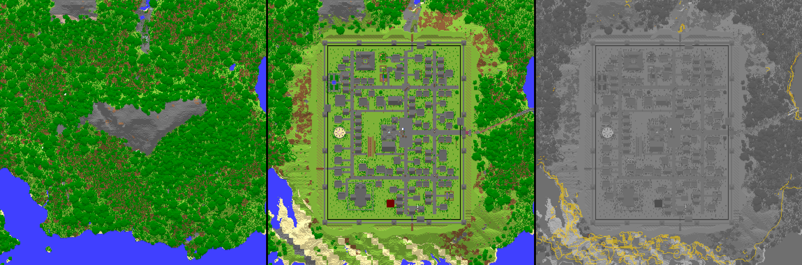

## Summary

| site | result |
|---|---|
| stony_peaks | 66 findings |

# KingdomQuest field test

Seed 20261117. Positions in details are relative to the heart (x, y, z).

## stony_peaks

minecraft:stony_peaks at -232, 132, -3088, facing COUNTERCLOCKWISE_90, relief 89, walkable out before founding: true, style highland, ground grass_block. Gate approach cost per side (* = used): south 1160, west 882, north 656, east 179*.

| stage | ms | float built | float land | floating feet | buried | destroyed | doors unreached | walk out | breach | wet inside | wet moat | new cliffs | tall walls | pits | road gaps | road steps | wall gaps | cut trees | foreign ground | snow lost | road steep | stumps | road high | road bank | road moved |
|---|---|---|---|---|---|---|---|---|---|---|---|---|---|---|---|---|---|---|---|---|---|---|---|---|---|
Founded as flat castle: plateau at 0 (relative to the heart), site shaped in 1216 ms.

| tent_1 | 708 | 0 | 0 | 0 | 0 | 0 | 0 | 1 | 0 | 0 | 0 | 2054 | 0 | 65 | 0 | 0 | 0 | 0 | 0 | 0 | 0 | 7 | 0 | 0 | 0 |
Country road to -11, 102, -3138 (20 blocks of water on the way).

Lord's changes: broke 2 blocks before tent_2; repair leaves them.

Lord's changes after tent_2: unchanged spot kept broken, changed spot rebuilt by the new plan, 1 change(s) remembered.

| tent_2 | 886 | 0 | 0 | 0 | 0 | 1 | 0 | 1 | 0 | 0 | 0 | 2013 | 29 | 65 | 0 | 0 | 0 | 0 | 0 | 0 | 0 | 5 | 0 | 0 | 0 |
| tent_3 | 449 | 0 | 0 | 0 | 0 | 0 | 0 | 1 | 0 | 0 | 0 | 2013 | 29 | 65 | 0 | 0 | 0 | 0 | 0 | 0 | 0 | 5 | 0 | 0 | 0 |
| hamlet_1 | 1377 | 0 | 0 | 0 | 0 | 0 | 0 | 1 | 0 | 0 | 0 | 1974 | 29 | 65 | 0 | 0 | 0 | 0 | 0 | 0 | 0 | 1 | 0 | 0 | 0 |
| hamlet_2 | 424 | 3 | 0 | 0 | 0 | 0 | 0 | 1 | 0 | 0 | 0 | 2095 | 29 | 69 | 0 | 0 | 0 | 0 | 0 | 0 | 0 | 0 | 0 | 296 | 0 |
| hamlet_3 | 542 | 1 | 0 | 0 | 0 | 0 | 0 | 1 | 0 | 0 | 0 | 2227 | 29 | 77 | 0 | 0 | 0 | 0 | 0 | 0 | 0 | 0 | 0 | 2 | 0 |
| village_1 | 1072 | 1 | 0 | 0 | 0 | 0 | 0 | 1 | 0 | 0 | 0 | 2109 | 29 | 84 | 6 | 0 | 0 | 0 | 0 | 0 | 0 | 0 | 0 | 2 | 0 |
| town_1 | 597 | 1 | 5 | 0 | 0 | 0 | 0 | 1 | 0 | 1 | 0 | 5144 | 30 | 178 | 0 | 0 | 0 | 0 | 2304 | 0 | 0 | 0 | 0 | 0 | 0 |
| castle_1 | 1342 | 1 | 4 | 0 | 0 | 0 | 0 | 1 | 0 | 0 | 0 | 5142 | 30 | 177 | 0 | 0 | 0 | 0 | 2304 | 0 | 0 | 0 | 0 | 0 | 0 |
| castle_2 | 1655 | 1 | 4 | 0 | 0 | 0 | 0 | 1 | 0 | 0 | 0 | 5142 | 30 | 177 | 0 | 0 | 0 | 0 | 2304 | 0 | 0 | 0 | 0 | 0 | 0 |
| citadel_1 | 1592 | 1 | 4 | 0 | 0 | 0 | 0 | 1 | 0 | 0 | 0 | 5142 | 30 | 177 | 0 | 0 | 0 | 0 | 2304 | 0 | 0 | 0 | 0 | 0 | 0 |
| final | 0 | 1 | 4 | 0 | 0 | 0 | 0 | 1 | 0 | 0 | 0 | 5142 | 30 | 177 | 0 | 0 | 0 | 0 | 2304 | 0 | 0 | 0 | 0 | 0 | 0 |
Country road at the end: 9 of 10 cells near the castle intact, cut at [109, -5, 0].

Gate (land relative to the heart, before -> after) at 0/5/10/15/20/30/40 blocks out of the gate: 21->-2 15->-2 4->-2 -8->-6 -9->-9 -6->-6 -6->-6. Moat columns per side {back=2331, gate=2504, left=385, right=597}. Way-out road none.

Production: level 1 made 16102 items in a game day, 48327 in three (store 4320 stacks); level 5 with every milestone 141571 items of 239 kinds a day. Storehouse goods shown: 14 blocks; unloaded 15552 items into the chests.

Tram: 880 rails, stops [gate, west, north, east]
Signal fires: 20 on 13 towers, lit 20, put out 20; tower guard posts 20.

- tent_1: new cliffs 2054 [(-189,-40,-80) to 3, (-189,-47,47) to 46, (-189,-47,47) to 46, (-189,-1,144) to -47, (-189,-48,145) to 47]
- tent_1: pits 65 [(-189,-47,47) hole, (-186,-48,45) hole, (-185,-48,44) hole, (-179,-48,46) hole, (-174,-47,51) hole]
- tent_1: stumps 7 [(-28,-37,51) bamboo under air, (-22,-10,-65) bamboo under air, (0,-9,-65) bamboo under oak_leaves, (6,-3,-70) bamboo under air, (7,-4,-70) bamboo under oak_leaves]
- tent_2: destroyed 1 [main (0,1,5) spruce_log->air]
- tent_2: new cliffs 2013 [(-189,-40,-80) to 3, (-189,-47,47) to 46, (-189,-47,47) to 46, (-189,-1,144) to -47, (-189,-48,145) to 47]
- tent_2: tall walls 29 [(171,-18,-25) 7 cap unowned low unowned:stone_bricks, (172,-11,-26) -7 cap unowned low unowned:stone_bricks, (172,-11,-25) -7 cap unowned low unowned:stone_bricks, (172,-11,-25) -7 cap unowned low unowned:stone_bricks, (173,-17,-30) 8 cap unowned low unowned:air]
- tent_2: pits 65 [(-189,-47,47) hole, (-186,-48,45) hole, (-185,-48,44) hole, (-179,-48,46) hole, (-174,-47,51) hole]
- tent_2: stumps 5 [(-22,-10,-65) bamboo under air, (0,-9,-65) bamboo under oak_leaves, (6,-3,-70) bamboo under air, (7,-4,-70) bamboo under oak_leaves, (21,-5,-65) bamboo under oak_leaves]
- tent_3: new cliffs 2013 [(-189,-40,-80) to 3, (-189,-47,47) to 46, (-189,-47,47) to 46, (-189,-1,144) to -47, (-189,-48,145) to 47]
- tent_3: tall walls 29 [(171,-18,-25) 7 cap unowned low unowned:stone_bricks, (172,-11,-26) -7 cap unowned low unowned:stone_bricks, (172,-11,-25) -7 cap unowned low unowned:stone_bricks, (172,-11,-25) -7 cap unowned low unowned:stone_bricks, (173,-17,-30) 8 cap unowned low unowned:air]
- tent_3: pits 65 [(-189,-47,47) hole, (-186,-48,45) hole, (-185,-48,44) hole, (-179,-48,46) hole, (-174,-47,51) hole]
- tent_3: stumps 5 [(-22,-10,-65) bamboo under air, (0,-9,-65) bamboo under oak_leaves, (6,-3,-70) bamboo under air, (7,-4,-70) bamboo under oak_leaves, (21,-5,-65) bamboo under oak_leaves]
- hamlet_1: new cliffs 1974 [(-189,-40,-80) to 3, (-189,-47,47) to 46, (-189,-47,47) to 46, (-189,-1,144) to -47, (-189,-48,145) to 47]
- hamlet_1: tall walls 29 [(171,-18,-25) 7 cap unowned low unowned:stone_bricks, (172,-11,-26) -7 cap unowned low unowned:stone_bricks, (172,-11,-25) -7 cap unowned low unowned:stone_bricks, (172,-11,-25) -7 cap unowned low unowned:stone_bricks, (173,-17,-30) 8 cap unowned low unowned:air]
- hamlet_1: pits 65 [(-189,-47,47) hole, (-186,-48,45) hole, (-185,-48,44) hole, (-179,-48,46) hole, (-174,-47,51) hole]
- hamlet_1: stumps 1 [(-22,-10,-65) bamboo under air]
- hamlet_2: float built 3 [lamps (-66,0,-68) spruce_fence, lamps (-66,1,-68) torch, dock (0,-55,157) lantern]
- hamlet_2: new cliffs 2095 [(-189,-40,-80) to 3, (-189,-47,47) to 46, (-189,-47,47) to 46, (-189,-1,144) to -47, (-189,-48,145) to 47]
- hamlet_2: tall walls 29 [(171,-18,-25) 7 cap unowned low unowned:stone_bricks, (172,-11,-26) -7 cap unowned low unowned:stone_bricks, (172,-11,-25) -7 cap unowned low unowned:stone_bricks, (172,-11,-25) -7 cap unowned low unowned:stone_bricks, (173,-17,-30) 8 cap unowned low unowned:air]
- hamlet_2: pits 69 [(-189,-47,47) hole, (-186,-48,45) hole, (-185,-48,44) hole, (-179,-48,46) hole, (-174,-47,51) hole]
- hamlet_2: road bank 296 [(74,-1,65) over 6/7, (10,-1,65) over 13/10, (42,-1,65) over 11/9, (-53,-1,-66) over 9/10, (-53,-1,-67) over 9/10]
- hamlet_3: float built 1 [dock (0,-55,157) lantern]
- hamlet_3: new cliffs 2227 [(-189,-40,-80) to 3, (-189,-47,47) to 46, (-189,-47,47) to 46, (-189,-1,144) to -47, (-189,-48,145) to 47]
- hamlet_3: tall walls 29 [(171,-18,-25) 7 cap unowned low unowned:stone_bricks, (172,-11,-26) -7 cap unowned low unowned:stone_bricks, (172,-11,-25) -7 cap unowned low unowned:stone_bricks, (172,-11,-25) -7 cap unowned low unowned:stone_bricks, (173,-17,-30) 8 cap unowned low unowned:air]
- hamlet_3: pits 77 [(-189,-47,47) hole, (-186,-48,45) hole, (-185,-48,44) hole, (-179,-48,46) hole, (-174,-47,51) hole]
- hamlet_3: road bank 2 [(88,-1,-3) over 4/4, (88,-1,3) over 4/4]
- village_1: float built 1 [dock (0,-55,162) lantern]
- village_1: new cliffs 2109 [(-189,-40,-80) to 3, (-189,-47,47) to 46, (-189,-47,47) to 46, (-189,-1,144) to -47, (-189,-48,145) to 47]
- village_1: tall walls 29 [(171,-18,-25) 7 cap unowned low unowned:stone_bricks, (172,-11,-26) -7 cap unowned low unowned:stone_bricks, (172,-11,-25) -7 cap unowned low unowned:stone_bricks, (172,-11,-25) -7 cap unowned low unowned:stone_bricks, (173,-17,-30) 8 cap unowned low unowned:air]
- village_1: pits 84 [(-189,-47,47) hole, (-186,-48,45) hole, (-185,-48,44) hole, (-179,-48,46) hole, (-174,-47,51) hole]
- village_1: road gaps 6 [(-68,-1,65) dirt_path over air, (-68,-1,64) dirt_path over air, (-68,-1,63) dirt_path over air, (-67,-1,65) dirt_path over air, (-64,-1,65) dirt_path over air]
- village_1: road bank 2 [(88,-1,-3) over 4/4, (88,-1,3) over 4/4]
- walls 1 took 6882 ms
- town_1: float built 1 [dock (0,-55,162) lantern]
- town_1: float land 5 [(-121,-6,151) oak_log, (-117,-5,150) oak_log, (-116,-2,147) oak_log, (-115,-2,147) oak_log, (108,11,-5) jungle_log]
- town_1: wet inside 1 [(72,13,-13)]
- town_1: new cliffs 5144 [(-189,-40,-80) to 3, (-189,-47,47) to 46, (-189,-47,47) to 46, (-189,-1,144) to -47, (-189,-48,145) to 47]
- town_1: tall walls 30 [(18,-17,-152) 9 cap unowned low unowned:stone, (171,-18,-25) 7 cap unowned low unowned:stone_bricks, (172,-11,-26) -7 cap unowned low unowned:stone_bricks, (172,-11,-25) -7 cap unowned low unowned:stone_bricks, (172,-11,-25) -7 cap unowned low unowned:stone_bricks]
- town_1: pits 178 [(-189,-47,47) hole, (-186,-48,45) hole, (-185,-48,44) hole, (-183,-24,35) spike, (-181,-48,150) hole]
- town_1: foreign ground 2304 [sand 2304 of 101954 columns (was 0)]
- castle_1: float built 1 [dock (0,-55,162) lantern]
- castle_1: float land 4 [(-121,-6,151) oak_log, (-117,-5,150) oak_log, (-116,-2,147) oak_log, (-115,-2,147) oak_log]
- castle_1: new cliffs 5142 [(-189,-40,-80) to 3, (-189,-47,47) to 46, (-189,-47,47) to 46, (-189,-1,144) to -47, (-189,-48,145) to 47]
- castle_1: tall walls 30 [(18,-17,-152) 9 cap unowned low unowned:stone, (171,-18,-25) 7 cap unowned low unowned:stone_bricks, (172,-11,-26) -7 cap unowned low unowned:stone_bricks, (172,-11,-25) -7 cap unowned low unowned:stone_bricks, (172,-11,-25) -7 cap unowned low unowned:stone_bricks]
- castle_1: pits 177 [(-189,-47,47) hole, (-186,-48,45) hole, (-185,-48,44) hole, (-183,-24,35) spike, (-181,-48,150) hole]
- castle_1: foreign ground 2304 [sand 2304 of 92117 columns (was 0)]
- castle_2: float built 1 [dock (0,-55,162) lantern]
- castle_2: float land 4 [(-121,-6,151) oak_log, (-117,-5,150) oak_log, (-116,-2,147) oak_log, (-115,-2,147) oak_log]
- castle_2: new cliffs 5142 [(-189,-40,-80) to 3, (-189,-47,47) to 46, (-189,-47,47) to 46, (-189,-1,144) to -47, (-189,-48,145) to 47]
- castle_2: tall walls 30 [(18,-17,-152) 9 cap unowned low unowned:stone, (171,-18,-25) 7 cap unowned low unowned:stone_bricks, (172,-11,-26) -7 cap unowned low unowned:stone_bricks, (172,-11,-25) -7 cap unowned low unowned:stone_bricks, (172,-11,-25) -7 cap unowned low unowned:stone_bricks]
- castle_2: pits 177 [(-189,-47,47) hole, (-186,-48,45) hole, (-185,-48,44) hole, (-183,-24,35) spike, (-181,-48,150) hole]
- castle_2: foreign ground 2304 [sand 2304 of 88311 columns (was 0)]
- citadel_1: float built 1 [dock (0,-55,162) lantern]
- citadel_1: float land 4 [(-121,-6,151) oak_log, (-117,-5,150) oak_log, (-116,-2,147) oak_log, (-115,-2,147) oak_log]
- citadel_1: new cliffs 5142 [(-189,-40,-80) to 3, (-189,-47,47) to 46, (-189,-47,47) to 46, (-189,-1,144) to -47, (-189,-48,145) to 47]
- citadel_1: tall walls 30 [(18,-17,-152) 9 cap unowned low unowned:stone, (171,-18,-25) 7 cap unowned low unowned:stone_bricks, (172,-11,-26) -7 cap unowned low unowned:stone_bricks, (172,-11,-25) -7 cap unowned low unowned:stone_bricks, (172,-11,-25) -7 cap unowned low unowned:stone_bricks]
- citadel_1: pits 177 [(-189,-47,47) hole, (-186,-48,45) hole, (-185,-48,44) hole, (-183,-24,35) spike, (-181,-48,150) hole]
- citadel_1: foreign ground 2304 [sand 2304 of 86009 columns (was 0)]
- final: tall by [{unowned/unowned=30}]
- final: float built 1 [dock (0,-55,162) lantern]
- final: float land 4 [(-121,-6,151) oak_log, (-117,-5,150) oak_log, (-116,-2,147) oak_log, (-115,-2,147) oak_log]
- final: new cliffs 5142 [(-189,-40,-80) to 3, (-189,-47,47) to 46, (-189,-47,47) to 46, (-189,-1,144) to -47, (-189,-48,145) to 47]
- final: tall walls 30 [(18,-17,-152) 9 cap unowned low unowned:stone, (171,-18,-25) 7 cap unowned low unowned:stone_bricks, (172,-11,-26) -7 cap unowned low unowned:stone_bricks, (172,-11,-25) -7 cap unowned low unowned:stone_bricks, (172,-11,-25) -7 cap unowned low unowned:stone_bricks]
- final: pits 177 [(-189,-47,47) hole, (-186,-48,45) hole, (-185,-48,44) hole, (-183,-24,35) spike, (-181,-48,150) hole]
- final: foreign ground 2304 [sand 2304 of 85432 columns (was 0)]
- country road cut in 1 cells, e.g. [109, -5, 0]

