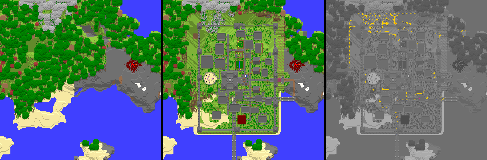

## Summary

| site | result |
|---|---|
| stony_shore | 56 findings |

# KingdomQuest field test

Seed 1813296525. Positions in details are relative to the heart (x, y, z).

## stony_shore

minecraft:stony_shore at 7172, 69, 5512, facing COUNTERCLOCKWISE_90, relief 55, walkable out before founding: true, style highland, ground grass_block. Gate approach cost per side (* = used): south 79, west 12, north 25, east 6*.

| stage | ms | float built | float land | floating feet | buried | destroyed | doors unreached | walk out | breach | wet inside | wet moat | new cliffs | tall walls | pits | road gaps | road steps | wall gaps | cut trees | foreign ground | snow lost | road steep | stumps | road high | road bank | road moved |
|---|---|---|---|---|---|---|---|---|---|---|---|---|---|---|---|---|---|---|---|---|---|---|---|---|---|
| tent_1 | 372 | 0 | 0 | 0 | 0 | 0 | 0 | 1 | 0 | 0 | 0 | 2 | 0 | 0 | 0 | 0 | 0 | 0 | 0 | 0 | 0 | 0 | 0 | 0 | 0 |
Country road to 7173, 66, 5632 (72 blocks of water on the way).

Lord's changes: broke 2 blocks before tent_2; repair leaves them.

Lord's changes after tent_2: unchanged spot kept broken, changed spot rebuilt by the new plan, 1 change(s) remembered.

| tent_2 | 242 | 0 | 0 | 0 | 0 | 1 | 0 | 1 | 0 | 0 | 0 | 16 | 0 | 1 | 0 | 0 | 0 | 0 | 0 | 0 | 0 | 0 | 0 | 0 | 0 |
| tent_3 | 220 | 0 | 0 | 0 | 0 | 0 | 0 | 1 | 0 | 0 | 0 | 8 | 0 | 1 | 0 | 0 | 0 | 0 | 0 | 0 | 0 | 0 | 0 | 0 | 0 |
| hamlet_1 | 539 | 0 | 0 | 0 | 0 | 0 | 0 | 1 | 0 | 0 | 0 | 46 | 0 | 1 | 0 | 0 | 0 | 0 | 0 | 0 | 0 | 0 | 0 | 0 | 0 |
| hamlet_2 | 249 | 1 | 0 | 0 | 0 | 0 | 0 | 1 | 0 | 0 | 0 | 92 | 0 | 2 | 0 | 0 | 0 | 0 | 0 | 0 | 1 | 0 | 0 | 2 | 0 |
| hamlet_3 | 197 | 1 | 0 | 0 | 0 | 0 | 0 | 1 | 0 | 0 | 0 | 86 | 0 | 3 | 0 | 0 | 0 | 0 | 0 | 0 | 1 | 0 | 0 | 0 | 0 |
| village_1 | 208 | 1 | 1 | 0 | 0 | 0 | 0 | 1 | 0 | 0 | 0 | 144 | 0 | 3 | 0 | 0 | 0 | 0 | 0 | 0 | 1 | 0 | 0 | 0 | 0 |
| town_1 | 363 | 1 | 1 | 0 | 0 | 3 | 1 | 1 | 0 | 0 | 0 | 589 | 2 | 20 | 0 | 0 | 167 | 0 | 0 | 0 | 0 | 0 | 0 | 0 | 0 |
| castle_1 | 347 | 1 | 3 | 0 | 0 | 0 | 1 | 1 | 0 | 0 | 0 | 581 | 4 | 13 | 0 | 0 | 0 | 0 | 0 | 0 | 0 | 0 | 0 | 0 | 0 |
| castle_2 | 344 | 1 | 1 | 0 | 0 | 0 | 1 | 1 | 0 | 0 | 0 | 585 | 3 | 13 | 0 | 0 | 0 | 0 | 0 | 0 | 0 | 0 | 0 | 0 | 0 |
| citadel_1 | 390 | 1 | 1 | 0 | 0 | 0 | 1 | 1 | 0 | 0 | 0 | 584 | 3 | 13 | 0 | 0 | 0 | 0 | 0 | 0 | 0 | 0 | 0 | 0 | 0 |
| final | 0 | 1 | 1 | 0 | 0 | 0 | 1 | 1 | 0 | 0 | 0 | 608 | 3 | 14 | 0 | 0 | 0 | 0 | 0 | 0 | 0 | 0 | 0 | 0 | 0 |
Country road at the end: 62 of 62 cells near the castle intact.

Gate (land relative to the heart, before -> after) at 0/5/10/15/20/30/40 blocks out of the gate: 0->-2 -1->-7 0->-2 1->1 1->1 2->2 1->1. Moat columns per side {back=2, gate=765, left=200}. Way-out road none.

- tent_1: new cliffs 2 [(19,-5,0) to 4, (20,-6,0) to 5]
- tent_2: destroyed 1 [main (-8,0,2) cobblestone->air]
- tent_2: new cliffs 16 [(-21,-1,-24) to 3, (-21,-2,-23) to 4, (-20,-1,-25) to 3, (-19,-1,-25) to 3, (-18,-1,-25) to 3]
- tent_2: pits 1 [(-11,-7,26) hole]
- tent_3: new cliffs 8 [(-20,1,-23) to -3, (-19,1,-23) to -3, (-14,-7,25) to 3, (-13,-7,24) to 3, (-11,-3,25) to -4]
- tent_3: pits 1 [(-11,-7,26) hole]
- hamlet_1: new cliffs 46 [(-35,-7,15) to 3, (-35,-7,17) to 3, (-35,-7,18) to 3, (-34,-4,18) to -3, (-34,-7,19) to 3]
- hamlet_1: pits 1 [(-11,-7,26) hole]
- hamlet_2: float built 1 [dock (72,-4,-58) lantern]
- hamlet_2: new cliffs 92 [(-24,6,-62) to -3, (-24,6,-61) to -3, (-24,6,-60) to -3, (-24,5,-57) to -3, (-23,7,-74) to -3]
- hamlet_2: pits 2 [(-11,-7,26) hole, (-4,-15,-72) hole]
- hamlet_2: road steep 1 [(5,-5,19) to 3 in 3]
- hamlet_2: road bank 2 [(8,-4,24) over 3/2, (8,-4,25) over 2/2]
- hamlet_3: float built 1 [dock (72,-4,-58) lantern]
- hamlet_3: new cliffs 86 [(-52,8,-45) to -3, (-51,7,-45) to -3, (-50,7,-45) to -3, (-48,5,-44) to -3, (-47,5,-44) to -3]
- hamlet_3: pits 3 [(-11,-7,26) hole, (-4,-15,-72) hole, (25,-13,-54) hole]
- hamlet_3: road steep 1 [(5,-5,19) to 3 in 3]
- village_1: float built 1 [dock (77,-4,-58) lantern]
- village_1: float land 1 [(72,-4,-58) grass_block]
- village_1: new cliffs 144 [(-69,30,-43) to -3, (-69,29,-42) to -3, (-69,23,-35) to -3, (-69,22,-31) to -3, (-69,21,-30) to -3]
- village_1: pits 3 [(-11,-7,26) hole, (-4,-15,-72) hole, (25,-13,-54) hole]
- village_1: road steep 1 [(5,-5,19) to 3 in 3]
- town_1: float built 1 [dock (77,-4,-58) lantern]
- town_1: float land 1 [(72,-4,-58) grass_block]
- town_1: destroyed 3 [walls (-56,28,-67) coarse_dirt->spruce_log, walls (40,-3,5) coarse_dirt->spruce_log, walls (40,0,-8) coarse_dirt->spruce_log]
- town_1: doors unreached 1 [brewery (16,-4,23) front [brewery_1 stone_brick_stairs deepslate_tile_stairs@brewery 3/1/1 | 5/7/9]]
- town_1: new cliffs 589 [(-71,30,-64) to -4, (-71,30,-63) to -4, (-71,30,-62) to -6, (-71,30,-61) to -9, (-71,30,-60) to -10]
- town_1: tall walls 2 [(-2,-13,-66) -19 cap unowned low unowned:stone, (-2,-32,-65) 20 cap unowned low unowned:stone]
- town_1: pits 20 [(-51,16,-71) hole, (-50,17,-79) hole, (-50,17,-73) hole, (-26,4,-72) hole, (-15,-39,-76) hole]
- town_1: wall gaps 167 [(-31,-7,63) over water, (33,-7,63) over water, (1,-7,63) over water, (-32,-7,63) over water, (32,-7,63) over water]
- castle_1: float built 1 [dock (77,-4,-58) lantern]
- castle_1: float land 3 [(-56,20,-50) dirt, (-56,14,-47) dirt, (72,-4,-58) grass_block]
- castle_1: doors unreached 1 [brewery (16,-4,23) front [brewery_1 stone_brick_stairs deepslate_tile_stairs@brewery 3/1/1 | 5/7/9]]
- castle_1: new cliffs 581 [(-71,30,-74) to -3, (-71,30,-73) to -3, (-71,30,-72) to -3, (-71,30,-71) to -3, (-71,30,-70) to -3]
- castle_1: tall walls 4 [(-19,3,-57) -7 cap unowned low unowned:stone_bricks, (-2,-13,-66) -19 cap unowned low unowned:stone, (-2,-32,-65) 20 cap unowned low unowned:stone, (37,-1,2) -7 cap unowned low unowned:stone]
- castle_1: pits 13 [(-50,15,-73) hole, (-48,20,-79) hole, (-38,9,-82) hole, (-26,-2,-72) hole, (-14,-15,-71) hole]
- castle_2: float built 1 [dock (77,-4,-58) lantern]
- castle_2: float land 1 [(72,-4,-58) grass_block]
- castle_2: doors unreached 1 [brewery (16,-4,23) front [brewery_1 stone_brick_stairs deepslate_tile_stairs@brewery 3/1/1 | 5/7/9]]
- castle_2: new cliffs 585 [(-71,30,-74) to -3, (-71,30,-73) to -3, (-71,30,-72) to -3, (-71,30,-71) to -3, (-71,30,-70) to -3]
- castle_2: tall walls 3 [(-2,-13,-66) -19 cap unowned low unowned:stone, (-2,-32,-65) 20 cap unowned low unowned:stone, (37,-1,2) -7 cap unowned low unowned:stone]
- castle_2: pits 13 [(-50,15,-73) hole, (-48,20,-79) hole, (-38,9,-82) hole, (-26,-2,-72) hole, (-14,-15,-71) hole]
- citadel_1: float built 1 [dock (77,-4,-58) lantern]
- citadel_1: float land 1 [(72,-4,-58) grass_block]
- citadel_1: doors unreached 1 [brewery (16,-4,23) front [brewery_1 stone_brick_stairs deepslate_tile_stairs@brewery 3/1/1 | 5/7/9]]
- citadel_1: new cliffs 584 [(-71,30,-74) to -3, (-71,30,-73) to -3, (-71,30,-72) to -3, (-71,30,-71) to -3, (-71,30,-70) to -3]
- citadel_1: tall walls 3 [(-2,-13,-66) -19 cap unowned low unowned:stone, (-2,-32,-65) 20 cap unowned low unowned:stone, (37,-1,2) -7 cap unowned low unowned:stone]
- citadel_1: pits 13 [(-50,15,-73) hole, (-48,20,-79) hole, (-38,9,-82) hole, (-26,-2,-72) hole, (-14,-15,-71) hole]
- final: door gaps [brewery (16,-4,23) enclosed (9 cells) climb 2.0 from (11,-4,23) to (12,-2,23) (cracked_stone_bricks under, air beside)]
- final: tall by [{unowned/unowned=3}]
- final: float built 1 [dock (77,-4,-58) lantern]
- final: float land 1 [(72,-4,-58) grass_block]
- final: doors unreached 1 [brewery (16,-4,23) front [brewery_1 stone_brick_stairs deepslate_tile_stairs@brewery 3/1/1 | 5/7/9]]
- final: new cliffs 608 [(-71,30,-74) to -3, (-71,30,-73) to -3, (-71,30,-72) to -3, (-71,30,-71) to -3, (-71,30,-70) to -3]
- final: tall walls 3 [(-2,-13,-66) -19 cap unowned low unowned:stone, (-2,-32,-65) 20 cap unowned low unowned:stone, (37,-1,2) -7 cap unowned low unowned:stone]
- final: pits 14 [(-50,15,-73) hole, (-48,20,-79) hole, (-38,9,-82) hole, (-26,-2,-72) hole, (-14,-15,-71) hole]

