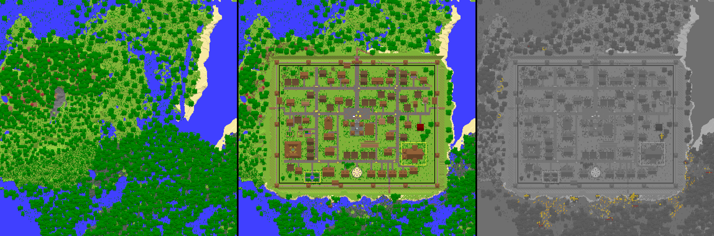

## Summary

| site | result |
|---|---|
| swamp | 44 findings |

# KingdomQuest field test

Seed 20261117. Positions in details are relative to the heart (x, y, z).

## swamp

minecraft:swamp at -3612, 65, 2324, facing CLOCKWISE_180, relief 34, walkable out before founding: true, style wild, ground grass_block. Gate approach cost per side (* = used): south 55, west 14, north 11*, east 56.

| stage | ms | float built | float land | floating feet | buried | destroyed | doors unreached | walk out | breach | wet inside | wet moat | new cliffs | tall walls | pits | road gaps | road steps | wall gaps | cut trees | foreign ground | snow lost | road steep | stumps | road high | road bank | road moved |
|---|---|---|---|---|---|---|---|---|---|---|---|---|---|---|---|---|---|---|---|---|---|---|---|---|---|
Founded as flat castle: plateau at 0 (relative to the heart), site shaped in 379 ms.

| tent_1 | 348 | 0 | 0 | 0 | 0 | 0 | 0 | 1 | 0 | 0 | 0 | 1 | 0 | 0 | 0 | 0 | 0 | 0 | 0 | 0 | 0 | 0 | 0 | 0 | 0 |
Country road to -3492, 67, 2273 (56 blocks of water on the way).

Lord's changes: broke 2 blocks before tent_2; repair leaves them.

Lord's changes after tent_2: unchanged spot kept broken, changed spot rebuilt by the new plan, 1 change(s) remembered.

| tent_2 | 550 | 0 | 0 | 0 | 0 | 1 | 0 | 1 | 0 | 0 | 0 | 15 | 0 | 3 | 0 | 0 | 0 | 0 | 0 | 0 | 0 | 0 | 0 | 0 | 0 |
| tent_3 | 242 | 0 | 0 | 0 | 0 | 0 | 0 | 1 | 0 | 0 | 0 | 15 | 0 | 3 | 0 | 0 | 0 | 0 | 0 | 0 | 0 | 0 | 0 | 0 | 0 |
| hamlet_1 | 861 | 0 | 41 | 0 | 0 | 0 | 0 | 1 | 0 | 0 | 0 | 227 | 0 | 51 | 0 | 0 | 0 | 0 | 0 | 0 | 0 | 0 | 0 | 0 | 0 |
| hamlet_2 | 255 | 12 | 41 | 0 | 0 | 0 | 0 | 1 | 0 | 0 | 0 | 206 | 0 | 47 | 0 | 0 | 0 | 0 | 0 | 0 | 0 | 0 | 0 | 129 | 0 |
| hamlet_3 | 282 | 0 | 11 | 0 | 0 | 13 | 0 | 1 | 0 | 0 | 0 | 247 | 0 | 55 | 0 | 0 | 0 | 0 | 0 | 0 | 0 | 0 | 0 | 0 | 0 |
| village_1 | 815 | 0 | 23 | 0 | 0 | 13 | 0 | 1 | 0 | 0 | 0 | 852 | 0 | 171 | 11 | 0 | 0 | 0 | 0 | 0 | 0 | 0 | 0 | 0 | 0 |
| town_1 | 548 | 0 | 97 | 0 | 0 | 0 | 0 | 1 | 0 | 0 | 0 | 1029 | 0 | 164 | 0 | 0 | 0 | 0 | 0 | 0 | 0 | 0 | 0 | 0 | 0 |
| castle_1 | 1106 | 0 | 97 | 0 | 0 | 0 | 0 | 1 | 0 | 0 | 0 | 1028 | 0 | 164 | 0 | 0 | 0 | 0 | 0 | 0 | 0 | 0 | 0 | 0 | 0 |
| castle_2 | 1176 | 0 | 97 | 0 | 0 | 2 | 0 | 1 | 0 | 0 | 0 | 1028 | 0 | 164 | 0 | 0 | 0 | 0 | 0 | 0 | 0 | 0 | 0 | 0 | 0 |
| citadel_1 | 1132 | 0 | 97 | 0 | 0 | 10 | 0 | 1 | 0 | 0 | 0 | 1028 | 0 | 164 | 0 | 0 | 0 | 0 | 0 | 0 | 0 | 0 | 0 | 0 | 0 |
| final | 0 | 0 | 97 | 0 | 0 | 10 | 0 | 1 | 0 | 0 | 0 | 1028 | 0 | 164 | 0 | 0 | 0 | 0 | 0 | 0 | 0 | 0 | 0 | 0 | 0 |
Country road at the end: 92 of 118 cells near the castle intact, cut at [25, -1, -100, 26, -1, -100, 27, -1, -99, 28, -1, -99, 29, -1, -98].

Gate (land relative to the heart, before -> after) at 0/5/10/15/20/30/40 blocks out of the gate: 0->-2 1->-2 0->-2 0->-2 0->-2 0->-2 1->-2. Moat columns per side {back=2853, gate=2809, left=776, right=670}. Way-out road none.

Production: level 1 made 16102 items in a game day, 48327 in three (store 4320 stacks); level 5 with every milestone 141571 items of 241 kinds a day. Storehouse goods shown: 14 blocks; unloaded 15552 items into the chests.

Tram: 880 rails, stops [gate, west, north, east]
Signal fires: 20 on 13 towers, lit 20, put out 20; tower guard posts 20.

- tent_1: new cliffs 1 [(3,-2,39) to -3]
- tent_2: destroyed 1 [main (5,1,0) jungle_log->air]
- tent_2: new cliffs 15 [(3,-2,39) to -3, (6,-4,39) to 13, (7,9,39) to -13, (14,-5,47) to 3, (14,-5,47) to 3]
- tent_2: pits 3 [(7,9,39) spike, (17,5,30) spike, (27,-7,46) hole]
- tent_3: new cliffs 15 [(3,-2,39) to -3, (6,-4,39) to 13, (7,9,39) to -13, (14,-5,47) to 3, (14,-5,47) to 3]
- tent_3: pits 3 [(7,9,39) spike, (17,5,30) spike, (27,-7,46) hole]
- hamlet_1: float land 41 [(-22,9,73) mangrove_log, (-22,8,74) mangrove_log, (-22,8,75) mangrove_log, (-22,9,75) mangrove_log, (-22,9,76) mangrove_log]
- hamlet_1: new cliffs 227 [(-34,0,56) to -3, (-32,-4,59) to 3, (-30,-4,58) to 3, (-30,-1,60) to -3, (-27,-1,61) to -3]
- hamlet_1: pits 51 [(-30,-4,58) hole, (-23,-5,45) hole, (-22,-6,41) hole, (-22,1,42) spike, (-22,3,72) spike]
- hamlet_2: float built 12 [lamps (62,0,-39) jungle_fence, lamps (62,1,-39) torch, lamps (62,0,-13) jungle_fence, lamps (62,1,-13) torch, lamps (68,0,-26) jungle_fence]
- hamlet_2: float land 41 [(-22,9,73) mangrove_log, (-22,8,74) mangrove_log, (-22,8,75) mangrove_log, (-22,9,75) mangrove_log, (-22,9,76) mangrove_log]
- hamlet_2: new cliffs 206 [(-34,0,56) to -3, (-32,-4,59) to 3, (-30,-4,58) to 3, (-30,-1,60) to -3, (-27,-1,61) to -3]
- hamlet_2: pits 47 [(-30,-4,58) hole, (-23,-5,45) hole, (-22,-6,41) hole, (-22,1,42) spike, (-22,3,72) spike]
- hamlet_2: road bank 129 [(57,-1,-7) over 2/2, (89,-1,-48) over 2/2, (56,-1,-7) over 2/2, (88,-1,-48) over 2/2, (59,-1,-7) over 3/2]
- hamlet_3: float land 11 [(-9,14,75) mangrove_log, (-9,15,75) mangrove_log, (-9,16,75) mangrove_log, (-9,14,76) mangrove_log, (-9,14,77) mangrove_log]
- hamlet_3: destroyed 13 [lumbercamp (-197,3,40) jungle_log->air, lumbercamp (-198,3,37) jungle_log->air, lumbercamp (-199,3,37) jungle_log->air, lumbercamp (-200,3,37) jungle_log->air, lumbercamp (-201,3,37) jungle_log->air]
- hamlet_3: new cliffs 247 [(-36,3,75) to -5, (-36,2,77) to -5, (-35,-2,71) to 3, (-35,1,72) to -3, (-35,1,74) to -3]
- hamlet_3: pits 55 [(-35,-2,71) hole, (-35,-2,73) hole, (-33,-3,77) hole, (-30,-3,73) hole, (-29,-4,76) hole]
- village_1: float land 23 [(35,6,89) bee_nest, (61,17,142) mangrove_log, (62,16,142) mangrove_log, (63,15,142) mangrove_log, (64,11,142) mangrove_log]
- village_1: destroyed 13 [lumbercamp (-197,3,40) jungle_log->air, lumbercamp (-198,3,37) jungle_log->air, lumbercamp (-199,3,37) jungle_log->air, lumbercamp (-200,3,37) jungle_log->air, lumbercamp (-201,3,37) jungle_log->air]
- village_1: new cliffs 852 [(-67,-2,101) to 3, (-66,1,101) to -3, (-63,-1,101) to -6, (-63,-7,102) to 4, (-61,-1,102) to -6]
- village_1: pits 171 [(-66,1,101) spike, (-63,-7,102) hole, (-61,-7,103) hole, (-59,-7,113) hole, (-56,-9,118) hole]
- village_1: road gaps 11 [(65,-1,-21) dirt_path over air, (63,-1,-35) dirt_path over air, (64,-1,-20) dirt_path over air, (63,-1,-33) dirt_path over air, (64,-1,-38) dirt_path over air]
- walls 1 took 4215 ms
- town_1: float land 97 [(-108,16,-116) oak_log, (-107,16,-116) oak_log, (-92,8,171) mangrove_log, (-91,7,171) mangrove_log, (-90,6,171) mangrove_log]
- town_1: new cliffs 1029 [(-158,8,-44) to -3, (-158,5,-43) to 3, (-157,5,-50) to 3, (-157,8,-43) to -4, (-157,13,-2) to -3]
- town_1: pits 164 [(-150,-5,109) hole, (-140,-6,121) hole, (-134,-11,126) hole, (-124,-10,136) hole, (-123,-10,135) hole]
- castle_1: float land 97 [(-108,16,-116) oak_log, (-107,16,-116) oak_log, (-92,8,171) mangrove_log, (-91,7,171) mangrove_log, (-90,6,171) mangrove_log]
- castle_1: new cliffs 1028 [(-158,8,-44) to -3, (-158,5,-43) to 3, (-157,5,-50) to 3, (-157,8,-43) to -4, (-157,13,-2) to -3]
- castle_1: pits 164 [(-150,-5,109) hole, (-140,-6,121) hole, (-134,-11,126) hole, (-124,-10,136) hole, (-123,-10,135) hole]
- castle_2: float land 97 [(-108,16,-116) oak_log, (-107,16,-116) oak_log, (-92,8,171) mangrove_log, (-91,7,171) mangrove_log, (-90,6,171) mangrove_log]
- castle_2: destroyed 2 [tram (55,0,-85) rail->air, tram (54,0,-85) rail->air]
- castle_2: new cliffs 1028 [(-158,8,-44) to -3, (-158,5,-43) to 3, (-157,5,-50) to 3, (-157,8,-43) to -4, (-157,13,-2) to -3]
- castle_2: pits 164 [(-150,-5,109) hole, (-140,-6,121) hole, (-134,-11,126) hole, (-124,-10,136) hole, (-123,-10,135) hole]
- citadel_1: float land 97 [(-108,16,-116) oak_log, (-107,16,-116) oak_log, (-92,8,171) mangrove_log, (-91,7,171) mangrove_log, (-90,6,171) mangrove_log]
- citadel_1: destroyed 10 [tram (-12,0,-82) stripped_jungle_log->air, tram (-16,0,-82) stripped_jungle_log->air, tram (55,0,-85) rail->air, tram (54,0,-85) rail->air, tram (-12,0,-87) stripped_jungle_log->air]
- citadel_1: new cliffs 1028 [(-158,8,-44) to -3, (-158,5,-43) to 3, (-157,5,-50) to 3, (-157,8,-43) to -4, (-157,13,-2) to -3]
- citadel_1: pits 164 [(-150,-5,109) hole, (-140,-6,121) hole, (-134,-11,126) hole, (-124,-10,136) hole, (-123,-10,135) hole]
- final: float land 97 [(-108,16,-116) oak_log, (-107,16,-116) oak_log, (-92,8,171) mangrove_log, (-91,7,171) mangrove_log, (-90,6,171) mangrove_log]
- final: destroyed 10 [tram (-12,0,-82) stripped_jungle_log->air, tram (-16,0,-82) stripped_jungle_log->air, tram (55,0,-85) rail->air, tram (54,0,-85) rail->air, tram (-12,0,-87) stripped_jungle_log->air]
- final: new cliffs 1028 [(-158,8,-44) to -3, (-158,5,-43) to 3, (-157,5,-50) to 3, (-157,8,-43) to -4, (-157,13,-2) to -3]
- final: pits 164 [(-150,-5,109) hole, (-140,-6,121) hole, (-134,-11,126) hole, (-124,-10,136) hole, (-123,-10,135) hole]
- country road cut in 26 cells, e.g. [25, -1, -100, 26, -1, -100, 27, -1, -99, 28, -1, -99, 29, -1, -98]
- tram: rails missing at [54, 0, -85, 55, 0, -85]

