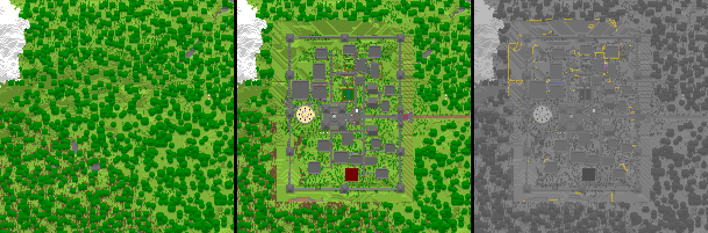

## Summary

| site | result |
|---|---|
| taiga | 53 findings |

# KingdomQuest field test

Seed 1813296525. Positions in details are relative to the heart (x, y, z).

## taiga

minecraft:taiga at -4856, 97, 1144, facing COUNTERCLOCKWISE_90, relief 47, walkable out before founding: true, style highland, ground grass_block. Gate approach cost per side (* = used): south 12, west 7, north 311, east 2*.

| stage | ms | float built | float land | floating feet | buried | destroyed | doors unreached | walk out | breach | wet inside | wet moat | new cliffs | tall walls | pits | road gaps | road steps | wall gaps | cut trees | foreign ground | snow lost | road steep | stumps | road high | road bank | road moved |
|---|---|---|---|---|---|---|---|---|---|---|---|---|---|---|---|---|---|---|---|---|---|---|---|---|---|
| tent_1 | 582 | 0 | 0 | 0 | 0 | 0 | 0 | 1 | 0 | 0 | 0 | 7 | 0 | 0 | 0 | 0 | 0 | 0 | 0 | 0 | 0 | 0 | 0 | 0 | 0 |
Country road to -4675, -64, 1144 (0 blocks of water on the way).

Lord's changes: broke 2 blocks before tent_2; repair leaves them.

Lord's changes after tent_2: unchanged spot kept broken, changed spot rebuilt by the new plan, 1 change(s) remembered.

| tent_2 | 310 | 0 | 0 | 0 | 0 | 1 | 0 | 1 | 0 | 0 | 0 | 16 | 0 | 0 | 0 | 0 | 0 | 0 | 0 | 0 | 0 | 0 | 0 | 0 | 0 |
| tent_3 | 208 | 0 | 0 | 0 | 0 | 0 | 0 | 1 | 0 | 0 | 0 | 9 | 0 | 0 | 0 | 0 | 0 | 0 | 0 | 0 | 0 | 0 | 0 | 0 | 0 |
| hamlet_1 | 418 | 0 | 0 | 0 | 0 | 0 | 0 | 1 | 0 | 0 | 0 | 109 | 0 | 1 | 0 | 0 | 0 | 0 | 0 | 0 | 0 | 0 | 0 | 0 | 0 |
| dock 1 not built |
| hamlet_2 | 283 | 0 | 0 | 0 | 0 | 0 | 0 | 1 | 0 | 0 | 0 | 239 | 2 | 1 | 0 | 0 | 0 | 0 | 0 | 0 | 4 | 0 | 5 | 2 | 0 |
| hamlet_3 | 275 | 0 | 0 | 0 | 0 | 0 | 0 | 1 | 0 | 0 | 0 | 284 | 2 | 1 | 0 | 0 | 0 | 0 | 0 | 0 | 4 | 0 | 5 | 0 | 0 |
| village_1 | 428 | 0 | 0 | 0 | 0 | 0 | 0 | 1 | 0 | 0 | 0 | 414 | 15 | 4 | 0 | 0 | 0 | 0 | 0 | 0 | 13 | 0 | 5 | 0 | 0 |
| town_1 | 282 | 5 | 0 | 0 | 0 | 0 | 0 | 1 | 0 | 0 | 0 | 372 | 5 | 6 | 0 | 0 | 29 | 0 | 0 | 0 | 15 | 0 | 5 | 0 | 13 |
| castle_1 | 455 | 5 | 0 | 0 | 0 | 0 | 0 | 1 | 0 | 0 | 0 | 419 | 5 | 3 | 0 | 0 | 0 | 0 | 0 | 0 | 15 | 0 | 5 | 0 | 0 |
| castle_2 | 457 | 0 | 0 | 0 | 0 | 0 | 0 | 1 | 0 | 0 | 0 | 375 | 5 | 2 | 0 | 0 | 0 | 0 | 0 | 0 | 15 | 0 | 5 | 0 | 0 |
| citadel_1 | 485 | 0 | 0 | 0 | 0 | 0 | 0 | 1 | 0 | 0 | 0 | 375 | 5 | 2 | 0 | 0 | 0 | 0 | 0 | 0 | 15 | 0 | 5 | 0 | 0 |
| final | 0 | 0 | 0 | 0 | 0 | 0 | 0 | 1 | 0 | 0 | 0 | 355 | 6 | 2 | 0 | 0 | 0 | 0 | 0 | 0 | 15 | 0 | 5 | 0 | 0 |
Country road at the end: 60 of 60 cells near the castle intact.

Gate (land relative to the heart, before -> after) at 0/5/10/15/20/30/40 blocks out of the gate: 2->-2 1->-7 -1->-2 0->0 0->0 -2->-2 -2->-2. Moat columns per side {gate=1080}. Way-out road none.

- tent_1: new cliffs 7 [(-53,-11,42) to 4, (-19,-6,47) to 3, (6,7,-28) to -6, (7,-4,-8) to 4, (20,0,20) to -3]
- tent_2: destroyed 1 [main (0,1,5) spruce_log->air]
- tent_2: new cliffs 16 [(-53,-11,42) to 4, (-21,1,-17) to -3, (-21,1,-16) to -3, (-20,2,-19) to -3, (-19,-6,47) to 3]
- tent_3: new cliffs 9 [(-53,-11,42) to 4, (-21,1,-17) to -3, (-21,1,-16) to -3, (-20,2,-19) to -3, (-19,-6,47) to 3]
- hamlet_1: new cliffs 109 [(-53,-11,42) to 4, (-43,12,-28) to -5, (-43,11,-27) to -4, (-43,10,-26) to -3, (-42,13,-30) to -6]
- hamlet_1: pits 1 [(-34,-6,7) hole]
- hamlet_2: new cliffs 239 [(-53,-11,42) to 4, (-43,12,-28) to -4, (-43,11,-27) to -3, (-42,13,-30) to -5, (-42,12,-29) to -5]
- hamlet_2: tall walls 2 [(12,10,-46) -7 cap unowned low unowned:stone_bricks, (13,3,-46) 7 cap unowned low unowned:stone_bricks]
- hamlet_2: pits 1 [(-34,-6,7) hole]
- hamlet_2: road steep 4 [(12,9,-42) to -3 in 3, (12,10,-43) to -3 in 3, (12,8,-41) to -3 in 3, (9,2,-38) to 3 in 3]
- hamlet_2: road high 5 [(12,9,-42) above kennel step (11,7,-42), (12,10,-43) above kennel step (11,7,-43), (12,10,-44) above kennel step (11,7,-44), (12,8,-41) above kennel step (11,7,-41), (12,10,-45) above kennel step (11,7,-45)]
- hamlet_2: road bank 2 [(1,2,-37) over 3/3, (1,2,-38) over 3/3]
- hamlet_3: new cliffs 284 [(-53,-11,42) to 4, (-50,23,-40) to -13, (-50,22,-39) to -12, (-50,21,-38) to -11, (-50,20,-37) to -10]
- hamlet_3: tall walls 2 [(12,10,-46) -7 cap unowned low unowned:stone_bricks, (13,3,-46) 7 cap unowned low unowned:stone_bricks]
- hamlet_3: pits 1 [(-34,-6,7) hole]
- hamlet_3: road steep 4 [(12,9,-42) to -3 in 3, (12,10,-43) to -3 in 3, (12,8,-41) to -3 in 3, (9,2,-38) to 3 in 3]
- hamlet_3: road high 5 [(12,9,-42) above kennel step (11,7,-42), (12,10,-43) above kennel step (11,7,-43), (12,10,-44) above kennel step (11,7,-44), (12,8,-41) above kennel step (11,7,-41), (12,10,-45) above kennel step (11,7,-45)]
- village_1: new cliffs 414 [(-68,30,-44) to -9, (-68,30,-43) to -9, (-68,29,-42) to -8, (-68,29,-41) to -8, (-68,29,-40) to -8]
- village_1: tall walls 15 [(-37,-1,-30) 11 cap unowned low unowned:stone_bricks, (-37,-1,-30) 11 cap unowned low unowned:stone_bricks, (-36,0,-31) 10 cap unowned low unowned:stone_bricks, (-36,10,-22) -11 cap unowned low unowned:andesite, (-35,0,-31) 10 cap unowned low unowned:stone_bricks]
- village_1: pits 4 [(-55,-3,-8) hole, (-53,-4,-5) hole, (-36,14,-49) hole, (-34,-6,7) hole]
- village_1: road steep 13 [(-26,5,-29) to -3 in 3, (-25,4,-29) to -3 in 3, (-28,7,-29) to -3 in 3, (-27,6,-29) to -3 in 3, (-30,9,-29) to -3 in 3]
- village_1: road high 5 [(12,9,-42) above kennel step (11,7,-42), (12,10,-43) above kennel step (11,7,-43), (12,10,-44) above kennel step (11,7,-44), (12,8,-41) above kennel step (11,7,-41), (12,10,-45) above kennel step (11,7,-45)]
- town_1: float built 5 [trophy (4,2,31) spruce_fence, trophy (4,3,31) spruce_fence, trophy (4,4,31) spruce_fence, trophy (5,3,31) spruce_hanging_sign, trophy (5,4,31) spruce_fence]
- town_1: new cliffs 372 [(-71,30,-57) to -3, (-71,30,-56) to -4, (-71,30,-55) to -5, (-71,30,-54) to -6, (-71,30,-53) to -6]
- town_1: tall walls 5 [(-37,-1,-30) 11 cap unowned low unowned:stone_bricks, (-37,-1,-30) 11 cap unowned low unowned:stone_bricks, (-36,10,-22) -11 cap unowned low unowned:andesite, (12,10,-46) -7 cap unowned low unowned:stone_bricks, (13,3,-46) 7 cap unowned low unowned:stone_bricks]
- town_1: pits 6 [(-34,-6,7) hole, (13,12,-65) hole, (16,17,-71) spike, (18,15,-81) hole, (19,19,-79) spike]
- town_1: wall gaps 29 [(-42,1,63) over air, (-41,1,63) over air, (16,19,-69) over air, (17,20,-69) over air, (14,17,-69) over air]
- town_1: road steep 15 [(12,9,-42) to -3 in 3, (12,10,-43) to -3 in 3, (12,8,-41) to -3 in 3, (-24,3,-29) to -3 in 3, (-26,5,-29) to -3 in 3]
- town_1: road high 5 [(12,9,-42) above kennel step (11,7,-42), (12,10,-43) above kennel step (11,7,-43), (12,10,-44) above kennel step (11,7,-44), (12,8,-41) above kennel step (11,7,-41), (12,10,-45) above kennel step (11,7,-45)]
- town_1: road moved 13 [(12,4,-38) from 5, (12,5,-39) from 6, (12,8,-42) from 9, (12,7,-41) from 8, (-22,0,-29) from 1]
- castle_1: float built 5 [trophy (4,2,31) spruce_fence, trophy (4,3,31) spruce_fence, trophy (4,4,31) spruce_fence, trophy (5,3,31) spruce_hanging_sign, trophy (5,4,31) spruce_fence]
- castle_1: new cliffs 419 [(-71,30,-62) to -4, (-71,30,-61) to -4, (-71,30,-60) to -4, (-71,30,-59) to -4, (-71,30,-58) to -6]
- castle_1: tall walls 5 [(-37,-1,-30) 11 cap unowned low unowned:stone_bricks, (-37,-1,-30) 11 cap unowned low unowned:stone_bricks, (-36,10,-22) -11 cap unowned low unowned:andesite, (12,10,-46) -7 cap unowned low unowned:stone_bricks, (13,3,-46) 7 cap unowned low unowned:stone_bricks]
- castle_1: pits 3 [(-34,-6,7) hole, (19,20,-79) spike, (26,12,-62) hole]
- castle_1: road steep 15 [(12,9,-42) to -3 in 3, (12,10,-43) to -3 in 3, (12,8,-41) to -3 in 3, (-24,3,-29) to -3 in 3, (-26,5,-29) to -3 in 3]
- castle_1: road high 5 [(12,9,-42) above kennel step (11,7,-42), (12,10,-43) above kennel step (11,7,-43), (12,10,-44) above kennel step (11,7,-44), (12,8,-41) above kennel step (11,7,-41), (12,10,-45) above kennel step (11,7,-45)]
- castle_2: new cliffs 375 [(-71,30,-62) to -4, (-71,30,-61) to -4, (-71,30,-60) to -4, (-71,30,-59) to -4, (-71,30,-58) to -6]
- castle_2: tall walls 5 [(-37,-1,-30) 11 cap unowned low unowned:stone_bricks, (-37,-1,-30) 11 cap unowned low unowned:stone_bricks, (-36,10,-22) -11 cap unowned low unowned:andesite, (12,10,-46) -7 cap unowned low unowned:stone_bricks, (13,3,-46) 7 cap unowned low unowned:stone_bricks]
- castle_2: pits 2 [(19,20,-79) spike, (26,12,-62) hole]
- castle_2: road steep 15 [(12,9,-42) to -3 in 3, (12,10,-43) to -3 in 3, (12,8,-41) to -3 in 3, (-24,3,-29) to -3 in 3, (-26,5,-29) to -3 in 3]
- castle_2: road high 5 [(12,9,-42) above kennel step (11,7,-42), (12,10,-43) above kennel step (11,7,-43), (12,10,-44) above kennel step (11,7,-44), (12,8,-41) above kennel step (11,7,-41), (12,10,-45) above kennel step (11,7,-45)]
- citadel_1: new cliffs 375 [(-71,30,-62) to -4, (-71,30,-61) to -4, (-71,30,-60) to -4, (-71,30,-59) to -4, (-71,30,-58) to -6]
- citadel_1: tall walls 5 [(-37,-1,-30) 11 cap unowned low unowned:stone_bricks, (-37,-1,-30) 11 cap unowned low unowned:stone_bricks, (-36,10,-22) -11 cap unowned low unowned:andesite, (12,10,-46) -7 cap unowned low unowned:stone_bricks, (13,3,-46) 7 cap unowned low unowned:stone_bricks]
- citadel_1: pits 2 [(19,20,-79) spike, (26,12,-62) hole]
- citadel_1: road steep 15 [(12,9,-42) to -3 in 3, (12,10,-43) to -3 in 3, (12,8,-41) to -3 in 3, (-24,3,-29) to -3 in 3, (-26,5,-29) to -3 in 3]
- citadel_1: road high 5 [(12,9,-42) above kennel step (11,7,-42), (12,10,-43) above kennel step (11,7,-43), (12,10,-44) above kennel step (11,7,-44), (12,8,-41) above kennel step (11,7,-41), (12,10,-45) above kennel step (11,7,-45)]
- final: tall by [{unowned/unowned=6}]
- final: new cliffs 355 [(-71,30,-62) to -4, (-71,30,-61) to -4, (-71,30,-60) to -4, (-71,30,-59) to -4, (-71,30,-58) to -6]
- final: tall walls 6 [(-37,-1,-30) 11 cap unowned low unowned:stone, (-37,-1,-30) 11 cap unowned low unowned:stone_bricks, (-36,0,-31) 10 cap unowned low unowned:stone, (-36,10,-22) -11 cap unowned low unowned:andesite, (12,10,-46) -7 cap unowned low unowned:stone_bricks]
- final: pits 2 [(19,20,-79) spike, (26,12,-62) hole]
- final: road steep 15 [(12,9,-42) to -3 in 3, (12,10,-43) to -3 in 3, (12,8,-41) to -3 in 3, (-24,3,-29) to -3 in 3, (-26,5,-29) to -3 in 3]
- final: road high 5 [(12,9,-42) above kennel step (11,7,-42), (12,10,-43) above kennel step (11,7,-43), (12,10,-44) above kennel step (11,7,-44), (12,8,-41) above kennel step (11,7,-41), (12,10,-45) above kennel step (11,7,-45)]
- not at the last level: dock 0/2, 

