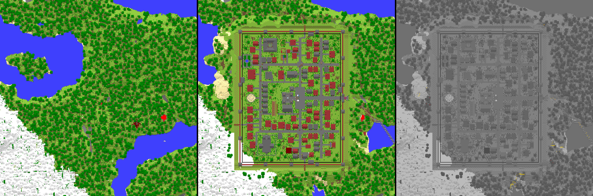

## Summary

| site | result |
|---|---|
| valley | 69 findings |

# KingdomQuest field test

Seed 20261117. Positions in details are relative to the heart (x, y, z).

## valley

minecraft:forest at 6596, 85, 8656, facing COUNTERCLOCKWISE_90, relief 52, walkable out before founding: false, style temperate, ground grass_block. Shape valley (score 1.5), land relative to the heart, directions S SE E NE N NW W SW, gate toward E: 24 out [3, -5, -3, -3, 3, -1, 4, 10]; 48 out [12, 1, -4, 11, 12, -14, 2, 9]; 72 out [14, -2, -3, 14, 8, -37, -2, 4]; 96 out [13, -4, -10, 20, 6, -35, -18, 5]. Gate approach cost per side (* = used): south 53, west 230, north 8, east 150*.

| stage | ms | float built | float land | floating feet | buried | destroyed | doors unreached | walk out | breach | wet inside | wet moat | new cliffs | tall walls | pits | road gaps | road steps | wall gaps | cut trees | foreign ground | snow lost | road steep | stumps | road high | road bank | road moved |
|---|---|---|---|---|---|---|---|---|---|---|---|---|---|---|---|---|---|---|---|---|---|---|---|---|---|
Founded as flat castle: plateau at 0 (relative to the heart), site shaped in 472 ms.

| tent_1 | 705 | 0 | 0 | 0 | 0 | 0 | 0 | 1 | 0 | 0 | 0 | 0 | 0 | 0 | 0 | 0 | 0 | 0 | 0 | 0 | 0 | 0 | 0 | 0 | 0 |
Country road to 6789, 69, 8748 (54 blocks of water on the way).

Lord's changes: broke 2 blocks before tent_2; repair leaves them.

Lord's changes after tent_2: unchanged spot kept broken, changed spot rebuilt by the new plan, 1 change(s) remembered.

| tent_2 | 649 | 0 | 0 | 0 | 0 | 1 | 0 | 1 | 0 | 0 | 0 | 16 | 6 | 1 | 0 | 0 | 0 | 0 | 0 | 0 | 0 | 0 | 0 | 0 | 0 |
| tent_3 | 350 | 0 | 0 | 0 | 0 | 0 | 0 | 1 | 0 | 0 | 0 | 16 | 6 | 1 | 0 | 0 | 0 | 0 | 0 | 0 | 0 | 0 | 0 | 0 | 0 |
| hamlet_1 | 898 | 0 | 0 | 0 | 0 | 2 | 0 | 1 | 0 | 0 | 0 | 16 | 6 | 1 | 0 | 0 | 0 | 0 | 0 | 0 | 0 | 0 | 0 | 0 | 0 |
| hamlet_2 | 485 | 2 | 1 | 0 | 0 | 0 | 0 | 1 | 0 | 0 | 0 | 55 | 6 | 1 | 0 | 0 | 0 | 0 | 3131 | 0 | 0 | 0 | 0 | 160 | 0 |
| hamlet_3 | 425 | 0 | 0 | 0 | 0 | 11 | 0 | 1 | 0 | 0 | 0 | 62 | 6 | 2 | 0 | 0 | 0 | 0 | 4753 | 0 | 0 | 0 | 0 | 2 | 0 |
| village_1 | 902 | 0 | 0 | 0 | 0 | 11 | 0 | 1 | 0 | 0 | 0 | 93 | 6 | 3 | 2 | 0 | 0 | 0 | 4769 | 0 | 0 | 0 | 0 | 2 | 0 |
| town_1 | 624 | 0 | 7 | 0 | 0 | 5 | 0 | 1 | 0 | 0 | 0 | 130 | 6 | 4 | 0 | 0 | 1 | 0 | 2536 | 111 | 0 | 0 | 0 | 0 | 0 |
| castle_1 | 1447 | 0 | 6 | 0 | 0 | 5 | 0 | 1 | 0 | 0 | 0 | 130 | 6 | 4 | 0 | 0 | 0 | 0 | 2536 | 107 | 0 | 0 | 0 | 0 | 0 |
| castle_2 | 1581 | 0 | 6 | 0 | 0 | 3 | 0 | 1 | 0 | 0 | 0 | 130 | 6 | 4 | 0 | 0 | 0 | 0 | 2536 | 107 | 0 | 0 | 0 | 0 | 0 |
| citadel_1 | 1548 | 0 | 6 | 0 | 0 | 3 | 0 | 1 | 0 | 0 | 0 | 130 | 6 | 4 | 0 | 0 | 0 | 0 | 2536 | 107 | 0 | 0 | 0 | 0 | 0 |
| final | 0 | 0 | 6 | 0 | 0 | 3 | 0 | 1 | 0 | 0 | 0 | 130 | 6 | 4 | 0 | 0 | 0 | 0 | 2536 | 107 | 0 | 0 | 0 | 0 | 0 |
Country road at the end: 10 of 10 cells near the castle intact.

Gate (land relative to the heart, before -> after) at 0/5/10/15/20/30/40 blocks out of the gate: -7->-2 -7->-2 -7->-4 -8->-7 -6->-6 -6->-6 -7->-7. Moat columns per side {back=2680, gate=2806, left=694, right=741}. Way-out road none.

Production: level 1 made 16102 items in a game day, 48327 in three (store 4320 stacks); level 5 with every milestone 141571 items of 239 kinds a day. Storehouse goods shown: 14 blocks; unloaded 15552 items into the chests.

Tram: 880 rails, stops [gate, west, north, east]
Signal fires: 20 on 13 towers, lit 20, put out 20; tower guard posts 20.

- tent_2: destroyed 1 [main (-8,0,2) white_wool->air]
- tent_2: new cliffs 16 [(-40,-22,-37) to 3, (117,-12,2) to 4, (126,-17,1) to -3, (128,-19,-2) to -3, (133,-21,6) to -3]
- tent_2: tall walls 6 [(151,-35,41) 15 cap unowned low unowned:stone_bricks, (151,-20,42) -14 cap unowned low unowned:stone_bricks, (154,-36,43) 16 cap unowned low unowned:stone_bricks, (155,-36,43) 17 cap unowned low unowned:stone_bricks, (156,-36,43) 17 cap unowned low unowned:stone_bricks]
- tent_2: pits 1 [(165,-22,49) hole]
- tent_3: new cliffs 16 [(-40,-22,-37) to 3, (117,-12,2) to 4, (126,-17,1) to -3, (128,-19,-2) to -3, (133,-21,6) to -3]
- tent_3: tall walls 6 [(151,-35,41) 15 cap unowned low unowned:stone_bricks, (151,-20,42) -14 cap unowned low unowned:stone_bricks, (154,-36,43) 16 cap unowned low unowned:stone_bricks, (155,-36,43) 17 cap unowned low unowned:stone_bricks, (156,-36,43) 17 cap unowned low unowned:stone_bricks]
- tent_3: pits 1 [(165,-22,49) hole]
- hamlet_1: destroyed 2 [main (-8,0,-4) rose_bush->air, main (-8,1,-4) rose_bush->air]
- hamlet_1: new cliffs 16 [(-58,-22,-32) to 3, (117,-12,2) to 4, (126,-17,1) to -3, (128,-19,-2) to -3, (133,-21,6) to -3]
- hamlet_1: tall walls 6 [(151,-35,41) 15 cap unowned low unowned:stone_bricks, (151,-20,42) -14 cap unowned low unowned:stone_bricks, (154,-36,43) 16 cap unowned low unowned:stone_bricks, (155,-36,43) 17 cap unowned low unowned:stone_bricks, (156,-36,43) 17 cap unowned low unowned:stone_bricks]
- hamlet_1: pits 1 [(165,-22,49) hole]
- hamlet_2: float built 2 [lamps (-53,0,-62) spruce_fence, lamps (-53,1,-62) torch]
- hamlet_2: float land 1 [(71,6,100) oak_log]
- hamlet_2: new cliffs 55 [(-59,-22,-118) to 3, (-58,-21,-116) to 3, (-58,-22,-32) to 3, (-51,-15,-116) to 3, (48,-19,126) to -3]
- hamlet_2: tall walls 6 [(151,-35,41) 15 cap unowned low unowned:stone_bricks, (151,-20,42) -14 cap unowned low unowned:stone_bricks, (154,-36,43) 16 cap unowned low unowned:stone_bricks, (155,-36,43) 17 cap unowned low unowned:stone_bricks, (156,-36,43) 17 cap unowned low unowned:stone_bricks]
- hamlet_2: pits 1 [(165,-22,49) hole]
- hamlet_2: foreign ground 3131 [sand 3131 of 114206 columns (was 328)]
- hamlet_2: road bank 160 [(68,-1,1) over 5/5, (68,-1,3) over 5/5, (68,-1,2) over 5/5, (-60,-1,-65) over 21/21, (68,-1,67) over 4/4]
- hamlet_3: destroyed 11 [tavern (-60,1,-40) vine->air, tavern (-60,1,-41) vine->air, tavern (-60,1,-45) vine->air, tavern (-60,1,-49) vine->air, tavern (-60,2,-40) vine->air]
- hamlet_3: new cliffs 62 [(-80,-15,-19) to 3, (-60,-18,-121) to 3, (-59,-16,-118) to 3, (40,-10,139) to -3, (43,-12,138) to -3]
- hamlet_3: tall walls 6 [(151,-35,41) 15 cap unowned low unowned:stone_bricks, (151,-20,42) -14 cap unowned low unowned:stone_bricks, (154,-36,43) 16 cap unowned low unowned:stone_bricks, (155,-36,43) 17 cap unowned low unowned:stone_bricks, (156,-36,43) 17 cap unowned low unowned:stone_bricks]
- hamlet_3: pits 2 [(84,-11,113) hole, (165,-22,49) hole]
- hamlet_3: foreign ground 4753 [sand 4753 of 110109 columns (was 315)]
- hamlet_3: road bank 2 [(88,-1,-3) over 4/4, (88,-1,3) over 3/3]
- village_1: destroyed 11 [tavern (-60,1,-40) vine->air, tavern (-60,1,-41) vine->air, tavern (-60,1,-45) vine->air, tavern (-60,1,-49) vine->air, tavern (-60,2,-40) vine->air]
- village_1: new cliffs 93 [(-130,-22,-1) to 3, (-129,-22,-2) to 3, (-129,-22,-2) to 3, (-128,-19,-4) to -3, (-127,-18,-5) to -4]
- village_1: tall walls 6 [(151,-35,41) 15 cap unowned low unowned:stone_bricks, (151,-20,42) -14 cap unowned low unowned:stone_bricks, (154,-36,43) 16 cap unowned low unowned:stone_bricks, (155,-36,43) 17 cap unowned low unowned:stone_bricks, (156,-36,43) 17 cap unowned low unowned:stone_bricks]
- village_1: pits 3 [(-128,-19,-39) hole, (84,-11,113) hole, (165,-22,49) hole]
- village_1: road gaps 2 [(76,-1,0) dirt_path over air, (74,-1,-3) dirt_path over air]
- village_1: foreign ground 4769 [sand 4769 of 107725 columns (was 301)]
- village_1: road bank 2 [(88,-1,-3) over 4/4, (88,-1,3) over 3/3]
- walls 1 took 4404 ms
- town_1: float land 7 [(-132,7,11) oak_log, (-126,6,-1) oak_log, (-126,8,13) oak_log, (-125,8,13) oak_log, (93,4,141) oak_log]
- town_1: destroyed 5 [tavern (-60,1,-40) vine->air, tavern (-60,1,-41) vine->air, tavern (-60,2,-40) vine->air, tavern (-60,2,-41) vine->air, tavern (-49,3,-42) dark_oak_hanging_sign->air]
- town_1: new cliffs 130 [(-149,-15,-9) to -3, (-148,-18,-4) to 3, (-147,-18,-4) to 4, (-146,-17,-6) to 3, (-146,-17,-4) to 3]
- town_1: tall walls 6 [(151,-35,41) 15 cap unowned low unowned:stone_bricks, (151,-20,42) -14 cap unowned low unowned:stone_bricks, (154,-36,43) 16 cap unowned low unowned:stone_bricks, (155,-36,43) 17 cap unowned low unowned:stone_bricks, (156,-36,43) 17 cap unowned low unowned:stone_bricks]
- town_1: pits 4 [(40,-16,165) hole, (96,10,-142) spike, (117,-8,3) spike, (165,-22,49) hole]
- town_1: wall gaps 1 [(92,0,132) over air]
- town_1: foreign ground 2536 [sand 2536 of 101254 columns (was 301)]
- town_1: snow lost 111 [(-131,6,68) on spruce_leaves at air light 0, (-90,14,156) on spruce_leaves at air light 0, (-62,8,147) on spruce_leaves at air light 0]
- castle_1: float land 6 [(-132,7,11) oak_log, (-126,6,-1) oak_log, (-126,8,13) oak_log, (-125,8,13) oak_log, (109,0,121) oak_log]
- castle_1: destroyed 5 [tavern (-60,1,-40) vine->air, tavern (-60,1,-41) vine->air, tavern (-60,2,-40) vine->air, tavern (-60,2,-41) vine->air, tavern (-49,3,-42) dark_oak_hanging_sign->air]
- castle_1: new cliffs 130 [(-149,-15,-9) to -3, (-148,-18,-4) to 3, (-147,-18,-4) to 4, (-146,-17,-6) to 3, (-146,-17,-4) to 3]
- castle_1: tall walls 6 [(151,-35,41) 15 cap unowned low unowned:stone_bricks, (151,-20,42) -14 cap unowned low unowned:stone_bricks, (154,-36,43) 16 cap unowned low unowned:stone_bricks, (155,-36,43) 17 cap unowned low unowned:stone_bricks, (156,-36,43) 17 cap unowned low unowned:stone_bricks]
- castle_1: pits 4 [(40,-16,165) hole, (96,10,-142) spike, (117,-8,3) spike, (165,-22,49) hole]
- castle_1: foreign ground 2536 [sand 2536 of 90129 columns (was 288)]
- castle_1: snow lost 107 [(-131,6,68) on spruce_leaves at air light 0, (-90,14,156) on spruce_leaves at air light 0, (-56,0,142) on grass_block at air light 0]
- castle_2: float land 6 [(-132,7,11) oak_log, (-126,6,-1) oak_log, (-126,8,13) oak_log, (-125,8,13) oak_log, (109,0,121) oak_log]
- castle_2: destroyed 3 [tavern (-60,1,-40) vine->air, tavern (-60,1,-41) vine->air, tavern (-60,2,-40) vine->air]
- castle_2: new cliffs 130 [(-149,-15,-9) to -3, (-148,-18,-4) to 3, (-147,-18,-4) to 4, (-146,-17,-6) to 3, (-146,-17,-4) to 3]
- castle_2: tall walls 6 [(151,-35,41) 15 cap unowned low unowned:stone_bricks, (151,-20,42) -14 cap unowned low unowned:stone_bricks, (154,-36,43) 16 cap unowned low unowned:stone_bricks, (155,-36,43) 17 cap unowned low unowned:stone_bricks, (156,-36,43) 17 cap unowned low unowned:stone_bricks]
- castle_2: pits 4 [(40,-16,165) hole, (96,10,-142) spike, (117,-8,3) spike, (165,-22,49) hole]
- castle_2: foreign ground 2536 [sand 2536 of 86216 columns (was 265)]
- castle_2: snow lost 107 [(-131,6,68) on spruce_leaves at air light 0, (-90,14,156) on spruce_leaves at air light 0, (-56,0,142) on grass_block at air light 0]
- citadel_1: float land 6 [(-132,7,11) oak_log, (-126,6,-1) oak_log, (-126,8,13) oak_log, (-125,8,13) oak_log, (109,0,121) oak_log]
- citadel_1: destroyed 3 [tavern (-60,1,-40) vine->air, tavern (-60,1,-41) vine->air, tavern (-60,2,-40) vine->air]
- citadel_1: new cliffs 130 [(-149,-15,-9) to -3, (-148,-18,-4) to 3, (-147,-18,-4) to 4, (-146,-17,-6) to 3, (-146,-17,-4) to 3]
- citadel_1: tall walls 6 [(151,-35,41) 15 cap unowned low unowned:stone_bricks, (151,-20,42) -14 cap unowned low unowned:stone_bricks, (154,-36,43) 16 cap unowned low unowned:stone_bricks, (155,-36,43) 17 cap unowned low unowned:stone_bricks, (156,-36,43) 17 cap unowned low unowned:stone_bricks]
- citadel_1: pits 4 [(40,-16,165) hole, (96,10,-142) spike, (117,-8,3) spike, (165,-22,49) hole]
- citadel_1: foreign ground 2536 [sand 2536 of 84297 columns (was 265)]
- citadel_1: snow lost 107 [(-131,6,68) on spruce_leaves at air light 0, (-90,14,156) on spruce_leaves at air light 0, (-56,0,142) on grass_block at air light 0]
- final: tall by [{unowned/unowned=6}]
- final: float land 6 [(-132,7,11) oak_log, (-126,6,-1) oak_log, (-126,8,13) oak_log, (-125,8,13) oak_log, (109,0,121) oak_log]
- final: destroyed 3 [tavern (-60,1,-40) vine->air, tavern (-60,1,-41) vine->air, tavern (-60,2,-40) vine->air]
- final: new cliffs 130 [(-149,-15,-9) to -3, (-148,-18,-4) to 3, (-147,-18,-4) to 4, (-146,-17,-6) to 3, (-146,-17,-4) to 3]
- final: tall walls 6 [(151,-35,41) 15 cap unowned low unowned:stone_bricks, (151,-20,42) -14 cap unowned low unowned:stone_bricks, (154,-36,43) 16 cap unowned low unowned:stone_bricks, (155,-36,43) 17 cap unowned low unowned:stone_bricks, (156,-36,43) 17 cap unowned low unowned:stone_bricks]
- final: pits 4 [(40,-16,165) hole, (96,10,-142) spike, (117,-8,3) spike, (165,-22,49) hole]
- final: foreign ground 2536 [sand 2536 of 83720 columns (was 256)]
- final: snow lost 107 [(-131,6,68) on spruce_leaves at air light 0, (-90,14,156) on spruce_leaves at air light 0, (-56,0,142) on grass_block at air light 0]

