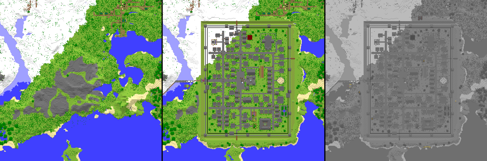

## Summary

| site | result |
|---|---|
| windswept_hills | 50 findings |

# KingdomQuest field test

Seed 20261117. Positions in details are relative to the heart (x, y, z).

## windswept_hills

minecraft:windswept_gravelly_hills at -3300, 80, 1400, facing CLOCKWISE_90, relief 87, walkable out before founding: true, style highland, ground grass_block. Gate approach cost per side (* = used): south 244, west 68*, north 107, east 213.

| stage | ms | float built | float land | floating feet | buried | destroyed | doors unreached | walk out | breach | wet inside | wet moat | new cliffs | tall walls | pits | road gaps | road steps | wall gaps | cut trees | foreign ground | snow lost | road steep | stumps | road high | road bank | road moved |
|---|---|---|---|---|---|---|---|---|---|---|---|---|---|---|---|---|---|---|---|---|---|---|---|---|---|
Founded as flat castle: plateau at 0 (relative to the heart), site shaped in 791 ms.

| tent_1 | 565 | 0 | 0 | 0 | 0 | 0 | 0 | 1 | 0 | 0 | 0 | 24 | 0 | 1 | 0 | 0 | 0 | 0 | 0 | 0 | 0 | 0 | 0 | 0 | 0 |
Country road to -3521, 63, 1450 (80 blocks of water on the way).

Lord's changes: broke 2 blocks before tent_2; repair leaves them.

Lord's changes after tent_2: unchanged spot kept broken, changed spot rebuilt by the new plan, 1 change(s) remembered.

| tent_2 | 636 | 0 | 0 | 0 | 0 | 1 | 0 | 1 | 0 | 0 | 0 | 24 | 0 | 1 | 0 | 0 | 0 | 0 | 0 | 34 | 0 | 0 | 0 | 0 | 0 |
| tent_3 | 295 | 0 | 0 | 0 | 0 | 0 | 0 | 1 | 0 | 0 | 0 | 24 | 0 | 1 | 0 | 0 | 0 | 0 | 0 | 34 | 0 | 0 | 0 | 0 | 0 |
| hamlet_1 | 739 | 0 | 0 | 0 | 0 | 0 | 0 | 1 | 0 | 0 | 0 | 21 | 0 | 1 | 0 | 0 | 0 | 0 | 0 | 34 | 0 | 0 | 0 | 0 | 0 |
| hamlet_2 | 411 | 1 | 0 | 0 | 0 | 0 | 0 | 1 | 0 | 0 | 0 | 21 | 0 | 1 | 0 | 0 | 0 | 0 | 0 | 51 | 0 | 0 | 0 | 40 | 0 |
| hamlet_3 | 430 | 1 | 0 | 0 | 0 | 0 | 0 | 1 | 0 | 0 | 0 | 21 | 0 | 3 | 0 | 0 | 0 | 0 | 0 | 56 | 0 | 0 | 0 | 0 | 0 |
| village_1 | 765 | 1 | 0 | 0 | 0 | 0 | 0 | 1 | 0 | 0 | 0 | 23 | 0 | 3 | 0 | 0 | 0 | 0 | 0 | 55 | 0 | 0 | 0 | 0 | 0 |
| town_1 | 524 | 1 | 4 | 0 | 0 | 0 | 0 | 1 | 0 | 0 | 0 | 45 | 0 | 6 | 0 | 0 | 0 | 0 | 0 | 75 | 0 | 0 | 0 | 0 | 0 |
| castle_1 | 1276 | 1 | 4 | 0 | 0 | 0 | 0 | 1 | 0 | 0 | 0 | 47 | 0 | 6 | 0 | 0 | 0 | 0 | 0 | 70 | 0 | 0 | 0 | 0 | 0 |
| castle_2 | 1321 | 1 | 4 | 0 | 0 | 0 | 0 | 1 | 0 | 0 | 0 | 45 | 0 | 5 | 0 | 0 | 0 | 0 | 0 | 70 | 0 | 0 | 0 | 0 | 0 |
| citadel_1 | 1434 | 1 | 4 | 0 | 0 | 0 | 0 | 1 | 0 | 0 | 0 | 45 | 0 | 5 | 0 | 0 | 0 | 0 | 0 | 66 | 0 | 0 | 0 | 0 | 0 |
| final | 0 | 1 | 4 | 0 | 0 | 0 | 0 | 1 | 0 | 0 | 0 | 45 | 0 | 5 | 0 | 0 | 0 | 0 | 0 | 66 | 0 | 0 | 0 | 0 | 0 |
Country road at the end: 10 of 10 cells near the castle intact.

Gate (land relative to the heart, before -> after) at 0/5/10/15/20/30/40 blocks out of the gate: 16->-2 15->-2 15->-2 14->-2 13->-2 10->-2 8->-2. Moat columns per side {back=2744, gate=3007, left=776, right=766}. Way-out road none.

Production: level 1 made 16102 items in a game day, 48327 in three (store 4320 stacks); level 5 with every milestone 141571 items of 239 kinds a day. Storehouse goods shown: 14 blocks; unloaded 15552 items into the chests.

Tram: 880 rails, stops [gate, west, north, east]
Signal fires: 20 on 13 towers, lit 20, put out 20; tower guard posts 20.

- tent_1: new cliffs 24 [(18,18,39) to 3, (19,18,39) to 3, (48,20,10) to 3, (113,30,49) to -24, (113,30,50) to -11]
- tent_1: pits 1 [(114,6,49) hole]
- tent_2: destroyed 1 [main (0,1,-5) spruce_log->air]
- tent_2: new cliffs 24 [(4,18,55) to 3, (11,26,54) to 3, (17,26,51) to 3, (113,30,49) to -24, (113,30,50) to -11]
- tent_2: pits 1 [(114,6,49) hole]
- tent_2: snow lost 34 [(-170,-6,11) on coarse_dirt at air light 0]
- tent_3: new cliffs 24 [(4,18,55) to 3, (11,26,54) to 3, (17,26,51) to 3, (113,30,49) to -24, (113,30,50) to -11]
- tent_3: pits 1 [(114,6,49) hole]
- tent_3: snow lost 34 [(-170,-6,11) on coarse_dirt at air light 0]
- hamlet_1: new cliffs 21 [(113,30,49) to -24, (113,30,50) to -11, (113,30,51) to -5, (114,30,48) to -10, (114,30,48) to -24]
- hamlet_1: pits 1 [(114,6,49) hole]
- hamlet_1: snow lost 34 [(-170,-6,11) on coarse_dirt at air light 0]
- hamlet_2: float built 1 [dock (-132,-4,13) lantern]
- hamlet_2: new cliffs 21 [(113,30,49) to -24, (113,30,50) to -11, (113,30,51) to -5, (114,30,48) to -10, (114,30,48) to -24]
- hamlet_2: pits 1 [(114,6,49) hole]
- hamlet_2: snow lost 51 [(-170,-6,11) on coarse_dirt at air light 0, (-20,0,-102) on grass_block at air light 0]
- hamlet_2: road bank 40 [(-62,-1,-65) over 8/6, (-61,-1,-65) over 8/6, (-64,-1,-65) over 8/6, (-63,-1,-65) over 8/6, (-66,-1,-65) over 8/2]
- hamlet_3: float built 1 [dock (-132,-4,13) lantern]
- hamlet_3: new cliffs 21 [(113,30,49) to -24, (113,30,50) to -11, (113,30,51) to -5, (114,30,48) to -10, (114,30,48) to -24]
- hamlet_3: pits 3 [(-27,-9,111) hole, (-23,-9,111) hole, (114,6,49) hole]
- hamlet_3: snow lost 56 [(-170,-6,11) on coarse_dirt at air light 0, (-32,1,-103) on dark_oak_leaves at air light 3]
- village_1: float built 1 [dock (-137,-4,13) lantern]
- village_1: new cliffs 23 [(-134,-7,9) to 4, (-134,-3,16) to -4, (-133,-7,9) to 5, (-133,-2,16) to -5, (-132,-7,9) to 6]
- village_1: pits 3 [(-27,-9,111) hole, (-23,-9,111) hole, (117,26,49) spike]
- village_1: snow lost 55 [(-170,-6,11) on coarse_dirt at air light 0, (-30,1,-117) on dark_oak_leaves at air light 5]
- town_1: float built 1 [dock (-137,-4,13) lantern]
- town_1: float land 4 [(30,9,-150) oak_log, (30,7,-145) oak_log, (36,10,-150) oak_log, (36,6,-146) oak_log]
- town_1: new cliffs 45 [(-134,-7,9) to 4, (-134,-3,16) to -4, (-133,-7,9) to 5, (-133,-2,16) to -5, (-132,-7,9) to 6]
- town_1: pits 6 [(-110,2,28) spike, (-80,2,91) spike, (5,-9,160) hole, (26,1,-83) spike, (42,2,-46) spike]
- town_1: snow lost 75 [(-170,-6,11) on coarse_dirt at air light 0, (-65,0,-52) on grass_block at air light 2]
- castle_1: float built 1 [dock (-137,-4,13) lantern]
- castle_1: float land 4 [(30,9,-150) oak_log, (30,7,-145) oak_log, (36,10,-150) oak_log, (36,6,-146) oak_log]
- castle_1: new cliffs 47 [(-134,-7,9) to 4, (-134,-3,16) to -4, (-133,-7,9) to 5, (-133,-2,16) to -5, (-132,-7,9) to 6]
- castle_1: pits 6 [(-110,2,28) spike, (-80,2,91) spike, (5,-9,160) hole, (26,1,-83) spike, (42,2,-46) spike]
- castle_1: snow lost 70 [(-170,-6,11) on coarse_dirt at air light 0, (-65,0,-52) on grass_block at air light 3]
- castle_2: float built 1 [dock (-137,-4,13) lantern]
- castle_2: float land 4 [(30,9,-150) oak_log, (30,7,-145) oak_log, (36,10,-150) oak_log, (36,6,-146) oak_log]
- castle_2: new cliffs 45 [(-134,-7,9) to 4, (-134,-3,16) to -4, (-133,-7,9) to 5, (-133,-2,16) to -5, (-132,-7,9) to 6]
- castle_2: pits 5 [(-110,2,28) spike, (-80,2,91) spike, (5,-9,160) hole, (42,2,-46) spike, (117,26,49) spike]
- castle_2: snow lost 70 [(-170,-6,11) on coarse_dirt at air light 0, (-65,0,-52) on grass_block at air light 4]
- citadel_1: float built 1 [dock (-137,-4,13) lantern]
- citadel_1: float land 4 [(30,9,-150) oak_log, (30,7,-145) oak_log, (36,10,-150) oak_log, (36,6,-146) oak_log]
- citadel_1: new cliffs 45 [(-134,-7,9) to 4, (-134,-3,16) to -4, (-133,-7,9) to 5, (-133,-2,16) to -5, (-132,-7,9) to 6]
- citadel_1: pits 5 [(-110,2,28) spike, (-80,2,91) spike, (5,-9,160) hole, (42,2,-46) spike, (117,26,49) spike]
- citadel_1: snow lost 66 [(-170,-6,11) on coarse_dirt at air light 0, (-65,0,-51) on grass_block at air light 4]
- final: float built 1 [dock (-137,-4,13) lantern]
- final: float land 4 [(30,9,-150) oak_log, (30,7,-145) oak_log, (36,10,-150) oak_log, (36,6,-146) oak_log]
- final: new cliffs 45 [(-134,-7,9) to 4, (-134,-3,16) to -4, (-133,-7,9) to 5, (-133,-2,16) to -5, (-132,-7,9) to 6]
- final: pits 5 [(-110,2,28) spike, (-80,2,91) spike, (5,-9,160) hole, (42,2,-46) spike, (117,26,49) spike]
- final: snow lost 66 [(-170,-6,11) on coarse_dirt at air light 0, (-65,0,-51) on grass_block at air light 4]

